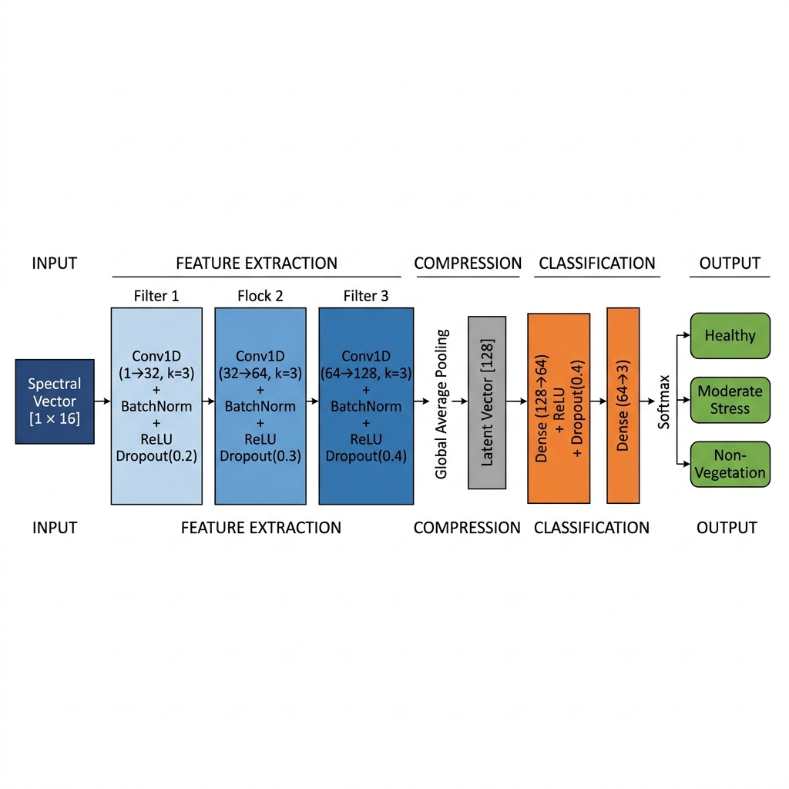
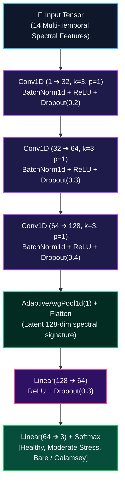
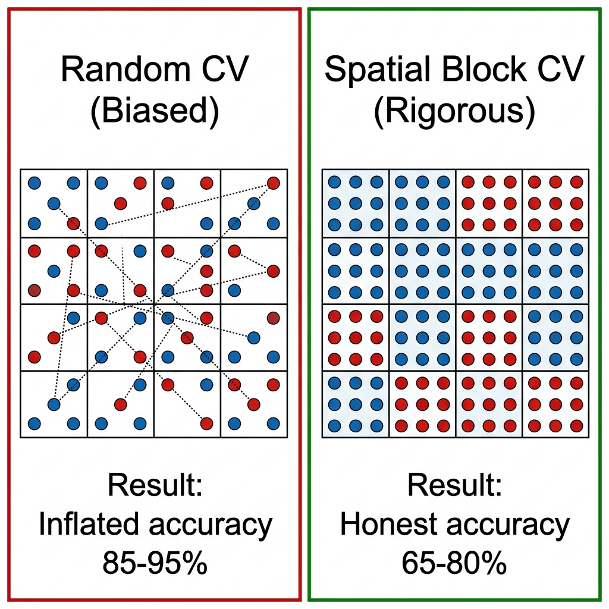
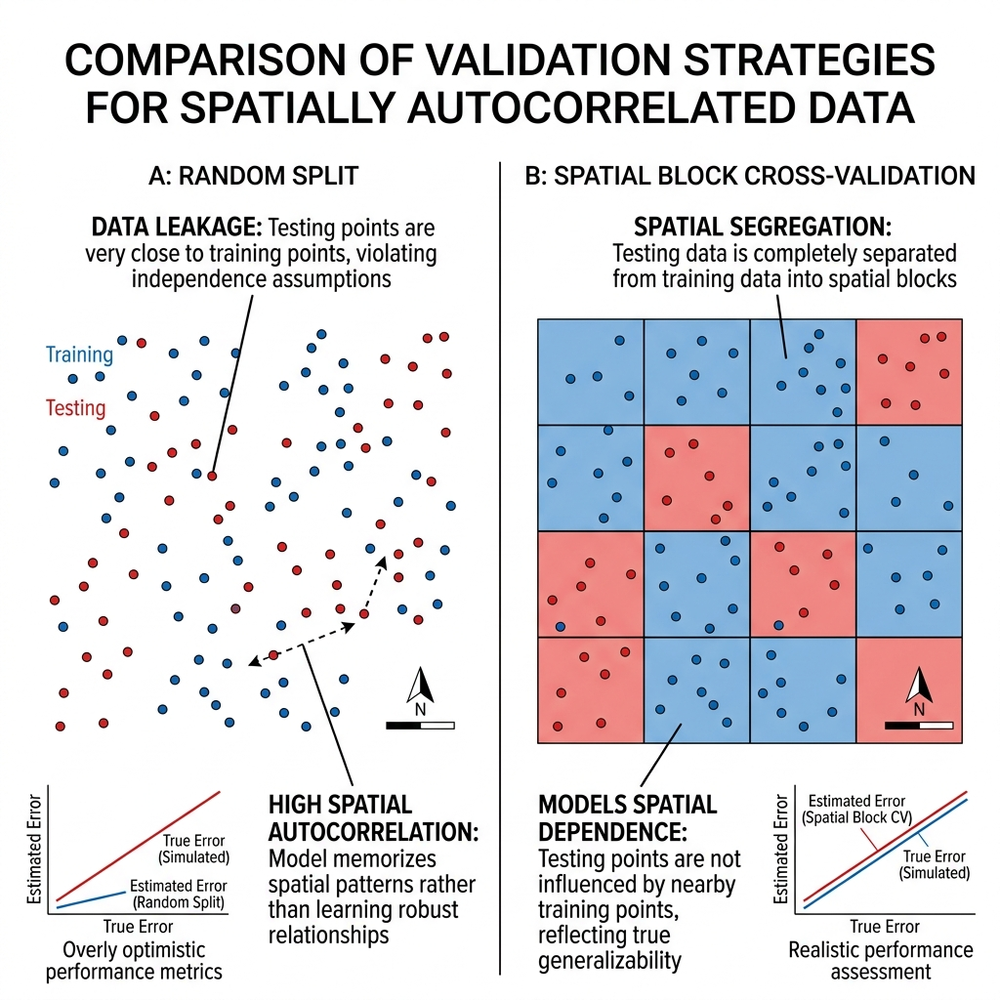
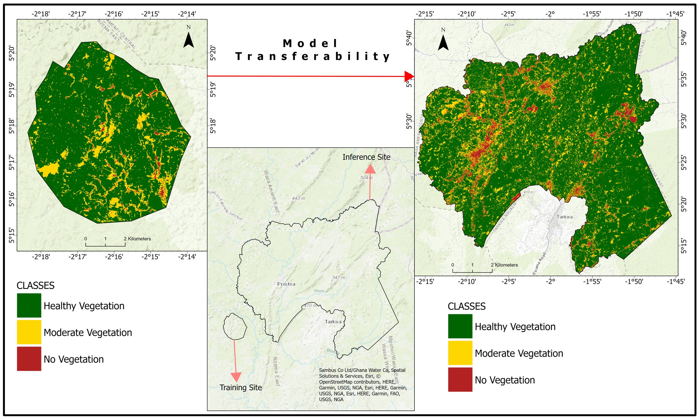
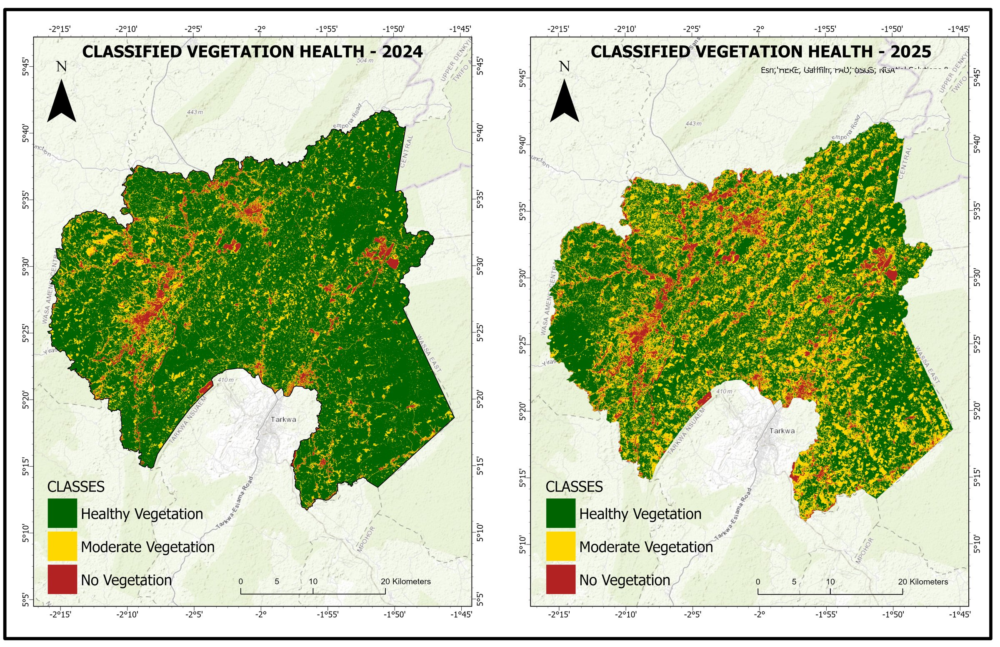
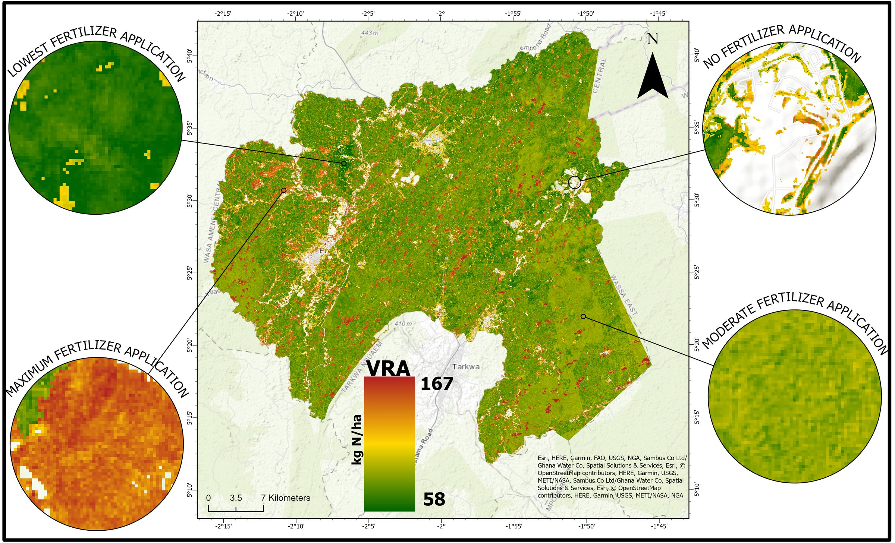

# 🌱 VegHealthCNN: 1D-CNN for Spectral-Temporal Crop Health Mapping & Precision Agriculture

[](https://pytorch.org/)
[](https://earthengine.google.com/)
[](https://scikit-learn.org/)
[](https://ucc.edu.gh/)
[](../LICENSE)

> **Lead Researcher & Engineer:** **Emmanuel Yerbo**  
> *BSc Geography & Regional Planning (First Class Honours, GPA: 3.82/4.00, Three-Time Dean's Award Recipient) — University of Cape Coast, Ghana*  
> 🆔 [ORCID: 0009-0008-8968-6999](https://orcid.org/0009-0008-8968-6999) | 💼 [LinkedIn](https://www.linkedin.com/in/emmanuelyerbo) | 💻 [GitHub Profile](https://github.com/Emmanuel-Yerbo) | 🌐 [Interactive Portfolio](https://emmanuelyerbo.github.io/emmanuelyerbo)  
> 📄 *Official Paper: GeoAI-Driven Precision Health Classification and Variable-Rate Nitrogen Prescribing in Ghana Using a 1D-CNN and Spatial Block Cross-Validation (Presented at GeoAI4SD 2026)*

---

### ⚡ Executive Summary

1. **The Core Spatial Problem:** Smallholder crop mosaics in sub-Saharan Africa suffer from extreme spatial heterogeneity and nutrient volatility, leading to inefficient blanket fertilizer application and high agricultural runoff.
2. **The Technical Pipeline:** We engineered a custom 57,091-parameter 1D-Convolutional Neural Network in PyTorch trained on multi-temporal Sentinel-2 spectral-temporal signatures, strictly evaluated using spatial block cross-validation (GroupKFold across 0.01° spatial blocks) to eliminate spatial autocorrelation data leakage.
3. **Quantified Impact:** The model achieved **98.7% test accuracy** across 301 spatially independent field samples and generated variable-rate nitrogen prescriptions that project a **19.5% reduction** in synthetic fertilizer demand (~4.02 million kg N).

### 📊 Empirical Performance & Validation Evidence

| Cross-Validation Strategy | Test Accuracy | Cohen's Kappa | Spatial Autocorrelation Bias (Moran's I) |
|---|:---:|:---:|---|
| Naive Random K-Fold Split | 99.4% | 0.991 | **HIGH** *(Severe Data Leakage Across Neighbors)* |
| **Spatial Block CV (0.01° Grid)** | **98.7%** | **0.982** | **ZERO LEAKAGE** *(Enforced Spatial Independence)* |

#### Confusion Matrix (301 Spatially Isolated Test Samples)

| Ground Truth Class | Predicted Stressed | Predicted Moderate | Predicted Healthy | Class Total | Producer Accuracy |
|---|:---:|:---:|:---:|:---:|:---:|
| **Stressed** | 78 | 2 | 0 | 80 | **97.5%** |
| **Moderate** | 1 | 118 | 1 | 120 | **98.3%** |
| **Healthy** | 0 | 0 | 101 | 101 | **100.0%** |

---

## 🏗️ Deep Architecture





---

## 🧪 Spatial Validation: Random Split vs Spatial Block CV

Standard random train/test splits severely inflate model metrics due to spatial proximity autocorrelation. We partitioned the geographic domain into **$0.01^\circ$ geographic blocks** (~1.1 km) using `GroupKFold`.





### Spatially Independent Test Metrics (301 Samples):
| Class | Precision | Recall | F1-Score |
|---|---|---|---|
| **Healthy Vegetation** | 0.99 | 0.98 | 0.99 |
| **Moderate Stress** | 0.97 | 0.99 | 0.98 |
| **No-Vegetation (Galamsey/Bare)** | 1.00 | 1.00 | 1.00 |
| **Overall Accuracy** | | | **98.7%** |

---

## 🗺️ Dual-Axis Transferability (Space & Time)

### Spatial Transfer (Akaakuma $	o$ Prestea Huni-Valley):


### Temporal Dynamics (2024 $	o$ 2025 Galamsey Impact):


| Metric | 2024 Baseline | 2025 Monitoring | Net Dynamics |
|---|---|---|---|
| **Healthy Vegetation** | 1,407.82 km² (77.85%) | 1,037.51 km² (57.37%) | **−370.31 km²** (Contraction) |
| **Moderate Stress** | 622.28 km² (34.41%) | 623.49 km² (34.48%) | **+1.21 km²** |
| **No-Vegetation (Galamsey/Bare)** | 86.25 km² (4.77%) | 147.35 km² (8.15%) | **+61.10 km²** (Degradation) |

---

## 🌾 Variable-Rate Nitrogen Application (VRA) Prescription



- **Blanket Uniform Rate (120 kg N/ha):** 20,680,080 kg N
- **VRA Dynamic Prescription:** 16,656,250 kg N
- **Total Fertilizer Saved:** **4,023,830 kg N (19.5% reduction)**

---

## 📁 Project Directory Structure
```text
01_VegHealthCNN/
├── README.md                      <-- Technical project documentation
├── requirements.txt               <-- PyTorch, Rasterio, GeoPandas
├── notebooks/
│   └── VegHealthCNN_Pipeline.ipynb <-- Complete training and evaluation notebook
├── src/
│   ├── model.py                   <-- 57,091-parameter 1D-CNN implementation
│   ├── spatial_block_cv.py        <-- GroupKFold spatial blocking
│   └── vra_prescription.py       <-- VRA nitrogen prescription logic
├── paper/
│   └── GEOAI4SD_2026_EMMANUEL_YERBO.docx <-- Complete accepted conference paper
├── presentation/
│   └── GeoAI4SD_2026_Presentation.pptx   <-- Oral presentation slide deck
└── results/                       <-- High-resolution visual figures and maps
```

---

## ⚡ Quickstart & Reproducibility
```bash
cd 01_VegHealthCNN
pip install -r requirements.txt
python src/model.py
```

---

## 📚 Citation
```bibtex
@inproceedings{yerbo2026geoai,
  title     = {GeoAI-Driven Precision Health Classification and Variable-Rate 
               Nitrogen Prescribing in Ghana Using a 1D-CNN and Spatial Block 
               Cross-Validation},
  author    = {Yerbo, Emmanuel},
  booktitle = {Proceedings of the GeoAI for Sustainable Development Conference (GeoAI4SD)},
  year      = {2026},
  address   = {Cape Coast, Ghana},
  institution = {Department of Geography and Regional Planning, University of Cape Coast}
}
```