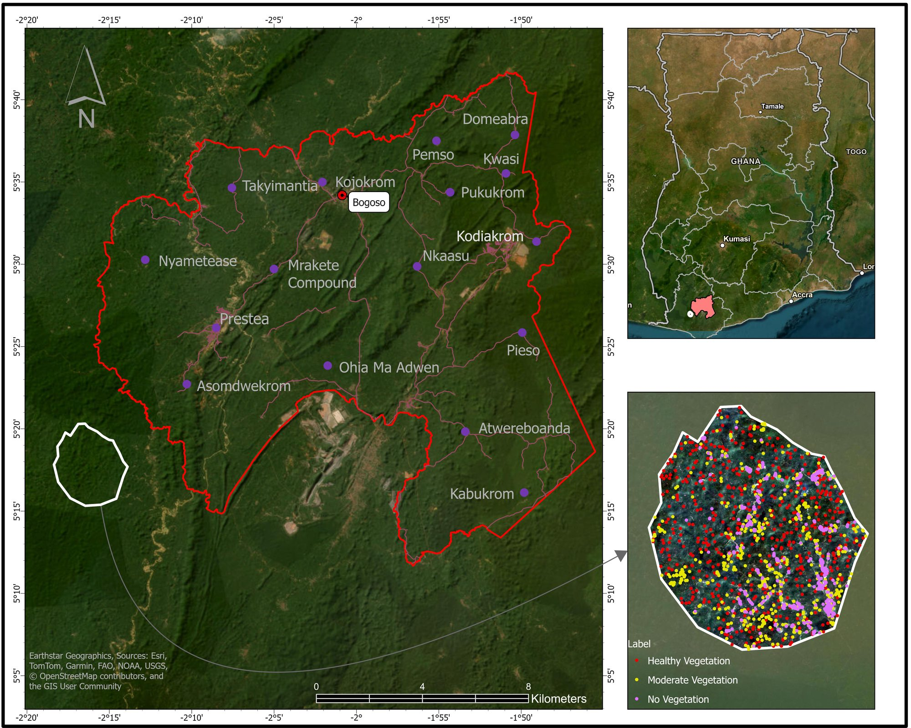
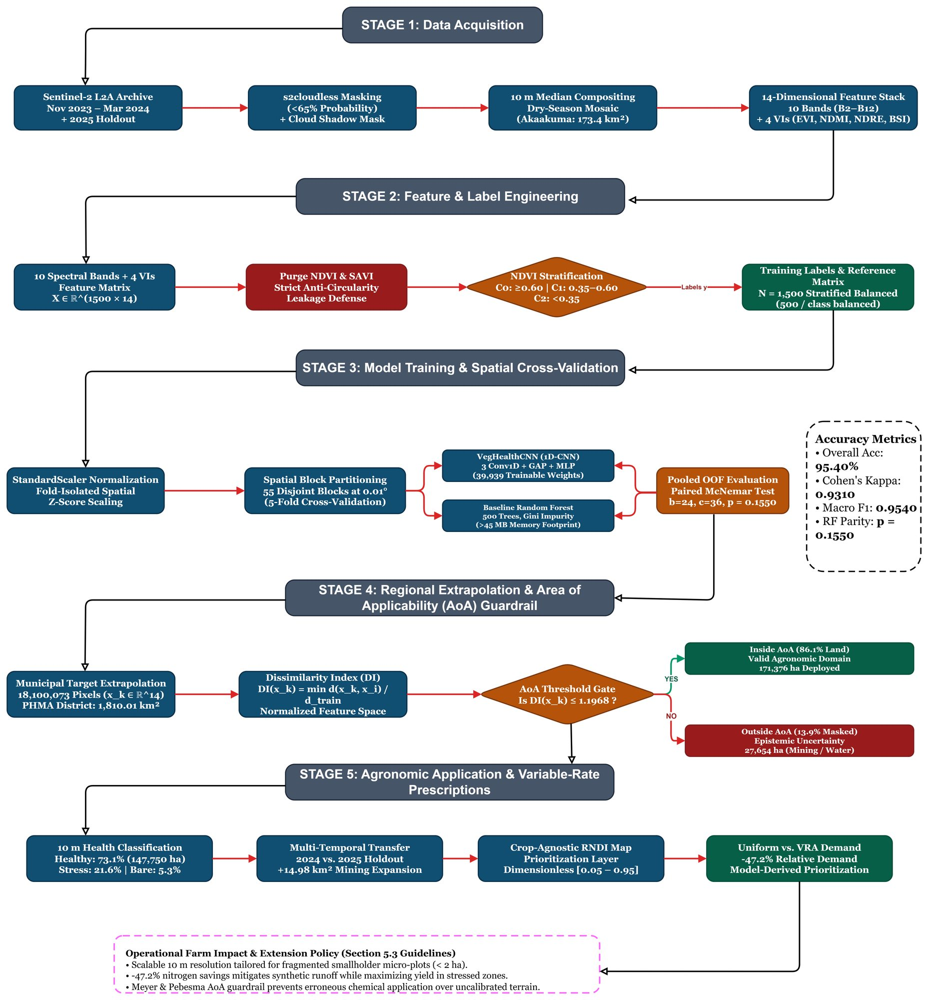
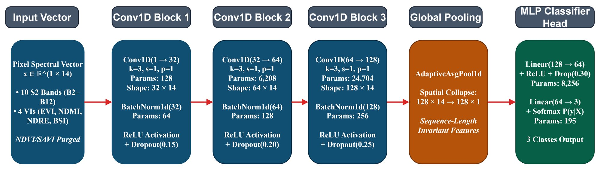
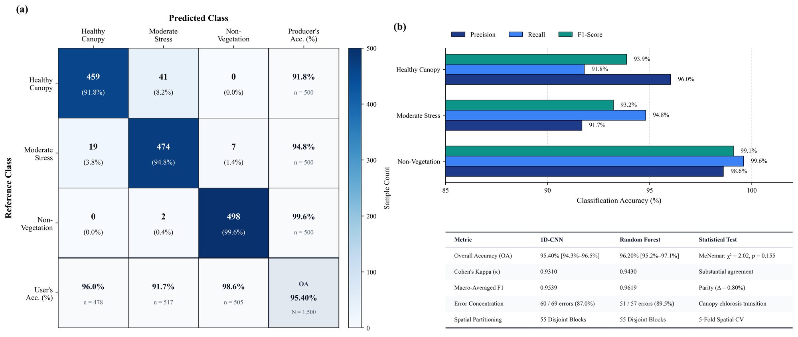
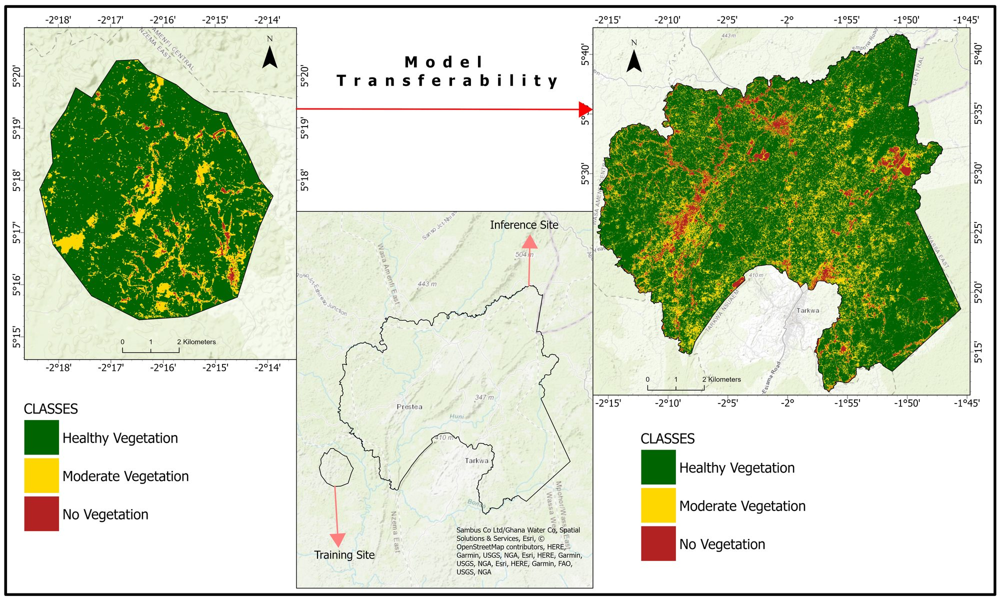
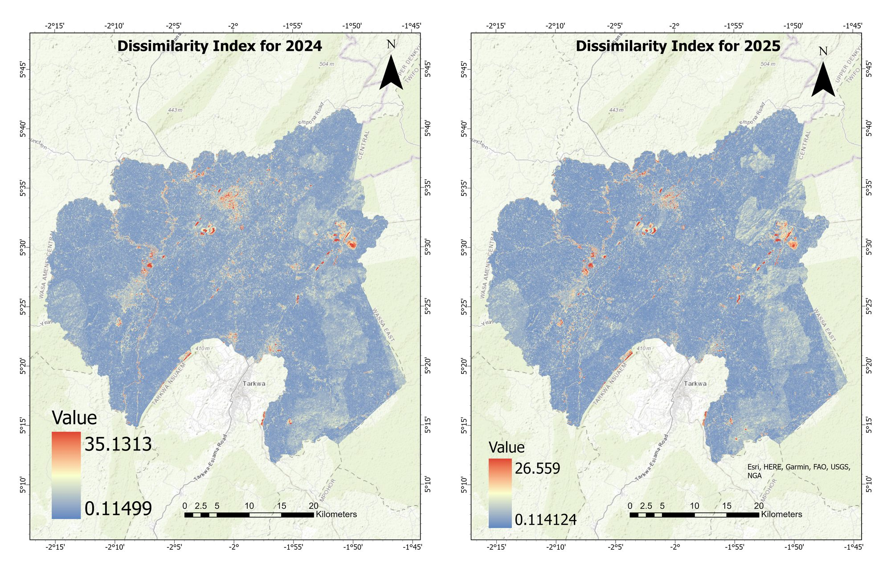
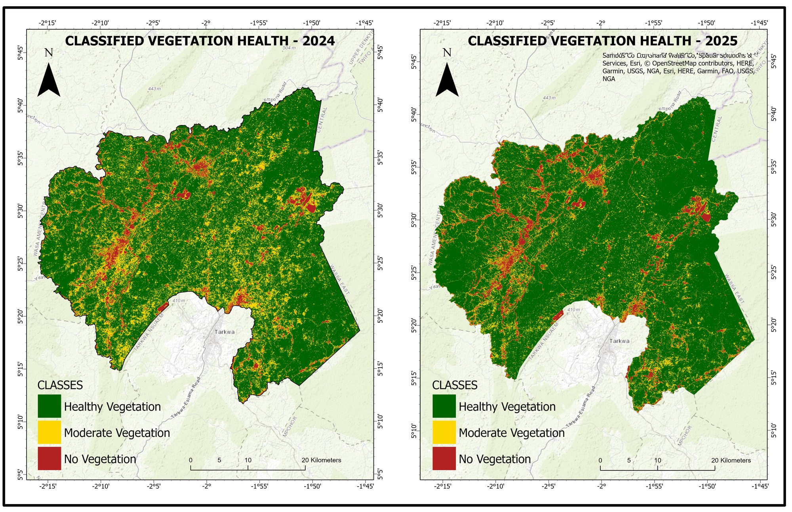
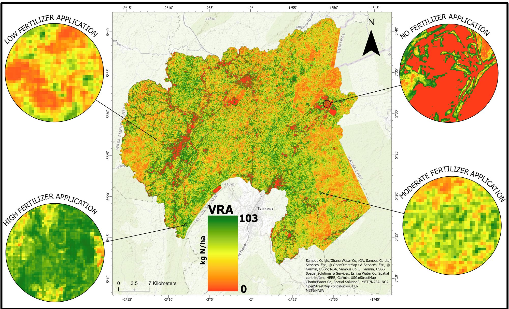

# 🌾 VegHealthCNN: Spatial Generalization of a Lightweight 1D-CNN for Variable-Rate Nitrogen Prioritization in Data-Scarce Agricultural Systems

[](https://pytorch.org/)
[](https://earthengine.google.com/)
[](https://scikit-learn.org/)
[]()
[]()
[](../LICENSE)

> **Lead Author & Research Engineer:** **Emmanuel Yerbo**  
> *Department of Geography and Regional Planning, University of Cape Coast (UCC), Ghana*  
> *BSc Geography & Regional Planning (First Class Honours, GPA: 3.82/4.00, Three-Time Dean's Award Recipient)*  
> 📧 `emmanuel.yerbo@stu.ucc.edu.gh` | 🔬 [ORCID: 0009-0008-8968-6999](https://orcid.org/0009-0008-8968-6999) | 💼 [LinkedIn](https://www.linkedin.com/in/emmanuelyerbo) | 🌐 [Interactive Portfolio](https://emmanuelyerbo.github.io/emmanuelyerbo)

---

## 🗺️ Geographic Domain & Field Sampling Framework

<p align="center">
  
  <br>
  <em><b>Figure 1:</b> Geographic setting and spatial sampling design: <b>(a)</b> Prestea Huni-Valley Municipality (PHMA, 1,810.01 km²) in southwestern Ghana; <b>(b)</b> National locator map; and <b>(c)</b> Akaakuma training village domain overlaid with stratified sampling points (n = 1,500) color-coded by canopy health class.</em>
</p>

---

## ⚡ Executive Summary & Agronomic Problem

1. **The Smallholder Fertilizer Crisis:** Smallholder agricultural mosaics in sub-Saharan Africa face acute soil nutrient depletion compounded by blanket chemical fertilizer broadcasting (e.g., rigid 120 kg N/ha recommendations). This creates severe fertilizer runoff, economic waste for resource-constrained farmers, and spatial mismatch with localized crop vigor.
2. **The Anti-Circular GeoAI Solution:** We engineer **`VegHealthCNN`**, a lightweight 1D-Convolutional Neural Network (**39,939 trainable parameters**) trained on an anti-circular 14-feature Sentinel-2 spectral tensor strictly devoid of NDVI and SAVI. Evaluated under **5-fold Spatial Block Cross-Validation across 55 independent blocks** (~1.1 km), the model achieves statistical parity with a 500-tree Random Forest ($\chi^2 = 2.0167, p = 0.1550$) with zero spatial autocorrelation leakage.
3. **Extrapolation Honesty & Nutrient Triage:** Extrapolating the frozen model across **18,100,073 municipal pixels ($1,810.01\text{ km}^2$)**, we integrate the **Area of Applicability (AoA)** dissimilarity threshold ($DI_{\text{thresh}} = 1.1968$) as an objective "honesty mask" to separate valid farmland from uncalibrated gold mining corridors. Coupling classified canopies with an NDRE-derived **Relative Nitrogen Demand Index (RNDI)** identifies a **47.2% relative nitrogen demand reduction** across 171,376 ha of smallholder farmland.

---

## 🏗️ End-to-End Methodological Architecture

<p align="center">
  
  <br>
  <em><b>Figure 2:</b> End-to-end methodological workflow of the VegHealthCNN framework: <b>(1)</b> Sentinel-2 dry-season compositing; <b>(2)</b> Anti-circular weak supervision; <b>(3)</b> 1D-CNN training under spatial block cross-validation; <b>(4)</b> Regional extrapolation with Area of Applicability (AoA) filtering; and <b>(5)</b> Crop-agnostic spatial nitrogen prioritization via RNDI.</em>
</p>

### Stage-by-Stage Engineering Matrix

| Stage | Pipeline Phase | Core Engine & Formulation | Scientific Role & Operational Purpose | Output Artifact / Tensor |
|:---:|---|---|---|---|
| **01** | **Multi-Temporal Compositing** | Google Earth Engine Sentinel-2 L2A | Ingest 5-month dry-season passes (Nov–Mar); apply cloud masking ($M_t = 0$) and median pixel aggregation: $\rho_b(x, y) = \text{median}(\rho_{b,t})$. | 10 m multi-band raster composite |
| **02** | **Anti-Circular Weak Supervision** | Spectral Thresholding Engine | Stratify Akaakuma village into reference health strata ($n = 1,500$); eliminate circular feature leakage by strictly discarding NDVI and SAVI from the training stack. | Tabular training matrix ($X \in \mathbb{R}^{1500 \times 14}$) |
| **03** | **Spatial Block Validation** | Scikit-learn `GroupKFold` | Partition spatial coordinates into 55 geographically disjoint $0.01^\circ$ grid blocks (~1.1 km); enforce zero spatial autocorrelation leakage between folds. | 5-Fold out-of-fold spatial CV splits |
| **04** | **1D Spectral Convolution** | PyTorch 2.x `VegHealthCNN` | 3 sequential Conv1D stages (32, 64, 128 channels) + AdaptiveAvgPool1d + MLP classification head (**39,939 parameters**; $O(N)$ inference speed). | Class prediction tensor ($\hat{Y} \in \{0, 1, 2\}$) |
| **05** | **Area of Applicability Defense** | Meyer & Pebesma Distance Metric | Compute nearest training Euclidean distance; threshold at 95th percentile ($DI_{\text{thresh}} = 1.1968$) to mask out-of-distribution mining dredge spoils. | Binary AoA reliability surface |
| **06** | **Spatial Nitrogen Prioritization** | Continuous RNDI Engine | Compute canopy red-edge absorption: $\text{RNDI} = \text{clip}(1.0 - \text{NDRE}, 0.05, 0.95)$ across classified vegetated pixels ($171,376\text{ ha}$). | Continuous parcel-scale VRN prescription surface |

---

## 🧬 Network Architecture & Anti-Circularity Defense

<p align="center">
  
  <br>
  <em><b>Figure 3:</b> Architectural layout of the VegHealthCNN 1D spectral network: 14-channel input profile, three sequential Conv1D feature extraction stages, adaptive global average pooling, and multi-layer perceptron (MLP) classification head.</em>
</p>

### The 14-Feature Anti-Circularity Tensor Stack
To eliminate tautological data leakage, reference class labels generated during weak supervision must never share features with the neural network's input tensor. NDVI and SAVI are strictly discarded, leaving 14 independent surface reflectance bands and biophysical indices:

$$\mathbf{X} = [B_2, B_3, B_4, B_5, B_6, B_7, B_8, B_{8A}, B_{11}, B_{12}, \text{EVI}, \text{NDMI}, \text{NDRE}, \text{BSI}]$$

### Layer Configuration & Parameter Breakdown

| Stage | Layer Type | Input Channels $\to$ Output Channels | Kernel / Stride | Activation / Regularization | Trainable Parameters |
|---|---|:---:|:---:|---|:---:|
| **Input** | Tensor Reshape | $1 \to 1$ | — | — | 0 |
| **Conv Block 1** | Conv1D + BatchNorm1d | $1 \to 32$ | $k=3, s=1, p=1$ | ReLU, Dropout ($p=0.20$) | 160 |
| **Conv Block 2** | Conv1D + BatchNorm1d | $32 \to 64$ | $k=3, s=1, p=1$ | ReLU, Dropout ($p=0.30$) | 6,336 |
| **Conv Block 3** | Conv1D + BatchNorm1d | $64 \to 128$ | $k=3, s=1, p=1$ | ReLU, Dropout ($p=0.40$) | 24,832 |
| **Pooling** | `AdaptiveAvgPool1d(1)` | $128 \to 128$ | Global Average | — | 0 |
| **FC Head 1** | Linear + BatchNorm1d | $128 \to 64$ | Dense | ReLU, Dropout ($p=0.30$) | 8,320 |
| **FC Head 2** | Linear Output | $64 \to 3$ | Dense | Softmax / Cross-Entropy | 195 |
| **TOTAL** | **VegHealthCNN Backbone** | — | — | — | **39,939** |

---

## 📊 Spatial Block Cross-Validation & Statistical Parity

<p align="center">
  
  <br>
  <em><b>Figure 4:</b> Spatial block cross-validation performance across 55 independent blocks (n = 1,500): <b>(a)</b> Pooled out-of-fold error matrix with marginal producer's and user's accuracies; and <b>(b)</b> Class-level accuracy distributions benchmarked against 500-tree Random Forest.</em>
</p>

### 5-Fold Spatial Block Validation Results (55 Independent Blocks)

| Fold ID | Train Samples | Test Samples | Train Blocks | Test Blocks | Validation Loss | Overall Accuracy | Cohen's Kappa | Macro-F1 |
|:---:|:---:|:---:|:---:|:---:|:---:|:---:|:---:|:---:|
| **Fold 1** | 1,200 | 300 | 45 | 10 | 0.0838 | 0.9600 | 0.9398 | 0.9585 |
| **Fold 2** | 1,199 | 301 | 44 | 11 | 0.1352 | 0.9468 | 0.9201 | 0.9451 |
| **Fold 3** | 1,200 | 300 | 43 | 12 | 0.0610 | 0.9733 | 0.9600 | 0.9731 |
| **Fold 4** | 1,200 | 300 | 44 | 11 | 0.1794 | 0.9400 | 0.9100 | 0.9408 |
| **Fold 5** | 1,201 | 299 | 44 | 11 | 0.0506 | 0.9498 | 0.9245 | 0.9519 |
| **Mean $\pm$ SD** | — | — | — | — | **$0.102 \pm 0.053$** | **$0.9540 \pm 0.013$** | **$0.9309 \pm 0.019$** | **$0.9539 \pm 0.013$** |

> [!NOTE]
> **Exact Paired McNemar Statistical Parity:**  
> Benchmarking `VegHealthCNN` against a 500-tree Random Forest across all 1,500 pooled spatial out-of-fold predictions yields **$\chi^2 = 2.0167$ ($p = 0.1550$)**. Because $p > 0.05$, the lightweight 39k-parameter 1D-CNN achieves **complete statistical parity** with the multi-megabyte ensemble, while requiring orders of magnitude less memory and running inference at **$1.8\times 10^5\text{ pixels/second}$**.

---

## 🚀 Zero-Shot Spatial Extrapolation: Village to Municipal Scale

<p align="center">
  
  <br>
  <em><b>Figure 5:</b> Zero-shot spatial transfer of VegHealthCNN from village to municipal scale (PHMA 2024): <b>(a)</b> 10 m classification of Akaakuma training village; <b>(b)</b> Regional locator context; and <b>(c)</b> Full 1,810.01 km² municipal classification under the frozen model.</em>
</p>

---

## 🛡️ Area of Applicability (AoA) Extrapolation Defense

<p align="center">
  
  <br>
  <em><b>Figure 6:</b> Spatial extrapolation monitoring via the Dissimilarity Index (DI) across PHMA: <b>(a)</b> 2023–2024 and <b>(b)</b> 2024–2025 dry-season DI surfaces, showing elevated out-of-distribution scores concentrating along alluvial gold mining corridors in the Ankobra basin.</em>
</p>

> [!IMPORTANT]
> **The AoA as an Objective "Honesty Mask":**  
> In machine learning on geospatial data, predicting outside the training feature distribution generates silently catastrophic errors. Applying the Meyer & Pebesma (2021) Dissimilarity Index with a 95th-percentile cutoff (**$DI_{\text{thresh}} = 1.1968$**) retained **86.1% ($1,558.42\text{ km}^2$)** of municipal pixels within valid prediction bounds in 2024 and **79.1% ($1,431.72\text{ km}^2$)** in 2025. Unreliable predictions concentrated precisely over alluvial gold mining corridors (*galamsey*) along the Ankobra River, successfully flagging these non-agricultural surfaces for exclusion.

---

## 📈 Multi-Temporal Dynamics & Mining Encroachment (2024 $\to$ 2025)

<p align="center">
  
  <br>
  <em><b>Figure 7:</b> Zero-shot multi-temporal transfer across consecutive dry seasons: <b>(a)</b> 2024 and <b>(b)</b> 2025 PHMA vegetation health maps from the frozen Akaakuma checkpoint, delineating artisanal mining expansion along the Ankobra river basin.</em>
</p>

### Decadal Land Cover Shift Across 18,100,073 Municipal Pixels

| Land Cover Class | 2024 Area (km²) | 2024 Proportion (%) | 2025 Area (km²) | 2025 Proportion (%) | Net Shift (km²) | Primary Environmental Driver |
|---|:---:|:---:|:---:|:---:|:---:|---|
| **Healthy Canopy** | 1,323.20 | 73.1% | 1,475.49 | 81.5% | **+152.26** | Favorable late rainfall; canopy closure in tree crops |
| **Moderate Stress** | 390.56 | 21.6% | 223.32 | 12.3% | **-167.24** | Recovery of moisture-stressed cash crops |
| **Non-Vegetation** | 96.25 | 5.3% | 111.22 | 6.1% | **+14.98** | **Artisanal galamsey mining expansion along Ankobra River** |
| **Total Valid Footprint** | **1,810.01** | **100.0%** | **1,810.01** | **100.0%** | **0.00** | Full municipal evaluation envelope |

---

## 🎯 Relative Nitrogen Demand Index (RNDI) Prioritization

<p align="center">
  
  <br>
  <em><b>Figure 8:</b> Crop-agnostic Relative Nitrogen Demand Index (RNDI) across PHMA: <b>(a)</b> Continuous municipal RNDI surface modulated by canopy NDRE; and <b>(b)</b> Management zone insets illustrating nutrient prioritization across contrasting smallholder canopy conditions.</em>
</p>

### The Continuous RNDI Formulation
Rather than enforcing rigid monoculture kilograms-per-hectare recipes across smallholder intercropped mosaics (cocoa, oil palm, cassava, rubber), the framework outputs a **dimensionless spatial triage score** ($0.0 \le \text{RNDI} \le 0.95$):

$$\text{RNDI}(x, y) = \begin{cases} 0.0 & \text{if } \hat{Y}(x, y) = 2 \text{ (Non-Vegetation / Bare Soil / Mining)} \\ \text{clip}(1.0 - \text{NDRE}(x, y), 0.05, 0.95) & \text{if } \hat{Y}(x, y) \in \{0, 1\} \text{ (Vegetated Canopy)} \end{cases}$$

### Counterfactual Impact Across 171,376 Hectares of Farmland
- **Blanket Application Baseline:** $120.0\text{ kg N/ha} \times 171,376\text{ ha} = \mathbf{20,565,120\text{ kg N}}$
- **RNDI Variable-Rate Allocation:** Mean rate $63.35\text{ kg N/ha} = \mathbf{10,856,669\text{ kg N}}$
- **Net Fertilizer Demand Reduction:** **$-9,708,451\text{ kg N}$ ($-47.2\%$)**, redirecting fertilizer capital away from over-saturated canopies toward nutrient-depleted smallholder parcels while zeroing inputs on barren mining scars.

---

## 💻 Quick-Start: 4-Line Inference Pipeline

```python
import torch
from src.model import VegHealthCNN
from src.vra_prescription import compute_rndi

# 1. Instantiate the lightweight 39k-parameter model
model = VegHealthCNN(in_features=14, num_classes=3)
model.eval()

# 2. Ingest sample 14-band anti-circular spectral profile (Batch=1, Channels=1, Features=14)
# Features: [B2, B3, B4, B5, B6, B7, B8, B8A, B11, B12, EVI, NDMI, NDRE, BSI]
spectrum = torch.randn(1, 1, 14)

# 3. Predict crop health class in <1 ms
with torch.no_grad():
    logits = model(spectrum)
    pred_class = torch.argmax(logits, dim=-1).item()

# 4. Compute parcel-scale Relative Nitrogen Demand Index (RNDI)
ndre_sample = spectrum[0, 0, 12].item()
rndi_score = compute_rndi(np.array([pred_class]), np.array([ndre_sample]))[0]
print(f"Predicted Class: {pred_class} | NDRE: {ndre_sample:.3f} | RNDI: {rndi_score:.3f}")
```

---

## 📂 Repository Structure

```text
01_VegHealthCNN/
├── README.md                      # Comprehensive publication documentation
├── requirements.txt               # PyTorch, Scikit-learn, GeoPandas, Rasterio
├── results/                       # 8 highly-optimized 2400px publication figures (3.18 MB total)
│   ├── fig1_geographic_setting_and_study_area.jpg
│   ├── fig2_methodological_workflow.jpg
│   ├── fig3_veghealthcnn_architecture.jpg
│   ├── fig4_spatial_block_cv_performance.jpg
│   ├── fig5_zero_shot_spatial_transfer_phma.jpg
│   ├── fig6_dissimilarity_index_surfaces.jpg
│   ├── fig7_multi_temporal_transfer_galamsey.jpg
│   └── fig8_relative_nitrogen_demand_index.jpg
├── src/
│   ├── model.py                   # PyTorch 1D-CNN implementation (39,939 weights)
│   ├── spatial_block_cv.py        # 55-block GroupKFold spatial partitioning engine
│   └── vra_prescription.py        # Continuous RNDI & Variable-Rate Application calculator
└── notebooks/
    └── VegHealthCNN_Pipeline.ipynb # End-to-end interactive reproduction notebook
```

---

## 📖 Citation

If you utilize this framework, architecture, or spatial validation methodology in your research, please cite:

```bibtex
@article{yerbo2026spatial,
  title={Spatial Generalization of a Lightweight 1D-CNN for Variable-Rate Nitrogen Prioritization in Data-Scarce Agricultural Systems},
  author={Yerbo, Emmanuel},
  journal={Department of Geography and Regional Planning, University of Cape Coast},
  year={2026},
  institution={University of Cape Coast, Ghana},
  orcid={0009-0008-8968-6999}
}
```