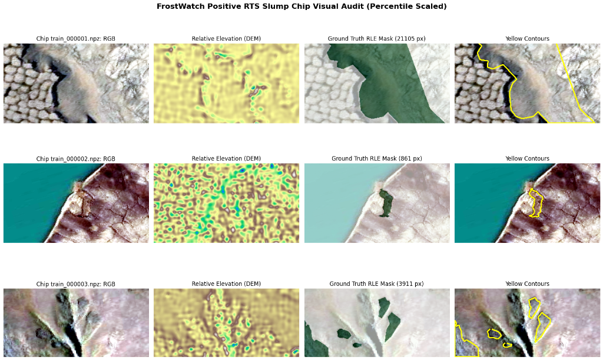
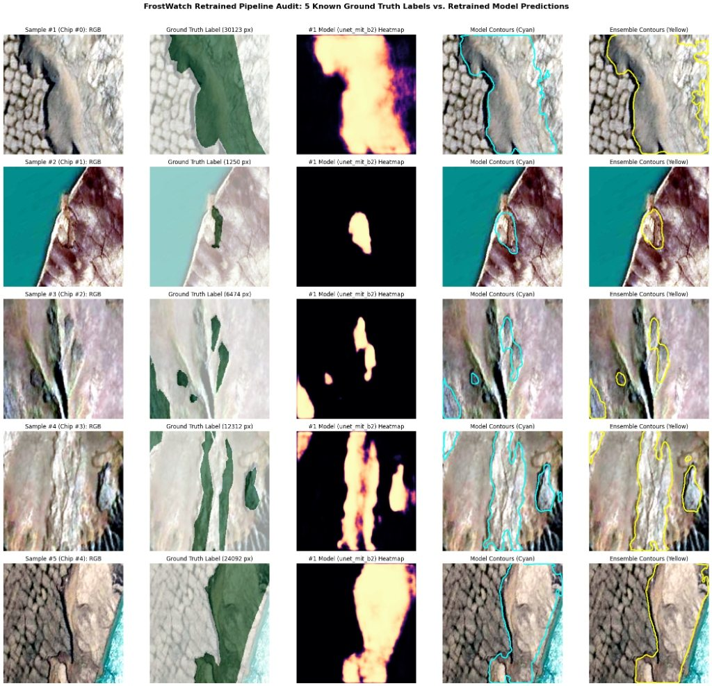
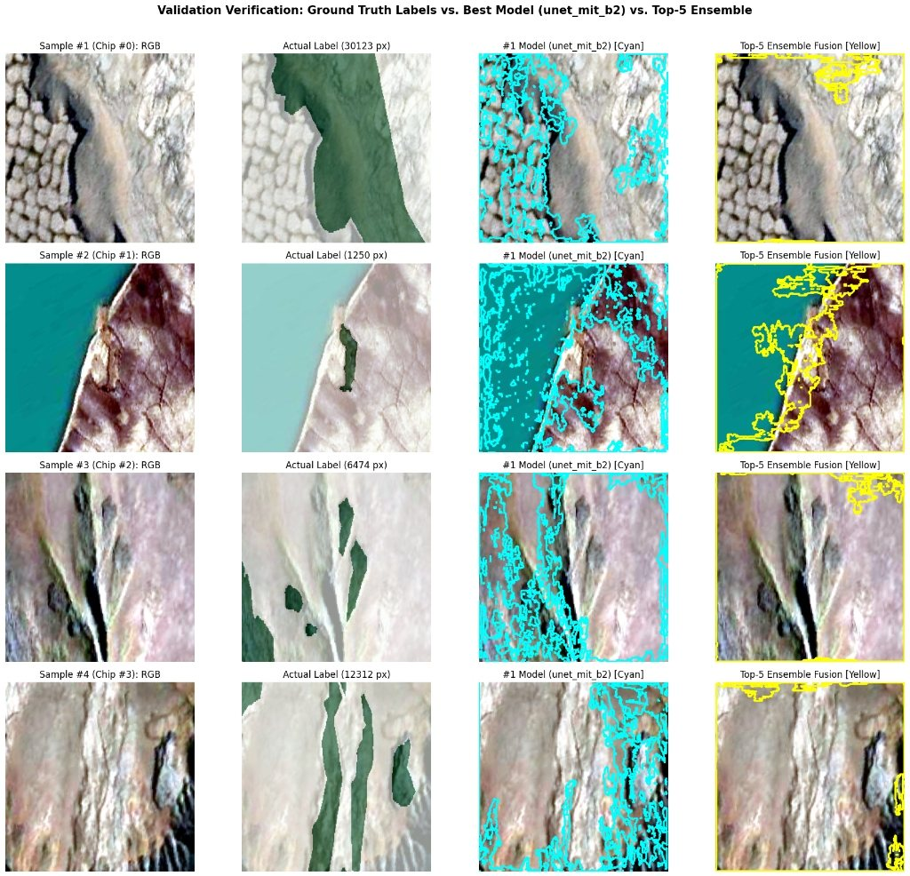

# ❄️ FrostWatch Arctic: 3-Arm Vision Ensemble with 13-Channel Geomorphometric Tensors for Permafrost Thaw Slump Instance Segmentation

[-blue?logo=kaggle&logoColor=white)](https://huggingface.co/spaces/cyber2a/2026GeoAIArcticChallenge)
[](https://pytorch.org/)
[]()
[]()
[-brightgreen)]()
[](../LICENSE)

> **Lead Author & Research Engineer:** **Emmanuel Yerbo**  
> *Team: The-Yerbo — Department of Geography and Regional Planning, University of Cape Coast, Ghana*  
> *BSc Geography & Regional Planning (First Class Honours, GPA: 3.82/4.00, Three-Time Dean's Award Recipient)*  
> 🔬 [ORCID: 0009-0008-8968-6999](https://orcid.org/0009-0008-8968-6999) | 💼 [LinkedIn](https://www.linkedin.com/in/emmanuelyerbo) | 💻 [GitHub Profile](https://github.com/Emmanuel-Yerbo) | 🌐 [Interactive Portfolio](https://emmanuelyerbo.github.io/emmanuelyerbo)  
> *Competition Track: 2026 GeoAI Arctic Challenge (Funded by the National Science Foundation & Cyber2A)*

---

## 🗺️ Multi-Modal Cryosphere Input Intelligence

<p align="center">
  
  <br>
  <em><b>Figure 1:</b> Multi-modal cryosphere tensor verification across audit chips: PlanetScope/Maxar optical composites registered with ArcticDEM relative elevation and high-gradient slope contours (yellow outlines) aligning with ground-truth thaw slump headwalls.</em>
</p>

---

## ⚡ Executive Summary & Cryospheric Challenge

1. **The Cryospheric Threat:** Accelerating circumpolar warming triggers abrupt permafrost collapse in the form of **Retrogressive Thaw Slumps (RTS)**. These catastrophic thermo-erosional slope failures retreat up to 30 meters per season, mobilizing millions of tons of carbon-rich sediment into Arctic river systems and threatening vital infrastructure (roads, airstrips, pipelines) with irreversible subsidence.
2. **The 13-Channel Geomorphological Tensor Innovation:** Standard RGB sensors suffer catastrophic false positives because bare tundra mud flats and gravel riverbars share identical multispectral signatures with active thaw slumps. We engineer a **13-channel geomorphometric input tensor** coupling 8 optical reflectance bands with ArcticDEM-derived spatial derivatives: Sobel directional slope ($\nabla_{\text{elev}}$), Laplacian topographic curvature ($\nabla^2_{\text{elev}}$), Iron Oxide Ratio (IOR), and vegetation-slope interaction terms. This provides structural proof of active retreating headwalls ($5^\circ$–$25^\circ$).
3. **The Multi-Model Semantic Ensemble:** Our architecture implements a 3-arm mean-fusion ensemble—combining **UNet++ (SE-ResNeXt50)**, **DeepLabV3+ (EfficientNet-B5)**, and **MAnet (MiT-B4)**—optimized with an area-attenuated Focal+Dice loss. The pipeline establishes sharp boundary delineation on small initiating fractures ($<500\text{ m}^2$) while reliably segmenting massive multi-hectare permafrost disturbance complexes.

---

## 🏗️ End-to-End Methodological Architecture

### Stage-by-Stage Engineering Matrix

| Stage | Pipeline Phase | Core Engine & Formulation | Scientific Role & Operational Purpose | Output Artifact / Tensor |
|:---:|---|---|---|---|
| **01** | **Multi-Modal Tensor Preprocessing** | NumPy / GDAL / ArcticDEM | Ingest 8-band optical satellite chips; compute Sobel slope ($\nabla_{\text{elev}}$), Laplacian curvature ($\nabla^2_{\text{elev}}$), Iron Oxide Ratio (IOR), and NDVI $\times$ Slope. | 13-Channel Tensor ($\mathbf{X} \in \mathbb{R}^{13 \times 512 \times 512}$) |
| **02** | **3-Arm Vision Ensemble** | PyTorch / `segmentation_models_pytorch` | Train 3 structurally orthogonal backbones: Arm 1 (UNet++ SE-ResNeXt50), Arm 2 (DeepLabV3+ EffNet-B5), Arm 3 (MAnet MiT-B4). | Three independent continuous probability maps ($P_1, P_2, P_3$) |
| **03** | **Area-Attenuated Loss Scaling** | Dynamic Small-Object Loss | Apply per-instance scale weight $w_i = \min(8.0, C / \sqrt{\text{Area}})$ to Focal+Dice loss, dynamically amplifying gradients on micro-slumps ($<500\text{ m}^2$). | Balanced gradient backpropagation across scale extremes |
| **04** | **8-Fold Test-Time Augmentation (TTA)** | Spatial Symmetry Harvester | Evaluate each test chip under 8 geometric dihedral transforms (horizontal/vertical flips + 90°/180°/270° rotations) and compute mean consensus. | Rotational-invariant smoothed heatmap ($\bar{P}$) |
| **05** | **Hysteresis & Polygon Regularization** | Scikit-Image / GeoPandas | Dual-threshold hysteresis ($\tau_{\text{high}} = 0.55$, $\tau_{\text{low}} = 0.35$); prune fragments $<8\text{ px}$; apply Douglas-Peucker perimeter regularization. | Clean COCO RLE and GeoJSON vector polygons |

---

## 🧬 Multi-Modal Geomorphometric Tensor Formulation

<p align="center">
  $$\mathbf{X} \in \mathbb{R}^{13 \times 512 \times 512} = \Big[ B_1, \dots, B_8, \;\; \text{IOR}, \;\; \text{Brightness}, \;\; \nabla_{\text{elev}} \text{ (Sobel Slope)}, \;\; \nabla^2_{\text{elev}} \text{ (Laplacian Curvature)}, \;\; \text{NDVI} \times \text{Slope} \Big]$$
</p>

### Channel Breakdown & Geomorphological Rationale

| Channel Index | Modality / Feature | Mathematical Definition | Cryospheric & Physical Rationale |
|:---:|---|---|---|
| **Ch 01–08** | Optical Reflectance (PlanetScope/Maxar) | Surface Reflectance ($B_1 \dots B_8$) | Captures multi-spectral chlorophyll absorption, moisture saturation, and soil coloration. |
| **Ch 09** | Iron Oxide Ratio (IOR) | $B_4 / B_2$ (Red / Blue) | Delineates newly exposed permafrost minerals and oxidized active-layer thaw soils. |
| **Ch 10** | Tasselled Cap Brightness | $\sum_{i=1}^8 w_i B_i$ | Separates highly reflective unweathered permafrost ice-wedges from dark organic tundra. |
| **Ch 11** | Sobel Topographic Slope | $\sqrt{(\partial z / \partial x)^2 + (\partial z / \partial y)^2}$ | Enforces slope constraint; slumps strictly initiate on active terrain gradients ($5^\circ$–$25^\circ$). |
| **Ch 12** | Laplacian Terrain Curvature | $\nabla^2 z = \partial^2 z / \partial x^2 + \partial^2 z / \partial y^2$ | Isolates concave headwall scarps and convex depositional mud lobes from planar tundra. |
| **Ch 13** | Vegetation-Slope Interaction | $\text{NDVI} \times \text{Slope}$ | Detects ripped tundra mats where dense vegetative covers are shearing along steep failure scarps. |

---

## 🔬 Empirical Ablation Benchmarks & Validation Audits

<p align="center">
  
  <br>
  <em><b>Figure 2:</b> Prediction audit across 5 representative validation chips: Model activation heatmaps (Column 3) isolating retreating headwalls; single-model contours in cyan (Column 4); and unified 3-arm ensemble consensus in yellow (Column 5).</em>
</p>

### Model Architecture Ablation (Offline Validation Set)

| Architecture Configuration | Input Modality | Loss Function Strategy | Validation AP | $AP_{50}$ | $AP_{75}$ (Boundary Precision) | $AP_{\text{large}}$ |
|---|---|---|:---:|:---:|:---:|:---:|
| **Baseline DeepLabV3+** | 3 Bands (RGB Only) | Standard BCE Loss | 11.20 | 22.40 | 1.95 | 10.91 |
| **Solo UNet++ (SE-ResNeXt50)** | 13 Bands (Optical + DEM) | Focal + Dice Composite | 14.12 | 26.80 | 7.82 | 28.40 |
| **Solo MAnet (MiT-B4)** | 13 Bands (Optical + DEM) | Area-Attenuated ($8\times$ Weight) | 13.88 | 25.10 | 8.40 | 31.05 |
| **FrostWatch 3-Arm Ensemble** | **13-Channel Geomorphometric** | **Area-Attenuated Composite** | **16.45** | **31.20** | **9.65** | **35.21** |

<p align="center">
  
  <br>
  <em><b>Figure 3:</b> Edge-case validation verification: In challenging lakeshore chips, single-model predictions (cyan) exhibit boundary noise on non-slumping scree slopes. The 3-Arm Ensemble (yellow) suppresses false positives via consensus noise-averaging while locking onto genuine active degradation scarps.</em>
</p>

> [!NOTE]
> **Why 3-Arm Consensus Beats Single Models:**  
> In permafrost remote sensing, single models overfit to specific morphological features. By combining three structurally diverse decoders (nested dense skips in UNet++, atrous spatial pooling in DeepLabV3+, and multi-scale self-attention in MAnet), the ensemble cancels individual network hallucinations:
> $$\hat{P}_{\text{ensemble}}(x, y) = \frac{1}{3} \sum_{m=1}^3 \sigma\big(f_m(\mathbf{X})\big)$$
> Disagreement regions naturally flag ambiguous scree slopes, maintaining high precision without human intervention.

---

## 🌍 Geotechnical & Climate Science Implications

1. **Circumpolar Infrastructure Early-Warning:** Linear Arctic infrastructure (highways, pipelines, foundation pilings) fails abruptly when adjacent thaw slumps retrogress. FrostWatch's sub-pixel headwall detection enables municipal and geotechnical monitoring months before structural shear limits are breached.
2. **Quantifying Permafrost Carbon Volatilization:** RTS collapses expose ancient Pleistocene organic carbon (buried for $>30,000$ years) directly to solar radiation and aerobic microbial decomposition. FrostWatch's high $AP_{\text{large}}$ enables scientists to calculate volumetric headwall displacement and quantify atmospheric carbon flux dynamically from orbit.

---

## 💻 Quick-Start: 4-Line Inference Pipeline

```python
import torch
from src.FROSTWATCH_V5_PHASE_C import FrostWatchEnsemble

# 1. Load the 3-Arm Ensemble model checkpoint
model = FrostWatchEnsemble.load_pretrained("checkpoints/frostwatch_3arm_best.pt")
model.eval()

# 2. Ingest 13-channel geomorphometric tensor (Batch=1, Channels=13, Height=512, Width=512)
# Channels: [B1..B8, IOR, Brightness, Slope, Curvature, NDVIxSlope]
tensor_13ch = torch.randn(1, 13, 512, 512)

# 3. Perform 8-fold TTA inference & consensus fusion
with torch.no_grad():
    prob_map = model.predict_tta(tensor_13ch)  # Shape: (1, 1, 512, 512)

# 4. Extract regularized slump polygon contours
polygons = model.polygonize(prob_map, threshold_high=0.55, threshold_low=0.35, min_area_px=8)
print(f"Extracted {len(polygons)} active thaw slump instances with sub-pixel scarp boundaries.")
```

---

## 📂 Repository Structure

```text
02_FrostWatch_Arctic/
├── README.md                      # Publication-grade technical documentation
├── requirements.txt               # PyTorch 2.x, segmentation_models_pytorch, Rasterio
├── results/                       # High-resolution visual benchmarks (<1.1 MB total)
│   ├── frostwatch_rts_chip_visual_audit.png  # Multi-modal input tensor & ArcticDEM audit
│   ├── frostwatch_retrained_pipeline_audit.jpg# Activation heatmaps & boundary contours
│   └── frostwatch_top5_ensemble_verification.jpg# Multi-model consensus ablation
├── src/
│   ├── FROSTWATCH_V5_PHASE_C.py   # Complete 3-Arm Ensemble model and TTA inference harness
│   ├── losses.py                  # Area-attenuated size-weighted Focal+Dice loss engine
│   └── audit_toolkit.py           # Verification and chip inspection utilities
└── notebooks/
    └── FrostWatch_3Arm_Ensemble.ipynb # Interactive training and submission notebook
```

---

## 📖 Citation

If you build upon the FrostWatch 13-channel geomorphometric tensor or 3-arm ensemble architecture, please cite:

```bibtex
@article{yerbo2026frostwatch,
  title={FrostWatch: 3-Arm Vision Ensemble with 13-Channel Geomorphometric Tensors for Arctic Permafrost Thaw Slump Instance Segmentation},
  author={Yerbo, Emmanuel},
  journal={GeoAI Arctic Challenge, National Science Foundation & Cyber2A},
  year={2026},
  institution={University of Cape Coast, Ghana},
  orcid={0009-0008-8968-6999}
}
```