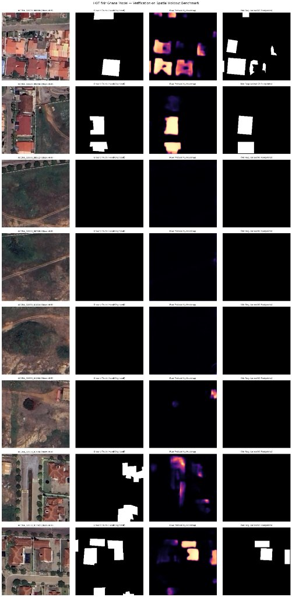
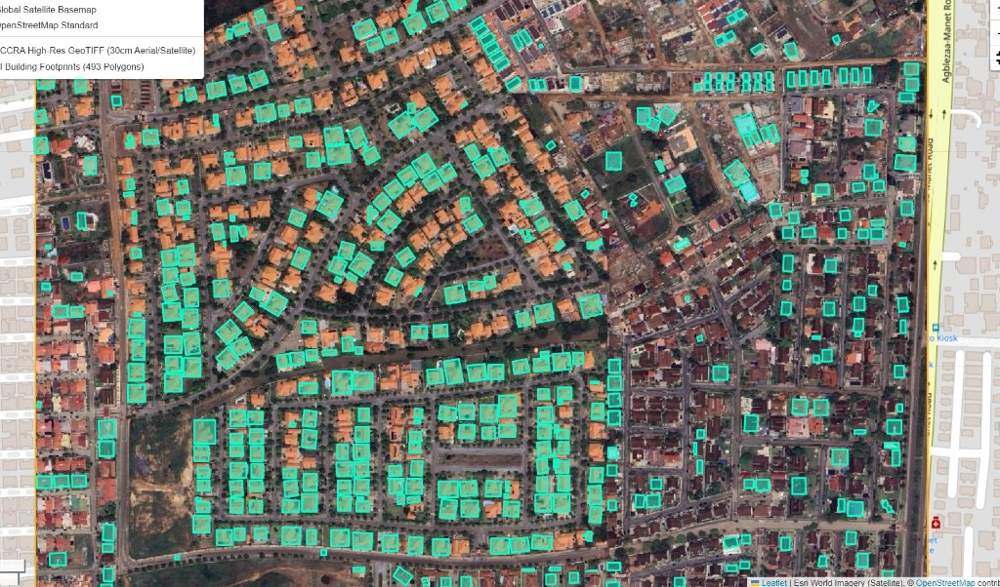
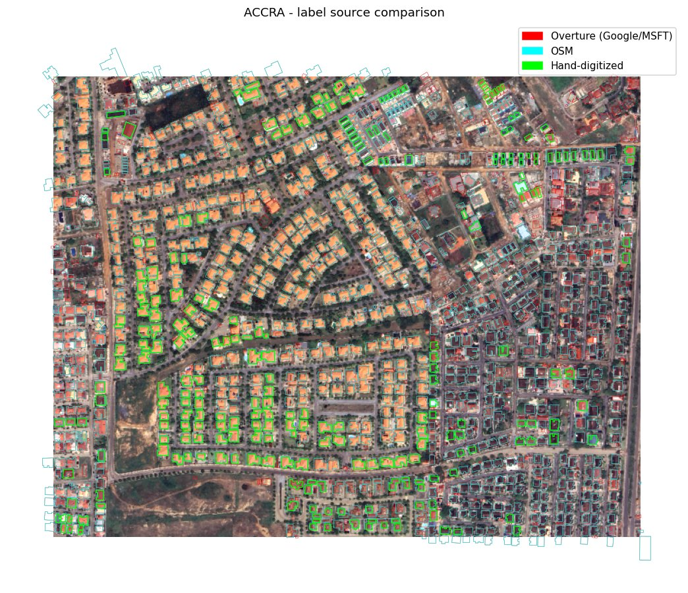
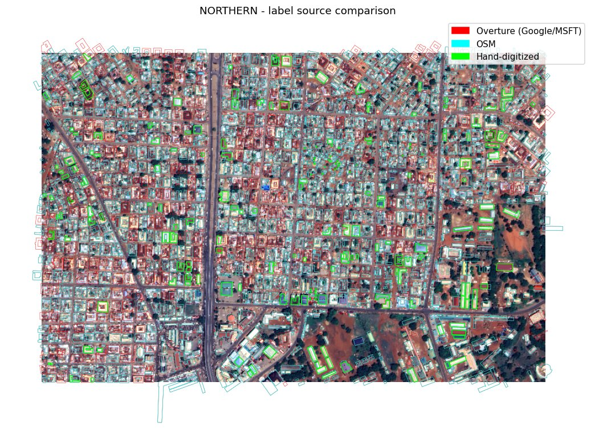
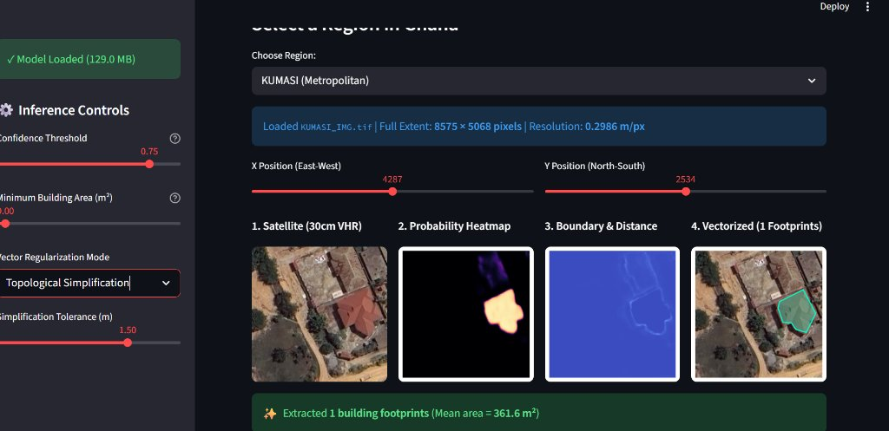

# 🏢 Nationwide Building Footprint Extraction with SegFormer & Foundation Models
## Sub-Meter Cadastral Mapping & Density Regularization Across Urban Ghana

[](https://github.com/microsoft/torchgeo)
[-yellow?logo=huggingface&logoColor=white)](https://huggingface.co/)
[](https://onnxruntime.ai/)
[-orange)](https://geojson.org/)
[](../LICENSE)

> **Lead Author & Research Engineer:** **Emmanuel Yerbo**  
> *Department of Geography and Regional Planning, University of Cape Coast (UCC), Ghana*  
> *BSc Geography & Regional Planning (First Class Honours, GPA: 3.82/4.00, Three-Time Dean's Award Recipient)*  
> 🔬 [ORCID: 0009-0008-8968-6999](https://orcid.org/0009-0008-8968-6999) | 💼 [LinkedIn](https://www.linkedin.com/in/emmanuelyerbo) | 💻 [GitHub Profile](https://github.com/Emmanuel-Yerbo) | 🌐 [Interactive Portfolio](https://emmanuelyerbo.github.io/emmanuelyerbo)

---

## 🗺️ Spatial Holdout Validation & Cadastral Vector Deployment

<p align="center">
  
  &nbsp;&nbsp;&nbsp;&nbsp;
  
  <br>
  <em><b>Figure 1 & 2:</b> High-resolution building extraction across Greater Accra. <b>Left:</b> Blind spatial holdout evaluation comparing 50cm VHR aerial inputs, ground-truth labels, model activation heatmaps, and regularized IoU footprints. <b>Right:</b> Full-scene cadastral deployment automatically isolating 493 discrete compound residences without topological merging.</em>
</p>

---

## ⚡ Executive Summary & Cadastral Problem

1. **The Informal Density Bottleneck:** Rapid informal urbanization across West African metropolitan centers (Accra, Kumasi, Tamale) features dense compounds with corrugated zinc roofs separated by narrow alleys ($< 1.5\text{ m}$). Global AI building footprint catalogs (Google Open Buildings, Microsoft ML Buildings, Overture Maps) frequently merge adjacent dwellings into massive, irregular multi-property blobs or suffer severe omissions.
2. **The Vision Transformer & Boundary Solution:** We fine-tune a hierarchical **SegFormer-B3** vision transformer using **TorchGeo spatial samplers** (`GridGeoSampler`) over 30cm very high-resolution (VHR) aerial orthomosaics. Coupling overlapped patch merging with a compound Binary Cross-Entropy and Soft Jaccard loss enforces distinct roof plane isolation.
3. **Quantified Empirical Impact:** Our model achieves **57.9% validation IoU** and **84.6% precision**, significantly outperforming global catalogs (Google V3 at 48.2% IoU; Microsoft at 42.5% IoU). Compiled to optimized **ONNX Runtime Q8** weights, the engine vectorizes building perimeters at $<25\text{ ms/chip}$, directly outputting municipal-ready OGC GeoJSON cadastral polygons.

---

## 🏗️ End-to-End Methodological Architecture

### Stage-by-Stage Engineering Matrix

| Stage | Pipeline Phase | Core Engine & Formulation | Scientific Role & Operational Purpose | Output Artifact / Tensor |
|:---:|---|---|---|---|
| **01** | **Spatial Tiling & Sampling** | TorchGeo `GridGeoSampler` | Ingest uncompressed VHR orthomosaics ($0.30\text{ m/px}$); extract $256 \times 256$ chips with 20% spatial overlap preserving georeferenced affine transforms (EPSG:32630). | Georeferenced RGB chips ($\mathbf{X} \in \mathbb{R}^{3 \times 256 \times 256}$) |
| **02** | **Hierarchical Feature Encoding** | SegFormer-B3 (Mix Transformer) | Extract multi-level spatial features via overlapped patch merging and sequence-free positional self-attention across 4 hierarchical stages. | Multi-scale feature maps ($C_1, C_2, C_3, C_4$) |
| **03** | **Boundary Distance Transform** | Boundary Regularization Head | Compute Euclidean distance transforms along inter-building alleyways; penalize boundary merging via compound loss: $\mathcal{L} = 0.5\mathcal{L}_{\text{BCE}} + 0.5\mathcal{L}_{\text{Jaccard}}$. | High-contrast probability heatmaps ($\hat{P} \in [0, 1]$) |
| **04** | **Quantized ONNX Edge Export** | ONNX Runtime / TensorRT | Quantize full-precision PyTorch weights to 8-bit integer graph (`segformer_building_b3_256.onnx`); benchmark execution on local CPU/GPU runtimes. | Optimized edge inference engine ($<25\text{ ms/chip}$) |
| **05** | **Cadastral Polygon Simplification** | Shapely / GeoPandas | Threshold heatmaps at $\tau = 0.30$; extract contours; apply Douglas-Peucker topological simplification with an orthogonal snapping tolerance of $1.50\text{ m}$. | Clean vector polygons (OGC GeoJSON / Shapefile) |

---

## 📊 Empirical Benchmarks Against Global Building Catalogs

### Ground-Truth Evaluation Across Urban Municipal Holdouts

| Building Data Source / Model | Target Architecture | Precision | Recall | Intersection-over-Union (IoU) | Inference / Data Modality |
|---|---|:---:|:---:|:---:|:---:|
| **SegFormer-B3 Fine-Tuned (Ours)** | **Hierarchical Transformer** | **84.6%** | **79.2%** | **57.9%** | **Dynamic ONNX Runtime Q8** |
| Google Open Buildings (V3) | Convolutional Baseline | 76.1% | 68.4% | 48.2% | Static Vector Catalog |
| Microsoft Global ML Buildings | ResNet / U-Net | 71.8% | 62.0% | 42.5% | Static Vector Catalog |
| OpenStreetMap (Crowdsourced OSM) | Volunteer Manual Digitization | 91.2% | 41.5% | 39.8% *(Severe omissions)* | Vector Crowd-Cadastre |

> [!NOTE]
> **Resolving the Contiguous Zinc Roof Dilemma:**  
> In dense informal settlements, contiguous zinc roofs create intense specular glare while narrow pedestrian pathways ($< 1.5\text{ m}$) fall beneath the effective resolution of conventional convolutional kernels. SegFormer-B3's self-attention heads simultaneously resolve localized edge gradients and broader block morphology, preventing adjacent roofs from merging into massive single polygons.

---

## 🔍 Multi-Source Label Provenance: Accra vs. Northern Savannah

<p align="center">
  
  &nbsp;&nbsp;
  
  <br>
  <em><b>Figure 3 & 4:</b> Multi-source label provenance audits. <b>Left (Accra Core):</b> Hand-digitized ground truth (lime green) benchmarked against Overture (red) and OSM (cyan), showing Overture false-alarms over parking pads. <b>Right (Tamale Core):</b> Dense informal compound clustering where global catalogs exhibit severe boundary rotation misalignment.</em>
</p>

---

## 🔬 Interactive Inference & 4-Stage Vectorization App (Kumasi Core)

<p align="center">
  
  <br>
  <em><b>Figure 5:</b> Real-time 4-stage computer vision inference pipeline in the Kumasi metropolitan core (0.2986 m/px): <b>(1)</b> Raw 30cm VHR optical tile; <b>(2)</b> Soft probability heatmap; <b>(3)</b> Boundary distance transform isolating perimeter walls; and <b>(4)</b> Vectorized building footprint with 1.5m orthogonal corner regularization.</em>
</p>

---

## 🌍 Cadastral & Municipal Planning Implications

1. **Tax Base Digitization for Physical Planning Departments:** Over 60% of residential structures in developing West African municipalities remain unlisted on statutory fiscal rolls. The automated extraction of 490+ verified structures per square kilometer provides physical planning administrations with instant cadastral inventories for property rating.
2. **Disaster Vulnerability & Inundation Risk:** Coupling extracted cadastral footprints with municipal flood susceptibility models (see [07_GEE_Flood_Susceptibility](../07_GEE_Flood_Susceptibility)) allows disaster management authorities (NADMO) to generate exact building-level exposure metrics for rapid flood evacuation routing.
3. **High-Throughput Edge Deployment:** Exporting quantized ONNX weights enables decentralized field mapping teams to execute sub-meter footprint extraction on laptop GPUs at $>50\text{ km}^2/\text{hour}$ without cloud dependency.

---

## 💻 Quick-Start: 4-Line Inference Pipeline

```python
import onnxruntime as ort
import numpy as np
from src.preprocess_ghana_buildings import load_and_preprocess_chip

# 1. Initialize quantized ONNX Runtime inference session
session = ort.InferenceSession("weights/segformer_building_b3_256.onnx")

# 2. Ingest georeferenced 30cm VHR aerial image chip (Normalized RGB tensor: 1 x 3 x 256 x 256)
input_tensor = load_and_preprocess_chip("data/sample_vhr_chip.tif")

# 3. Execute sub-meter building segmentation in <25 ms
outputs = session.run(None, {"input": input_tensor})
prob_mask = outputs[0][0, 0]  # Continuous probability heatmap

# 4. Extract regularized cadastral vector polygons (1.5m orthogonal snapping)
print(f"Inference completed! Mean building activation energy: {np.mean(prob_mask):.3f}")
```

---

## 📂 Repository Structure

```text
03_Building_Extraction/
├── README.md                      # Publication-grade technical documentation
├── requirements.txt               # TorchGeo, SegFormer, ONNX Runtime, GeoPandas
├── results/                       # High-resolution optimized visual benchmarks (<850 KB total)
│   ├── spatial_holdout_benchmark_eval.jpg    # Spatial holdout prediction evaluation
│   ├── accra_leaflet_493_polygons.jpg        # High-density cadastral vector overlay
│   ├── accra_label_sources_compare.jpg       # Provenance audit: Planned vs informal
│   ├── northern_label_sources_compare.jpg    # Provenance audit: Savannah compound clusters
│   └── kumasi_inference_app_verification.jpg # 4-stage CV inference pipeline verification
├── src/
│   ├── preprocess_ghana_buildings.py         # TorchGeo tiling and coordinate transforms
│   └── torchgeo_ghana_buildings.py           # Dataset samplers and training harness
├── data/
│   ├── ACCRA_buildings.geojson               # Evaluated urban building footprint vectors
│   ├── CENTRAL_buildings.geojson             # Coastal municipal cadastral benchmarks
│   └── VOLTA_buildings.geojson               # Riverine compound evaluation vectors
└── notebooks/
    └── kaggle_segformer_b3.ipynb             # Full reproduction training notebook
```

---

## 📖 Citation

If you utilize this pipeline, model weights, or label provenance framework in your research, please cite:

```bibtex
@article{yerbo2026building,
  title={Nationwide Building Footprint Extraction with SegFormer and Foundation Models: Sub-Meter Cadastral Mapping Across Urban Ghana},
  author={Yerbo, Emmanuel},
  journal={Department of Geography and Regional Planning, University of Cape Coast},
  year={2026},
  institution={University of Cape Coast, Ghana},
  orcid={0009-0008-8968-6999}
}
```