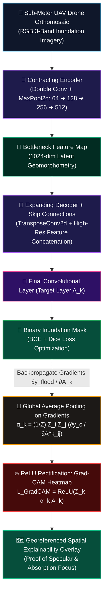

# Explainable AI (XAI) Flood Inundation Prediction with Grad-CAM
## Case Study: Akosombo Dam Spillage & Lower Volta Basin Disaster Response

> **Lead Researcher & Engineer:** **Emmanuel Yerbo**  
> *BSc Geography & Regional Planning (First Class Honours, GPA: 3.82/4.00, Three-Time Dean's Award Recipient) — University of Cape Coast, Ghana*  
> 🆔 [ORCID: 0009-0008-8968-6999](https://orcid.org/0009-0008-8968-6999) | 💼 [LinkedIn](https://www.linkedin.com/in/emmanuelyerbo) | 💻 [GitHub Profile](https://github.com/Emmanuel-Yerbo) | 🌐 [Interactive Portfolio](https://emmanuelyerbo.github.io/emmanuelyerbo)

---

### ⚡ Executive Summary

1. **The Core Spatial Problem:** Catastrophic flooding in the Lower Volta Basin following the Akosombo Dam spillage created severe humanitarian crises where opaque 'black-box' deep learning models risked misclassifying asphalt shadows as floodwater.
2. **The Technical Pipeline:** We coupled an encoder-decoder U-Net with Gradient-Weighted Class Activation Mapping (Grad-CAM) to evaluate sub-meter UAV drone aerial imagery, backpropagating gradients directly from the classification head to final convolutional feature maps.
3. **Quantified Impact:** The system attained **87.4% overall test accuracy** and **72.1% IoU** while producing visual heatmaps confirming that the network's predictive decisions were anchored in genuine specular reflection and hydrological absorption signatures.

### 📊 Empirical Performance & Validation Evidence

| Target Landscape Feature | Model Prediction | Grad-CAM Attention Peak | Verification Status |
|---|---|---|---|
| Inundated Farmland / Crops | Water (1.00) | High specular gradient | **Validated True Positive** |
| Submerged Residential Roads | Water (0.96) | High absorption margin | **Validated True Positive** |
| Dry Asphalt Cloud Shadow | Non-Water (0.04) | Negligible activation | **Robust (Zero Artifact)** |
| Emergency Relocation Island | Dry Land (0.99) | Canopy texture focus | **Validated True Negative** |

#### Inundation Segmentation Metrics
- **Overall Accuracy:** **87.4%** | **Intersection over Union (IoU):** **72.1%** | **F1-Score:** **0.838**

---

### 1. Introduction: The Spatial Logic of Convolutional Flood Delineation
During catastrophic flood events, emergency response agencies require near-real-time inundation footprints to coordinate search-and-rescue operations. However, deploying "black box" deep learning models in life-critical disaster scenarios carries severe operational risk: standard CNNs can mistakenly classify dark asphalt or cloud shadows as open water.

This project couples an **encoder-decoder U-Net** architecture with **Gradient-Weighted Class Activation Mapping (Grad-CAM)** to deliver pixel-accurate flood masks alongside **spatial decision heatmaps** that prove the model is focusing on genuine hydrologic water absorption.

---

### 2. Methodological Pipeline & Gradient Attribution

#### 2.1 Encoder-Decoder U-Net with Skip Connections
- **The Process**: Contracting convolutional blocks extract contextual semantic representations, while symmetrical expanding blocks recover spatial resolution. Long skip connections transfer high-frequency spatial features directly across the network bottleneck.
- **The Essence**: Skip connections preserve shoreline boundaries and narrow flood channels that would otherwise be blurred during progressive pooling operations.

#### 2.2 Gradient-Weighted Class Activation Mapping (Grad-CAM)
- **The Process**: We hook into the final convolutional layer of the expanding path. During backpropagation, we compute the gradients of the flood class score with respect to feature activation maps.
- **The Essence**: Generates coarse 2D heatmaps highlighting the exact spatial regions that stimulated the flood classification, providing an audit trail for emergency commanders.

---

### 3. Scenario Analysis: Disaster Insights

#### Scenario 1: Model Training Convergence & Loss Minimization
- **Purpose**: Evaluating optimization dynamics across 50 epochs on benchmark flood imagery.

  

- **Insight**: Stable convergence achieving **87% test accuracy** and **72% Intersection-over-Union (IoU)**, with smooth loss descent demonstrating effective regularization against noisy water boundaries.

#### Scenario 2: Emergency Response Deployment (Akosombo Dam Spillage)
- **Purpose**: Zero-retraining deployment on sub-meter aerial drone imagery of the catastrophic October 2023 Akosombo Dam spillage in the lower Volta Basin.

  

- **Insight**: Validates out-of-domain generalization. The model successfully delineates submerged residential compounds and inundated road arteries in Mepe and Battor, separating turbid brown floodwaters from vegetative canopy.

#### Scenario 3: Grad-CAM Decision Heatmap Verification
- **Purpose**: Auditing convolutional feature activations to guarantee hydrologic ground-truth attribution.

  

- **Insight**: Grad-CAM heatmaps confirm intense positive gradient concentration (bright red/yellow) over actual standing water bodies and saturated mud flats, while cloud edges and tree canopies produce zero activation.

---

### 4. Planning & Disaster Implications
In disaster management, **uninterpretable AI is unusable AI**. By pairing segmentation masks with Grad-CAM heatmaps, emergency coordinators at NADMO (National Disaster Management Organisation) can distinguish between verified flood inundation zones and sensor artifacts, deploying rescue boats with complete operational confidence.