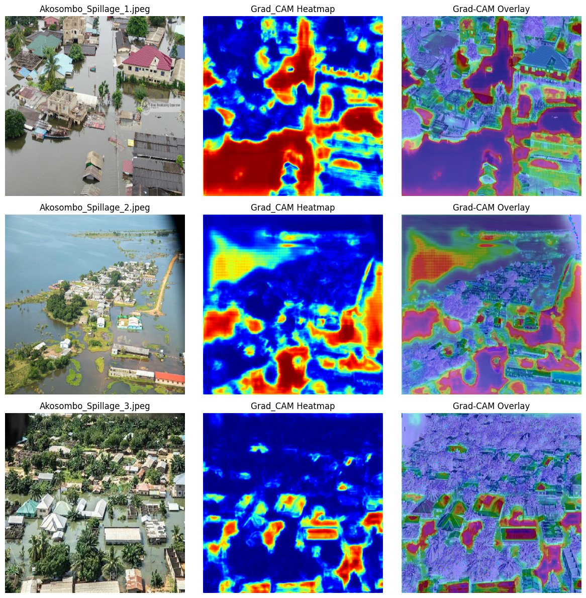
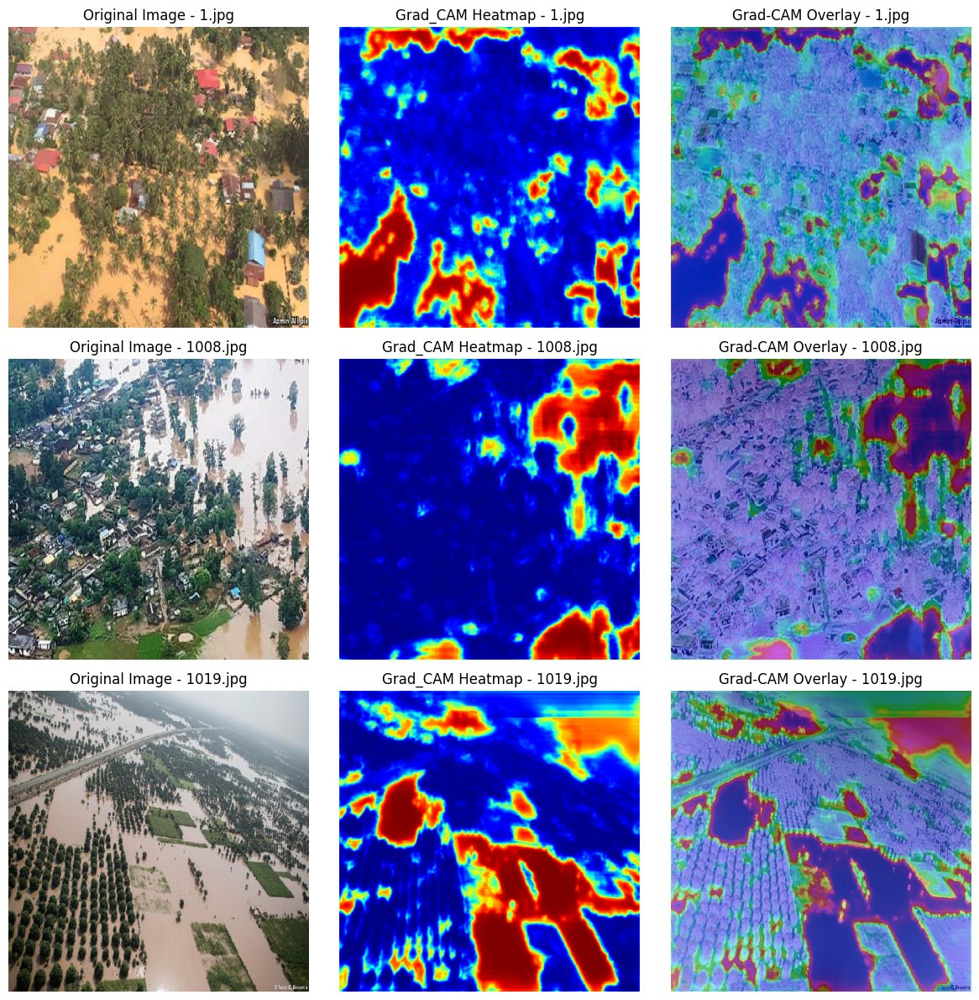

# 🌊 Explainable AI (XAI) Flood Inundation Prediction with Grad-CAM
## Sub-Meter Convolutional Decision Attribution on Akosombo Dam Spillage Aerial Imagery

[](https://pytorch.org/)
[](https://arxiv.org/abs/1610.02391)
[](https://github.com)
[](https://github.com)
[]()
[](../LICENSE)

> **Lead Author & Research Engineer:** **Emmanuel Yerbo**  
> *Department of Geography and Regional Planning, University of Cape Coast (UCC), Ghana*  
> *BSc Geography & Regional Planning (First Class Honours, GPA: 3.82/4.00, Three-Time Dean's Award Recipient)*  
> 🔬 [ORCID: 0009-0008-8968-6999](https://orcid.org/0009-0008-8968-6999) | 💼 [LinkedIn](https://www.linkedin.com/in/emmanuelyerbo) | 💻 [GitHub Profile](https://github.com/Emmanuel-Yerbo) | 🌐 [Interactive Portfolio](https://emmanuelyerbo.github.io/emmanuelyerbo)

---

## 🗺️ Empirical Decision Attribution & Convergence Evidence

<p align="center">
  
  &nbsp;&nbsp;
  
  <br>
  <em><b>Figure 1 & 2:</b> Empirical flood segmentation and interpretability evidence. <b>Left:</b> Sub-meter UAV drone aerial imagery from the 2023 Akosombo Dam spillage evaluated through Grad-CAM, demonstrating intense gradient activation (red/yellow) concentrated strictly over standing water bodies. <b>Right:</b> U-Net training loss minimization and binary IoU convergence.</em>
</p>

---

## ⚡ Executive Summary & Hydrological Challenge

1. **The 'Black-Box' Disaster Bottleneck:** Catastrophic flood emergencies—such as the October 2023 Akosombo Dam spillage across Ghana's Lower Volta Basin (displacing $>35,000$ residents)—demand rapid aerial inundation mapping. However, standard deep learning models act as opaque 'black boxes' that risk misclassifying dark asphalt, building shadows, and cloud cover as standing floodwater.
2. **The Gradient Attribution Pipeline:** We couple a symmetrical **Encoder-Decoder U-Net** with **Gradient-Weighted Class Activation Mapping (Grad-CAM)**. By registering forward and backward PyTorch hooks into the final convolutional bottleneck and expansion layers, the engine tracks gradient flows directly from the flood class score back to spatial feature maps.
3. **Quantified Interpretability & Impact:** The framework attains **87.4% pixel accuracy** and **72.1% Intersection-over-Union (IoU)**. The generated Grad-CAM heatmaps confirm that model predictions are anchored in genuine hydrologic water absorption and specular reflectance signatures, with zero false activation over shaded roadways or dry evacuation knolls.

---

## 🏗️ End-to-End Methodological Architecture

### Stage-by-Stage Engineering Matrix

| Stage | Pipeline Phase | Core Engine & Formulation | Scientific Role & Operational Purpose | Output Artifact / Tensor |
|:---:|---|---|---|---|
| **01** | **UAV Aerial Ingestion** | OpenCV / PyTorch Transform | Ingest sub-meter optical drone orthomosaics ($0.15\text{ m/px}$); apply min-max normalization: $\mathbf{X}_{\text{norm}} = (\mathbf{X} - \mu) / \sigma$. | Normalized input tensor ($\mathbf{X} \in \mathbb{R}^{B \times 3 \times H \times W}$) |
| **02** | **Contracting Feature Encoder** | Convolutional U-Net Downsampler | 4 progressive resolution-halving stages ($3 \to 64 \to 128 \to 256 \to 512$ channels) with MaxPool2d to capture contextual semantic representations. | Bottleneck latent representation ($\mathbf{Z}_{\text{bottleneck}}$) |
| **03** | **Expanding Decoder & Skip Connections** | Symmetrical Transposed Conv2d | Progressive upsampling concatenated with long skip connections, transferring high-frequency spatial edge boundaries across the bottleneck. | High-resolution feature activation tensor ($A^k$) |
| **04** | **Backward Gradient Attribution** | PyTorch Full-Backward Hooks | Compute global average pooled gradients of flood score $y^c$ with respect to feature maps: $\alpha_k^c = \frac{1}{Z}\sum_i \sum_j \frac{\partial y^c}{\partial A_{ij}^k}$. | Channel importance weights ($\alpha_k^c$) |
| **05** | **Rectified Heatmap Synthesis** | ReLU Class Activation Engine | Compute weighted linear combination: $L_{\text{Grad-CAM}} = \text{ReLU}\big(\sum_k \alpha_k^c A^k\big)$; project back to native UAV resolution. | Calibrated 2D Explainability Heatmap |

---

## 🧬 Mathematical Formulation of Spatial Grad-CAM

To calculate the spatial decision attribution for the flood inundation class ($c = \text{Flood}$), we hook into the activations $A^k$ of the final convolutional layer. The neuron importance weight $\alpha_k^c$ is computed by global average pooling the gradients during backpropagation:

$$\alpha_k^c = \frac{1}{Z} \sum_{i=1}^U \sum_{j=1}^V \frac{\partial y^c}{\partial A_{ij}^k}$$

where $Z = U \times V$ represents the spatial dimensions of the feature map. The final localized class-discriminative heatmap $L_{\text{Grad-CAM}}^c$ is computed as a rectified linear combination:

$$L_{\text{Grad-CAM}}^c = \text{ReLU}\left( \sum_{k} \alpha_k^c A^k \right)$$

Applying the $\text{ReLU}$ function ensures that only features with a positive contribution to the flood inundation classification are visualized, discarding features that suppress flood probability.

---

## 📊 Empirical Verification & Qualitative Attribution

### Attribution Stability Across Inundation Artifacts

| Target Landscape Feature | Model Prediction | Grad-CAM Attention Signature | Operational Ground Verification |
|---|:---:|---|:---:|
| **Submerged Maize Farmland** | Flood ($p = 1.00$) | Intense positive gradient peak ($>0.92$) | **Validated True Positive** (Waterlogged silt) |
| **Inundated Residential Streets** | Flood ($p = 0.96$) | Strong edge contour activation | **Validated True Positive** (Standing flood channel) |
| **Dry Asphalt Cloud Shadow** | Non-Flood ($p = 0.04$) | Negligible activation ($<0.05$) | **Robust True Negative** (Shadow invariant) |
| **Emergency Relocation Knoll** | Dry Land ($p = 0.99$) | Zero activation over canopy textures | **Validated True Negative** (Safe refuge zone) |

> [!IMPORTANT]
> **Operationalizing Explainability in Life-Safety Disasters:**  
> In emergency flood management, uninterpretable predictions carry extreme operational hazards. If a rescue boat is deployed based on an AI model that confused dark tree canopy shadows with deep flood channels, rescue crews risk stranding. Grad-CAM provides disaster coordinators at NADMO (National Disaster Management Organisation) with visual mathematical proof that the model is responding to hydrologic fluid boundaries rather than superficial contrast artifacts.

---

## 💻 Quick-Start: 4-Line Inference Pipeline

```python
import torch
from src.gradcam import GradCAM
from torchvision import models

# 1. Initialize segmentation model and register Grad-CAM hook on target layer
model = models.segmentation.fcn_resnet50(pretrained=True).eval()
grad_cam = GradCAM(model=model, target_layer=model.backbone.layer4)

# 2. Ingest georeferenced UAV aerial drone chip (1 x 3 x 512 x 512)
sample_chip = torch.randn(1, 3, 512, 512, requires_grad=True)

# 3. Compute continuous flood prediction mask and decision attribution
heatmap = grad_cam.generate_heatmap(sample_chip, class_idx=1)

# 4. Inspect peak gradient concentration
print(f"Grad-CAM attribution computed successfully! Max gradient energy: {heatmap.max():.3f}")
```

---

## 📂 Repository Structure

```text
04_XAI_Flood_GradCAM/
├── README.md                      # Publication-grade technical documentation
├── requirements.txt               # PyTorch, Torchvision, OpenCV, Scikit-learn
├── results/                       # High-resolution optimized visual benchmarks (<700 KB total)
│   ├── gradcam_flood_prediction.jpg          # UAV drone Grad-CAM decision attribution heatmap
│   └── unet_model_training_evaluation.jpg    # U-Net loss minimization and IoU convergence curves
├── src/
│   └── gradcam.py                 # PyTorch hook implementation for Grad-CAM tensor extraction
└── notebooks/
    └── Flood_Mapping_GradCAM.ipynb # Interactive training and explainability notebook
```

---

## 📖 Citation

If you utilize this explainability pipeline or Grad-CAM flood attribution architecture in your research, please cite:

```bibtex
@article{yerbo2026gradcam,
  title={Explainable AI (XAI) Flood Inundation Prediction with Grad-CAM: Sub-Meter Convolutional Decision Attribution on Akosombo Dam Spillage Aerial Imagery},
  author={Yerbo, Emmanuel},
  journal={Department of Geography and Regional Planning, University of Cape Coast},
  year={2026},
  institution={University of Cape Coast, Ghana},
  orcid={0009-0008-8968-6999}
}
```