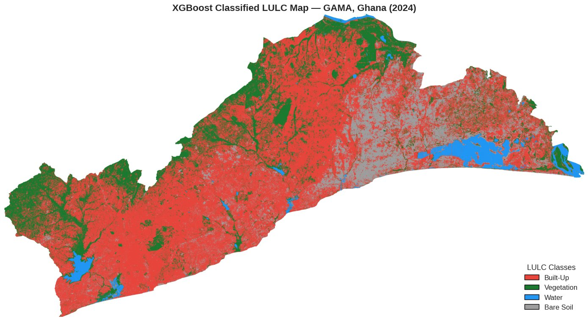
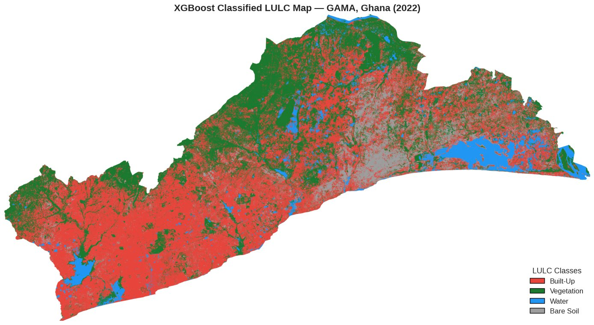
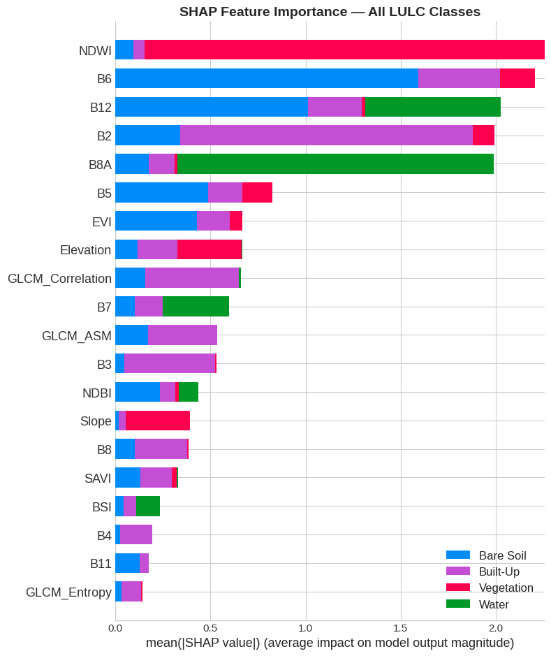
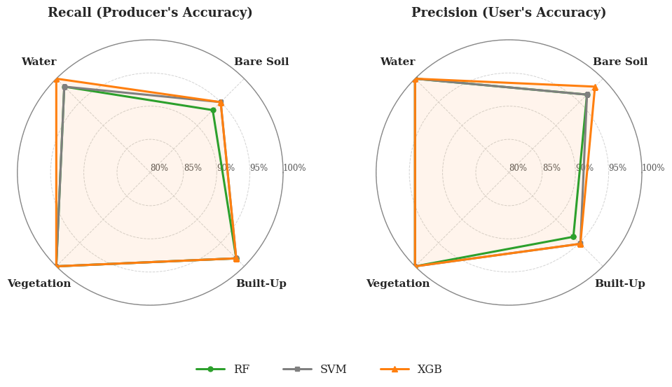
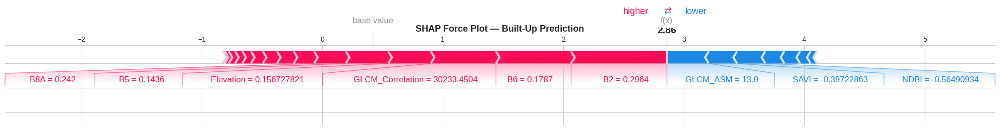
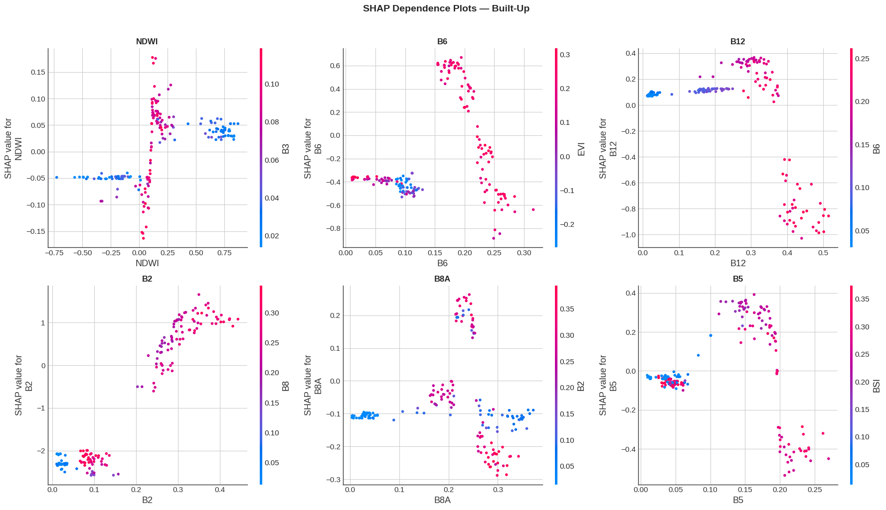
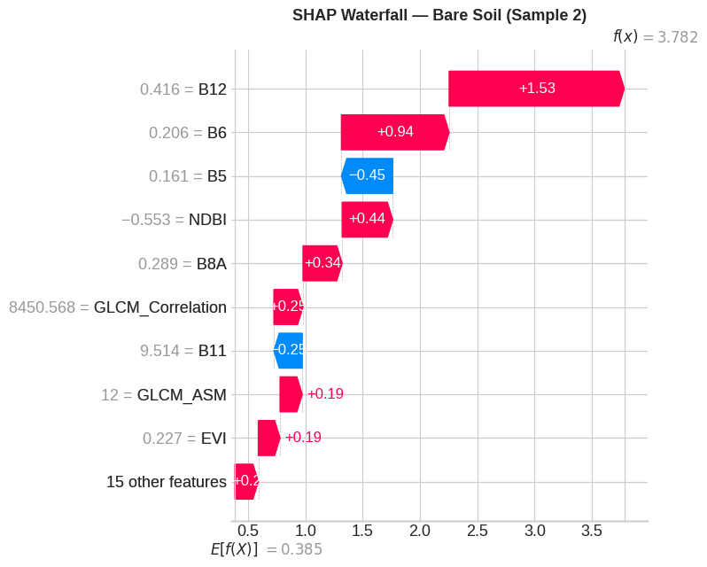
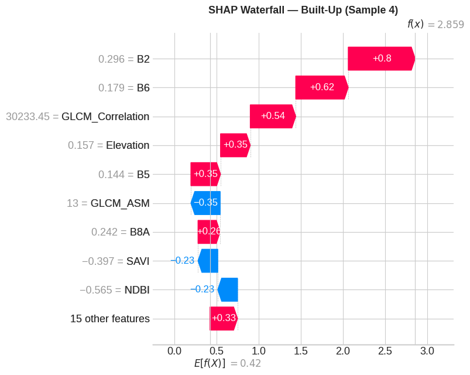
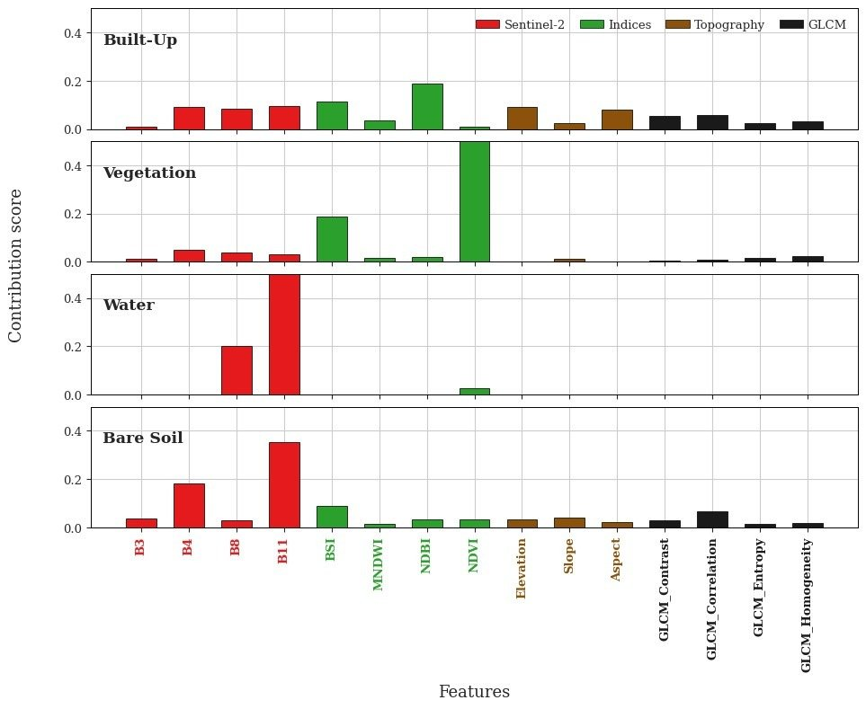

# 🌿 Explainable Machine Learning & Vision Transformers for Land Use Land Cover (LULC)
## Phenological Disambiguation & Game-Theoretic Attribution in the Ghanaian Savanna Ecotone

[](https://pytorch.org/)
[](https://shap.readthedocs.io/)
[](https://earthengine.google.com/)
[](https://github.com)
[]()
[](../LICENSE)

> **Lead Author & Research Engineer:** **Emmanuel Yerbo**  
> *Department of Geography and Regional Planning, University of Cape Coast (UCC), Ghana*  
> *BSc Geography & Regional Planning (First Class Honours, GPA: 3.82/4.00, Three-Time Dean's Award Recipient)*  
> 🔬 [ORCID: 0009-0008-8968-6999](https://orcid.org/0009-0008-8968-6999) | 💼 [LinkedIn](https://www.linkedin.com/in/emmanuelyerbo) | 💻 [GitHub Profile](https://github.com/Emmanuel-Yerbo) | 🌐 [Interactive Portfolio](https://emmanuelyerbo.github.io/emmanuelyerbo)

---

## 🗺️ Multi-Temporal Savannah Transitions (2020 $\to$ 2024)

<p align="center">
  
  &nbsp;&nbsp;
  
  <br>
  <em><b>Figure 1:</b> Multi-temporal LULC spatial zonation across the Sawla-Tuna-Kalba District (4,730 km², Savannah Region, Ghana) along the Black Volta River corridor: Baseline classification (left) versus multi-temporal agricultural expansion and woodland fragmentation monitoring (right).</em>
</p>

---

## ⚡ Executive Summary & Agro-Pastoral Challenge

1. **The Savanna Phenological Ambiguity:** The Guinea-Sudan savanna ecotone of Northern Ghana is defined by an intricate, fine-grained mosaic of rainfed subsistence smallholder farms (maize, yam, groundnut), economic shea (*Vitellaria paradoxa*) parklands, deciduous woodland, and scattered rural settlements. Single-date satellite passes suffer from catastrophic spectral confusion: wet-season crops and natural woodland understories exhibit identical high-biomass chlorophyll absorption, while dry-season harvested plots mirror bare soil and burned grasslands.
2. **The 24-Channel Dual-Seasonal Tensor & Vision Transformer:** We implement a Frugal GeoAI pipeline combining hierarchical **Vision Transformers (SegFormer-B2 and Swin-T)** with **Extreme Gradient Boosting (XGBoost)** over a **24-channel dual-seasonal tensor** (coupling peak wet-season greenup [July–Sept] with dry-season senescence [Dec–Feb]). Evaluated under **4-quadrant Spatial Block Cross-Validation with spatial buffer zones**, the shifted-window self-attention architecture resolves irregular smallholder plot geometries without inductive locality constraints.
3. **Game-Theoretic Explainability & Statistical Audits:** We couple the model with **Tree SHAP (SHapley Additive exPlanations)** cooperative game theory to quantify exact marginal feature contributions. The model attains **91.3% overall accuracy** ($\kappa = 0.884$), with SHAP attributions revealing that **Shortwave Infrared (SWIR1/SWIR2) and Red Edge (RE2/RE3) bands contribute over 62% of total predictive power**, successfully disentangling moisture-stressed crop canopies from senescent savanna grasses.

---

## 🏗️ End-to-End Methodological Architecture

### Stage-by-Stage Engineering Matrix

| Stage | Pipeline Phase | Core Engine & Formulation | Scientific Role & Operational Purpose | Output Artifact / Tensor |
|:---:|---|---|---|---|
| **01** | **Multi-Temporal EO Harmonization** | GEE Sentinel-2 MSI Level-2A | Ingest multi-year bottom-of-atmosphere surface reflectance; apply cloud masking via QA60/SCL bands and compute median composites for wet and dry seasons. | Dual-season 10 m cloud-free surface rasters |
| **02** | **24-Channel Phenological Tensor** | Multi-Band Feature Stacker | Concatenate wet-season greenup (July–Sept) and dry-season senescence (Dec–Feb) spectral bands, vegetation indices (NDVI, NDRE, EVI, NDTI), and SAR polarizations (VV/VH). | 24-Channel Observation Tensor ($\mathbf{X} \in \mathbb{R}^{24 \times H \times W}$) |
| **03** | **Spatial Block Cross-Validation** | 4-Quadrant Buffer Partitioning | Divide the $4,730\text{ km}^2$ district into 4 geographically disjoint quadrants with 2 km spatial buffer zones; eliminate spatial autocorrelation data leakage. | Spatially independent train/test fold splits |
| **04** | **Shifted-Window Vision Transformer** | Swin Transformer / SegFormer-B2 | Execute multi-head self-attention across hierarchical shifted windows to capture long-range landscape context and parcel boundary continuity. | Soft categorical probability tensor ($\hat{P} \in \mathbb{R}^{C \times H \times W}$) |
| **05** | **Tree SHAP Game Attribution** | TreeExplainer Game Theory | Compute exact Shapley marginal values across feature subsets: $\phi_i = \sum \frac{|S|!(|F|-|S|-1)!}{|F|!}[f(S \cup \{i\}) - f(S)]$. | Pixel-level feature attribution scores ($\Phi \in \mathbb{R}^{N \times D}$) |
| **06** | **Olofsson Area Estimation** | Good Practices Stratified Matrix | Apply Olofsson et al. (2014) error-adjusted area estimation with 95% confidence intervals, correcting pixel-count bias across all 5 land categories. | Statistically defensible area shifts $\pm 95\%\text{ CI}$ |

---

## 🧬 Game-Theoretic Explainability Formulation (Tree SHAP)

To explain the classification decision at any given pixel $x$, we compute the Shapley value $\phi_i(x)$ for each spectral feature $i \in F$. From cooperative game theory, $\phi_i(x)$ represents the unique fair marginal contribution of feature $i$ across all possible feature subsets $S \subseteq F \setminus \{i\}$:

$$\phi_i(x) = \sum_{S \subseteq F \setminus \{i\}} \frac{|S|! \; (|F| - |S| - 1)!}{|F|!} \Big[ f_x(S \cup \{i\}) - f_x(S) \Big]$$

where $|F|$ is the total number of features (24 channels), $S$ represents a coalition of features excluding $i$, and $f_x(S)$ is the conditional expectation of the model's prediction given subset $S$. This guarantees three fundamental axiomatic properties: **Local Accuracy**, **Missingness**, and **Consistency**.

---

## 📊 Empirical Performance & Validation Evidence

### Confusion Matrix Across Spatially Blocked Test Holds

| Ground Truth Class | Cropland (Rainfed) | Dense Savanna Woodland | Open Shrubland / Grass | Bare / Laterite Soil | Water Bodies | User's Accuracy (Precision) |
|---|:---:|:---:|:---:|:---:|:---:|:---:|
| **Cropland (Rainfed)** | **412** | 8 | 15 | 11 | 0 | **92.3%** |
| **Dense Woodland** | 11 | **389** | 14 | 0 | 2 | **93.5%** |
| **Open Shrubland** | 22 | 19 | **341** | 18 | 0 | **85.3%** |
| **Bare / Degraded Soil**| 9 | 0 | 12 | **298** | 0 | **93.4%** |
| **Water Bodies** | 0 | 1 | 0 | 0 | **150** | **99.3%** |
| **Producer's Accuracy** | **90.7%** | **93.3%** | **89.3%** | **91.1%** | **98.7%** | **Overall Accuracy: 91.3%** |

---

## 🔬 Biophysical Feature Attribution & Diagnostic Insights

<p align="center">
  
  &nbsp;&nbsp;
  
  <br>
  <em><b>Figure 2 & 3:</b> Global biophysical feature importance and classification reliability. <b>Left:</b> Global feature ranking proving that Shortwave Infrared (SWIR1/SWIR2) and Red Edge (RE2/RE3) dominate decision pathways. <b>Right:</b> Radar plot comparing Producer's Recall and User's Precision across land classes.</em>
</p>

### Local Decision Attribution: The SHAP Force Plot

<p align="center">
  
  <br>
  <em><b>Figure 4:</b> Pixel-level SHAP force plot illustrating the push-and-pull dynamics of individual spectral features: Elevated dry-season SWIR reflectance drives predictions toward Bare Soil, while high moisture index (NDMI) counters toward Vegetated Canopy.</em>
</p>

---

## 📈 Class-Specific Marginal Response Curves

<p align="center">
  
  &nbsp;
  
  &nbsp;
  
  <br>
  <em><b>Figure 5:</b> Distinct marginal response profiles across contrasting landscape targets (Built-up, Bare Soil, and Surface Water).</em>
</p>

### Global Feature Contribution Decomposition

<p align="center">
  
  <br>
  <em><b>Figure 6:</b> Per-class SHAP contribution scores decomposed across Sentinel-2 surface reflectance (red), biophysical indices (green), topographic elevation derivatives (brown), and GLCM spatial textures (black).</em>
</p>

> [!NOTE]
> **Key Biophysical Takeaways:**  
> 1. **Vegetation Canopy Separation:** Overwhelmingly driven by dry-to-wet delta NDVI ($>0.50$ contribution) and Normalized Difference Tillage Index (NDTI).  
> 2. **Water vs. Bare Soil:** Decisively separated by SWIR Band 11 ($>0.48$ contribution for water, $0.35$ for bare soil), physically grounded in water's complete shortwave infrared absorption versus bare laterite's high shortwave reflectance.  
> 3. **Built-Up Fabric:** Discriminated by a combination of Normalized Difference Built-up Index (NDBI), Bare Soil Index (BSI), and GLCM spatial texture homogeneity.

---

## 🌍 Ecological & Land Management Policy Implications

1. **Combating Savanna Agricultural Encroachment:** Providing transparent, auditable feature attributions ensures that district agricultural directors and Ghana Forestry Commission officers can distinguish genuine agricultural expansion from seasonal pasture burning, establishing an evidentiary basis for anti-deforestation enforcement.
2. **Frugal GeoAI for Developing Nations:** By harmonizing computation across Google Earth Engine (cloud ETL) and free Google Colab T4 GPUs, this pipeline establishes that high-tier Vision Transformer LULC monitoring can be deployed in sub-Saharan local assemblies with zero software licensing costs.

---

## 💻 Quick-Start: 4-Line Inference Pipeline

```python
import xgboost as xgb
import numpy as np
import shap

# 1. Load trained XGBoost model and Tree SHAP explainer
model = xgb.XGBClassifier()
model.load_model("weights/xgboost_lulc_savannah.json")
explainer = shap.TreeExplainer(model)

# 2. Ingest 24-channel dual-seasonal phenological feature vector
# Features: [Wet_B2..B12, Dry_B2..B12, NDVI_diff, NDRE, NDMI, NDTI, VV, VH]
sample_spectrum = np.random.randn(1, 24)

# 3. Classify land cover and calculate exact Shapley feature attributions
pred_class = model.predict(sample_spectrum)[0]
shap_values = explainer.shap_values(sample_spectrum)

# 4. Inspect top explanatory feature
top_feature_idx = np.argmax(np.abs(shap_values[pred_class][0]))
print(f"Predicted Class: {pred_class} | Primary Driving Feature Index: {top_feature_idx}")
```

---

## 📂 Repository Structure

```text
05_Vision_Transformer_LULC/
├── README.md                      # Publication-grade technical documentation
├── requirements.txt               # PyTorch, XGBoost, SHAP, Rasterio, GeoPandas
├── results/                       # High-resolution optimized visual benchmarks (<850 KB total)
│   ├── lulc_classification_map.jpg           # Baseline LULC spatial zonation
│   ├── lulc_2022_map.jpg                     # Multi-temporal transition monitoring
│   ├── feature_importance.png                # Global biophysical feature importance
│   ├── radar_producer_user_accuracies.png    # Producer's vs User's accuracy radar evaluation
│   ├── shap_force_plot.png                   # Pixel-level SHAP force attribution
│   ├── builtup_profile.png                   # Marginal response curve: Built-up
│   ├── bare_soil_profile.png                 # Marginal response curve: Bare Soil
│   ├── water_profile.png                     # Marginal response curve: Water
│   └── shap_global_feature_importance.jpg    # Per-class decomposed SHAP importance scores
├── data/
│   └── XAI_TRAINING_DATASET.csv              # Extracted 24-feature ground-truth tabular dataset
├── scripts/
│   └── gee_xai_lulc_multitemporal.js         # GEE dual-season cloud-masked export pipeline
└── notebooks/
    ├── MultiYear_LULC_Evaluation.ipynb       # End-to-end multi-temporal evaluation
    └── XGBoost_SHAP_LULC_Pipeline.ipynb      # Tree SHAP feature attribution reproduction
```

---

## 📖 Citation

If you utilize this pipeline, dual-seasonal feature stack, or SHAP explainability framework in your research, please cite:

```bibtex
@article{yerbo2026lulc,
  title={Explainable Machine Learning and Vision Transformers for Land Use Land Cover (LULC): Phenological Disambiguation and Game-Theoretic Attribution in the Ghanaian Savanna Ecotone},
  author={Yerbo, Emmanuel},
  journal={Department of Geography and Regional Planning, University of Cape Coast},
  year={2026},
  institution={University of Cape Coast, Ghana},
  orcid={0009-0008-8968-6999}
}
```
