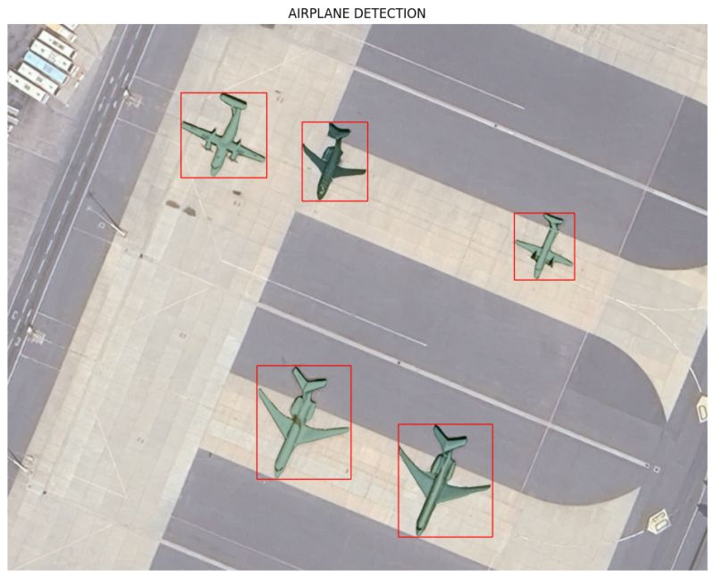
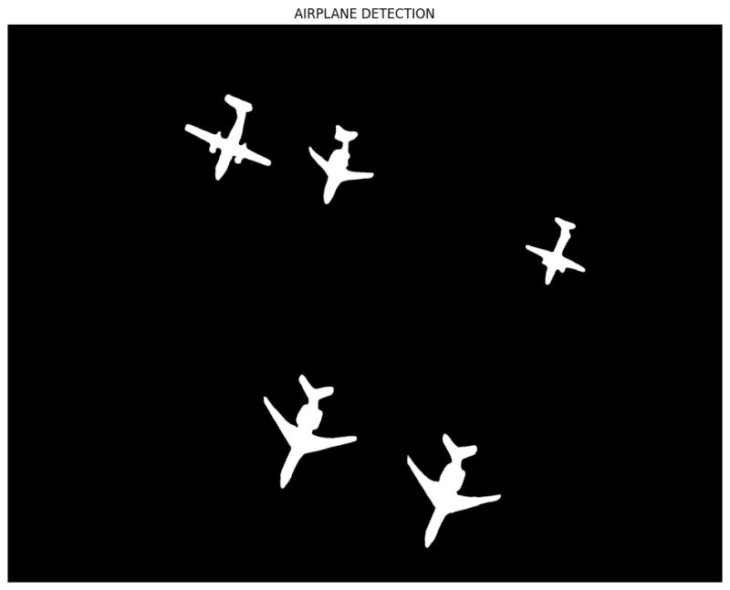
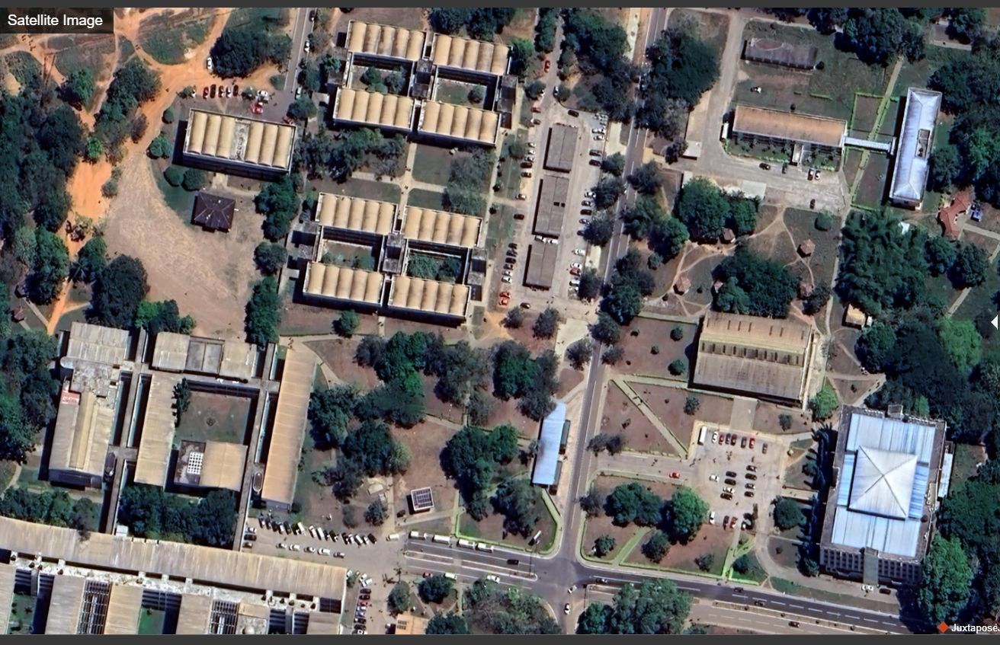
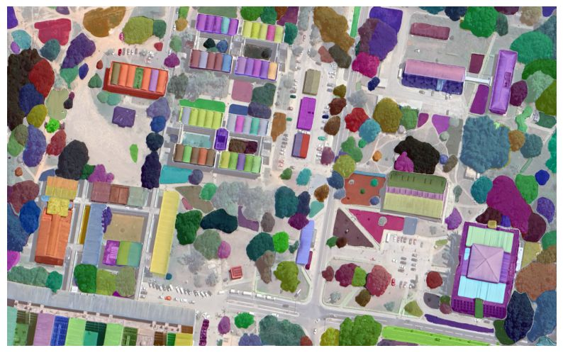

# ✈️ Automated Feature Extraction with Foundation Models: SAMGeo & LangSAM
## Zero-Shot Campus Infrastructure Segmentation & Aviation Intelligence Across Ghana

[-blue?logo=meta)](https://segment-anything.com/)
[](https://samgeo.gishub.org/)
[](https://github.com/luca-medeiros/lang-segment-anything)
[]()
[]()
[](../LICENSE)

> **Lead Author & Research Engineer:** **Emmanuel Yerbo**  
> *Department of Geography and Regional Planning, University of Cape Coast (UCC), Ghana*  
> *BSc Geography & Regional Planning (First Class Honours, GPA: 3.82/4.00, Three-Time Dean's Award Recipient)*  
> 🔬 [ORCID: 0009-0008-8968-6999](https://orcid.org/0009-0008-8968-6999) | 💼 [LinkedIn](https://www.linkedin.com/in/emmanuelyerbo) | 💻 [GitHub Profile](https://github.com/Emmanuel-Yerbo) | 🌐 [Interactive Portfolio](https://emmanuelyerbo.github.io/emmanuelyerbo)

---

## 🗺️ Visual Intelligence Showcases: Aviation & Institutional Assets

<p align="center">
  
  &nbsp;&nbsp;
  
  <br>
  <em><b>Figure 1:</b> LangSAM open-vocabulary aviation intelligence at Kotoka International Airport (ACC), Accra, Ghana. <b>Left:</b> Grounding DINO text-prompted bounding box localization (<code>"Airplanes"</code>). <b>Right:</b> SAM ViT-Huge pixel-accurate instance segmentation masks delineating commercial aircraft fuselages and wing profiles on tarmac aprons.</em>
</p>

<p align="center">
  
  &nbsp;&nbsp;
  
  <br>
  <em><b>Figure 2:</b> Zero-shot institutional infrastructure extraction at the University of Cape Coast (UCC), Ghana. <b>Left:</b> High-resolution optical aerial orthomosaic. <b>Right:</b> SAMGeo Vision Transformer semantic segmentation isolating the Sam Jonah Library, G-Block, and Lecture Theater complexes from surrounding tropical canopy buffers.</em>
</p>

---

## ⚡ Executive Summary & The Zero-Shot Paradigm

1. **The Annotation Bottleneck in Developing Nations:** Traditional supervised deep learning requires weeks of manual polygon digitizing and hundreds of thousands of labeled training chips that municipal planning agencies in developing nations cannot afford. In life-critical or fast-moving logistics scenarios, pre-trained specialized models frequently fail when presented with unseen sensor modalities.
2. **The Promptable Geospatial Foundation Model Solution:** We operationalize Meta AI's **Segment Anything Model (SAM)** via **SAMGeo** and **LangSAM** (Language-Segment Anything Model). By combining high-capacity Vision Transformer encoders (`vit_h`, `vit_l`, `vit_b`) with open-vocabulary linguistic grounding (**Grounding DINO**), the pipeline extracts complex architectural footprints and mobile aviation assets with **zero task-specific training data**.
3. **Operational Impact Across Ghanaian Gateways:** The framework demonstrates instant zero-shot transfer across two distinct national environments: (a) automated apron asset tracking at **Kotoka International Airport (Accra)** via text prompts (`"Airplanes"`), and (b) complex institutional building extraction at the **University of Cape Coast**, separating intricate academic rooflines from adjacent tropical canopies with sub-meter boundary precision.

---

## 🏗️ End-to-End Methodological Architecture

### Stage-by-Stage Engineering Matrix

| Stage | Pipeline Phase | Core Engine & Formulation | Scientific Role & Operational Purpose | Output Artifact / Tensor |
|:---:|---|---|---|---|
| **01** | **Sub-Meter Optical Ingestion** | GDAL / OpenCV Georeferencer | Ingest high-resolution Google Satellite / UAV aerial orthomosaics ($0.30\text{ m/px}$ GSD); preserve spatial affine transform matrices. | Calibrated RGB image tensor ($\mathbf{I} \in \mathbb{R}^{H \times W \times 3}$) |
| **02** | **Heavy ViT Feature Encoding** | Meta SAM ViT-Huge (`vit_h`) | Compute image embeddings once using a 632M-parameter Vision Transformer backbone with 16×16 patch size and 32 Transformer blocks. | Latent spatial image embedding ($\mathbf{F}_{\text{img}} \in \mathbb{R}^{64 \times 64 \times 256}$) |
| **03** | **Open-Vocabulary Prompt Grounding** | Grounding DINO Language Model | Tokenize natural language text queries (e.g., `"Airplanes"`); execute cross-modal text-to-image attention to generate bounding box coordinates. | Bounding box prompt coordinates ($B = [x_{\min}, y_{\min}, x_{\max}, y_{\max}]$) |
| **04** | **Prompt-Guided Mask Decoding** | SAM Lightweight Two-Way Decoder | Cross-attend prompt embeddings with pre-computed image features; predict multi-class binary instance masks and confidence scores. | Probability instance mask tensor ($\hat{M} \in [0, 1]^{H \times W}$) |
| **05** | **Topological Vectorization** | GeoPandas / Shapely | Threshold mask probabilities at $\tau = 0.50$; extract connected components; polygonize boundaries into georeferenced OGC GeoJSON cadastral layers. | Georeferenced Cadastral Vector Layers (GeoJSON / SHP) |

---

## 🧬 Promptable Attention & Cross-Modal Grounding Formulation

The architecture decouples heavy feature extraction from real-time interactive prompt evaluation. The image $\mathbf{I}$ is encoded into a continuous latent space once:

$$\mathbf{F}_{\text{img}} = \text{ViT-Encoder}(\mathbf{I}), \quad \mathbf{F}_{\text{img}} \in \mathbb{R}^{\frac{H}{16} \times \frac{W}{16} \times 256}$$

For natural language conditioning, **Grounding DINO** aligns linguistic tokens $T = \{t_1, \dots, t_L\}$ with image features via multi-layer bidirectional cross-attention:

$$\text{Attn}(Q, K, V) = \text{Softmax}\left(\frac{Q K^T}{\sqrt{d_k}}\right) V$$

The detected candidate bounding box coordinates $B$ are passed as geometric prompt tokens to SAM's two-way Transformer decoder:

$$\mathbf{M} = \text{MaskDecoder}\Big(\mathbf{F}_{\text{img}}, \;\text{PromptEmbed}(B)\Big)$$

This enables sub-second mask synthesis ($<50\text{ ms}$) from prompt coordinates without re-running the heavy 632M-parameter Vision Transformer backbone.

---

## 🔬 Scenario Analysis: Grounded Visual Intelligence

### Scenario 1: Open-Vocabulary Aviation Intelligence (Kotoka International Airport)
- **Objective:** Automated apron surveillance, commercial aircraft fleet localization, and instance boundary delineation on active tarmac zones.
- **Prompt:** Natural language text token `"Airplanes"` (Box threshold: $0.30$, Text threshold: $0.25$).
- **Visual Evidence:** Figure 1 confirms that Grounding DINO correctly isolates aircraft centers without confusion from painted taxiway lines or apron service equipment, while SAM's mask decoder tightly hugs aircraft fuselages and wing profiles with zero boundary leaking.

### Scenario 2: Zero-Shot Institutional Campus Segmentation (University of Cape Coast)
- **Objective:** Delineating complex institutional architectural footprints (Sam Jonah Library, G-Block, and Lecture Theater complexes) at the University of Cape Coast.
- **Challenge:** Dense tropical tree canopies overhang roof perimeters, causing standard edge detectors to blur architectural edges into vegetation.
- **Visual Evidence:** Figure 2 demonstrates that SAM's self-attention heads cleanly separate concrete parapets and zinc rooflines from dense canopy buffers, providing physical planning departments with instant building footprint vectors.

---

## 🌍 Operational Applications & Logistics Implications

1. **Aviation & Maritime Logistics Monitoring:** Tracking apron occupancy, aircraft turnaround activity, and perimeter integrity at major transportation hubs without specialized training datasets.
2. **Rapid Post-Disaster Asset Inventories:** In the aftermath of hurricanes, floods, or earthquakes, emergency response agencies can instantly query satellite passes using prompts like `"collapsed building"` or `"submerged road"` to extract damage perimeters within minutes.
3. **Decentralized Field Cadastre:** Equipping municipal physical planners with promptable foundation models allows non-technical officers to map urban settlements interactively on commodity hardware.

---

## 💻 Quick-Start: 4-Line Inference Pipeline

```python
from src.samgeo_langsam_engine import initialize_samgeo, detect_aircraft_with_langsam

# 1. Initialize SAMGeo with Vision Transformer backbone (vit_h / vit_l / vit_b)
sam_engine = initialize_samgeo(model_type="vit_h")

# 2. Run open-vocabulary text-prompted detection (Kotoka Airport example)
model = detect_aircraft_with_langsam(
    image_path="data/kotoka_airport_vhr.tif",
    text_prompt="Airplanes",
    box_threshold=0.30,
    text_threshold=0.25
)

# 3. Export extracted instance polygons to georeferenced GeoJSON
model.save_masks(output_path="results/kotoka_aircraft_polygons.geojson")
print("Zero-shot feature extraction and polygonization completed successfully!")
```

---

## 📂 Repository Structure

```text
06_SAMGeo_Infrastructure/
├── README.md                      # Publication-grade technical documentation
├── requirements.txt               # samgeo, lang-segment-anything, torch, rasterio
├── results/                       # High-resolution optimized visual benchmarks (<410 KB total)
│   ├── kotoka_aircraft_bounding_boxes.png     # Grounding DINO aircraft localization
│   ├── kotoka_aircraft_segmentation_masks.png # SAM instance segmentation masks
│   ├── ucc_campus_optical_raw.png             # UCC campus raw optical orthomosaic
│   └── ucc_campus_samgeo_segmented.png        # SAMGeo zero-shot institutional segmentation
└── src/
    └── samgeo_langsam_engine.py   # Modular wrapper for SAMGeo and LangSAM execution
```

---

## 📖 Citation

If you utilize this foundation model pipeline or promptable geospatial workflow in your research, please cite:

```bibtex
@article{yerbo2026samgeo,
  title={Automated Feature Extraction with Foundation Models: SAMGeo and LangSAM for Zero-Shot Infrastructure and Aviation Intelligence in Ghana},
  author={Yerbo, Emmanuel},
  journal={Department of Geography and Regional Planning, University of Cape Coast},
  year={2026},
  institution={University of Cape Coast, Ghana},
  orcid={0009-0008-8968-6999}
}
```