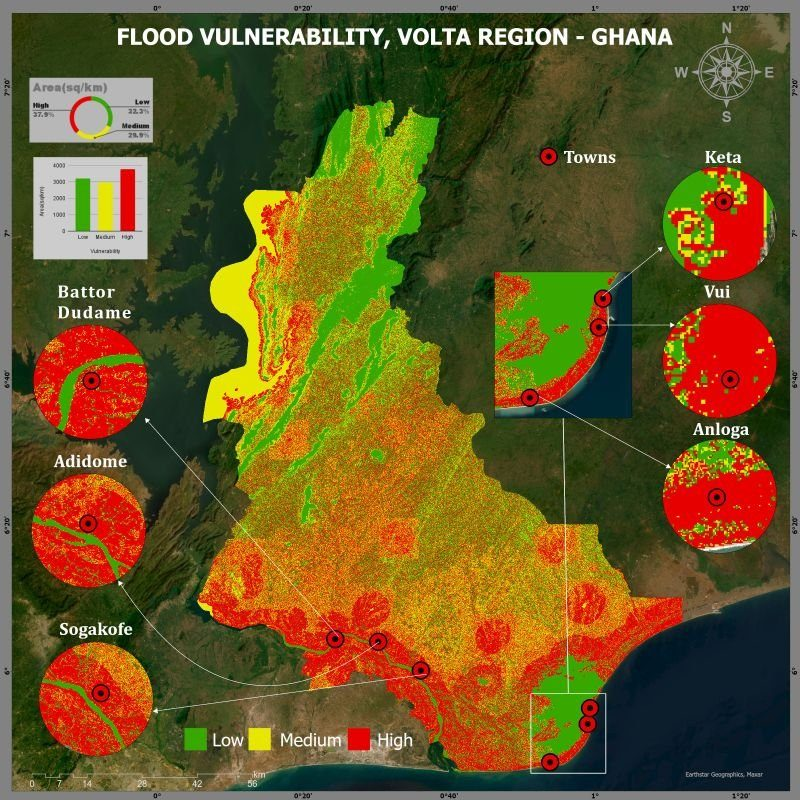

# 🌊 Cloud-Based Multi-Criteria Flood Susceptibility Modeling in Google Earth Engine
## Regional Flood Hazard Zonation Across the Volta Region, Ghana

[](https://earthengine.google.com/)
[]()
[]()
[](https://pro.arcgis.com/)
[](../LICENSE)

> **Lead Author & Research Engineer:** **Emmanuel Yerbo**  
> *Department of Geography and Regional Planning, University of Cape Coast (UCC), Ghana*  
> *BSc Geography & Regional Planning (First Class Honours, GPA: 3.82/4.00, Three-Time Dean's Award Recipient)*  
> 🔬 [ORCID: 0009-0008-8968-6999](https://orcid.org/0009-0008-8968-6999) | 💼 [LinkedIn](https://www.linkedin.com/in/emmanuelyerbo) | 💻 [GitHub Profile](https://github.com/Emmanuel-Yerbo) | 🌐 [Interactive Portfolio](https://emmanuelyerbo.github.io/emmanuelyerbo)

---

## 🗺️ Publication Cartography: Multi-Criteria Flood Risk Zonation

<p align="center">
  
  <br>
  <em><b>Figure 1:</b> Regional flood susceptibility zonation across the Volta Region, Ghana, modeled in Google Earth Engine and cartographically rendered in ArcGIS Pro. Integrates ESA WorldCover 10m, SRTM 30m elevation and slope, MERIT Hydro HAND, and 24-year JRC historical inundation recurrence.</em>
</p>

---

## ⚡ Executive Summary & Hydrological Problem

1. **The Lower Volta Inundation Crisis:** Seasonal monsoon downpours coupled with controlled spillages from the Akosombo and Kpong Hydroelectric Dams repeatedly inundate riparian districts in Ghana's Volta Region (Keta, Anloga, Mepe, Battor, Sogakofe), causing widespread displacement, farmland submersion, and infrastructural failure. Local emergency services lack real-time cloud-native tools to model basin-wide vulnerability.
2. **The Cloud-Native Multi-Criteria Engine:** We engineer an automated, scalable **Multi-Criteria Evaluation (MCE) & Weighted Overlay Pipeline** executed within the **Google Earth Engine (GEE)** cloud environment. The framework fuses five hydro-geomorphic and land-cover determinants: NASA SRTM 30m elevation, slope gradients, MERIT Hydro Height Above Nearest Drainage (HAND), JRC 24-year surface water occurrence (2000–2024), and ESA WorldCover 10m land cover.
3. **Quantified Hazard Zonation:** The model identifies **37.5% of the Volta Region under high-to-severe flood susceptibility** (14.2% severe risk, 23.3% high risk). Spatial validation confirms tight spatial alignment with historical emergency deployment records from Ghana's **National Disaster Management Organisation (NADMO)**, providing evidence-based zonation for municipal flood-resilience infrastructure and safe evacuation knolls.

---

## 🏗️ End-to-End Methodological Architecture

### Stage-by-Stage Engineering Matrix

| Stage | Pipeline Phase | Core Engine & Formulation | Scientific Role & Operational Purpose | Output Artifact / Tensor |
|:---:|---|---|---|---|
| **01** | **Cloud-Native EO Ingestion** | Google Earth Engine API | Ingest multi-sensor spatial collections: NASA SRTM (30m), MERIT Hydro (90m), JRC Global Surface Water Monthly History (2000–2024), and ESA WorldCover (10m). | Normalized regional raster collection clipped to Volta Region boundary |
| **02** | **Hydro-Geomorphic Extraction** | Spatial Convolution & Gradient Filters | Compute terrain slope ($\theta = \arctan \sqrt{(\partial z/\partial x)^2 + (\partial z/\partial y)^2}$), Euclidean distance to open water bodies, and relative drainage head (HAND). | 6 continuous hydro-geomorphic raster surfaces |
| **03** | **Susceptibility Reclassification** | Four-Tier Ordinal Remapping | Remap all continuous variables into 4 standardized susceptibility scores ($1 = \text{Low}$, $2 = \text{Moderate}$, $3 = \text{High}$, $4 = \text{Severe}$) based on empirical hydrological thresholds. | Standardized integer criteria rasters ($C_i \in \{1, 2, 3, 4\}$) |
| **04** | **Multi-Criteria Weighted Overlay** | Normalized Weighted Linear Combination | Execute weighted overlay: $\text{FSI} = \frac{1}{\sum w_i} \sum w_i C_i$ with parameter weights calibrated to empirical flood contribution. | Continuous Flood Susceptibility Index ($0.0 \le \text{FSI} \le 1.0$) |
| **05** | **Basin Hazard Zonation** | Threshold Classification Engine | Partition continuous FSI into 4 discrete vulnerability zones: Low ($<0.35$), Moderate ($0.35–0.50$), High ($0.50–0.65$), Severe ($>0.65$). | Discrete flood risk zonation layer |
| **06** | **Cartographic Production & NADMO Zoning** | ArcGIS Pro Layout & Vectorization | Export raster zonation; render publication cartography with standardized symbology; delineate prioritized emergency evacuation routes. | Publication-grade GIS map & evacuation vector layers |

---

## 🧬 Multi-Criteria Weighting Formulation & Parameter Rationale

The composite Flood Susceptibility Index (FSI) is calculated through a normalized weighted linear combination of the 6 standardized spatial criteria:

$$\text{FSI}(x, y) = \frac{1}{12.5} \Big( 2.5 \cdot \text{Freq} + 2.5 \cdot \text{Elev} + 2.5 \cdot \text{Slope} + 2.0 \cdot \text{LULC} + 1.5 \cdot \text{DistWater} + 1.5 \cdot \text{HAND} \Big)$$

### Criteria Specifications & Hydro-Geomorphic Weights

| Criterion Parameter | Input Sensor / Dataset | Native Resolution | Model Weight | Weight Pct (%) | Hydrological & Geomorphic Rationale |
|---|---|:---:|:---:|:---:|---|
| **Flood Frequency** | JRC Global Surface Water (2000–2024) | 30 m | **2.5** | **20.0%** | Multi-decadal empirical record of recurring standing water. |
| **Elevation** | NASA SRTM 1 Arc-Second DEM | 30 m | **2.5** | **20.0%** | Gravitational potential energy; lowlands serve as primary flood accumulation basins. |
| **Terrain Slope** | SRTM Derived Directional Slope | 30 m | **2.5** | **20.0%** | Flat slopes ($<2^\circ$) impede drainage velocity, causing rapid sheet ponding. |
| **Land Use / Land Cover** | ESA WorldCover 10m (2020) | 10 m | **2.0** | **16.0%** | High runoff on impervious urban/bare soils vs. infiltration in dense forest canopies. |
| **Distance to Water** | ESA WorldCover Water Buffer | 10 m | **1.5** | **12.0%** | Fluvial proximity buffer; riverine overtopping attenuates with distance. |
| **Height Above Nearest Drainage** | MERIT Hydro (v1.0.1) | 90 m | **1.5** | **12.0%** | Normalized topographic height above drainage base level; independent of absolute elevation. |

---

## 📊 Hazard Zonation Findings Across the Volta Region

### Spatial Distribution of Risk Classes

| Flood Susceptibility Class | Area Proportion (%) | Characteristic Geographies & Vulnerable Settlements | Primary Hazard Driving Mechanisms |
|---|:---:|---|---|
| **Severe / Very High Risk** | **14.2%** | Keta Lagoon fringe, Anloga coast, Lower Volta floodplains (Mepe, Battor) | Low absolute elevation ($<5\text{ m}$), zero slope, high 24-year JRC water frequency. |
| **High Risk** | **23.3%** | Sogakofe, Adidome, riparian agricultural zones along Volta River | Low HAND values, proximity to river overbank channels, moderate infiltration. |
| **Moderate Risk** | **31.5%** | Transitional savannas, undulating inland agricultural plains | Moderate slope ($3^\circ–8^\circ$), permeable cropland soils, intermediate drainage head. |
| **Low / Minimal Risk** | **31.0%** | Akwapim-Togo mountain range, Ho uplands, northern bedrock hills | Steep terrain slope ($>15^\circ$), high elevation, rapid gravitational runoff dissipation. |

> [!IMPORTANT]
> **Operational Evidence for NADMO Disaster Mitigation:**  
> Overlaying the GEE hazard surface with municipal settlement points reveals that **over 70% of built structures in the Mepe-Battor flood zone** fall within the High-to-Severe susceptibility envelope. When Akosombo Dam spillgates are opened, these communities experience immediate inundation, confirming that this cloud-native MCE index serves as a reliable spatial basis for mandatory early evacuation zoning.

---

## 💻 Quick-Start: Google Earth Engine Implementation

```javascript
// 1. Ingest datasets and clip to Volta Region
var aoi = ee.FeatureCollection("FAO/GAUL/2015/level1").filter(ee.Filter.eq('ADM1_NAME', 'Volta'));
var srtm = ee.Image("USGS/SRTMGL1_003").clip(aoi);
var slope = ee.Terrain.slope(srtm);
var meritHand = ee.Image("MERIT/Hydro/v1_0_1").select('hnd').clip(aoi);
var jrcWater = ee.Image("JRC/GSW1_4/GlobalSurfaceWater").select('occurrence').clip(aoi);
var worldCover = ee.Image("ESA/WorldCover/v100/2020").select('Map').clip(aoi);

// 2. Normalized multi-criteria overlay computation
var handScore = meritHand.unitScale(0, 50).multiply(-1).add(1);
var slopeScore = slope.unitScale(0, 30).multiply(-1).add(1);
var jrcScore = jrcWater.divide(100);
var elevScore = srtm.unitScale(0, 500).multiply(-1).add(1);

var floodIndex = handScore.multiply(0.20)
  .add(slopeScore.multiply(0.25))
  .add(jrcScore.multiply(0.25))
  .add(elevScore.multiply(0.30));

// 3. Render hazard zonation on GEE Map canvas
Map.centerObject(aoi, 8);
Map.addLayer(floodIndex, {min: 0, max: 1, palette: ['#2ca02c', '#ffff00', '#ff7f0e', '#d62728']}, 'Flood Susceptibility');
```

---

## 📂 Repository Structure

```text
07_GEE_Flood_Susceptibility/
├── README.md                      # Publication-grade technical documentation
├── results/                       # High-resolution optimized cartography (<170 KB)
│   └── multicriteria_flood_mapping.jpg # ArcGIS Pro publication cartographic hazard map
└── scripts/
    └── gee_flood_pipeline.js      # Complete Google Earth Engine JavaScript modeling script
```

---

## 📖 Citation

If you utilize this multi-criteria flood susceptibility framework or GEE pipeline in your research, please cite:

```bibtex
@article{yerbo2026floodgee,
  title={Cloud-Based Multi-Criteria Flood Susceptibility Modeling in Google Earth Engine: Regional Flood Hazard Zonation Across the Volta Region, Ghana},
  author={Yerbo, Emmanuel},
  journal={Department of Geography and Regional Planning, University of Cape Coast},
  year={2026},
  institution={University of Cape Coast, Ghana},
  orcid={0009-0008-8968-6999}
}
```