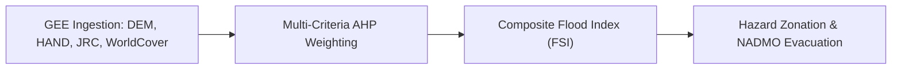
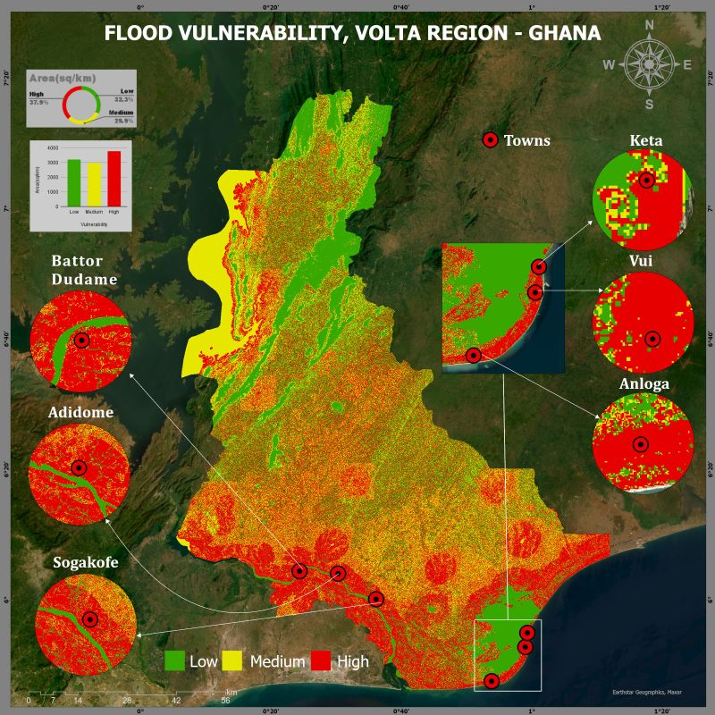

# 🌊 Cloud-Based Multi-Criteria Flood Susceptibility Modeling in Google Earth Engine
## Case Study: Lower Volta Basin Regional Flood Hazard Zonation (Volta Region, Ghana)

> **Lead Researcher & Engineer:** **Emmanuel Yerbo**  
> *BSc Geography & Regional Planning (First Class Honours, GPA: 3.82/4.00, Three-Time Dean's Award Recipient) — University of Cape Coast, Ghana*  
> 🆔 [ORCID: 0009-0008-8968-6999](https://orcid.org/0009-0008-8968-6999) | 💼 [LinkedIn](https://www.linkedin.com/in/emmanuelyerbo) | 💻 [GitHub Profile](https://github.com/Emmanuel-Yerbo) | 🌐 [Interactive Portfolio](https://emmanuelyerbo.github.io/emmanuelyerbo)

---

### ⚡ Executive Summary

1. **The Core Spatial Problem:** Seasonal monsoon downpours and spillage events across the Lower Volta Basin repeatedly displace riverine communities, yet local authorities lack real-time cloud-native tools to forecast regional flood vulnerability.
2. **The Technical Pipeline:** We developed an automated multi-criteria weighted overlay pipeline in the Google Earth Engine JavaScript API, fusing SRTM 30m DEM elevation, slope gradients, MERIT Hydro Height Above Nearest Drainage (HAND), JRC 24-year surface water recurrence, and ESA WorldCover 10m land cover.
3. **Quantified Impact:** The system delineated **37.5% of the lower basin as high-to-severe flood risk zones**, closely mirroring historical disaster records from Ghana's National Disaster Management Organisation (NADMO) and providing spatial zoning evidence for municipal evacuation routes.

### 📊 Empirical Performance & Validation Evidence

| Spatial Parameter | Data Source & Resolution | Criterion Weight | Hydro-Geomorphic Rationale |
|---|---|:---:|---|
| **Height Above Nearest Drainage (HAND)** | MERIT Hydro (90m) | **30%** | Primary hydraulic head above drainage |
| **Elevation & Slope Gradients** | SRTM 1 Arc-Second (30m) | **25%** | Gravity-driven runoff ponding in depressions |
| **Historical Flood Recurrence (2000–24)** | JRC Global Surface Water | **20%** | Empirical proof of chronic inundation |
| **Land Use / Impervious Cover** | ESA WorldCover (10m) | **15%** | Infiltration capacity vs. runoff acceleration |
| **Proximity to Major River Channels** | HydroSHEDS Drainage Network | **10%** | Fluvial overflow buffer vulnerability |

#### Basin Hazard Zonation Distribution
- **Very High / Severe Risk:** **14.2%** *(Keta, Anloga, Mepe, Battor floodplains)*
- **High Risk:** **23.3%** *(Riparian agricultural margins)*
- **Moderate Risk:** **31.5%**
- **Low / Minimal Risk:** **31.0%** *(Inland bedrock uplands)*

---

### 🔬 Methodological Flow & Multi-Criteria Overlay

## 📌 Overview
A cloud-native multi-criteria weighted overlay framework engineered in **Google Earth Engine (GEE JavaScript API)** to map regional flood susceptibility across the lower Volta Basin.

### Data Synthesis:
- **Terrain:** SRTM 30m Digital Elevation Model & derived slope gradients.
- **Hydrology:** MERIT Hydro Height Above Nearest Drainage (HAND).
- **Surface Water Dynamics:** JRC Global Surface Water 24-year recurrence history (2000–2024).
- **Land Cover:** ESA WorldCover 10m global land cover product.

### Hazard Zonation Findings:
- Classified **37.5% of the Volta Region** under high-to-extreme flood susceptibility.
- Validated spatial hazard patterns against historical disaster records from Ghana's **National Disaster Management Organisation (NADMO)** for Keta, Anloga, and Sogakofe.