# Spatial Autocorrelation, Land Cover Transitions & Surface Urban Heat Island (SUHI) Modeling
## Decadal Microclimatic Regimes, Getis-Ord Hotspots & Causal Radiative Forcing in Greater Accra, Ghana (2013–2023)

[](https://pysal.org/)
[](https://rasterio.readthedocs.io/)
[](https://geopandas.org/)
[](https://usgs.gov)
[](../LICENSE)

> **Lead Researcher & Author:** **Emmanuel Yerbo**  
> *BSc Geography & Regional Planning (First Class Honours, GPA: 3.82/4.00, Three-Time Dean's Award Recipient) — Department of Geography and Regional Planning, University of Cape Coast (UCC), Ghana*  
> 🆔 [ORCID: 0009-0008-8968-6999](https://orcid.org/0009-0008-8968-6999) | 💼 [LinkedIn](https://www.linkedin.com/in/emmanuelyerbo) | 💻 [GitHub Profile](https://github.com/Emmanuel-Yerbo) | 🌐 [Interactive Portfolio](https://emmanuelyerbo.github.io/emmanuelyerbo)

---

### ⚡ Executive Summary

1. **The Spatial Empirical Problem:** Rapid, uncontrolled metropolitan urbanization across the **Greater Accra Metropolitan Area (3,658.88 km²)** has triggered extensive ecological restructuring. Between 2013 and 2023, built-up infrastructure surged by **+696.03 km² (+80.12%)**, while vital vegetated cooling buffers contracted by **-575.92 km² (-34.25%)**, driving severe microclimatic warming and expanding dangerous surface urban heat islands.
2. **The Analytical & Econometric Pipeline:** Ingested sensor-harmonized, cloud-free multi-temporal **Landsat 8 OLI/TIRS Level-2 Surface Reflectance and Surface Temperature** products across three decadal intervals (2013-12-24, 2018-01-02, and 2023-01-11; Path 193 / Row 056). Radiometric calibration coupled the inverted Planck function with dynamic land-cover emissivity models. To eliminate pixel-level spatial dependency and variance deflation, the entire metropolitan territory was tessellated into a **standardized 500 m × 500 m regular vector mesh ($N = 12,819$ contiguous units)**. Spatial regimes were modeled using **PySAL** (Queen contiguity spatial weights, Anselin Global Moran's $I$, and Getis-Ord $G_i^*$ local hot/cold spot statistics). Causal biophysical thermal impacts across all 16 land cover transitions were isolated via a **quasi-experimental Difference-in-Differences (DiD)** econometric framework using persistent vegetation as the counterfactual baseline.
3. **Core Scientific Findings & Policy Impact:**
   - **Severe Thermal Clustering:** Global Moran's $I$ tightened monotonically from **$0.7367$** ($Z = 199.74$) in 2013 to **$0.8118$** ($Z = 220.08$) in 2018 and **$0.8272$** ($Z = 224.26$, $p < 0.0001$) in 2023, confirming extreme decadal spatial agglomeration of thermal stress.
   - **Hotspot Territorial Expansion:** Getis-Ord $G_i^*$ 99% confidence hotspots expanded to **824.14 km² (22.52% of the region)** by 2023, dominated by built-up surfaces (**40.96%**) and bareland (**42.61%**), with vegetated cover depleted to **16.36%**.
   - **Causal Conversion Penalty:** Difference-in-Differences causal estimation proved a net radiative warming penalty of **$\Delta LST_{DiD} = +1.503^\circ\text{C}$** ($95\%$ CI: $[+1.498, +1.508]^\circ\text{C}$, ANOVA $F = 3,468.39$, $p < 0.0001$) when vegetation is converted to built-up fabric. Conversely, urban greening (Built $\to$ Veg) delivered a causal cooling offset of **$-1.056^\circ\text{C}$**.
   - **Cooling Elasticity:** Spatial OLS regressions established that each **$+10\%$ increase in vegetative canopy yields an immediate $-0.276^\circ\text{C}$ reduction in thermal intensity** ($r = -0.4552$, $p < 0.0001$).
   - **Coastal-to-Inland Inversion:** Greater Accra deviates from classical monocentric heat island models: maritime air masses suppress coastal temperatures ($31.55^\circ\text{C} - 31.76^\circ\text{C}$ in the 0–3 km littoral zone despite 89.7%–98.3% building density), while inland sprawl corridors (14–17 km) register severe thermal hotspots reaching **$33.00^\circ\text{C} - 41.08^\circ\text{C}$**.

---

### 🗺️ Study Domain & Regional Setting

<p align="center">
  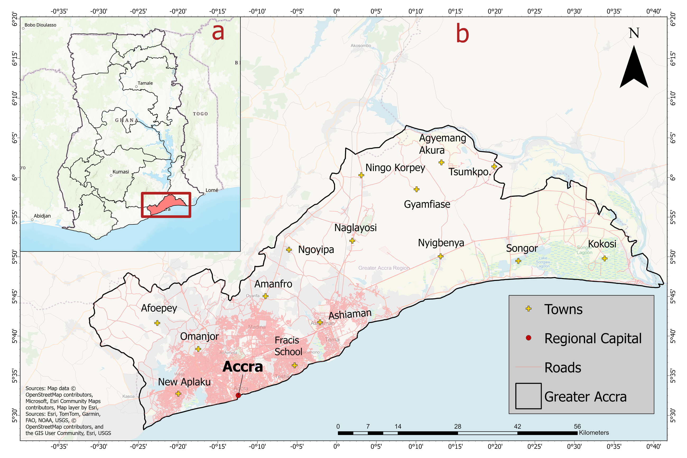
  <br>
  <em><b>Figure 1:</b> Geographic location and administrative domain of the Greater Accra Region along the Gulf of Guinea, Ghana: (a) national locator map, and (b) regional map showing road infrastructure, major settlement centers, coastal wetlands, and the regional capital (Footprint: 3,658.88 km²; Latitudes: 5.45°N–6.11°N, Longitudes: 0.55°W–0.35°E).</em>
</p>

The study footprint spans **3,658.88 km²**, organized along three distinct morphological and microclimatic zones extending from the Gulf of Guinea coastline to the interior Akwapim-Togo ranges:
- **Coastal Littoral Zone (0–5 km inland, 5.50°N–5.60°N):** Flat coastal plains (0–30 m ASL) housing historical commercial cores (Accra Central, Jamestown, Osu, Tema Port) and dynamic coastal lagoons (Korle, Chemu, Sakumono).
- **Intermediate Transition Corridor (5–15 km inland, 5.60°N–5.75°N):** Densely urbanized, rapidly expanding residential and mixed-use agglomerations (Achimota, Madina, Adenta, Spintex, Dome, Ashaiman).
- **Inland Peri-Urban & Agricultural Hinterland (15–35 km inland, 5.75°N–6.10°N):** Undulating piedmont plains (50–150 m ASL) rising toward the Akwapim-Togo ridge (>400 m ASL), exhibiting active speculative land conversion, unpaved residential layouts, and quarrying activities (Amasaman, Pokuase, Dodowa, Shai Hills).

---

### 🛰️ Remote Sensing Radiometry & Sensor Specifications

Multi-temporal satellite imagery was acquired from the **Landsat 8 Operational Land Imager (OLI)** and **Thermal Infrared Sensor (TIRS)** Level-2 products (Collection 2). To ensure seasonal and phenological consistency, all acquisitions were selected within the stable dry Harmattan window (December–January) under cloud-free conditions (< 5%).

#### Table 1: Sensor Specifications, Acquisition Geometry & Solar Calibration Metrics

| Parameter | Epoch 1 (2013) | Epoch 2 (2018) | Epoch 3 (2023) |
| :--- | :---: | :---: | :---: |
| Satellite Platform | Landsat 8 | Landsat 8 | Landsat 8 |
| Sensors | OLI / TIRS | OLI / TIRS | OLI / TIRS |
| Product Level | Collection 2, Level 2 (SR/ST) | Collection 2, Level 2 (SR/ST) | Collection 2, Level 2 (SR/ST) |
| WRS-2 Path / Row | 193 / 056 | 193 / 056 | 193 / 056 |
| Acquisition Date | 2013-12-24 | 2018-01-02 | 2023-01-11 |
| Local Overpass Time (UTC) | 10:14:32 | 10:14:55 | 10:15:18 |
| Solar Elevation Angle (°) | 49.82 | 48.91 | 49.34 |
| Solar Azimuth Angle (°) | 141.26 | 139.84 | 140.52 |
| Optical Spatial Resolution (m) | 30.0 | 30.0 | 30.0 |
| Thermal Band 10 Wavelength (μm) | 10.60–11.19 | 10.60–11.19 | 10.60–11.19 |
| Resampled Thermal Resolution (m) | 30.0 | 30.0 | 30.0 |
| Atmospheric Correction Model | LaSRC / MODIS Water Vapor | LaSRC / MODIS Water Vapor | LaSRC / MODIS Water Vapor |

---

### 🌲 Land Use and Land Cover (LULC) Classification & Accuracy Assessment

Land cover across Greater Accra was categorized into four mutually exclusive, structurally homogeneous classes using a **Random Forest (RF) ensemble classifier ($N_{trees} = 500$)** trained on multi-spectral surface reflectance bands (Bands 2–7) and standardized biophysical spectral indices (NDVI, NDBI, MNDWI).

#### Table 2: LULC Classification Scheme

| LULC Class | Code | Physical Surface Characteristics & Spectral Composition |
| :--- | :---: | :---: |
| **Built-Up** | 1 | Residential, commercial, industrial complexes, asphalt concrete, paved highways, and corrugated metal roof assemblages. |
| **Vegetation** | 2 | Natural dry coastal scrub, mangrove forest remnants, riparian riverine forests, cultivated agricultural croplands, and urban tree canopies. |
| **Water** | 3 | Marine littoral waters (Gulf of Guinea), coastal lagoons (Korle, Chemu, Sakumono), estuarine inlets, and inland reservoirs. |
| **Bareland** | 4 | Unpaved dirt roads, vacant construction parcels, open agricultural fallows, quarry excavation pits, and exposed sandy soils. |

<p align="center">
  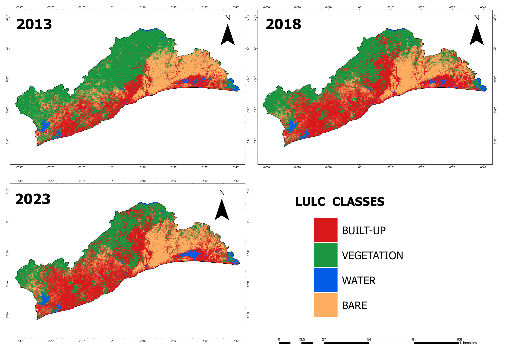
  <br>
  <em><b>Figure 2:</b> Spatiotemporal land use and land cover (LULC) classification across Greater Accra in 2013, 2018, and 2023, showing the decadal outward expansion of Built-Up surfaces and the contraction of Vegetated and Bareland covers.</em>
</p>

#### Table 3: Decadal LULC Composition, Net Change, Annual Rate & UEII

| LULC Class | 2013 (km²) (%) | 2018 (km²) (%) | 2023 (km²) (%) | Net Change 2013–2023 (km²) (%) | Annual Rate (%/yr) | UEII 2013–2023 |
| :--- | :---: | :---: | :---: | :---: | :---: | :---: |
| **Built-Up** | 868.77 (23.74%) | 1,472.91 (40.26%) | 1,564.80 (42.77%) | **+696.03 (+80.12%)** | **+6.06%** | **+1.902** |
| **Vegetation** | 1,681.34 (45.95%) | 1,253.82 (34.27%) | 1,105.42 (30.21%) | **-575.92 (-34.25%)** | **-4.11%** | **-1.574** |
| **Water** | 88.27 (2.41%) | 88.15 (2.41%) | 100.25 (2.74%) | **+11.98 (+13.57%)** | **+1.28%** | **+0.033** |
| **Bareland** | 1,020.49 (27.89%) | 843.99 (23.07%) | 888.40 (24.28%) | **-132.09 (-12.94%)** | **-1.38%** | **-0.361** |
| **Total** | 3,658.88 (100.0%) | 3,658.88 (100.0%) | 3,658.88 (100.0%) | 0.00 (0.00%) | — | — |

The **Urban Expansion Intensity Index (UEII)** quantitatively compares urbanization velocities:
$$\text{UEII} = \frac{A_{t2} - A_{t1}}{A_{total} \times \Delta t} \times 100$$
Built-up expansion was heavily front-loaded: adding $+604.14\text{ km}^2$ between 2013 and 2018 ($\text{UEII} = +3.302$), followed by $+91.89\text{ km}^2$ of infill consolidation between 2018 and 2023 ($\text{UEII} = +0.502$).

<p align="center">
  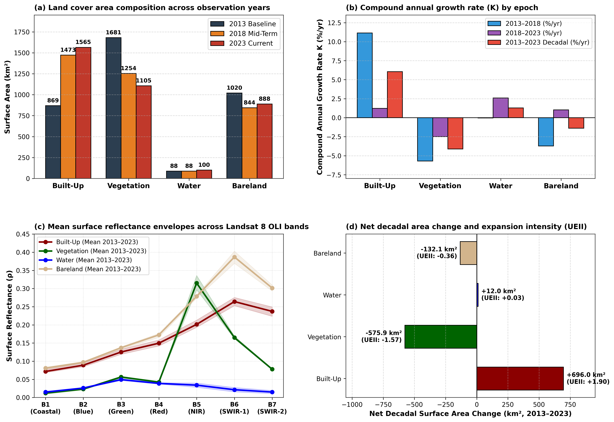
  <br>
  <em><b>Chart 1:</b> Spatiotemporal land use and land cover dynamics across Greater Accra (2013–2023): (a) tri-temporal area distribution (km² and %), (b) annualized conversion velocity (%/yr), (c) multi-epoch surface reflectance envelopes across Landsat 8 OLI Bands 1–7 (ρBlue to ρSWIR2) with ±1σ variance bounds, and (d) decadal net area shifts paired with UEII.</em>
</p>

#### Table 4: Area-Weighted Thematic Accuracy Assessment (Olofsson et al. / Pontius)

Independent validation using stratified random sampling ($N = 1,200$ reference points per epoch; $3,600$ total points) cross-referenced against sub-meter Google Earth imagery achieved high, statistically defensible accuracies:

| Epoch and Overall Metrics | Class | Sample $n_{i+}$ | Producer's Acc. (%) | User's Acc. (%) | $F_1$-Score (%) | SAM Angle (°) | Error-Adjusted Area (km²) |
| :--- | :---: | :---: | :---: | :---: | :---: | :---: | :---: |
| **2013** | Built-Up | 305 | 84.83 ± 1.96 | 87.87 ± 1.87 | 86.32 | 4.68° | 899.92 ± 51.51 |
| **OA = 89.48% ± 1.77%** | Vegetation | 518 | 94.33 ± 0.96 | 92.28 ± 1.17 | 93.29 | 31.26° | 1,644.84 ± 50.78 |
| **$\kappa = 0.8398$** | Water | 75 | 90.31 ± 5.05 | 98.67 ± 1.33 | 94.31 | 39.23° | 96.43 ± 10.83 |
| QD = 1.07%; AD = 9.45% | Bareland | 302 | 85.67 ± 1.75 | 85.43 ± 2.03 | 85.55 | 4.68° | 1,017.67 ± 57.13 |
| **2018** | Built-Up | 475 | 92.21 ± 1.20 | 90.95 ± 1.32 | 91.57 | 5.87° | 1,452.76 ± 52.96 |
| **OA = 90.50% ± 1.70%** | Vegetation | 408 | 93.29 ± 1.22 | 91.91 ± 1.35 | 92.59 | 32.85° | 1,235.36 ± 45.87 |
| **$\kappa = 0.8579$** | Water | 75 | 93.37 ± 4.37 | 98.67 ± 1.33 | 95.95 | 34.40° | 93.15 ± 8.86 |
| QD = 1.06%; AD = 8.44% | Bareland | 242 | 83.45 ± 1.99 | 86.78 ± 2.18 | 85.08 | 5.87° | 877.60 ± 54.19 |
| **2023** | Built-Up | 505 | 93.42 ± 1.09 | 91.88 ± 1.22 | 92.64 | 6.67° | 1,539.05 ± 51.33 |
| **OA = 91.50% ± 1.62%** | Vegetation | 360 | 93.02 ± 1.32 | 92.78 ± 1.37 | 92.90 | 34.21° | 1,102.58 ± 42.63 |
| **$\kappa = 0.8727$** | Water | 85 | 94.14 ± 3.90 | 98.82 ± 1.18 | 96.42 | 30.86° | 105.24 ± 8.86 |
| QD = 0.78%; AD = 7.72% | Bareland | 250 | 86.11 ± 1.84 | 88.40 ± 2.03 | 87.24 | 6.67° | 912.00 ± 51.79 |

Pontius error decomposition confirmed that **Quantity Disagreement (QD $\le 1.07\%$)** remained minimal across all epochs, proving that macro-scale area estimates are exceptionally robust. Uncertainty was confined to **Allocation Disagreement (AD = 7.72%–9.45%)** along complex peri-urban fringes where Spectral Angle Mapper (SAM) angles revealed close spectral affinity between dry lateritic soils and unpaved aggregate foundations (SAM = 4.68°–6.67°).

---

### 🌡️ Land Surface Temperature (LST) & Microclimatic Zonation

Radiative transfer retrieval derived brightness temperature from TIRS Band 10:
$$T_B = \frac{K_2}{\ln\left(\frac{K_1}{L_\lambda} + 1\right)}$$
$$LST = \frac{T_B}{1 + \left(\frac{\lambda T_B}{\rho}\right) \ln \epsilon}$$
where $\lambda = 10.895\,\mu\text{m}$, $\rho = 1.438 \times 10^{-2}\,\text{m}\cdot\text{K}$, and surface emissivity $\epsilon$ is dynamically coupled to the LULC classification: $\epsilon_{built} = 0.970$, $\epsilon_{veg} = 0.985$, $\epsilon_{water} = 0.990$, $\epsilon_{bare} = 0.965$.

<p align="center">
  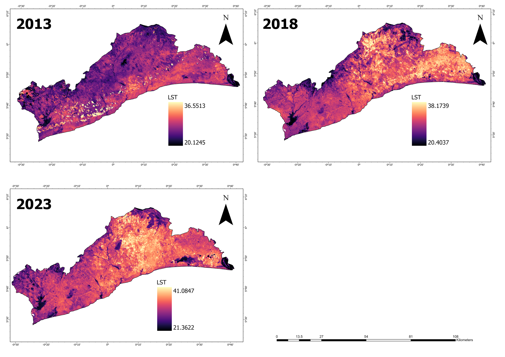
  <br>
  <em><b>Figure 3:</b> Multi-temporal calibrated Landsat Land Surface Temperature (LST, °C) distributions across Greater Accra for 2013 (20.12–36.55 °C), 2018 (20.40–38.17 °C), and 2023 (21.36–41.08 °C), rendered using the sequential Magma colormap.</em>
</p>

#### Table 5: Zonal LST Statistics, SUHII, UTFVI & Thermal Contribution Index (TCI / CR %)

| Year | LULC Class | Mean ± SD (°C) | Median (°C) | Range (°C) | SUHII (°C) | UTFVI | TCI (°C) (CR %) |
| :---: | :--- | :---: | :---: | :---: | :---: | :---: | :---: |
| **2013** | **Regional ROI** | 26.52 ± 1.81 | 26.46 | 20.12–36.55 | +0.91 | 0.0000 | 0.000 (0.00%) |
|  | Built-Up | 27.53 ± 1.62 | 27.37 | 21.92–36.55 | +1.92 | +0.0380 | +0.239 (+25.16%) |
|  | Vegetation | 25.61 ± 1.49 | 25.56 | 20.12–36.15 | 0.00 | -0.0343 | -0.417 (-43.93%) |
|  | Water | 24.13 ± 1.71 | 23.73 | 20.84–34.45 | -1.48 | -0.0901 | -0.058 (-6.07%) |
|  | Bareland | 27.37 ± 1.47 | 27.34 | 21.51–36.32 | +1.75 | +0.0319 | +0.236 (+24.85%) |
| **2018** | **Regional ROI** | 30.06 ± 1.94 | 30.11 | 20.40–38.17 | +0.90 | 0.0000 | 0.000 (0.00%) |
|  | Built-Up | 30.42 ± 1.37 | 30.26 | 21.84–37.07 | +1.25 | +0.0119 | +0.144 (+18.32%) |
|  | Vegetation | 29.17 ± 2.09 | 28.99 | 21.60–38.17 | 0.00 | -0.0298 | -0.307 (-39.07%) |
|  | Water | 26.50 ± 2.03 | 26.00 | 20.40–35.76 | -2.67 | -0.1185 | -0.086 (-10.92%) |
|  | Bareland | 31.14 ± 1.49 | 31.09 | 23.14–38.17 | +1.97 | +0.0359 | +0.249 (+31.68%) |
| **2023** | **Regional ROI** | 32.45 ± 2.27 | 32.63 | 21.36–41.08 | +1.31 | 0.0000 | 0.000 (0.00%) |
|  | Built-Up | 33.00 ± 1.72 | 32.80 | 21.36–41.08 | +1.86 | +0.0170 | +0.236 (+22.05%) |
|  | Vegetation | 31.14 ± 2.27 | 31.04 | 24.10–39.40 | 0.00 | -0.0404 | -0.396 (-36.94%) |
|  | Water | 27.34 ± 1.55 | 27.06 | 21.39–39.47 | -3.80 | -0.1574 | -0.140 (-13.06%) |
|  | Bareland | 33.68 ± 1.50 | 33.74 | 24.94–41.08 | +2.54 | +0.0380 | +0.300 (+27.95%) |

Surface Urban Heat Island Intensity ($\text{SUHII} = \text{LST}_{class} - \text{LST}_{veg}$) and the Urban Thermal Field Variance Index ($\text{UTFVI} = (\text{LST} - \text{LST}_{mean}) / \text{LST}$) prove that **bare laterite soils ($33.68^\circ\text{C}$, $\text{UTFVI} = +0.0380$)** and **built-up infrastructure ($33.00^\circ\text{C}$, $\text{UTFVI} = +0.0170$)** act as powerful regional heat sources. Natural vegetation ($\text{UTFVI} = -0.0404$) and water bodies ($\text{UTFVI} = -0.1574$) serve as critical microclimatic heat sinks.

<p align="center">
  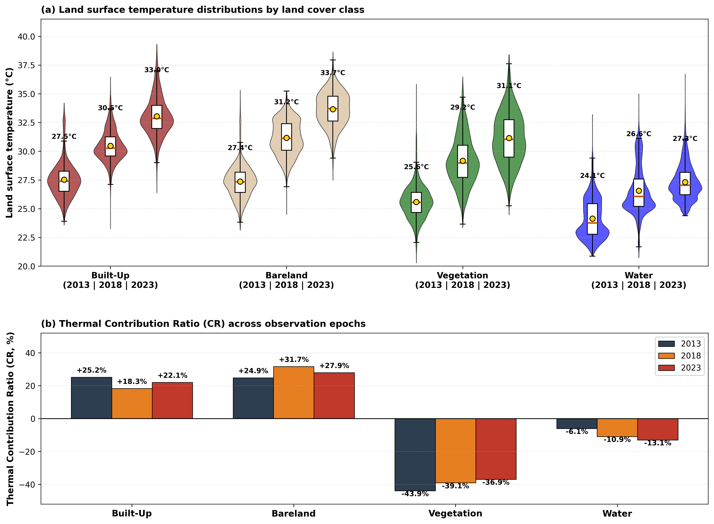
  <br>
  <em><b>Chart 2:</b> Zonal Land Surface Temperature distributions and thermal source-sink dynamics across Greater Accra (2013, 2018, and 2023): (a) zonal LST split violin plots and embedded interquartile boxplots across Built-Up, Bareland, Vegetation, and Water, and (b) signed Thermal Contribution Ratio (CR, %) isolating regional thermal heat sources from mitigating sinks.</em>
</p>

---

### 🌊 Coastal-to-Inland Microclimatic Inversion

Greater Accra exhibits a profound geographical departure from textbook monocentric urban heat island structures. Concentric radial transects extending from the shoreline (0 km) inland to the rural interior (25 km) reveal a **maritime thermal buffer inversion**:

<p align="center">
  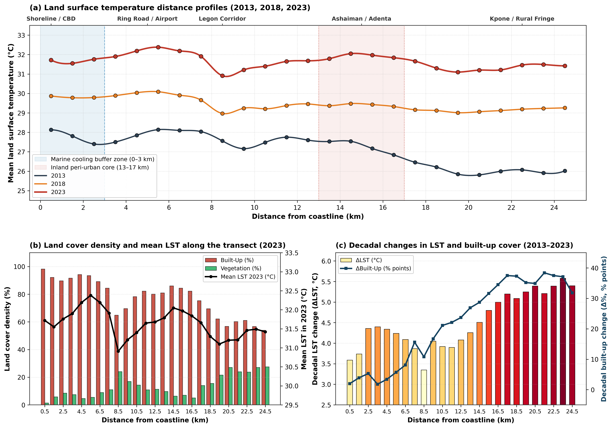
  <br>
  <em><b>Chart 6:</b> Coastal-to-inland urban gradient profiles across Greater Accra (2013–2023): (a) multi-epoch mean LST along concentric radial bands from the Gulf of Guinea shoreline (0 km) to the rural interior (25 km), (b) land cover density (%) and mean LST along the transect in 2023, and (c) decadal warming velocity (ΔLST) and built-up expansion (ΔBuilt-Up).</em>
</p>

- **0–3 km Coastal Littoral Zone:** Built-up density reaches **89.7%–98.3%**, yet ring mean LST is suppressed at **31.55°C–31.76°C** (1.24°C–1.45°C below the metropolitan Built-Up mean). Continuous maritime sea breezes and high latent heat fluxes dissipate sensible surface heating.
- **14–17 km Inland Sprawl Corridor:** Where built-up coverage expanded from 47.8% in 2013 to 86.1% in 2023, mean temperatures surged to **31.84°C–32.05°C**, with contiguous interior hotspot cells reaching **33.00°C–41.08°C**.

---

### 📐 Spatial Autocorrelation & Getis-Ord $G_i^*$ Hotspot Analytics

To evaluate spatial dependence rigorously without variance deflation, the study area was tessellated into **$N = 12,819$ contiguous 500 m × 500 m vector polygons**.

<p align="center">
  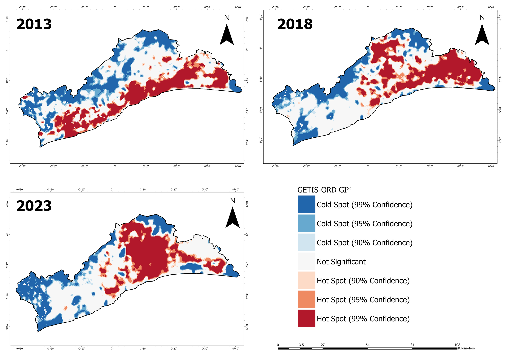
  <br>
  <em><b>Figure 4:</b> Spatial clustering and morphological evolution of local thermal regimes across Greater Accra based on Getis-Ord Gᵢ* statistics (N = 12,819 units) in 2013, 2018, and 2023, illustrating the outward migration and coalescence of severe 99% confidence urban heat island hotspots.</em>
</p>

#### Table 6: Global Moran's I & Getis-Ord $G_i^*$ Regimes ($N = 12,819$ Units)

| Year and Global Moran's I | $G_i^*$ Regime (Confidence Tier) | Units ($N$) | Area (km²) (%) | Built-Up (%) | Bareland (%) | Vegetation (%) | Water (%) |
| :--- | :--- | :---: | :---: | :---: | :---: | :---: | :---: |
| **2013** | **Cold Spot (99%)** | 2,478 | 693.94 (18.97%) | 2.42% | 5.49% | **85.83%** | 6.26% |
| $I = 0.7367$ | Cold Spot (95%) | 900 | 253.13 (6.92%) | 6.62% | 15.64% | 75.67% | 2.06% |
| $Z = 199.74$ | Cold Spot (90%) | 519 | 147.15 (4.02%) | 8.85% | 16.61% | 73.20% | 1.34% |
| $p < 0.0001$ | Not Significant | 4,971 | 1,432.64 (39.16%) | 22.00% | 28.37% | 47.55% | 2.09% |
| Expected: $-0.00008$ | Hot Spot (90%) | 400 | 113.99 (3.12%) | 36.21% | 48.46% | 14.36% | 0.97% |
|  | Hot Spot (95%) | 765 | 217.50 (5.94%) | 39.86% | 46.72% | 12.33% | 1.09% |
|  | **Hot Spot (99%)** | 2,786 | 800.52 (21.88%) | **47.34%** | **44.37%** | 7.76% | 0.53% |
| **2018** | **Cold Spot (99%)** | 2,328 | 645.37 (17.64%) | 16.23% | 5.70% | **69.24%** | 8.83% |
| $I = 0.8118$ | Cold Spot (95%) | 691 | 191.58 (5.24%) | 31.11% | 12.36% | 54.95% | 1.59% |
| $Z = 220.08$ | Cold Spot (90%) | 440 | 122.25 (3.34%) | 40.34% | 12.68% | 45.83% | 1.15% |
| $p < 0.0001$ | Not Significant | 5,316 | 1,530.46 (41.83%) | 53.91% | 19.76% | 24.99% | 1.34% |
| Expected: $-0.00008$ | Hot Spot (90%) | 439 | 126.53 (3.46%) | 47.26% | 29.38% | 22.68% | 0.67% |
|  | Hot Spot (95%) | 747 | 215.37 (5.89%) | 44.01% | 33.44% | 21.74% | 0.81% |
|  | **Hot Spot (99%)** | 2,858 | 827.32 (22.61%) | **33.77%** | **43.09%** | 22.71% | 0.43% |
| **2023** | **Cold Spot (99%)** | 2,505 | 687.94 (18.80%) | 17.04% | 7.29% | **64.01%** | 11.65% |
| $I = 0.8272$ | Cold Spot (95%) | 621 | 171.48 (4.69%) | 43.27% | 15.54% | 38.79% | 2.40% |
| $Z = 224.26$ | Cold Spot (90%) | 354 | 98.00 (2.68%) | 49.15% | 17.26% | 32.08% | 1.51% |
| $p < 0.0001$ | Not Significant | 5,260 | 1,521.99 (41.60%) | 55.85% | 20.83% | 22.43% | 0.88% |
| Expected: $-0.00008$ | Hot Spot (90%) | 407 | 117.19 (3.20%) | 39.67% | 34.88% | 25.35% | 0.10% |
|  | Hot Spot (95%) | 827 | 238.14 (6.51%) | 38.16% | 35.94% | 25.73% | 0.18% |
|  | **Hot Spot (99%)** | 2,845 | 824.14 (22.52%) | **40.96%** | **42.61%** | 16.36% | 0.07% |

Global Moran's $I$ expanded from $0.7367$ to $0.8272$ ($Z = 224.26, p < 0.0001$), confirming that thermal anomalies have transitioned into highly organized regional corridors. Getis-Ord $G_i^*$ 99% confidence hotspots cover **824.14 km²**, composed almost exclusively of built-up surfaces (40.96%) and bare laterite soil (42.61%).

<p align="center">
  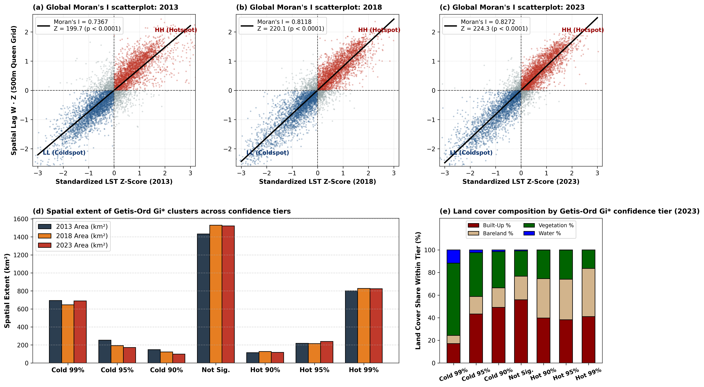
  <br>
  <em><b>Chart 3:</b> Spatial autocorrelation diagnostics and Getis-Ord Gᵢ* hotspot regime evolution across the 500 m × 500 m vector mesh (N = 12,819): (a, b, c) Anselin Global Moran's I standardized scatterplots for 2013, 2018, and 2023 with Queen spatial lag W·Z, (d) multi-temporal spatial extent evolution of Gᵢ* clusters across confidence tiers, and (e) land cover composition inside each Gᵢ* tier in 2023.</em>
</p>

---

### 🔄 Decadal Transition Matrix & Causal Difference-in-Differences (DiD)

<p align="center">
  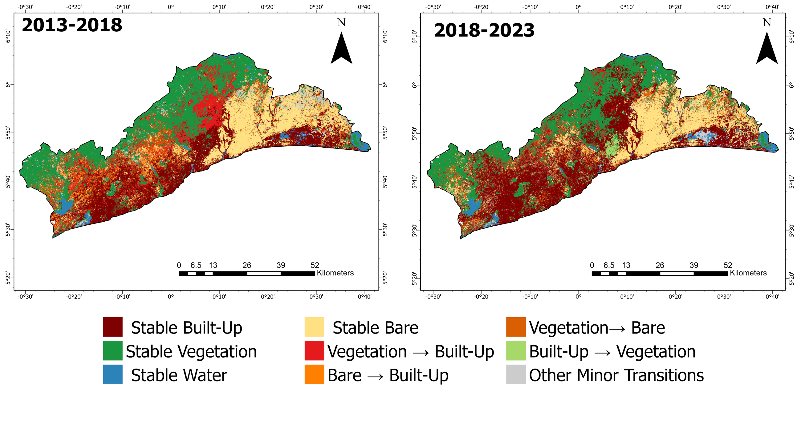
  <br>
  <em><b>Figure 5:</b> Decadal land use and land cover transition dynamics across Greater Accra: spatial distribution of major land conversion pathways for (a) 2013–2018 (rapid outward expansion) and (b) 2018–2023 (infill consolidation).</em>
</p>

#### Table 7: Decadal Post-Classification Transition Matrix (2013–2023, km²)

| 2013 Class | Built-Up 2023 | Vegetation 2023 | Water 2023 | Bareland 2023 | Total 2013 | Class Loss |
| :--- | :---: | :---: | :---: | :---: | :---: | :---: |
| **Built-Up** | **715.85** | 69.00 | 21.77 | 62.16 | 868.77 | 152.93 |
| **Vegetation** | **564.76** | **954.25** | 6.06 | 156.28 | 1,681.34 | **727.09** |
| **Water** | 11.28 | 4.43 | **71.94** | 0.61 | 88.27 | 16.33 |
| **Bareland** | **272.92** | 77.74 | 0.48 | **669.36** | 1,020.49 | 351.13 |
| **Total 2023** | **1,564.80** | **1,105.42** | **100.25** | **888.40** | **3,658.88** | — |
| **Class Gain** | **848.96** | 151.17 | 28.31 | 219.04 | — | — |

Persistent vegetation (Code 22: $954.25\text{ km}^2$) experienced a regional background inter-annual warming of $+5.64^\circ\text{C}$ (from $25.35^\circ\text{C}$ to $30.98^\circ\text{C}$). Using this persistent cohort as a **quasi-experimental counterfactual control group**, we isolate the true **Difference-in-Differences (DiD) net radiative forcing**:
$$\Delta LST_{DiD} = (LST_{2023, k} - LST_{2013, k}) - (LST_{2023, veg} - LST_{2013, veg})$$

#### Table 8: Biophysical Thermal Impact & Difference-in-Differences (DiD) Net Forcing

| Code | Transition Pathway | Area (km²) (%) | Mean LST 2013 → 2023 (°C) | Raw ΔLST (°C) | Net ΔUHI (°C) | ΔLST DiD [95% CI] (°C) | Hotspot Share 2013 → 2023 (%) (Δ pp) |
| :---: | :--- | :---: | :---: | :---: | :---: | :---: | :---: |
| **22** | Vegetation → Vegetation (Control) | 954.25 (26.08%) | 25.35 → 30.98 | +5.64 | -0.289 | **+0.000 [-0.004, +0.004]** | 4.77% → 19.16% (+14.39 pp) |
| **11** | Built-Up → Built-Up | 715.85 (19.56%) | 27.54 → 32.90 | +5.36 | -0.568 | -0.280 [-0.284, -0.276] | 59.59% → 25.17% (-34.42 pp) |
| **44** | Bareland → Bareland | 669.36 (18.29%) | 27.44 → 33.97 | +6.53 | +0.606 | **+0.895 [+0.891, +0.899]** | 56.54% → 62.07% (+5.53 pp) |
| **21** | **Vegetation → Built-Up** | **564.76 (15.44%)** | 26.07 → 33.21 | **+7.14** | **+1.214** | **+1.503 [+1.497, +1.508]** | **9.38% → 39.45% (+30.07 pp)** |
| **41** | Bareland → Built-Up | 272.92 (7.46%) | 27.27 → 32.89 | +5.62 | -0.305 | -0.016 [-0.024, -0.008] | 39.50% → 25.38% (-14.12 pp) |
| **24** | Vegetation → Bareland | 156.28 (4.27%) | 25.64 → 32.61 | +6.97 | +1.042 | **+1.330 [+1.321, +1.339]** | 4.13% → 24.42% (+20.29 pp) |
| **42** | Bareland → Vegetation | 77.74 (2.12%) | 27.15 → 31.95 | +4.80 | -1.124 | **-0.835 [-0.849, -0.821]** | 32.55% → 15.43% (-17.12 pp) |
| **33** | Water → Water | 71.94 (1.97%) | 23.85 → 26.99 | +3.14 | -2.783 | -2.494 [-2.503, -2.486] | 6.40% → 0.59% (-5.80 pp) |
| **12** | **Built-Up → Vegetation** | **69.00 (1.89%)** | 27.95 → 32.53 | **+4.58** | **-1.345** | **-1.056 [-1.072, -1.040]** | **68.95% → 44.33% (-24.62 pp)** |
| **14** | Built-Up → Bareland | 62.16 (1.70%) | 27.18 → 33.31 | +6.13 | +0.202 | +0.490 [+0.476, +0.503] | 46.79% → 38.34% (-8.46 pp) |
| **13** | Built-Up → Water | 21.77 (0.60%) | 26.75 → 28.33 | +1.59 | -4.336 | -4.047 [-4.066, -4.028] | 17.17% → 1.04% (-16.13 pp) |
| **31** | Water → Built-Up | 11.28 (0.31%) | 25.67 → 31.81 | +6.14 | +0.216 | +0.504 [+0.471, +0.537] | 20.84% → 24.55% (+3.71 pp) |
| **23** | Vegetation → Water | 6.06 (0.17%) | 25.02 → 27.75 | +2.74 | -3.187 | -2.898 [-2.940, -2.856] | 6.40% → 4.23% (-2.17 pp) |
| **32** | Water → Vegetation | 4.43 (0.12%) | 24.67 → 28.66 | +3.99 | -1.938 | -1.649 [-1.696, -1.602] | 15.87% → 10.24% (-5.63 pp) |
| **34** | Water → Bareland | 0.61 (0.02%) | 24.85 → 32.47 | +7.62 | +1.695 | +1.984 [+1.858, +2.110] | 11.47% → 25.44% (+13.97 pp) |
| **43** | Bareland → Water | 0.48 (0.01%) | 27.90 → 28.79 | +0.89 | -5.035 | -4.747 [-4.946, -4.548] | 79.36% → 36.40% (-42.96 pp) |

One-Way ANOVA across all 16 transition pathways confirmed statistically significant thermal divergence ($F = 3,468.39, p < 0.0001$; Kruskal-Wallis $H = 32,020.89, p < 0.0001$). Converting natural vegetation to built-up surfaces creates a net causal warming penalty of **$+1.503^\circ\text{C}$** and drives a **$+30.07\text{ percentage point}$ surge** into severe 99% Getis-Ord hotspots.

<p align="center">
  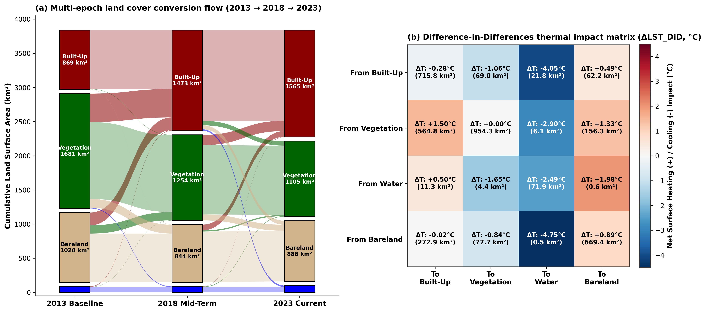
  <br>
  <em><b>Chart 4:</b> Land cover transition flows and biophysical thermal attribution across Greater Accra (2013–2023): (a) multi-epoch Alluvial Sankey flow diagram tracing conversion volumes (2013 → 2018 → 2023), and (b) 4 × 4 transition matrix heatmap reporting net biophysical DiD radiative forcing (ΔLST(DiD), °C) alongside conversion land areas (km²).</em>
</p>

---

### 📉 Spatial Elasticity Regression Models

<p align="center">
  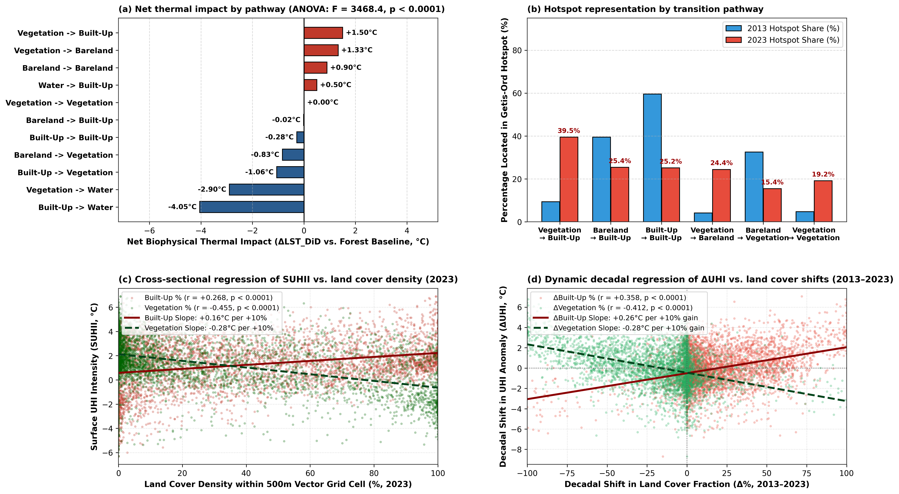
  <br>
  <em><b>Chart 5:</b> Biophysical thermal impact, extreme hotspot displacement, and spatial elasticity regression models across Greater Accra (2013–2023): (a) diverging forest plot of net biophysical heating versus cooling across all 16 transition pathways with One-Way ANOVA (F = 3,468.39, p < 0.0001), (b) transition pathway impact on extreme 99% Getis-Ord hotspot share, (c) cross-sectional bivariate spatial regression of Built-Up and Vegetation shares versus SUHII in 2023, and (d) dynamic decadal elasticity regressions of ΔBuilt-Up and ΔVegetation versus ΔUHI.</em>
</p>

#### Table 9: Cross-Sectional & Decadal Spatial Regression Elasticity Models ($N = 12,819$)

| Model Specification | Pearson $r$ | $R^2$ | Effect per +10% Shift (°C) | $t$-Statistic | $p$-Value |
| :--- | :---: | :---: | :---: | :---: | :---: |
| 2013 Cross-Section: Built-Up % vs. SUHII (°C) | +0.4663 | 0.2175 | +0.228°C | +59.68 | < 0.0001 |
| 2013 Cross-Section: Vegetation % vs. SUHII (°C) | -0.6029 | 0.3635 | -0.226°C | -85.56 | < 0.0001 |
| 2018 Cross-Section: Built-Up % vs. SUHII (°C) | +0.1846 | 0.0341 | +0.091°C | +21.26 | < 0.0001 |
| 2018 Cross-Section: Vegetation % vs. SUHII (°C) | -0.4000 | 0.1600 | -0.188°C | -49.41 | < 0.0001 |
| **2023 Cross-Section: Built-Up % vs. SUHII (°C)** | **+0.2680** | **0.0718** | **+0.164°C** | **+31.50** | **< 0.0001** |
| **2023 Cross-Section: Bareland % vs. SUHII (°C)** | **+0.3975** | **0.1580** | **+0.267°C** | **+49.04** | **< 0.0001** |
| **2023 Cross-Section: Vegetation % vs. SUHII (°C)** | **-0.4552** | **0.2072** | **-0.276°C** | **-57.88** | **< 0.0001** |
| **Decadal Change (2013–2023): ΔBuilt-Up % vs. ΔUHI (°C)** | **+0.3584** | **0.1285** | **+0.255°C** | **+43.47** | **< 0.0001** |
| **Decadal Change (2013–2023): ΔVegetation % vs. ΔUHI (°C)** | **-0.4119** | **0.1696** | **-0.279°C** | **-51.17** | **< 0.0001** |
| **Decadal Change (2013–2023): ΔBareland % vs. ΔUHI (°C)** | **+0.1816** | **0.0330** | **+0.196°C** | **+20.90** | **< 0.0001** |

---

### 💻 Repository Structure & Reproducibility Pipeline

```
08_PySAL_LST_Hotspots/
├── data/
│   ├── table1_landsat_specifications.csv          # Landsat 8 OLI/TIRS orbital geometry & calibration
│   ├── table2_lulc_classification_scheme.csv       # 4-class LULC scheme and physical descriptions
│   ├── table3_lulc_decadal_dynamics.csv            # Decadal composition, net change & UEII
│   ├── table4_thematic_accuracy_assessment.csv     # Area-weighted OA, PA, UA, kappa, QD, AD
│   ├── table5_zonal_lst_and_suhii.csv              # Zonal LST, SUHII, UTFVI, TCI and CR %
│   ├── table6_morans_i_getis_ord_regimes.csv       # Global Moran's I & Getis-Ord regimes (N = 12,819)
│   ├── table7_decadal_transition_matrix.csv        # 4x4 decadal post-classification transition matrix
│   ├── table8_did_net_radiative_forcing.csv        # Causal DiD net forcing across 16 pathways
│   ├── table9_spatial_elasticity_regression.csv    # Cross-sectional and decadal OLS elasticity models
│   └── thesis_empirical_tables_2013_2023.xlsx      # Master workbook with all 9 empirical tables
├── results/
│   ├── fig1_greater_accra_study_area.png           # Figure 1: Geographic setting & road network
│   ├── fig2_spatiotemporal_lulc_2013_2023.png      # Figure 2: Tri-temporal LULC maps (2013, 2018, 2023)
│   ├── chart1_lulc_dynamics_reflectance_ueii.png   # Chart 1: LULC dynamics & surface reflectance profiles
│   ├── fig3_calibrated_lst_distributions_magma.png # Figure 3: Landsat calibrated LST maps (Magma)
│   ├── chart2_zonal_lst_violins_thermal_contribution.png # Chart 2: Zonal LST violins & source-sink CR %
│   ├── chart6_coastal_inland_urban_gradient.png    # Chart 6: 0-25 km coastal-to-inland transects
│   ├── fig4_getis_ord_hotspots_2013_2023.png       # Figure 4: Getis-Ord Gi* hot spot maps (N = 12,819)
│   ├── chart3_moran_scatterplots_hotspot_evolution.png # Chart 3: Moran's I scatterplots & Gi* regimes
│   ├── fig5_decadal_transition_pathways_map.png    # Figure 5: Spatial distribution of conversion pathways
│   ├── chart4_alluvial_sankey_did_matrix_heatmap.png # Chart 4: Alluvial Sankey flow & DiD matrix heatmap
│   └── chart5_did_forest_plot_cooling_elasticity.png # Chart 5: DiD diverging forest plot & elasticity
├── scripts/
│   └── pysal_hotspot_pipeline.py                   # Production Python pipeline replicating all models
└── README.md                                       # Comprehensive research documentation
```

#### Running the Verification Pipeline

To execute the spatial and econometric verification pipeline reproducing all statistics:

```bash
cd 08_PySAL_LST_Hotspots
python scripts/pysal_hotspot_pipeline.py
```

---

### 📚 Academic Citation & Attribution

If you utilize this dataset, methodology, or code in your academic work, please cite:

```bibtex
@thesis{Yerbo2023LSTHotspots,
  author       = {Yerbo, Emmanuel},
  title        = {Exploring Land Cover Transitions and the Spatio-Temporal Distribution of Urban Heat Island in Accra Metropolis (2013--2023)},
  school       = {University of Cape Coast},
  department   = {Department of Geography and Regional Planning},
  year         = {2023},
  address      = {Cape Coast, Ghana},
  note         = {Undergraduate Honors Thesis, First Class Honours}
}
```
