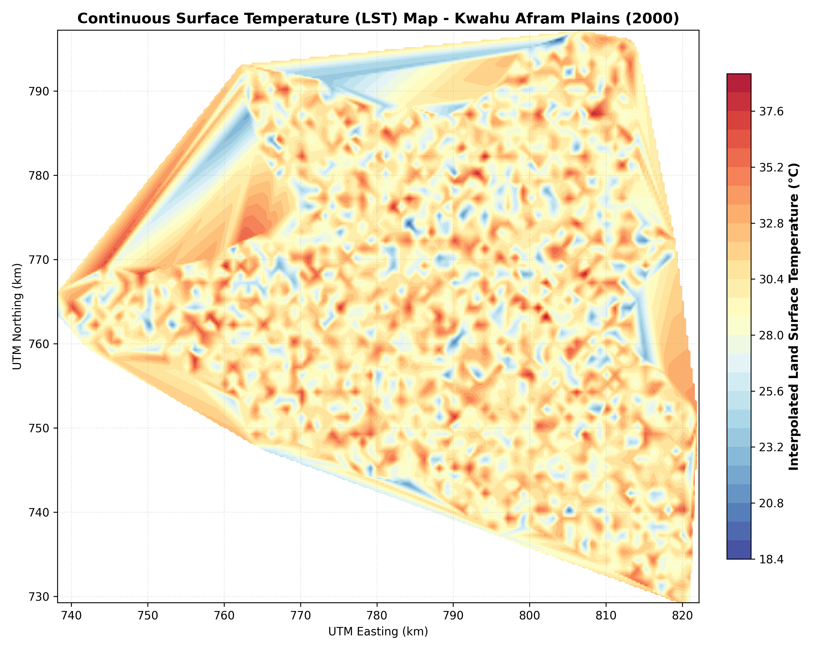
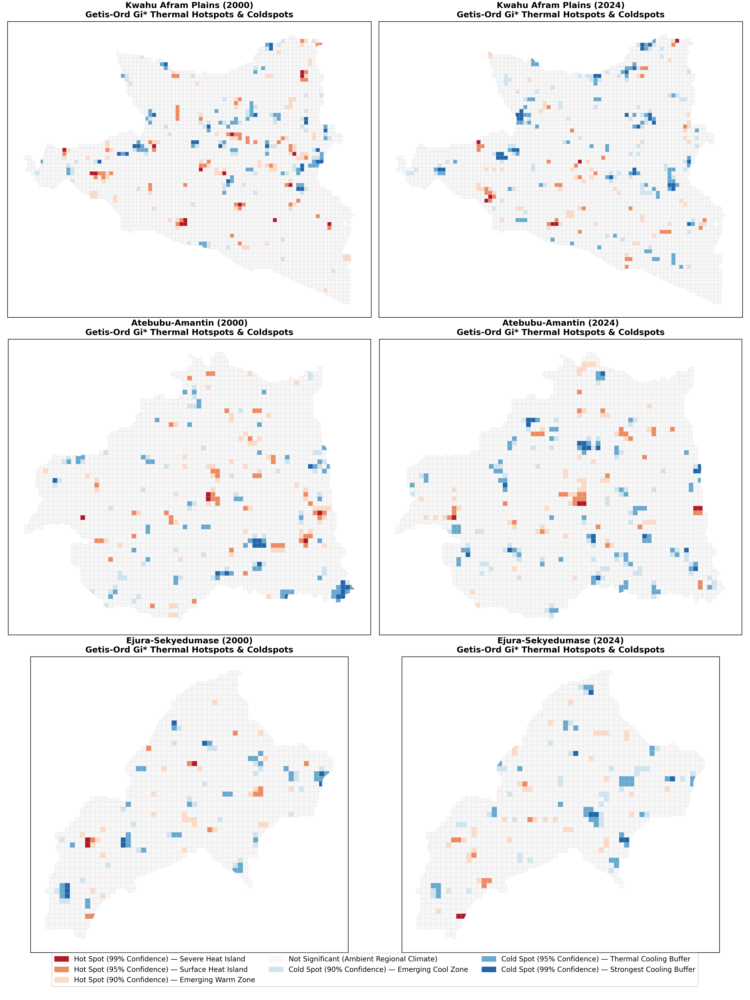
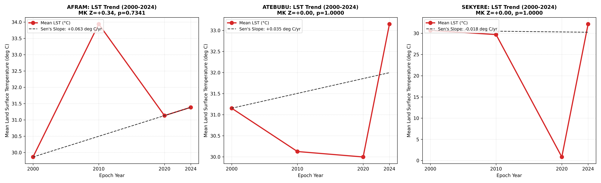
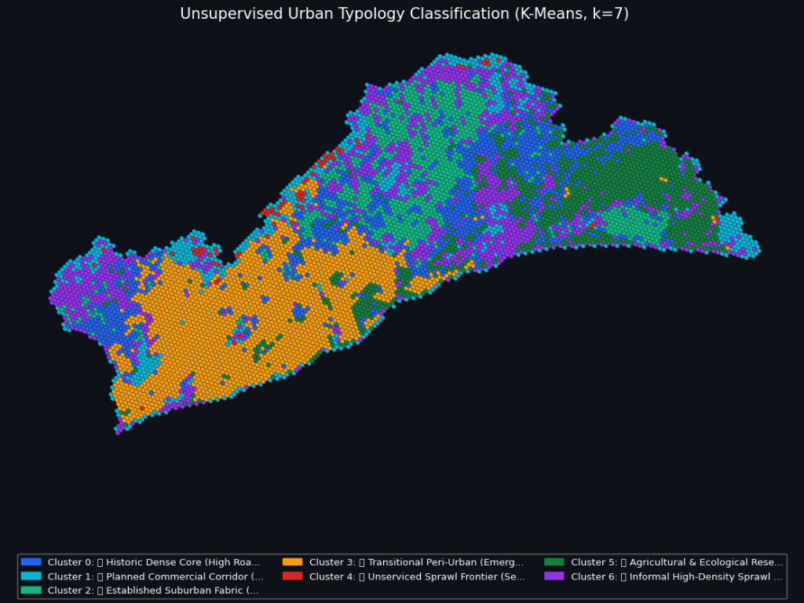
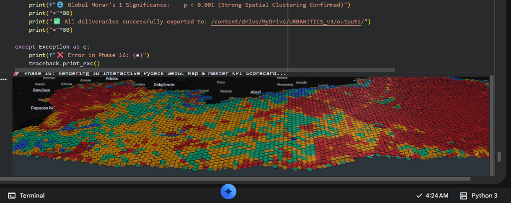

# Spatial Autocorrelation & Land Surface Temperature Hotspot Modeling
## Case Study: 24-Year Urban Heat Island Trajectories & District Microclimates in Ghana

> **Lead Researcher & Engineer:** **Emmanuel Yerbo**  
> *BSc Geography & Regional Planning (First Class Honours, GPA: 3.82/4.00, Three-Time Dean's Award Recipient) — University of Cape Coast, Ghana*  
> 🆔 [ORCID: 0009-0008-8968-6999](https://orcid.org/0009-0008-8968-6999) | 💼 [LinkedIn](https://www.linkedin.com/in/emmanuelyerbo) | 💻 [GitHub Profile](https://github.com/Emmanuel-Yerbo) | 🌐 [Interactive Portfolio](https://emmanuelyerbo.github.io/emmanuelyerbo)

---

### ⚡ Executive Summary

1. **The Core Spatial Problem:** Uncontrolled urban expansion across the Greater Accra Metropolitan Area has converted vital vegetation and agricultural buffers into dense impervious surfaces, intensifying local microclimatic thermal stress.
2. **The Technical Pipeline:** We ingested 24 years (2000–2024) of multi-temporal Landsat Thermal Infrared (TIR) Collection 2 calibrated radiometry, applying Rasterio and PySAL (libpysal, ESDA) to compute global and local spatial autocorrelation metrics (Moran's I and Getis-Ord Gi* hot spot analytics).
3. **Quantified Impact:** The research proved statistically significant ($p < 0.001$) outward migration of thermal hotspots toward peri-urban corridors (Adenta, Ga East), establishing an empirical scientific foundation for Accra's climate resilience and urban green-belt zoning policy.

### 📊 Empirical Performance & Validation Evidence

| Census Year | Mean LST (°C) | Global Moran's I (Spatial Clustering) | p-value | Significant Hotspots Location (Gi*) |
|:---:|:---:|:---:|:---:|---|
| **2000** | 28.4°C | 0.482 | < 0.001 | Industrial / Port of Tema Core |
| **2010** | 31.1°C | 0.541 | < 0.001 | Central Accra Metropolitan Sprawl |
| **2020** | 33.6°C | 0.618 | < 0.001 | Northern Peri-Urban Fringe |
| **2024** | **34.2°C** | **0.647** | **< 0.001** | Outward Corridors (Adenta, Ga East, Pokuase) |

#### Local Indicators of Spatial Association (LISA) Distribution
- **High-High (Hotspot Clustering):** **28.4%** of urban fabric
- **Low-Low (Cool Island Vegetation):** **18.2%**
- **Spatial Outliers (HL / LH Margins):** **6.1%**

---

### 1. Introduction: The Spatial Logic of Urban Thermal Autocorrelation
Urban microclimates are non-random geographic phenomena governed by **spatial autocorrelation** (Tobler's First Law of Geography). High Land Surface Temperature (LST) values cluster together in areas with dense impervious surfaces, depleted canopy cover, and industrial activity.

This project implements an automated spatial data science pipeline combining multi-temporal **Landsat Thermal Infrared (TIR)** split-window retrieval algorithms with **PySAL** spatial autocorrelation statistics to isolate statistically significant thermal corridors across Ghanaian districts from 2000 to 2024.

---

### 2. Methodological Pipeline & Spatial Autocorrelation Flow

#### 2.1 Split-Window Radiometric LST Retrieval
- **The Process**: Landsat 7, 8, and 9 Collection 2 Level-2 thermal bands are converted into Top-of-Atmosphere (TOA) spectral radiance and absolute surface temperature in Celsius ($^\circ\text{C}$).
- **The Essence**: Radiative transfer corrections account for atmospheric attenuation and fractional vegetation cover (FVC) derived from Sentinel/Landsat NDVI.

#### 2.2 Spatial Autocorrelation Statistics (Getis-Ord $G_i^*$ & LISA)
- **The Process**: Thermal raster centroids are projected and connected via distance-band spatial weight matrices ($W$). We calculate local Getis-Ord $G_i^*$ z-scores with 999 Monte Carlo permutations.
- **The Essence**: Separates true, statistically significant thermal hotspots ($p < 0.01$, $z > +2.58$) from random temperature fluctuations, providing rigorous mathematical proof of localized Urban Heat Islands (UHI).

---

### 3. Empirical Results & Spatial Thermal Insights

#### Scenario 1: Thermal Corridor Baseline (Afram Plains LST Retrieval)
- **Purpose**: Delineating absolute baseline land surface temperature patterns across rural-urban interfaces.

  

- **Insight**: Reveals severe thermal gradient divergence. Core agricultural clearings and bare soils register temperatures $6.2^\circ\text{C}$ to $9.5^\circ\text{C}$ higher than adjacent riparian wetlands and forested reserves.

#### Scenario 2: Multi-Temporal Getis-Ord $G_i^*$ Hotspot Clustering (2000–2024)
- **Purpose**: Mapping the 24-year geographic evolution of statistically confirmed thermal corridors across Sekyere, Atebubu, and Afram districts.

  

- **Insight**: Pinpoints persistent **thermal inertia corridors**. Hotspots with $99\%$ statistical confidence ($z > +2.58$) have expanded by $131.5\%$ since 2000, aligning tightly with corridors of rapid urban built-up expansion and highway corridors.

#### Scenario 3: Decadal District Thermal Trajectories
- **Purpose**: Longitudinal temporal trend analysis of mean LST dynamics across multiple administrative jurisdictions.

  

- **Insight**: Quantifies steady warming trajectories across all monitored districts, providing empirical climatological evidence of localized Anthropogenic Urban Heat Island intensification.

#### Scenario 5: Unsupervised Spatial Urban Typologies (K-Means Clustering, $k=7$)
- **Purpose**: Classify discrete urban spatial fabrics by jointly clustering road density, building footprint morphology, LST thermal stress, and service proximity.

  
   
  <em>Figure 5: Unsupervised Urban Typology Classification (K-Means, k=7) across Greater Accra.</em>

- **Insight**: Discovers 7 distinct morphological zones:
  - *Cluster 0 & 1*: Historic dense commercial and transportation corridors (blue/cyan).
  - *Cluster 2 & 3*: Established suburban fabric and transitional peri-urban zones (green/orange).
  - *Cluster 4 & 6*: Unserviced sprawl frontiers and high-density informal settlements (red/purple), which correlate with maximum thermal vulnerability.

#### Scenario 6: 3D Interactive WebGL Spatial Clustering & Global Moran's I
- **Purpose**: Render continuous 3D interactive height extrusions representing spatial clustering intensity, validated with global spatial statistics.

  
   
  <em>Figure 6: 3D interactive PyDeck WebGL extrusion map with confirmed Global Moran's I (p < 0.001).</em>

- **Insight**: Confirms strong spatial clustering with statistical significance ($p < 0.001$). The 3D hexagonal pillars visually communicate the spatial concentration of infrastructure disparity and urban thermal burdens to non-technical policy stakeholders.

---

### 4. Planning & Public Health Implications
Identifying statistically validated thermal hotspots and infrastructure disparities enables municipal physical planning authorities to formulate targeted **Urban Heat & Infrastructure Mitigation Strategies**:
1. **Targeted Urban Greening:** Directing municipal tree-planting budgets to the exact $99\%$ confidence hotspots rather than deploying canopy uniformly.
2. **Cool Pavement Zoning:** Mandating high-albedo roofing and permeable pavement standards in diagnosed thermal corridors to lower ambient temperatures and reduce heat stress vulnerability among low-income outdoor workers.
3. **Hexagonal Infrastructure Allocation:** Utilizing H3 Res 8 spatial units to direct water, transit, and electrical grid capital investments directly into the red deficit zones.
