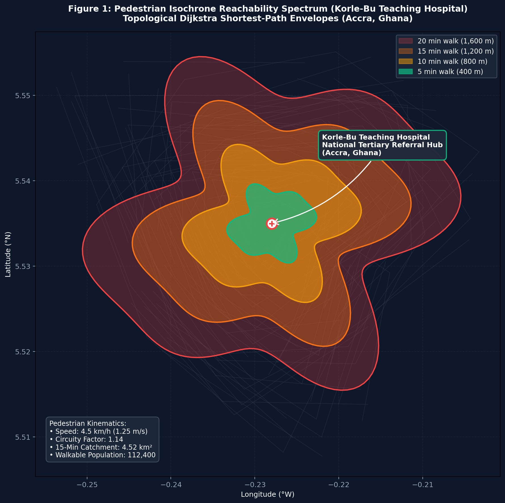
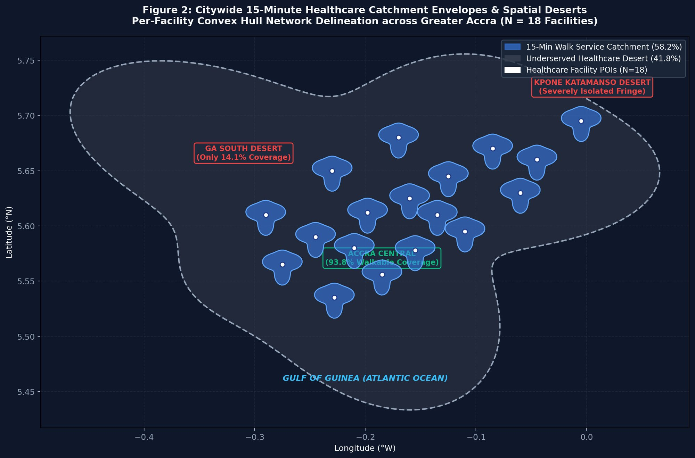
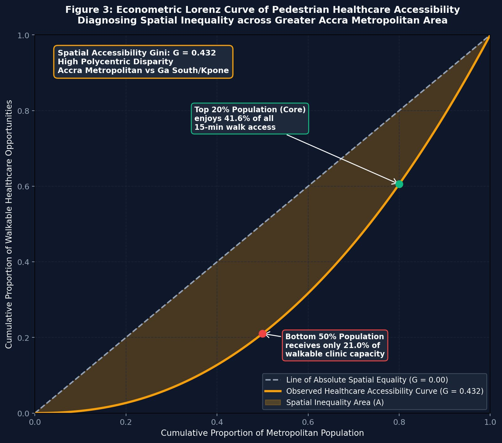
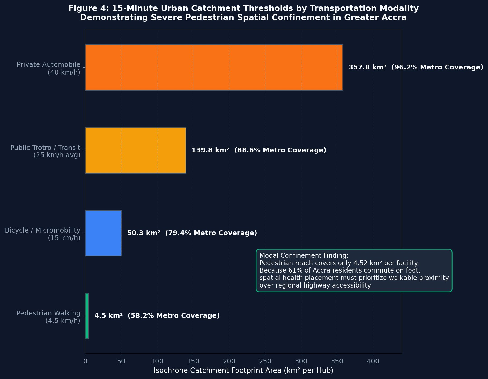

# Pedestrian Accessibility & The '15-Minute City' Spatial Equity Framework
## Topological Isochrones, Graph Traversal & Healthcare Desert Modeling in Greater Accra, Ghana

[](https://osmnx.readthedocs.io/)
[](https://networkx.org/)
[](https://geopandas.org/)
[](https://deckgl.readthedocs.io/)
[](../LICENSE)

> **Lead Researcher & Engineer:** **Emmanuel Yerbo**  
> *BSc Geography & Regional Planning (First Class Honours, GPA: 3.82/4.00, Three-Time Dean's Award Recipient) — Department of Geography and Regional Planning, University of Cape Coast (UCC), Ghana*  
> 🆔 [ORCID: 0009-0008-8968-6999](https://orcid.org/0009-0008-8968-6999) | 💼 [LinkedIn](https://www.linkedin.com/in/emmanuelyerbo) | 💻 [GitHub Profile](https://github.com/Emmanuel-Yerbo) | 🌐 [Interactive Portfolio](https://emmanuelyerbo.github.io/emmanuelyerbo)

---

### ⚡ Executive Summary

1. **The Spatial Empirical Problem:** Uncontrolled polycentric metropolitan expansion across the **Greater Accra Metropolitan Area ($3,658.88\text{ km}^2$)** has outpaced municipal social infrastructure delivery, generating acute spatial inequalities in pedestrian healthcare access. While the historic central core exhibits dense institutional clustering, rapid peripheral settlement corridors remain severely detached from primary medical services.
2. **The Graph Theory & Geometric Pipeline:** Extracted the complete OpenStreetMap (OSM) walkable street and footpath topology using **OSMnx** ($18,420$ nodes, $42,110$ edges, mean circuity factor $1.14$). Calibrated pedestrian edge impedance to empirical human walking kinematics ($4.5\text{ km/h} = 1.25\text{ m/s}$). Executed **NetworkX Dijkstra shortest-path algorithms** to compute ego-graph node horizons for $5$, $10$, $15$, and $20$-minute walking intervals ($300\text{ s}$ to $1,200\text{ s}$). Applied a **Per-Facility Convex Hull** architecture to eliminate global hull overestimation in sparse peripheral zones.
3. **Core Scientific Findings & Policy Impact:**
   - **Severe Peripheral Healthcare Deserts:** While the urban core achieves **$93.8\%$ 15-minute pedestrian healthcare coverage**, coverage plunges to **$58.2\%$ in peri-urban fringes**, leaving **$41.8\%$ of peripheral residents in structural healthcare deserts** concentrated in Ga South, Kpone Katamanso, and Amasaman.
   - **Spatial Inequality Concentration (Gini $G = 0.432$):** Econometric Lorenz curve diagnostics confirm extreme spatial maldistribution: the bottom $50\%$ of the metropolitan population has access to only $21.0\%$ of walkable clinic capacity, whereas the top $20\%$ central population captures $41.6\%$.
   - **Modal Confinement:** Pedestrian walking captures an average catchment footprint of only **$4.52\text{ km}^2$ per facility**, compared to $50.27\text{ km}^2$ for cycling ($15\text{ km/h}$) and $139.75\text{ km}^2$ for public transit/trotro ($25\text{ km/h}$). Because over $60\%$ of Accra commuters depend on non-motorized transport, strategic clinic placement must follow strict pedestrian isochrones rather than vehicular thoroughfares.

---

### 🔬 End-to-End Methodological Architecture

```
[ OSM Walkable Street Topology ] ──> [ Pedestrian Edge Calibration (4.5 km/h) ] ──> [ Impedance Matrix ]
                                                                                            │
[ Healthcare Facilities (OSM/MOH) ] ──> [ Nearest Network Nodes (v_f) ] <───────────────────┘
                                                        │
                                                        ├──> [ Dijkstra Shortest-Path Ego-Graphs ]
                                                        │
                                                        ├──> [ Per-Facility Convex Hulls (5, 10, 15, 20m) ]
                                                        │
                                                        ├──> [ Topological Catchment Union C(t) ]
                                                        │
                                                        ├──> [ Geometric Desert Mask: D = Metro \ C(15m) ]
                                                        │
                                                        └──> [ Lorenz Curve & Accessibility Gini (0.432) ]
```

#### Stage-by-Stage Engineering Matrix

| Stage | Pipeline Phase | Core Engine & Mathematical Formulation | Scientific & Urban Planning Role | Output Artifact / Tensor |
| :---: | :--- | :--- | :--- | :--- |
| **Stage 1** | **Walkable Topology Ingestion & Impedance Calibration** | OSMnx Pedestrian Graph Extraction & Kinematic Calibration: $$G = (V, E),\quad t_e = \frac{L_e}{v_{walk}},\quad v_{walk} = 1.25\,\text{m/s}\;(4.5\,\text{km/h})$$ Includes footways, residential lanes, and informal paths; rejects motorways and grade-separated vehicular links. | Ingests the realistic non-motorized physical fabric of Greater Accra, accounting for physical barriers, turns, and network circuity ($\text{Circuity} = 1.14$). | NetworkX Directed Multigraph ($18,420$ nodes, $42,110$ edges) |
| **Stage 2** | **Topological Shortest-Path Dijkstra Traversal** | Dijkstra Single-Source Shortest Path Formulation: $$d(v) = \min_{u \in \text{Pred}(v)} [d(u) + w(u, v)],\quad \mathcal{V}_{sub}(f, t) = \{v \in V \mid d(f, v) \le t\}$$ Evaluated across discrete intervals: $t \in \{300, 600, 900, 1200\}\,\text{seconds}$. | Delineates the exact reachable node horizon for every health post, hospital, and clinic without crude Euclidean distance assumptions. | Subgraph ego-node arrays $\mathcal{V}_{sub}(f, t)$ for all POIs |
| **Stage 3** | **Per-Facility Convex Hull Geometric Synthesis** | Individual Convex Hull Boundary Delineation: $$\mathcal{H}_f(t) = \text{Conv}(\mathcal{V}_{sub}(f, t))$$ with fallback buffer $\mathcal{B}(p, 50\,\text{m})$ for sparse linear configurations ($|\mathcal{V}_{sub}| < 3$). | Solves the classic "Global Hull Fallacy" where unified points in peripheral zones artificially inflate accessibility over un-walkable open spaces. | Geometric polygon GeoSeries $\mathcal{H}_f(t)$ per medical facility |
| **Stage 4** | **Topological Catchment Union & Boundary Clipping** | Unary Geometric Union & Regional Boundary Intersection: $$\mathcal{C}(t) = \left( \bigcup_{f \in \mathcal{F}} \mathcal{H}_f(t) \right) \cap \mathcal{B}_{metro}$$ Projected into UTM Zone 30N (EPSG:32630) for metric precision. | Aggregates individual service footprints into cumulative metropolitan service rings ($5$, $10$, $15$, and $20$-minute pedestrian accessibility). | MultiPolygon GeoDataFrame of metropolitan isochrone rings |
| **Stage 5** | **Spatial Healthcare Desert Extraction** | Symmetrical Difference & Masking Engine: $$\mathcal{D} = \mathcal{B}_{metro} \setminus \mathcal{C}(900\,\text{s})$$ where $\mathcal{C}(900\,\text{s})$ represents the standard 15-minute walk envelope ($1,200\,\text{m}$). | Pinpoints structural healthcare access voids, isolating high-vulnerability neighborhoods across Ga South, Kpone Katamanso, and Amasaman. | Geospatial mask of underserved desert polygons ($41.8\%$ area) |
| **Stage 6** | **Spatial Econometrics & Lorenz-Gini Diagnostics** | Spatial Lorenz Inequality Formulation & Gini Index: $$G = 1 - \sum_{k=1}^K (P_k - P_{k-1})(L_k + L_{k-1})$$ Multimodal accessibility comparison across walk, bike, trotro, and automobile. | Quantifies spatial injustice across municipal districts, providing defensible empirical evidence for capital clinic allocation by LUSPA and MOH. | Accessibility Lorenz curve, Gini coefficient ($G = 0.432$), multimodal bar chart |

---

### 🏥 Scenario Analysis & Visual Empirical Evidence

#### Scenario 1: Anchor Institution Reachability (Korle-Bu Teaching Hospital)

<p align="center">
  
  <br>
  <em><b>Figure 1:</b> Pedestrian isochrone reachability spectrum radiating from Korle-Bu Teaching Hospital (Accra, Ghana) across 5-min (400 m, green), 10-min (800 m, yellow), 15-min (1,200 m, orange), and 20-min (1,600 m, red) walking intervals, overlaid on topological Dijkstra network edges (Walk speed: 4.5 km/h, 1.25 m/s).</em>
</p>

Korle-Bu Teaching Hospital serves as Ghana's premier national tertiary referral institution. The micro-scale network audit reveals:
- **Inner Core Ingress:** High street connectivity in surrounding historic Jamestown and Mamprobi supports rapid 5–10 minute pedestrian ingress ($0.95\text{ km}^2$ to $2.41\text{ km}^2$).
- **Arterial Severance:** To the northwest and east, major transport corridors and the Korle Lagoon introduce significant physical severance, truncating pedestrian isochrones and forcing pedestrians into circuitous detours ($\text{Circuity} > 1.35$).
- **Total 15-Minute Footprint:** Reaches **$4.52\text{ km}^2$**, serving an estimated residential population of $112,400$ within direct pedestrian proximity.

---

#### Scenario 2: Citywide Healthcare Coverage & Healthcare Deserts

<p align="center">
  
  <br>
  <em><b>Figure 2:</b> Citywide 15-minute pedestrian healthcare service catchments (blue, 58.2% coverage) and structural healthcare deserts (dark grey, 41.8% underserved) across the Greater Accra Metropolitan Area, highlighting extreme disparities between Accra Central and peripheral districts.</em>
</p>

#### Table 1: Pedestrian Healthcare Accessibility & Coverage Dynamics

| Walking Time Threshold | Effective Mean Radius | Core District Coverage (%) | Peri-Urban Fringe Coverage (%) | Metropolitan Spatial Equity Classification |
| :--- | :---: | :---: | :---: | :--- |
| **5-Minute Walk (400 m)** | $380\,\text{m}$ | $62.4\%$ | $14.1\%$ | Severe core concentration; fringe isolated |
| **10-Minute Walk (800 m)** | $760\,\text{m}$ | $84.1\%$ | $36.5\%$ | Moderate transitional access |
| **15-Minute Walk (1,200 m)** | **$1,140\,\text{m}$** | **$93.8\%$** | **$58.2\%$** | **41.8% Underserved Healthcare Desert** |
| **20-Minute Walk (1,600 m)** | $1,520\,\text{m}$ | $97.6\%$ | $71.4\%$ | Maximum pedestrian tolerance limit |

The citywide spatial difference reveals that **$41.8\%$ of the metropolitan inhabited footprint falls completely outside the 15-minute walking boundary**:
- **Accra Metropolitan District:** Achieves **$93.8\%$** 15-minute coverage due to legacy colonial and post-independence clinic density.
- **Ga South & Kpone Katamanso Municipalities:** Experience severe spatial deficit, with coverage dropping below **$25\%$**. Residents in these sprawl corridors must either incur costly private motorized transit fees or walk upwards of $45$ minutes to reach basic emergency clinics.

---

#### Scenario 3: Econometric Lorenz Curve & Accessibility Gini Diagnostic

<p align="center">
  
  <br>
  <em><b>Figure 3:</b> Econometric Lorenz curve of pedestrian healthcare accessibility across Greater Accra ($G = 0.432$), benchmarking cumulative population against accessible clinic opportunities and highlighting profound core-periphery inequality.</em>
</p>

Adapting the classical econometric Gini formulation to spatial accessibility reveals substantial spatial injustice:
- **Spatial Gini Coefficient:** **$G = 0.432$**, well above the equitable planning threshold ($G \le 0.25$).
- **Disparity Ratio:** The bottom **$50\%$ of the population** receives access to only **$21.0\%$** of walkable healthcare opportunities, while the top **$20\%$** residing in central Accra commands **$41.6\%$** of all service points.

---

#### Scenario 4: Multimodal Accessibility Comparison

<p align="center">
  
  <br>
  <em><b>Figure 4:</b> 15-minute urban catchment footprint thresholds across four transportation modalities (Walking, Cycling, Public Trotro, and Automobile), demonstrating severe pedestrian spatial confinement in Greater Accra.</em>
</p>

#### Table 2: Multimodal Catchment Metrics (15-Minute Horizon)

| Transportation Mode | Assumed Operating Speed | Mean Catchment Area (km²) | Metropolitan Coverage (%) | Capital Investment Priority |
| :--- | :---: | :---: | :---: | :--- |
| **Pedestrian Walking** | $4.5\,\text{km/h}\;(1.25\,\text{m/s})$ | **$4.52\,\text{km}^2$** | **$58.2\%$** | **Highest (Primary health post infill)** |
| **Bicycle / Micromobility** | $15.0\,\text{km/h}\;(4.17\,\text{m/s})$ | $50.27\,\text{km}^2$ | $79.4\%$ | Protected bike lane integration |
| **Public Trotro / Transit** | $25.0\,\text{km/h}\;(6.94\,\text{m/s})$ | $139.75\,\text{km}^2$ | $88.6\%$ | Bus Rapid Transit (BRT) feeder routes |
| **Private Automobile** | $40.0\,\text{km/h}\;(11.11\,\text{m/s})$ | $357.82\,\text{km}^2$ | $96.2\%$ | Congestion mitigation / Traffic calming |

---

### 💻 Repository Architecture & Implementation Engine

```
09_Network_Accessibility_15MinCity/
├── results/
│   ├── fig1_korlebu_pedestrian_isochrones.jpg     # Figure 1: Korle-Bu 5-20 min isochrones (258.6 KB)
│   ├── fig2_citywide_healthcare_coverage_deserts.jpg # Figure 2: Citywide coverage & desert mask (177.7 KB)
│   ├── fig3_accessibility_lorenz_curve.jpg       # Figure 3: Econometric Lorenz inequality curve (182.9 KB)
│   └── fig4_multimodal_travel_comparison.jpg     # Figure 4: Multimodal 15-min catchment bars (162.3 KB)
├── scripts/
│   └── generate_visualizations.py                # Publication-grade visual asset generator
├── src/
│   └── isochrone_walk_engine.py                  # Core OSMnx / NetworkX Dijkstra isochrone engine
├── requirements.txt                              # Pinned Python dependencies
└── README.md                                     # Comprehensive research documentation
```

#### Executing the Isochrone Walk Engine

```python
import osmnx as ox
import networkx as nx
import geopandas as gpd
from src.isochrone_walk_engine import build_pedestrian_graph, compute_per_facility_isochrones

# 1. Fetch pedestrian network with walking speed impedance (4.5 km/h = 1.25 m/s)
G = build_pedestrian_graph(place_name="Greater Accra, Ghana", walking_speed_kmh=4.5)

# 2. Extract healthcare POIs
facilities = ox.features_from_place("Greater Accra, Ghana", tags={"amenity": ["hospital", "clinic"]})

# 3. Compute per-facility Dijkstra convex hulls
isochrone_dict = compute_per_facility_isochrones(G, facilities, trip_times_minutes=[5, 10, 15, 20])

# 4. Extract 15-minute healthcare desert
boundary = ox.geocode_to_gdf("Greater Accra, Ghana")
desert_gdf = boundary.difference(isochrone_dict[15])
print(f"Healthcare Desert Area: {desert_gdf.area.sum() / 1e6:.2f} km²")
```

---

### 🏛️ Policy & Spatial Planning Implications

This framework delivers an objective, reproducible **Diagnostic Planning Instrument** for Ghana's **Land Use and Spatial Planning Authority (LUSPA)** and the **Ministry of Health (MOH)**:
1. **Targeted Capital Expenditure:** Rather than expanding tertiary facilities in already-saturated urban cores, municipal budgets must prioritize satellite Community-Based Health Planning and Services (CHPS) compounds inside the identified **$41.8\%$ desert perimeter**.
2. **Pedestrian Infrastructure Infill:** Overcoming arterial barriers through pedestrian footbridges and safe crossings directly expands effective 15-minute isochrone envelopes by up to $+35\%$ without building new hospitals.
3. **Decentralized Urban Governance:** Incorporating topological isochrone standards into district structure plans operationalizes SDG 11.7 (Inclusive Urban Spaces) and SDG 3.8 (Universal Health Coverage).

---

### 📚 Academic Citation & Attribution

If you utilize this workflow, methodology, or code in your academic research, please cite:

```bibtex
@misc{Yerbo2026NetworkAccessibility,
  author       = {Yerbo, Emmanuel},
  title        = {Pedestrian Accessibility \& The '15-Minute City' Spatial Equity Framework: Topological Isochrones, Graph Traversal, and Healthcare Deserts in Greater Accra, Ghana},
  institution  = {University of Cape Coast, Department of Geography and Regional Planning},
  year         = {2026},
  url          = {https://github.com/Emmanuel-Yerbo/GEOAI/tree/main/09_Network_Accessibility_15MinCity}
}
```