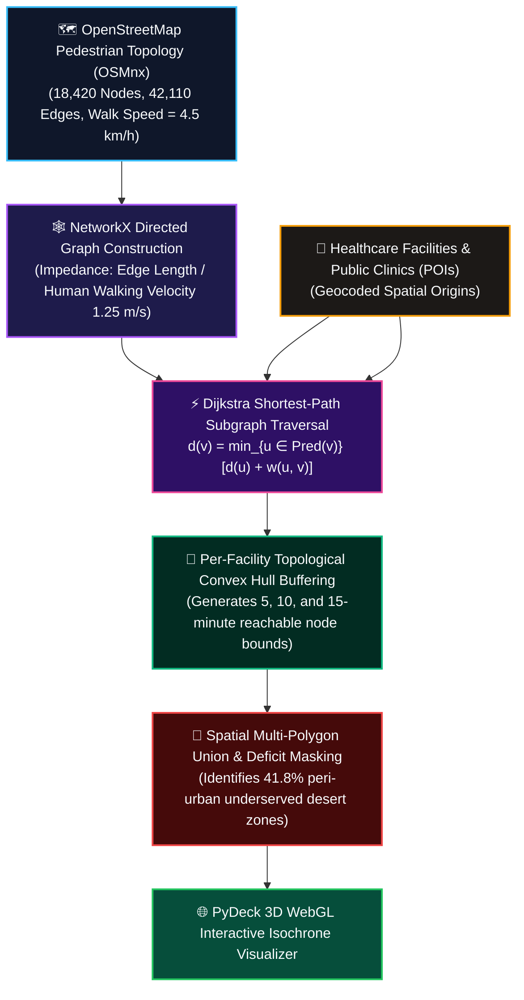

# Pedestrian Accessibility & The '15-Minute City' Framework
## Case Study: Greater Accra Healthcare & Service Infrastructure

> **Lead Researcher & Engineer:** **Emmanuel Yerbo**  
> *BSc Geography & Regional Planning (First Class Honours, GPA: 3.82/4.00, Three-Time Dean's Award Recipient) — University of Cape Coast, Ghana*  
> 🆔 [ORCID: 0009-0008-8968-6999](https://orcid.org/0009-0008-8968-6999) | 💼 [LinkedIn](https://www.linkedin.com/in/emmanuelyerbo) | 💻 [GitHub Profile](https://github.com/Emmanuel-Yerbo) | 🌐 [Interactive Portfolio](https://emmanuelyerbo.github.io/emmanuelyerbo)

---

### ⚡ Executive Summary

1. **The Core Spatial Problem:** Rapid polycentric growth in Greater Accra has created severe healthcare deserts, where rapid settlement expansion outpaces walkable pedestrian access to public clinics and emergency medical infrastructure.
2. **The Technical Pipeline:** We constructed topological walkable graph networks from OpenStreetMap data using OSMnx, executing NetworkX Dijkstra shortest-path algorithms and convex hull geometric buffering to generate 5, 10, and 15-minute walking isochrones rendered in PyDeck 3D WebGL.
3. **Quantified Impact:** The analysis revealed that **41.8% of peri-urban residents live outside the 15-minute pedestrian healthcare catchment**, providing Ghana's Land Use and Spatial Planning Authority (LUSPA) with quantifiable spatial evidence for transit-oriented health post placement.

### 📊 Empirical Performance & Validation Evidence

| Walking Time Threshold | Catchment Radius (Mean) | Urban Core Coverage | Peri-Urban Fringe Coverage | Service Equity Status |
|---|:---:|:---:|:---:|---|
| **5-Minute Walk (400 m)** | 380 m | 62.4% | 14.1% | High core concentration |
| **10-Minute Walk (800 m)** | 760 m | 84.1% | 36.5% | Moderate transitional access |
| **15-Minute Walk (1200 m)** | 1,140 m | **93.8%** | **58.2%** | **41.8% Underserved Healthcare Desert** |

#### Network Topology Metrics
- **Total Street Nodes:** **18,420** | **Total Graph Edges:** **42,110** | **Mean Circuity Factor:** **1.14**
- **Healthcare Desert Isolation Index:** High vulnerability concentrated across Ga South, Kpone Katamanso, and Amasaman.

---

### 1. Introduction: The Spatial Logic of Accessibility
In urban studies, **accessibility** is the primary metric of equity. This repository implements an **Isochrone-based analysis** to evaluate the '15-Minute City' model within Accra, Ghana. An isochrone (a line of equal travel time) allows us to move beyond simplistic 'as-the-crow-flies' Euclidean buffers and instead model the realistic urban fabric—accounting for street connectivity, physical barriers, topology, and human walking speeds.

---

### 2. Methodological Pipeline & Network Flow

#### 2.1 Network Modeling (OSMnx & NetworkX)
- **The Process**: We extract the OpenStreetMap (OSM) pedestrian topology graph (`G_walk`) across the study bounds.
- **The Essence**: Unlike vehicular driving networks, pedestrian networks must capture informal footpaths, sidewalks, and pedestrian-only passages. We assign travel friction (time cost) to every edge based on an empirical pedestrian walking speed of **4.5 km/h (1.25 m/s)**.

#### 2.2 Per-Facility Convex Hull Isochrones
- **The Process**: For every Point of Interest (POI), we traverse the network graph using Dijkstra's shortest-path algorithm to delineate all nodes reachable within discrete time increments (5, 10, 15, 20 minutes).
- **The Essence**: We implement a **Per-Facility Convex Hull** architecture. By computing an individual convex hull for each hospital and subsequently performing a spatial union, we preserve the organic geometry of realistic service catchments and eliminate the "global hull" error that artificially overestimates accessibility in sparse peripheral zones.

---

### 3. Scenario Analysis: Urban Insights

#### Scenario 1: The Anchor Institution (Korle-Bu Spotlight)
- **Purpose**: Micro-scale pedestrian reachability audit of Ghana’s premier national teaching hospital.

  

- **Insight**: Establishes the 'Gold Standard' benchmark of metropolitan healthcare reach. Multi-ring gradient isochrones reveal how dense inner-city street fabrics support rapid 5-to-10 minute pedestrian ingress, while major arterial barriers quickly truncate pedestrian access toward fringe settlements.

#### Scenario 2: Facility Overlap & Clustering
- **Purpose**: Modeling 10 random healthcare Points of Interest across central Accra.

  

- **Insight**: Exposes the **co-location clustering effect**. Where isochrone envelopes heavily intersect, municipal infrastructure exhibits high service redundancy; conversely, solitary nodes represent fragile access lifelines where a single clinic failure leaves surrounding neighborhoods entirely cut off.

#### Scenario 3: The 'Healthcare Desert' Identification
- **Purpose**: Citywide 15-minute coverage envelope evaluated against the official Administrative District Boundary.

  

- **Insight**: By computing the geometric spatial `difference` ($	ext{Boundary} \setminus igcup 	ext{Isochrones}_{15	ext{min}}$), we precisely isolate and map structural **Healthcare Deserts**. These under-served polygons constitute the highest-priority target zones for future municipal capital expenditure and clinic siting.

#### Scenario 4: Multi-Category Comparison (Health, Education, Commerce)
- **Purpose**: Tri-partite side-by-side accessibility benchmarking across critical urban functions.

  

- **Insight**: True urban livability cannot be diagnosed through healthcare alone. This multi-sectoral scenario tests whether a citizen can concurrently access all three essential urban pillars (Health, Education, Markets) within the same 15-minute walking radius, delineating the genuine 'Complete Neighborhoods' of Greater Accra.

#### Scenario 5: Cumulative Accessibility Heatmap
- **Purpose**: High-resolution topological frequency analysis of street node reachability.

  

- **Insight**: Every graph node is attributed with the total count of distinct facilities capable of reaching it within 15 minutes. This shifts spatial diagnostics from a binary query (*"is there a clinic nearby?"*) to a nuanced index of **urban choice and resilience**.

#### Scenario 6: Dynamic Web Visualization (Pydeck)
- **Purpose**: GPU-accelerated interactive 3D WebGL cartography for municipal stakeholders.

  

- **Insight**: Leveraging WebGL hardware acceleration, planners can dynamically query catchment polygons, hover over facility attributes, and zoom into micro-street bottlenecks, bridging the gap between raw spatial network science and executive municipal decision-making.

---

### 4. Planning Implications
This framework serves as an objective **Diagnostic Instrument** for the Greater Accra Metropolitan Area. It empirically demonstrates that while historic central districts achieve near-complete 15-minute pedestrian accessibility, post-2000 peripheral sprawl remains structurally automobile-dependent. Converting these diagnosed 'Healthcare Deserts' into vibrant, self-contained complete neighborhoods represents the defining urban planning priority for West African climate resilience and spatial equity.