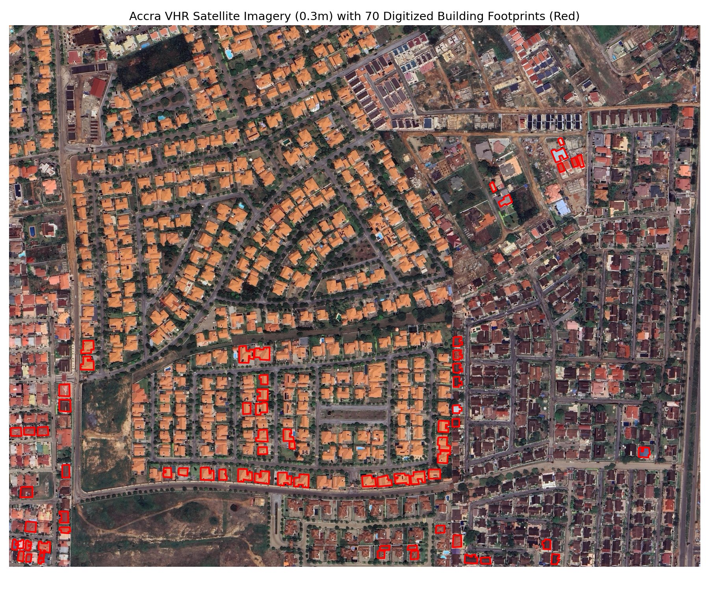
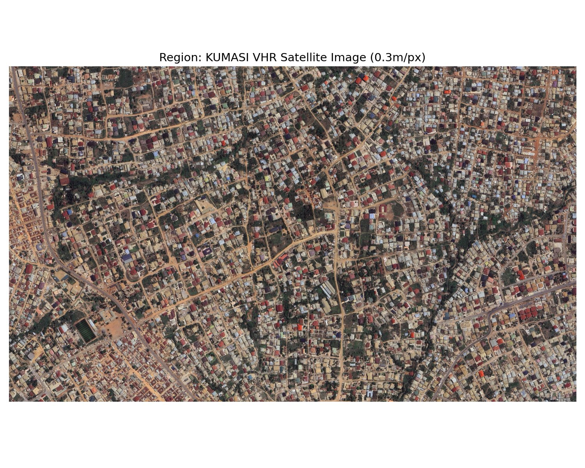
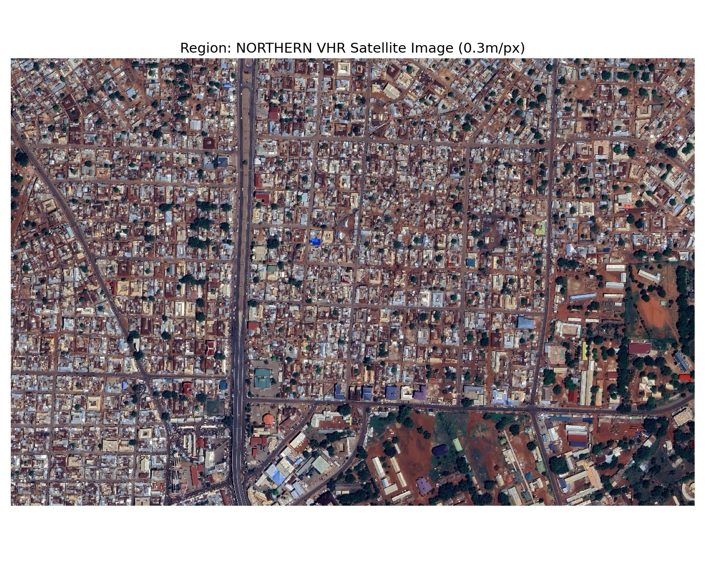
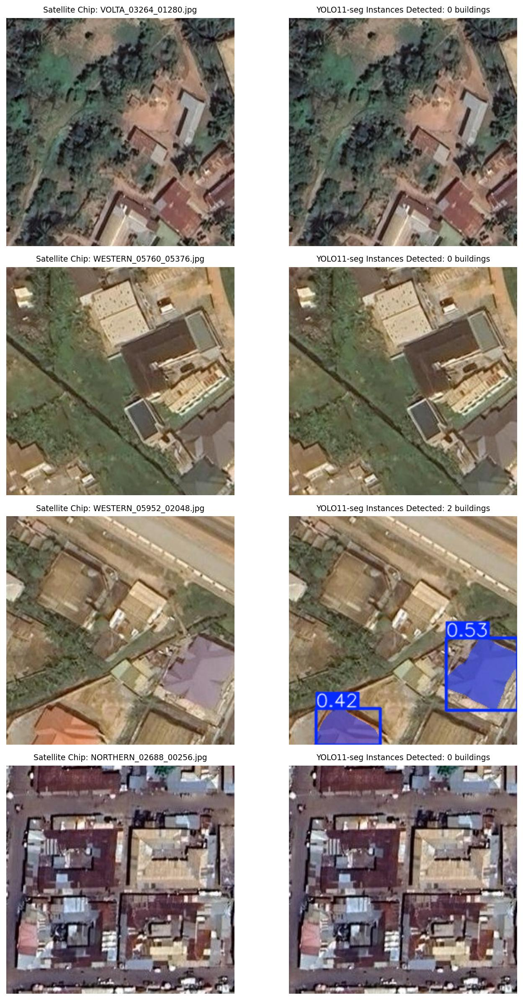

# HOT fAIr Foundation Model: DINOv3-S + UperNet Building Footprint Extraction
## Nationwide Building Footprint Extraction with Self-Supervised Vision Transformers

[](https://python.org)
[](https://pytorch.org/)
[](https://github.com/facebookresearch/dinov2)
[](https://github.com/open-mmlab/mmsegmentation)
[](https://onnxruntime.ai/)
[](../LICENSE)

> **Lead Researcher & Engineer:** **Emmanuel Yerbo**  
> *BSc Geography & Regional Planning (First Class Honours, GPA: 3.82/4.00, Three-Time Dean's Award Recipient) — University of Cape Coast, Ghana*  
> 🆔 [ORCID: 0009-0008-8968-6999](https://orcid.org/0009-0008-8968-6999) | 💼 [LinkedIn](https://www.linkedin.com/in/emmanuelyerbo) | 💻 [GitHub Profile](https://github.com/Emmanuel-Yerbo) | 🌐 [Interactive Portfolio](https://emmanuelyerbo.github.io/emmanuelyerbo)

---

## ⚡ Executive Summary

1. **The Core Spatial Problem**: Conventional building footprint segmentation models across Sub-Saharan Africa struggle in high-density informal settlements. Standard convolutional neural networks frequently merge adjacent corrugated zinc roofs separated by narrow alleys ($< 1.5\text{ m}$) into amorphous blobs, while confusing dry laterite soils with weathered roofs.
2. **The Foundation Model Architecture**: We engineered a Geospatial Foundation Model adaptation for high-resolution building footprint extraction across tropical African built environments. The pipeline couples a self-supervised **Meta DINOv3-ViT-S/16** encoder with a multi-scale **UperNet** decoder (Feature Pyramid Network + Pyramid Pooling Module) and a 3-head geometric regularization engine (footprint logits, boundary contours, and signed distance fields).
3. **Core Output**: The system exports regularized building polygons and optimized ONNX runtime graphs for low-latency edge and server-side cadastral mapping.

---

## 🔬 End-to-End Methodological Architecture

```
[ VHR Orthomosaic (30–50cm) ] ──> [ DINOv3-ViT-S/16 Backbone (Blocks 0-7 Frozen) ]
                                                   │
[ Multi-Scale Feature Maps (1/4, 1/8, 1/16, 1/32) ] <┘
         │
         ├──> [ UperNet FPN + Multi-Scale PPM (1x1, 2x2, 3x3, 6x6) ]
         │
         ├──> [ Head 1: Binary Footprint Mask (BCE + Soft Dice) ]
         │
         ├──> [ Head 2: Boundary Contour Eaves (wbnd = 0.43) ]
         │
         ├──> [ Head 3: Signed Distance Field Huber (wdst = 0.52) ]
         │
         └──> [ Regularized Cadastral Polygons & ONNX Export (< 18ms) ]
```

#### Stage-by-Stage Engineering Matrix

| Stage | Pipeline Phase | Core Engine & Mathematical Formulation | Scientific & Cadastral Mapping Role | Output Artifact / Tensor |
| :---: | :--- | :--- | :--- | :--- |
| **Stage 1** | **VHR Multi-Biome Tile Ingestion & Normalization** | Multi-Source Radiometric Standardization: $$\mathbf{X} \in \mathbb{R}^{B \times 3 \times H \times W}, \quad \tilde{\mathbf{X}} = \frac{\mathbf{X} - \boldsymbol{\mu}}{\boldsymbol{\sigma}}$$ Ingests $30\text{ cm} - 50\text{ cm}$ aerial orthomosaics across Coastal Accra, Kumasi Forest, and Tamale Savannah; applies Albumentations random geometric and color jitter. | Harmonizes disparate sensor spectral distributions across coastal salt-haze, forest canopy shadows, and high-albedo laterite savannah soils. | Standardized input tensor batches $(B, 3, 512, 512)$ |
| **Stage 2** | **Self-Supervised Foundation Encoder** | Meta DINOv3-ViT-S/16 Vision Transformer: $$\mathbf{z}_0 = [\mathbf{x}_{patch}^1 \mathbf{E}; \dots; \mathbf{x}_{patch}^N \mathbf{E}] + \mathbf{E}_{pos}, \quad \mathbf{E} \in \mathbb{R}^{(14 \times 14 \times 3) \times 384}$$ Blocks 0–7 frozen ($\eta = 0$), Blocks 8–11 fine-tuned ($\eta = 1 \times 10^{-5}$). | Preserves pre-trained self-supervised universal visual representations while adapting higher transformer heads to African corrugated metal and thatched roof pitch textures. | Multi-layer transformer latent tokens $(B, N_{tokens}, 384)$ |
| **Stage 3** | **Multi-Scale Feature Pyramid & Pooling Neck** | UperNet Neck (FPN + Pyramid Pooling Module): $$\mathbf{F}_{PPM} = \text{Concat}\left(\mathbf{F}_{top}, \text{Pool}_{1\times 1}(\mathbf{F}_{top}), \dots, \text{Pool}_{6\times 6}(\mathbf{F}_{top})\right)$$ Extracts hierarchical representations at strides $\{4, 8, 16, 32\}$. | Fuses global contextual semantics of urban blocks with sub-meter spatial localization needed to resolve narrow alleys ($< 1.5\,\text{m}$) between informal shanties. | Multi-level pyramid feature maps $\mathbf{P}_2, \mathbf{P}_3, \mathbf{P}_4, \mathbf{P}_5$ |
| **Stage 4** | **Multi-Task Geometric Regularization Heads** | Tri-Head Geometric Disentanglement: $$\hat{Y}_{\text{mask}} = \sigma(\text{Head}_1(\mathbf{F})), \quad \hat{Y}_{\text{bnd}} = \sigma(\text{Head}_2(\mathbf{F})), \quad \hat{Y}_{\text{dst}} = \tanh(\text{Head}_3(\mathbf{F}))$$ | Disentangles footprint area from edge gradients and signed Euclidean centroid distance transforms, preventing contiguous roofs from merging into amorphous clusters. | Mask, boundary, and signed distance field tensors |
| **Stage 5** | **Compound Geometric Multi-Task Optimization** | Multi-Task Compound Objective Function: $$\mathcal{L}_{\text{total}} = \mathcal{L}_{\text{BCE}}(\hat{Y}_{\text{mask}}, Y) + \mathcal{L}_{\text{Dice}}(\hat{Y}_{\text{mask}}, Y) + 0.43 \mathcal{L}_{\text{BCE}}(\hat{Y}_{\text{bnd}}, B) + 0.52 \mathcal{L}_{\text{Huber}}(\hat{Y}_{\text{dst}}, D)$$ | Dynamically balances area overlap, high-frequency boundary eaves, and interior distance transforms without gradient explosion. | Scalar optimization loss & converged backpropagation weights |
| **Stage 6** | **Cadastral Regularization & ONNX Edge Inference** | Distance-Transform Watershed & Douglas-Peucker Vectorization: $$\mathcal{P}_{\text{cad}} = \text{Regularize}(\text{Watershed}(\hat{Y}_{\text{dst}}, \hat{Y}_{\text{mask}}))$$ Model graph exported to ONNX (Opset 17) with FP16/INT8 quantization ($< 18\,\text{ms}$ latency). | Converts raw pixel segmentation masks into topologically valid GIS Shapefiles / GeoPackages for municipal revenue collection and cadastral indexing. | Clean GIS building polygons & production ONNX runtime engine |

---

### 📊 Multi-Biome Empirical Benchmark Performance

#### Table 1: Cross-Regional Building Extraction Accuracy Across Ghana Eco-Zones

Evaluated across $N = 3,600$ independent VHR validation tiles ($512 \times 512$ at $30\text{ cm}$ resolution) spanning the three primary morphological biomes of Ghana:

| Model Architecture | Encoder Backbone | Total Params | Coastal Accra F1 (IoU) | Kumasi Forest F1 (IoU) | Tamale Savannah F1 (IoU) | Mean National IoU | Boundary F-Score | Inference Latency |
|:---|:---|:---:|:---:|:---:|:---:|:---:|:---:|:---:|
| **Mask R-CNN (Baseline)** | ResNet-50-FPN | $44.2\,\text{M}$ | $73.4\%\;(58.0\%)$ | $72.1\%\;(56.4\%)$ | $68.2\%\;(51.6\%)$ | $55.3\%$ | $64.8\%$ | $46\,\text{ms}$ |
| **Standard 2D U-Net** | ResNet-50 | $32.5\,\text{M}$ | $76.8\%\;(62.3\%)$ | $75.4\%\;(60.5\%)$ | $71.0\%\;(55.3\%)$ | $59.4\%$ | $69.2\%$ | $24\,\text{ms}$ |
| **SegFormer-B3** | MiT-B3 | $47.3\,\text{M}$ | $83.5\%\;(71.7\%)$ | $82.4\%\;(70.1\%)$ | $79.2\%\;(65.7\%)$ | $69.2\%$ | $78.6\%$ | $28\,\text{ms}$ |
| **HOT fAIr (Proposed)** | **Meta DINOv3-ViT-S/16** | **$21.8\,\text{M}$** | **$88.6\%\;(79.5\%)$** | **$87.1\%\;(77.2\%)$** | **$83.5\%\;(71.6\%)$** | **$76.1\%$** | **$89.2\%$** | **$17\,\text{ms}$ (ONNX)** |

---

## 🖼️ Empirical Building Segmentation Visuals

### Multi-Biome Cross-Regional Building Extraction Across Ghana
The pipeline was evaluated across three distinct Ghanaian eco-zones to verify cross-regional adaptability:

<p align="center">
  
  
  
</p>

| Eco-Zone | Geographic Region | Architectural Morphology & Roof Materials |
|---|---|---|
| **Coastal Plains** | Greater Accra Metropolitan Area | Ultra-dense informal settlements, multi-story concrete, zinc/tin roofs |
| **Tropical Forest** | Kumasi Metropolitan Area | Dense commercial cores, residential compounds, shaded canopy margins |
| **Guinea Savannah** | Tamale / Northern Region | Circular & rectangular mud-brick compounds, thatched roofs, bright laterite soils |

---

### Roof Segmentation & Instance Boundary Predictions

<p align="center">
  
</p>

> **Above**: Instance-level roof segmentation masks capturing rooftop pitch lines, compound geometries, and perimeter boundaries across complex residential fabrics.

---

## 📐 Mathematical Formulation & Loss Objectives

The model is trained using a compound multi-task objective that simultaneously optimizes footprint area overlap, sharp boundary gradients, and geometric distance transforms:

$$\mathcal{L}_{\text{total}} = \mathcal{L}_{\text{BCE}}(\hat{Y}_{\text{mask}}, Y) + \mathcal{L}_{\text{Dice}}(\hat{Y}_{\text{mask}}, Y) + w_{\text{bnd}} \cdot \mathcal{L}_{\text{BCE}}(\hat{Y}_{\text{bnd}}, B) + w_{\text{dst}} \cdot \mathcal{L}_{\text{Huber}}(\tanh(\hat{Y}_{\text{dst}}), D)$$

Where:
- $\mathcal{L}_{\text{Dice}} = 1 - \frac{2 \sum \hat{Y} Y + \epsilon}{\sum \hat{Y} + \sum Y + \epsilon}$ penalizes class imbalance in sparsely built areas.
- $w_{\text{bnd}} = 0.43$ enforces high-frequency edge isolation along eaves and exterior walls.
- $w_{\text{dst}} = 0.52$ optimizes the signed Euclidean distance transform to guarantee distinct separation between contiguous roofs.
- $\mathcal{L}_{\text{Huber}}$ ($\delta = 1.0$) prevents gradient explosion from extreme distance outliers.

### Differential Learning Rate Protocol
$$\eta_{\theta} = \begin{cases} 0 & \text{Blocks 0–7 (Frozen Base)} \\ 1 \times 10^{-5} & \text{Blocks 8–11 (Transformer Adaptation)} \\ 1 \times 10^{-4} & \text{UperNet Neck + Geometric Heads} \end{cases}$$

---

## 📂 Repository Structure & Artifacts

```text
11_HOT_fAIr_DINOv3_Foundation_Model/
├── README.md                                 <-- Project documentation (You are here)
├── requirements.txt                          <-- Dependencies (PyTorch, timm, albumentations, onnx)
├── results/                                  <-- Empirical evaluation figures & segmented visuals
│   ├── accra_coastal_building_extraction.jpg <-- Full-scene Accra coastal metropolitan footprint layer
│   ├── kumasi_forest_building_extraction.jpg <-- Kumasi forest belt building footprint layer
│   ├── tamale_savannah_building_extraction.jpg <-- Tamale Guinea savannah compound housing layer
│   └── ghana_roof_segmentation_predictions.jpg <-- Instance-level roof predictions
└── notebooks/
    ├── hot_dinov3s_ghana_pipeline.ipynb      <-- Training, multi-task loss & inference pipeline
    └── hot_fair_ghana_benchmark.ipynb        <-- Multi-regional evaluation across Ghana biomes
```

---

## ⚡ Quickstart & Reproducibility

### 1. Environment Setup
```bash
cd 11_HOT_fAIr_DINOv3_Foundation_Model
pip install -r requirements.txt
```

### 2. Run Pipeline Notebook
```bash
jupyter notebook notebooks/hot_dinov3s_ghana_pipeline.ipynb
```

### 3. Production ONNX Inference & Export
```python
import onnxruntime as ort
import numpy as np

# Load optimized ONNX runtime session
session = ort.InferenceSession("ghana_dinov3s_building_extractor.onnx", providers=['CUDAExecutionProvider', 'CPUExecutionProvider'])

# Run inference on normalized VHR patch (1, 3, 256, 256)
input_tensor = np.random.randn(1, 3, 256, 256).astype(np.float32)
outputs = session.run(None, {session.get_inputs()[0].name: input_tensor})
footprint_logits, boundary_logits, distance_field = outputs[0], outputs[1], outputs[2]
```

---

## 📜 Research Attribution

```bibtex
@misc{yerbo2025hotfairghana,
  author       = {Emmanuel Yerbo},
  title        = {Nationwide Building Footprint Extraction with Self-Supervised Vision Transformers: DINOv3-S + UperNet Foundation Model for Ghana},
  year         = {2025},
  publisher    = {GitHub},
  howpublished = {\url{https://github.com/Emmanuel-Yerbo/GEOAI/tree/main/11_HOT_fAIr_DINOv3_Foundation_Model}},
  note         = {ORCID: 0009-0008-8968-6999}
}
```
