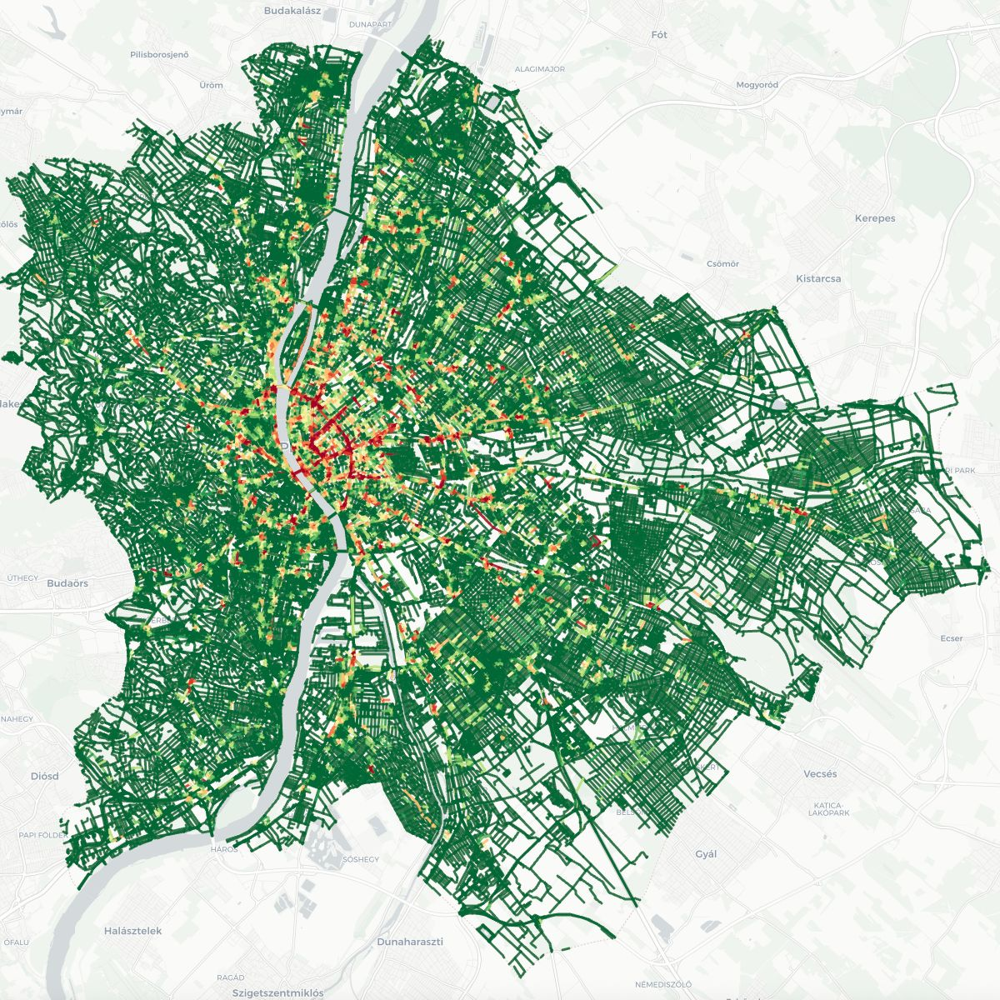

# 🇬🇭 GeoNLP: Spatial Entity Extraction & Traffic Accident Geocoding

[](https://python.org)
[](https://spacy.io/)
[](https://geopandas.org/)
[](https://scikit-learn.org)
[](../LICENSE)

> **Lead Researcher & Engineer:** **Emmanuel Yerbo**  
> *BSc Geography & Regional Planning (First Class Honours, GPA: 3.82/4.00, Three-Time Dean's Award Recipient) — University of Cape Coast, Ghana*  
> 🆔 [ORCID: 0009-0008-8968-6999](https://orcid.org/0009-0008-8968-6999) | 💼 [LinkedIn](https://www.linkedin.com/in/emmanuelyerbo) | 💻 [GitHub Profile](https://github.com/Emmanuel-Yerbo) | 🌐 [Interactive Portfolio](https://emmanuelyerbo.github.io/emmanuelyerbo)

---

> **A Spatial Data Science & GeoAI Framework for Mining Public Perception, Emotion, and Spatial Blackspots in Road Traffic Accidents Across Ghana (Mid-2024 to Mid-2026).**

---

## 🌟 Overview

This repository contains a full 6-stage end-to-end Python pipeline designed to scrape Ghanaian online news portals and Google News RSS feeds, extract accident locations via NLP and a custom Ghana gazetteer, analyze article sentiment and blame attribution, geocode location coordinates, perform spatial clustering (DBSCAN + Getis-Ord Gi*), calculate the Perception-Reality Gap Index (PRGI), and generate an interactive GeoSentiment dashboard map.

---

## 🏗️ Architecture & Pipeline Stages


---

## 🗺️ Spatial Accident Intelligence Output

<p align="center">
  
  <br>
  <em>Figure 1: Geocoded Road Traffic Accident Heatmap and Spatial Blackspot Clusters Across Ghana.</em>
</p>

---

## 🚗 Expanded Vehicle Taxonomy (17 Categories)
- **Commercial Passenger**: Trotro, Sprinter, VIP/VVIP Bus, Yutong
- **Private Hire & Micro**: **Toyota Voxy / Noah**, Okada, Aboboyaa, Pragya (Tuk-tuk), Taxi
- **Freight & Heavy Cargo**: Tipper Truck, Articulated Truck, Fuel/LPG Tanker
- **Vulnerable & Institutional**: Pedestrian, Ambulance, Police Vehicle, Bicycle

---

## 🧠 GeoSentiment & PRGI Methodology

### 1. Multi-Axis Sentiment Analysis (`sentiment/sentiment_engine.py`)
- **VADER Polarity**: `compound`, `pos`, `neu`, `neg` scores.
- **Subjectivity**: TextBlob `subjectivity` metric (0.0 to 1.0).
- **Emotion Intensities**: Scores for `fear`, `sadness`, `anger`, `shock`, and `urgency`.
- **Urgency / Panic Index**: $0.0 \to 1.0$ index derived from severity and emergency wording.

### 2. Blame Attribution Taxonomy (`sentiment/blame_classifier.py`)
Attributes accident causes mentioned in reports across 6 targets:
- `DRIVER`: Speeding, drunk driving, wrongful overtaking, fatigue.
- `INFRASTRUCTURE`: Potholes, unlit highways, dark roads, narrow bridges.
- `INSTITUTIONAL`: NRSA, DVLA, Police/MTTD, Ministry of Roads.
- `VEHICLE`: Brake failure, tyre burst, unroadworthy, overloading.
- `PEDESTRIAN`: Jaywalking, hawking on carriageways, non-use of footbridges.
- `SYSTEMIC`: Corruption, extortion, emergency response delays.

### 3. Perception-Reality Gap Index (`spatial/prgi_calculator.py`)
$$\text{PRGI} = \frac{\text{Perception Score}}{\text{Reality Score} + 0.1}$$
- **$\text{PRGI} > 1.2$**: *Over-Amplified Zone* (high media panic relative to actual casualties).
- **$0.8 \le \text{PRGI} \le 1.2$**: *Proportional Coverage Zone*.
- **$\text{PRGI} < 0.8$**: *Silent High-Risk Zone* (high casualties but low news reporting).

---

## ⚡ Quick Start & Command Examples

### Install Dependencies
```bash
pip install -r requirements.txt
```

### Run Full Pipeline
```bash
python src/run_pipeline.py --pages 3
```

### Run Specific Stages
```bash
# Run only Sentiment & Blame Analysis (Stage 3.5)
python src/run_pipeline.py --stage 3.5

# Run only Spatial Blackspot & PRGI Analysis (Stage 4.5)
python src/run_pipeline.py --stage 4.5

# Run only Map Builder (Stage 5)
python src/run_pipeline.py --stage 5
```

---

## 📂 Output Files
- **Interactive Map**: `output/maps/ghana_accident_map.html`
- **Word Clouds**: `output/wordclouds/` (grouped by vehicle type, severity, blame target)
- **Blackspot Report**: `output/reports/blackspot_summary.csv`
- **PRGI Report**: `output/reports/prgi_summary.csv`
- **Enriched Dataset**: `data/processed/accidents_sentiment.csv`
