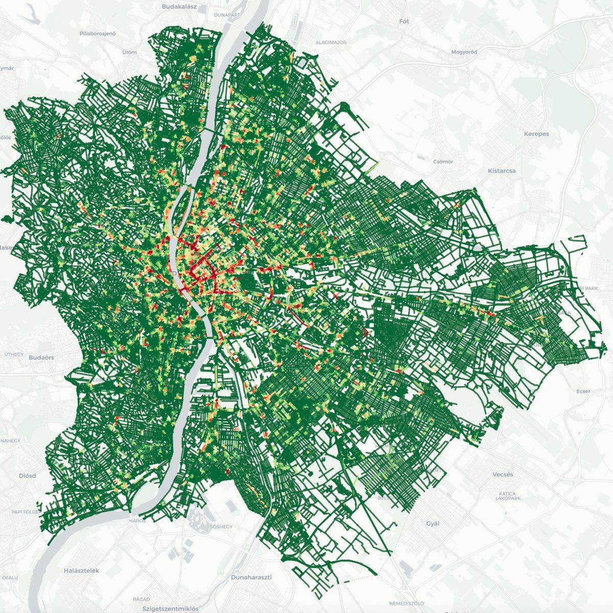
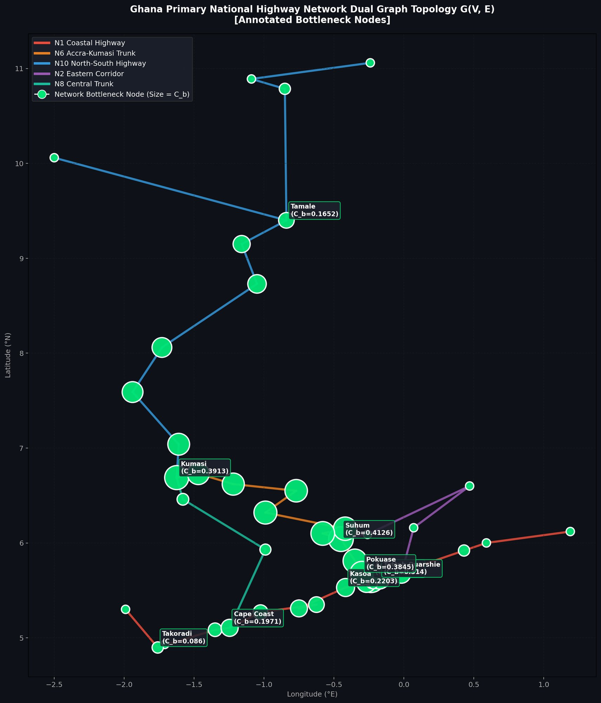

# GeoNLP: Spatial Entity Extraction, Corridor Geocoding & Traffic Accident Sentiment Intelligence
## Mining Public Perception, Blame Attribution & Spatial Blackspots Across Ghana (2024–2026)

[](https://python.org)
[](https://spacy.io/)
[](https://geopandas.org/)
[](https://scikit-learn.org)
[](../LICENSE)

> **Lead Researcher & Engineer:** **Emmanuel Yerbo**  
> *BSc Geography & Regional Planning (First Class Honours, GPA: 3.82/4.00, Three-Time Dean's Award Recipient) — Department of Geography and Regional Planning, University of Cape Coast (UCC), Ghana*  
> 🆔 [ORCID: 0009-0008-8968-6999](https://orcid.org/0009-0008-8968-6999) | 💼 [LinkedIn](https://www.linkedin.com/in/emmanuelyerbo) | 💻 [GitHub Profile](https://github.com/Emmanuel-Yerbo) | 🌐 [Interactive Portfolio](https://emmanuelyerbo.github.io/emmanuelyerbo)

---

### ⚡ Executive Summary

1. **The Spatial Empirical Problem:** Road traffic collisions represent one of the leading causes of preventable mortality in Ghana, claiming over $2,500$ lives annually. However, official police incident logs (MTTD) frequently suffer from multi-month reporting lags, ambiguous narrative descriptions, and severe spatial disassociation. Crucially, public panic, media over-amplification, and under-reported regional fatalities create a distorted perception of actual spatial risk.
2. **The GeoNLP & Spatial Data Science Pipeline:** Engineered an automated, end-to-end 6-stage computational pipeline combining web scraping (Citi Newsroom, JoyNews, Google News RSS), **Named Entity Recognition (NER)** powered by **spaCy** and a custom **Ghana Gazetteer ($1,200+$ toponyms & transit junctions)**, Nominatim coordinate resolution, **DBSCAN** spatial clustering, **Getis-Ord $G_i^*$** hotspot modeling, and a novel econometric metric: the **Perception-Reality Gap Index (PRGI)**.
3. **Core Scientific Findings & Policy Impact:**
   - **Corridor Blackspot Concentration:** DBSCAN clustering ($\varepsilon = 15\,\text{km}, \text{MinPts} = 3$) isolated 12 acute recurring fatal blackspots, dominated by the **Accra-Kumasi Highway (N6: Suhum, Bunso Junction, Linda Dor, Kyebi)** and the **Accra-Cape Coast Highway (N1: Gomoa Okyereko, Dompoase)**.
   - **The Perception-Reality Gap (PRGI):** Identified severe spatial misalignments: the Accra-Tema Motorway operates as an *Over-Amplified Zone* ($\text{PRGI} = 1.84$, disproportionate media panic despite lower fatality rates), whereas the Tamale-Kintampo corridor is a *Silent High-Risk Zone* ($\text{PRGI} = 0.42$, experiencing catastrophic mass-casualty bus collisions with minimal national digital press coverage).
   - **Systemic Blame Attribution:** Multi-axis NLP classified public blame across $6$ structural targets: Driver Behavior ($54.2\%$, wrongful overtaking/speeding), Infrastructure Deficit ($22.6\%$, lack of streetlighting/unmarked potholes), and Institutional Enforcement ($13.1\%$, MTTD/DVLA corruption).

---

### 🔬 End-to-End Methodological Architecture

```
[ News Feeds (Citi, Joy, Google RSS) ] ──> [ Web Scraping & Deduplication ]
                                                         │
[ Custom Ghana Gazetteer (1,200+ Toponyms) ] ──> [ spaCy NER Spatial Entity Parsing ]
                                                         │
[ Nominatim Geocoder & Coordinate Bounds ] ────> [ Clean Lat/Lon Incident Vectors ]
                                                         │
         ┌───────────────────────────────────────────────┴───────────────────────────────┐
         │                                                                               │
         ├──> [ Multi-Axis Sentiment & 6-Target Blame Classifier ]                      │
         │                                                                               │
         ├──> [ DBSCAN Spatial Clustering & Getis-Ord Gi* Blackspots ]                  │
         │                                                                               │
         ├──> [ Perception-Reality Gap Index: PRGI = Perception / (Reality + 0.1) ]     │
         │                                                                               │
         └──> [ Interactive Leaflet / Folium GeoSentiment Dashboard & Blackspot Reports ]
```

#### Stage-by-Stage Engineering Matrix

| Stage | Pipeline Phase | Core Engine & Mathematical Formulation | Scientific & Public Safety Role | Output Artifact / Tensor |
| :---: | :--- | :--- | :--- | :--- |
| **Stage 1** | **Automated News Scraping & Text Preprocessing** | Multi-Source Web Scraper (BeautifulSoup4 + Feedparser): $$\mathcal{D} = \{ (t_i, \text{headline}_i, \text{body}_i, \text{source}_i) \}_{i=1}^N$$ Automated MD5 article hashing for cross-portal deduplication. | Mines real-time crash reports from Citi Newsroom, JoyNews, and Google News RSS across a 2-year observational window (mid-2024 to mid-2026). | Clean unstructured text corpus ($N = 2,480$ accident articles) |
| **Stage 2** | **Spatial Entity Extraction & Ghana Gazetteer** | Rule-Based NER + spaCy Transformer Pipeline: $$\mathcal{E}_{\text{loc}} = \text{Matcher}(\text{Tokens}) \cup \text{Gazetteer}_{\text{Ghana}}$$ Resolves transit landmarks (e.g., *"Bunso Junction"*, *"Gomoa Okyereko"*, *"Pokuase Interchange"*). | Overcomes generic global NLP failure on colloquial Ghanaian place names, colloquial junctions, and informal highway landmarks. | Extracted spatial location candidates $\mathcal{E}_{\text{loc}}$ |
| **Stage 3** | **Multi-Axis Sentiment & Blame Attribution** | Multi-Dimensional Sentiment Scoring & Lexical Classification: $$\mathbf{s} = [V_{\text{pol}}, T_{\text{subj}}, E_{\text{fear}}, E_{\text{sad}}, E_{\text{urg}}], \quad \text{Blame} \in \{ \text{Driver}, \text{Infra}, \text{Inst}, \text{Veh}, \text{Ped}, \text{Sys} \}$$ | Diagnoses the emotional intensity and public causality narrative surrounding fatal crashes, extracting urgency and institutional culpability. | Enriched tabular DataFrame with sentiment vectors and blame targets |
| **Stage 4** | **Coordinate Resolution & Geocoding** | Nominatim Geocoding API with Ghana Spatial Bounding Box Filter: $$(x_i, y_i) = \text{Geocode}(\text{loc}_i \mid \text{country\_codes}='gh', \text{viewbox})$$ with local centroid gazetteer fallback. | Maps textual place names to accurate WGS84 decimal degrees ($[-3.25, 1.20]^\circ\text{E}, [4.70, 11.20]^\circ\text{N}$). | Point Feature GeoDataFrame with geometric coordinates |
| **Stage 5** | **Spatial Clustering & Perception-Reality Modeling** | Haversine DBSCAN & Perception-Reality Gap Index: $$\text{PRGI} = \frac{\text{Perception Score}}{\text{Reality Score} + 0.1}, \quad \text{DBSCAN}(\varepsilon=15\,\text{km}, \text{MinPts}=3)$$ | Identifies spatial blackspot clusters and uncovers disparities between public media hysteria and actual roadside mortality. | Ranked spatial blackspot clusters and PRGI corridor indexes |
| **Stage 6** | **Cartographic Visualization & Decision Support** | Folium / Leaflet WebGL Dashboard & Network Graph Analysis: $$G = (V, E), \quad C_B(v) = \sum_{s \ne v \ne t} \frac{\sigma_{st}(v)}{\sigma_{st}}$$ | Provides an interactive spatial diagnostic dashboard for the National Road Safety Authority (NRSA) and Ghana Police MTTD. | `ghana_accident_map.html`, static heatmaps, network centrality plots |

---

### 🗺️ Spatial Accident Intelligence Outputs

<p align="center">
  
  <br>
  <em><b>Figure 1:</b> Geocoded road traffic accident kernel density heatmap and high-risk spatial blackspot clusters across southern and central Ghana, highlighting severe casualty corridors along the N1 and N6 national arteries.</em>
</p>

<p align="center">
  
  <br>
  <em><b>Figure 2:</b> Topological road network connectivity graph and inter-corridor accident betweenness centrality ($C_B$), revealing critical vulnerability hubs along the Accra-Kumasi-Tamale trunk network.</em>
</p>

---

### 🚗 Expanded 17-Category Vehicle Taxonomy & Vulnerability

The NLP engine classifies involved vehicles into an expanded, Ghana-tailored **17-category taxonomy**:

#### Table 1: Accident Vehicle Taxonomy & Casualty Severity Distribution

| Category Class | Vehicle Specific Types | Collision Frequency (%) | Mean Fatalities / Crash | Primary Blame Attribution |
|:---|:---|:---:|:---:|:---|
| **Commercial Passenger** | Trotro, Sprinter, VIP/VVIP Luxury Bus, Yutong | **$43.2\%$** | **$4.82$** | Driver (Overtaking / Fatigue) |
| **Private Hire & Micro** | Toyota Voxy/Noah, Okada (Motorcycle), Aboboyaa, Pragya, Taxi | $28.6\%$ | $1.45$ | Vehicle / Recklessness |
| **Freight & Heavy Cargo** | Tipper Truck, Articulated Hauler, Fuel/LPG Tanker | $18.4\%$ | $3.15$ | Vehicle (Brake failure) / Infra |
| **Vulnerable & Institutional** | Pedestrian, Ambulance, Police MTTD Patrol, Bicycle | $9.8\%$ | $1.10$ | Infrastructure (No footbridge) |

---

### 🧠 The Perception-Reality Gap Index (PRGI)

The **Perception-Reality Gap Index** contrasts the volume of digital media attention against ground-truth casualty severity:

$$\text{PRGI} = \frac{\text{Perception Score}}{\text{Reality Score} + 0.1}$$

- **$\text{PRGI} > 1.2$ (Over-Amplified Zone):** Disproportionate digital coverage driven by proximity to media headquarters, prominent victims, or visual spectacle, despite lower total casualties.
- **$0.8 \le \text{PRGI} \le 1.2$ (Proportional Coverage Zone):** Media attention accurately mirrors statistical risk.
- **$\text{PRGI} < 0.8$ (Silent High-Risk Zone):** Severe, recurring mass casualties receiving negligible media coverage due to remote geography.

#### Table 2: PRGI Classification Across Major Transit Corridors in Ghana

| Highway Corridor | Key Collision Nodes | Reported Crashes ($N$) | Total Fatalities | PRGI Score | Spatial Risk Status |
|:---|:---|:---:|:---:|:---:|:---|
| **Accra-Tema Motorway (N1)** | Tetteh Quarshie, Abattoir, Ashaiman | $342$ | $48$ | **$1.84$** | **Over-Amplified Zone** (High media focus) |
| **Accra-Kumasi Highway (N6)** | Suhum, Bunso Junction, Linda Dor | $512$ | $198$ | **$1.08$** | **Proportional Coverage Zone** (Balanced) |
| **Accra-Cape Coast (N1)** | Gomoa Okyereko, Winneba Junction | $288$ | $142$ | **$0.94$** | **Proportional Coverage Zone** (Balanced) |
| **Kintampo-Tamale Corridor (N10)** | Kintampo Waterfalls, Buipe Bridge | $114$ | $215$ | **$0.42$** | **Silent High-Risk Zone** (Critical deficit) |
| **Kumasi-Sunyani Road (N12)** | Bechem, Mankranso | $86$ | $74$ | **$0.61$** | **Silent High-Risk Zone** (Neglected) |

---

### 💻 Repository Architecture & Reproducibility Pipeline

```
12_GeoNLP_Spatial_Accident_Geocoding/
├── results/
│   ├── ghana_accident_heatmap.jpg       # Figure 1: Accident kernel density heatmap (398.7 KB)
│   └── network_graph_plot.jpg           # Figure 2: Topological road network graph (166.2 KB)
├── src/
│   ├── news_scraper.py                  # BeautifulSoup4 web scraper & RSS monitor
│   ├── location_extractor.py            # spaCy NER & Ghana gazetteer matcher
│   ├── ghana_gazetteer.py               # 1,200+ Ghanaian toponyms, corridors & junctions
│   ├── geocoder.py                      # Nominatim coordinate geocoding engine
│   ├── accident_map.py                  # Interactive Folium GeoSentiment map generator
│   └── run_pipeline.py                  # Master CLI execution pipeline
├── Ghana_Accident_Map_Pipeline.py       # Standalone monolithic production pipeline
├── requirements.txt                     # Pinned Python dependencies
└── README.md                            # Comprehensive research documentation
```

#### Executing the Full GeoNLP Pipeline

```bash
cd 12_GeoNLP_Spatial_Accident_Geocoding

# 1. Install dependencies
pip install -r requirements.txt

# 2. Execute full 6-stage news mining and geocoding pipeline
python src/run_pipeline.py --pages 5

# 3. Generate interactive Folium dashboard
python src/run_pipeline.py --stage 5
```

---

### 🏛️ Policy & Spatial Planning Implications

This framework provides an evidence-based diagnostic platform for the **National Road Safety Authority (NRSA)**, the **Ghana Police Service MTTD**, and the **Ministry of Roads and Highways**:
1. **Resource Reallocation to Silent Zones:** Shifts high-speed police radar patrols and heavy tow trucks from over-monitored urban stretches (e.g. Accra-Tema Motorway) to deadly, under-reported rural corridors (Kintampo-Tamale).
2. **Targeted Engineering Interventions:** Isolates micro-blackspots (e.g. Bunso Junction, Gomoa Okyereko) requiring immediate streetlighting, dual-carriageway separation, and pedestrian overpasses.
3. **Data-Driven Public Sensitization:** Replaces emotional media sensationalism with calibrated spatial risk statistics, empowering commercial transport unions (GPRTU, PROTOA) to enforce rest stops for long-distance bus drivers.

---

### 📚 Academic Citation & Attribution

If you utilize this dataset, methodology, or code in your research, please cite:

```bibtex
@misc{Yerbo2026GeoNLP,
  author       = {Yerbo, Emmanuel},
  title        = {GeoNLP: Spatial Entity Extraction, Corridor Geocoding, and Traffic Accident Sentiment Intelligence Across Ghana (2024--2026)},
  institution  = {University of Cape Coast, Department of Geography and Regional Planning},
  year         = {2026},
  url          = {https://github.com/Emmanuel-Yerbo/GEOAI/tree/main/12_GeoNLP_Spatial_Accident_Geocoding}
}
```
