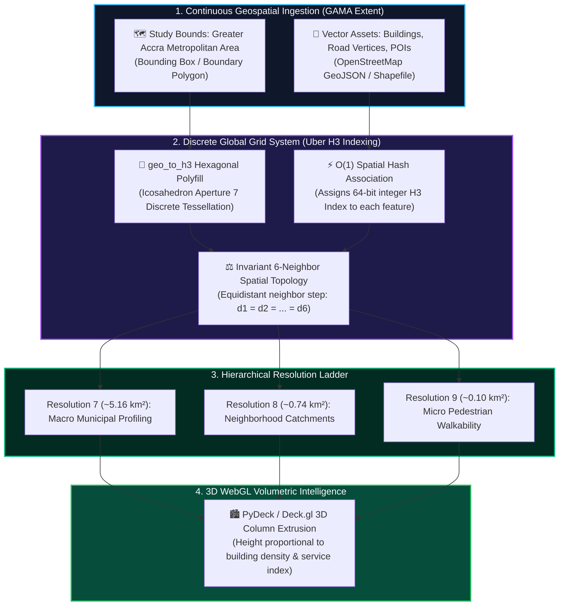

# 🔷 H3 Hexagonal Spatial Intelligence & Discrete Global Grid Systems (DGGS)

[](https://python.org)
[](https://h3geo.org/)
[](https://geopandas.org/)
[](https://deckgl.readthedocs.io/)
[](../LICENSE)

> **Lead Researcher & Engineer:** **Emmanuel Yerbo**  
> *BSc Geography & Regional Planning (First Class Honours, GPA: 3.82/4.00, Three-Time Dean's Award Recipient) — University of Cape Coast, Ghana*  
> 🆔 [ORCID: 0009-0008-8968-6999](https://orcid.org/0009-0008-8968-6999) | 💼 [LinkedIn](https://www.linkedin.com/in/emmanuelyerbo) | 💻 [GitHub Profile](https://github.com/Emmanuel-Yerbo) | 🌐 [Interactive Portfolio](https://emmanuelyerbo.github.io/emmanuelyerbo)

---

## 📌 Executive Summary

Traditional spatial analyses rely on arbitrary administrative units (e.g., electoral districts, municipal boundaries) that introduce severe **Modifiable Areal Unit Problem (MAUP)** distortions. Furthermore, square grids exhibit non-uniform adjacency distances ($\sqrt{2} \times$ difference between orthogonal and diagonal neighbors).

This project implements an end-to-end **Discrete Global Grid System (DGGS)** pipeline using **Uber H3** across the **Greater Accra Metropolitan Area (GAMA)**. By partitioning complex urban domains into regular, hierarchically nested hexagonal cells, every cell has exactly **6 equidistant neighbors**, enabling invariant spatial convolution, multi-scale aperture aggregation, and 3D volumetric density modeling.

---

## 🔬 Core Methodological Principles & Architecture



### 1. Hierarchical Resolution Ladder
- **Resolution 7** ($\sim 5.16\text{ km}^2$, edge $\sim 1.4\text{ km}$): Macro-scale municipal urban profile and regional infrastructure allocation.
- **Resolution 8** ($\sim 0.74\text{ km}^2$, edge $\sim 530\text{ m}$): Neighborhood-scale livability, healthcare catchment, and transport accessibility.
- **Resolution 9** ($\sim 0.10\text{ km}^2$, edge $\sim 200\text{ m}$): Micro-scale building cluster density and pedestrian walkability.

### 2. Multi-Criteria Hexagonal Indexing
Points of Interest (POIs), OpenStreetMap building footprints, and road network vertices are indexed directly to 64-bit integer H3 spatial hashes (`geo_to_h3`), allowing:
- $O(1)$ spatial lookup without geometric intersection overhead.
- Rapid $k$-ring spatial lag and neighborhood contiguity calculation via `k_ring(origin, k=1)`.
- Seamless hierarchical roll-up (`h3_to_parent`) and subdivision (`h3_to_children`).

### 3. 3D Volumetric Cartography
Density values (e.g., healthcare accessibility index, building footprint area per hex) are mapped to 3D column extrusions using **PyDeck (deck.gl WebGL)**, rendering elevation proportional to infrastructure density.

---

## 📂 Project Structure

```text
13_H3_Hexagonal_Spatial_Intelligence/
├── README.md                     <-- Technical documentation (You are here)
├── requirements.txt              <-- Dependencies (h3, geopandas, pydeck, folium)
├── chapter_08_h3_hexagons.py     <-- Modular Python pipeline
└── Chapter_08_H3_Hexagons.ipynb  <-- Interactive Jupyter Notebook with 3D PyDeck maps
```

---

## ⚡ Quickstart

```bash
# Navigate to directory
cd 13_H3_Hexagonal_Spatial_Intelligence

# Install requirements
pip install -r requirements.txt

# Execute pipeline
python chapter_08_h3_hexagons.py
```
