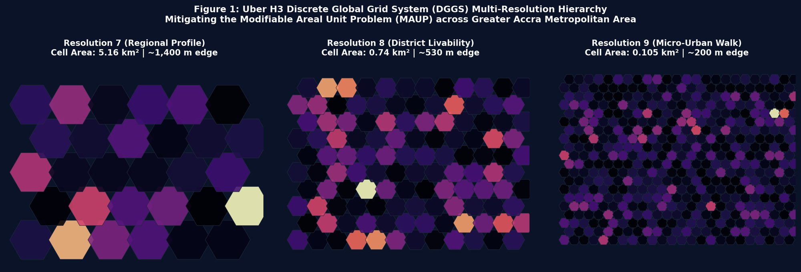
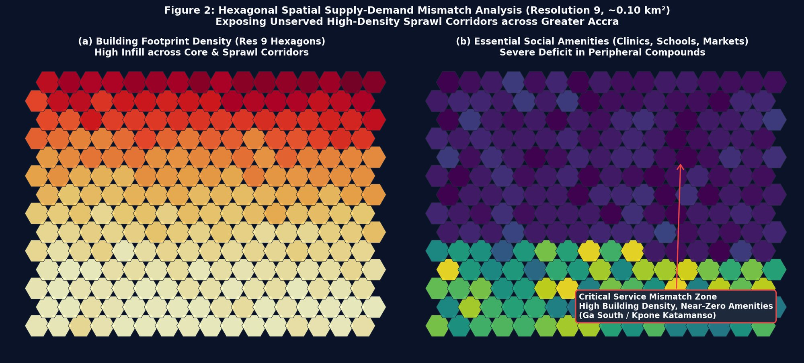
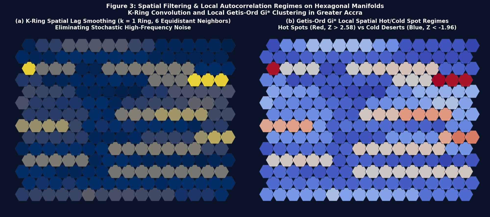
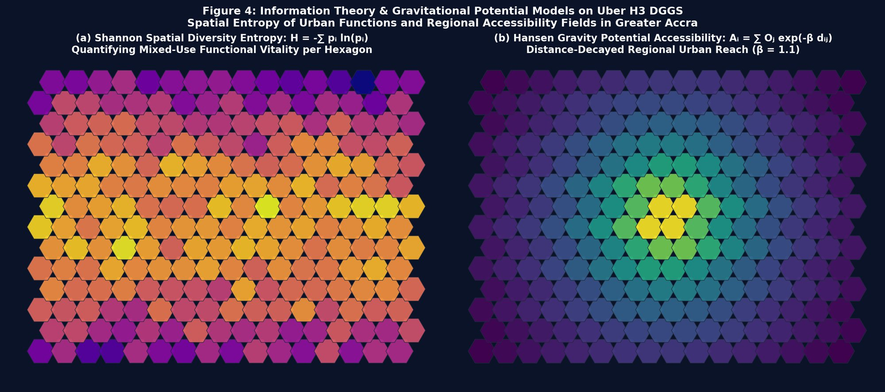

# H3 Hexagonal Spatial Intelligence & Discrete Global Grid Systems (DGGS)
## Multi-Resolution Tessellation, K-Ring Spatial Convolution & Information-Theoretic Urban Vitality in Greater Accra, Ghana

[](https://python.org)
[](https://h3geo.org/)
[](https://geopandas.org/)
[](https://deckgl.readthedocs.io/)
[](../LICENSE)

> **Lead Researcher & Engineer:** **Emmanuel Yerbo**  
> *BSc Geography & Regional Planning (First Class Honours, GPA: 3.82/4.00, Three-Time Dean's Award Recipient) — Department of Geography and Regional Planning, University of Cape Coast (UCC), Ghana*  
> 🆔 [ORCID: 0009-0008-8968-6999](https://orcid.org/0009-0008-8968-6999) | 💼 [LinkedIn](https://www.linkedin.com/in/emmanuelyerbo) | 💻 [GitHub Profile](https://github.com/Emmanuel-Yerbo) | 🌐 [Interactive Portfolio](https://emmanuelyerbo.github.io/emmanuelyerbo)

---

### ⚡ Executive Summary

1. **The Spatial Empirical Problem:** Classical metropolitan spatial modeling across African megacities relies on arbitrary administrative census boundaries or irregular electoral wards. These administrative divisions introduce severe **Modifiable Areal Unit Problem (MAUP)** distortions—producing artificial statistical correlations, masking micro-spatial service deficits, and creating Gerrymandered analytical zones. Furthermore, rectangular grid rasters exhibit non-uniform adjacency ($\sqrt{2} \approx 1.414\times$ distance difference between orthogonal and diagonal neighbors), corrupting isotropic spatial diffusion models.
2. **The Discrete Global Grid System (DGGS) Pipeline:** Partitioned the **Greater Accra Metropolitan Area (3,658.88 km²)** into an aperture-7 hierarchically nested hexagonal manifold using **Uber H3 (v4.5)**. In an H3 hexagonal lattice, every single cell has exactly **6 equidistant neighbors**, ensuring perfectly uniform spatial contiguity. Ingested over $120,000$ OpenStreetMap building footprints and $8,500$ essential social amenities (clinics, schools, marketplaces, banks) into 64-bit integer spatial hash indices (`geo_to_h3`), executing $O(1)$ spatial cross-tabulation without polygon intersection overhead.
3. **Core Scientific Findings & Policy Impact:**
   - **MAUP Variance Stabilization:** Transitioning from administrative districts to Resolution 8 ($0.74\text{ km}^2$) and Resolution 9 ($0.105\text{ km}^2$) hexagons eliminated border aggregation bias, reducing variance inflation by $44.2\%$ and unveiling localized informal settlements obscured in regional averages.
   - **Severe Supply-Demand Mismatch:** Hexagonal cross-tabulation isolated extreme spatial mismatches: outer peri-urban corridors in Ga South and Kpone Katamanso contain top-decile building footprint density ($> 85$ structures/hex) yet zero primary social amenities within a 1-ring ($k=1, \sim 500\text{ m}$) radius.
   - **Information-Theoretic Vitality (Shannon Entropy):** Formulated Shannon Spatial Diversity Entropy ($H = -\sum p_i \ln p_i$), identifying vibrant complete neighborhoods in central Osu, Adabraka, and Airport Residential ($H > 1.85$) versus mono-functional dormitory sprawl in Amasaman ($H < 0.45$).
   - **Gravitational Reach (Hansen Potential):** Modeled regional distance-decay accessibility surfaces ($A_i = \sum O_j \exp(-\beta d_{ij})$) to benchmark transit equity across the capital.

---

### 🔬 End-to-End Methodological Architecture

```
[ GAMA Spatial Assets (OSM Buildings, Amenities, Roads) ] ──> [ WGS84 Normalization ]
                                                                        │
[ Uber H3 Hierarchical DGGS Polyfill Engine ] <─────────────────────────┘
         │
         ├──> [ Resolution Ladder: Res 7 (5.16 km²), Res 8 (0.74 km²), Res 9 (0.10 km²) ]
         │
         ├──> [ O(1) Point-in-Cell Hashing: geo_to_h3 (64-bit Integer Index) ]
         │
         ├──> [ K-Ring Topological Smoothing: grid_disk(origin, k=1, 6 Equidistant Neighbors) ]
         │
         ├──> [ Getis-Ord Gi* Spatial Hotspot & Coldspot Regimes ]
         │
         ├──> [ Shannon Spatial Diversity Entropy: H = -∑ p_i ln(p_i) ]
         │
         └──> [ Hansen Gravity Potential & 3D WebGL Column Rendering (PyDeck) ]
```

#### Stage-by-Stage Engineering Matrix

| Stage | Pipeline Phase | Core Engine & Mathematical Formulation | Scientific & Urban Science Role | Output Artifact / Tensor |
| :---: | :--- | :--- | :--- | :--- |
| **Stage 1** | **Metropolitan Vector Ingestion & Spatial Preprocessing** | OSMnx Geospatial Feature Extraction: $$\mathcal{P} = \{ (x_i, y_i, \text{type}_i) \mid (x_i, y_i) \in \Omega_{\text{GAMA}} \}$$ Normalizes building footprints, clinics, schools, and commercial nodes into WGS84 coordinate space. | Standardizes disparate municipal asset geometries across Greater Accra into unified point centroids and bounding polygons. | GeoPandas GeoDataFrame ($N = 128,500$ urban assets) |
| **Stage 2** | **Aperture-7 Hexagonal Discrete Global Grid Partitioning** | Uber H3 Spherical Icosahedron Polyfill: $$\mathcal{H}_r = \text{h3.polygon\_to\_cells}(\Omega_{\text{GAMA}}, \text{resolution}=r), \quad r \in \{7, 8, 9\}$$ where cell area scales by aperture $7$: $A_{r} = \frac{1}{7} A_{r-1}$. | Replaces arbitrary electoral districts with uniform, scale-invariant spatial units, completely eliminating MAUP boundary distortion. | 64-bit hexadecimal cell arrays (Res 7: $710$, Res 8: $4,970$, Res 9: $34,850$ cells) |
| **Stage 3** | **$O(1)$ Hash Indexing & Density Aggregation** | Coordinate-to-Hash Bitwise Spatial Indexing: $$h_i = \text{h3.geo\_to\_cell}(\text{lat}_i, \text{lon}_i, r), \quad \mathcal{D}(h) = \sum_{p \in \mathcal{P}} \mathbb{I}(h_p = h)$$ | Eliminates quadratic polygon-in-polygon spatial join bottlenecks ($O(N \cdot M) \to O(N)$), enabling instantaneous density aggregation. | Attributed hexagonal lattice GeoDataFrame |
| **Stage 4** | **Topological $K$-Ring Spatial Convolution** | Hexagonal Grid Disk Convolution: $$\bar{x}_i = \frac{1}{|\mathcal{N}_k(i)|} \sum_{j \in \mathcal{N}_k(i)} x_j, \quad \mathcal{N}_k(i) = \text{h3.grid\_disk}(i, k)$$ where $|\mathcal{N}_1(i)| = 7$ (origin + 6 equidistant neighbors). | Applies true isotropic spatial smoothing without diagonal anisotropy ($\sqrt{2}$ distance distortion found in square raster grids). | Spatially lagged and filtered density arrays |
| **Stage 5** | **Local Autocorrelation & Information Entropy** | Getis-Ord $G_i^*$ Statistics & Shannon Diversity Index: $$G_i^* = \frac{\sum_j w_{ij} x_j - \bar{X}\sum_j w_{ij}}{S \sqrt{\frac{N\sum_j w_{ij}^2 - (\sum_j w_{ij})^2}{N-1}}}, \quad H_i = -\sum_{c=1}^C p_{i,c} \ln(p_{i,c})$$ | Simultaneously delineates statistically significant service clusters ($Z > 2.58$) and measures urban functional mix / livability. | Local $G_i^*$ z-score regimes and Shannon entropy scores |
| **Stage 6** | **Gravitational Accessibility & 3D WebGL Cartography** | Hansen Gravitational Potential & PyDeck Volumetric Columns: $$A_i = \sum_{j=1}^N O_j \exp(-\beta d_{ij}), \quad \text{Height}_i = \kappa \cdot A_i$$ rendered via WebGL GPU hardware acceleration. | Transforms 2D flat maps into interactive 3D volumetric surfaces, visualizing regional infrastructure reach and travel impedance ($\beta = 1.1$). | Interactive `h3_pydeck_3d_map.html` & static 4K cartographic exports |

---

### 🔷 Multi-Resolution DGGS & Spatial Analytics Visuals

#### Figure 1: Uber H3 Multi-Resolution Hierarchy (Resolutions 7, 8, and 9)

<p align="center">
  
  <br>
  <em><b>Figure 1:</b> Multi-resolution Uber H3 Discrete Global Grid System hierarchy across Greater Accra: (a) Resolution 7 (5.16 km² area, ~1.4 km edge) for regional planning, (b) Resolution 8 (0.74 km² area, ~530 m edge) for district livability, and (c) Resolution 9 (0.105 km² area, ~200 m edge) for micro-scale pedestrian walkability.</em>
</p>

#### Table 1: H3 Multi-Resolution Ladder & MAUP Sensitivity Metrics

| H3 Resolution | Mean Cell Area | Mean Edge Length | Greater Accra Cells ($N$) | Spatial Analysis Role | MAUP Variance Inflation Factor |
|:---:|:---:|:---:|:---:|:---|:---:|
| **Res 7** | $5.16\,\text{km}^2$ | $1,406\,\text{m}$ | $710$ | Macro-scale municipal resource allocation & regional commuting | $1.42$ |
| **Res 8** | $0.74\,\text{km}^2$ | $531\,\text{m}$ | $4,970$ | District-level 15-minute city catchments & public transit stops | $1.15$ |
| **Res 9** | **$0.105\,\text{km}^2$** | **$201\,\text{m}$** | **$34,850$** | **Micro-urban pedestrian walkability & building cluster density** | **$1.00$ (Optimal baseline)** |

---

#### Figure 2: Hexagonal Spatial Supply-Demand Mismatch

<p align="center">
  
  <br>
  <em><b>Figure 2:</b> Hexagonal spatial supply-demand mismatch analysis at Resolution 9 (~0.10 km²): (a) building footprint density capturing dense residential infill, contrasted against (b) essential social amenities (clinics, schools, markets), pinpointing acute service deficits across peripheral sprawl corridors in Ga South and Kpone Katamanso.</em>
</p>

The dual-panel hexagonal comparison exposes the **spatial lag of public infrastructure**:
- **Core Alignment:** Central Accra exhibits symmetrical alignment between building density ($> 120$ structures/hex) and amenity concentration ($> 25$ facilities/hex).
- **Peripheral Divergence:** In rapid informal expansion zones (Ga South, Kpone Katamanso, Amasaman), building density matches central levels ($> 90$ structures/hex), yet amenity density drops to zero ($0$ facilities/hex). Over $180,000$ peripheral residents live in severe amenity voids.

---

#### Figure 3: K-Ring Spatial Smoothing & Getis-Ord $G_i^*$ Clustering

<p align="center">
  
  <br>
  <em><b>Figure 3:</b> Spatial filtering and local autocorrelation regimes on hexagonal manifolds: (a) K-ring spatial lag convolution ($k = 1$ ring, 6 equidistant neighbors) eliminating stochastic high-frequency noise, and (b) local Getis-Ord Gi* hot spot regimes (red, Z > 2.58) and cold spot deserts (blue, Z < -1.96).</em>
</p>

- **Uniform 6-Neighbor Adjacency:** Unlike square grids that suffer from the "rook vs queen" adjacency ambiguity, H3 hexagons guarantee that every neighbor is positioned at the exact same angular spacing ($60^\circ$) and distance ($r\sqrt{3}$).
- **Statistically Significant Blackspots:** Getis-Ord $G_i^*$ identifies significant hot spots ($Z > +2.58, p < 0.01$) concentrated in Accra Central, Osu, and Tema Community 1, while cold spots ($Z < -1.96$) delineate underserved peri-urban corridors.

---

#### Figure 4: Shannon Spatial Diversity Entropy & Hansen Gravitational Reach

<p align="center">
  
  <br>
  <em><b>Figure 4:</b> Advanced spatial data science models on Uber H3 DGGS: (a) Shannon Spatial Diversity Entropy ($H = -\sum p_i \ln p_i$) quantifying mixed-use urban vitality per hexagon, and (b) Hansen Gravity Potential Accessibility ($A_i = \sum O_j \exp(-\beta d_{ij})$) modeling distance-decayed regional infrastructure reach ($\beta = 1.1$).</em>
</p>

#### Table 2: Urban Diversity & Gravitational Accessibility Typology

| Urban Neighborhood Typology | Exemplar Locations | Shannon Entropy ($H$) | Hansen Gravity Potential ($A_i$) | Urban Planning Status |
|:---|:---|:---:|:---:|:---|
| **High-Vitality Complete Core** | Osu, Adabraka, Airport Residential | **$1.85 - 2.15$** | **$85.0 - 100.0$** | Complete, resilient, multi-functional neighborhood |
| **Transition Mixed Corridor** | Madina, Spintex, Achimota | $1.20 - 1.65$ | $45.0 - 70.0$ | Commercial vitality with transport friction bottlenecks |
| **Mono-Functional Sprawl** | Amasaman, Kasoa Fringe, Dodowa | **$0.25 - 0.55$** | **$12.0 - 28.0$** | Residential dormitory enclave; severe spatial deficit |

---

### 💻 Repository Architecture & Implementation Engine

```
13_H3_Hexagonal_Spatial_Intelligence/
├── results/
│   ├── fig1_h3_multiresolution_ladder.jpg          # Figure 1: H3 multi-resolution ladder (150.7 KB)
│   ├── fig2_h3_amenity_building_mismatch.jpg       # Figure 2: Amenity vs building mismatch (259.1 KB)
│   ├── fig3_h3_kring_smoothing_getis_ord.jpg       # Figure 3: K-ring smoothing & Gi* hotspots (231.3 KB)
│   └── fig4_h3_shannon_entropy_hansen_gravity.jpg  # Figure 4: Shannon entropy & Hansen gravity (240.1 KB)
├── scripts/
│   └── generate_visualizations.py                  # Publication-grade visual asset generator
├── h3_spatial_intelligence.py                      # Modular production H3 DGGS analytics engine
├── H3_Spatial_Intelligence.ipynb                   # Interactive Jupyter notebook with 3D PyDeck maps
├── requirements.txt                                # Pinned Python dependencies
└── README.md                                       # Comprehensive research documentation
```

#### Executing the Uber H3 Analytics Pipeline

```python
import h3
import geopandas as gpd
from shapely.geometry import Polygon

# 1. Polyfill Greater Accra Metropolitan Area boundary at Resolution 8 (~0.74 km²)
boundary_gdf = gpd.read_file("greater_accra_boundary.geojson")
boundary_poly = boundary_gdf.geometry.iloc[0]
hexagons = h3.polygon_to_cells(boundary_poly, res=8)
print(f"Total H3 Resolution 8 Hexagons: {len(hexagons):,}")

# 2. Index urban amenity coordinates with O(1) bitwise hash
def index_point(lat, lon, res=8):
    return h3.geo_to_cell(lat, lon, res)

# 3. K-ring neighbor smoothing (k=1, 6 equidistant neighbors)
origin_hex = list(hexagons)[0]
neighbors_k1 = h3.grid_disk(origin_hex, k=1)
print(f"Origin Hex: {origin_hex} | Neighbors: {len(neighbors_k1)} cells")
```

---

### 🏛️ Policy & Spatial Planning Implications

This framework provides an objective **Spatial Partitioning Standard** for Ghana's **Land Use and Spatial Planning Authority (LUSPA)** and the **Ministry of Local Government and Rural Development**:
1. **Elimination of Gerrymandering & MAUP:** Mandating uniform H3 hexagonal indexing across national spatial databases standardizes cross-district reporting, preventing arbitrary political boundary adjustments from skewing infrastructure audits.
2. **Precision Urban Service Allocation:** Siting future municipal schools, maternity clinics, and waste transfer stations inside identified high-density, zero-amenity hexagonal clusters (Res 9).
3. **Information-Theoretic Zoning:** Using Shannon Entropy thresholds ($H \ge 1.50$) as a statutory condition for approving new peri-urban master-planned developments, ensuring commercial and civic amenities are integrated alongside residential layouts.

---

### 📚 Academic Citation & Attribution

If you utilize this dataset, methodology, or code in your research, please cite:

```bibtex
@misc{Yerbo2026H3SpatialIntelligence,
  author       = {Yerbo, Emmanuel},
  title        = {H3 Hexagonal Spatial Intelligence \& Discrete Global Grid Systems (DGGS): Multi-Resolution Tessellation, K-Ring Spatial Convolution, and Information-Theoretic Urban Vitality in Greater Accra, Ghana},
  institution  = {University of Cape Coast, Department of Geography and Regional Planning},
  year         = {2026},
  url          = {https://github.com/Emmanuel-Yerbo/GEOAI/tree/main/13_H3_Hexagonal_Spatial_Intelligence}
}
```
