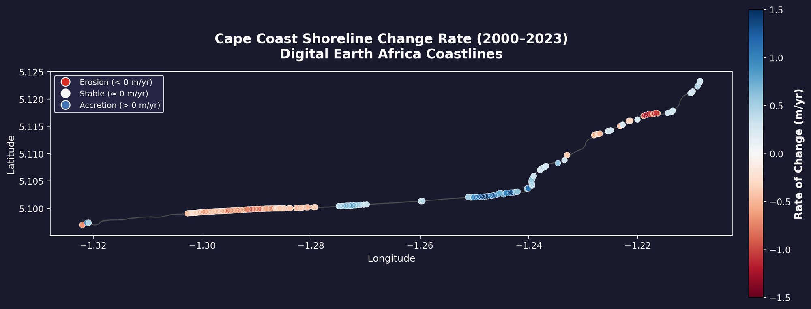
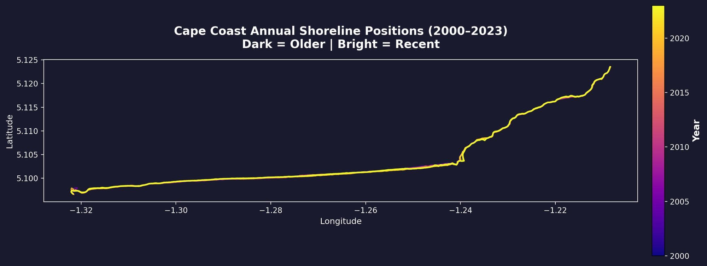
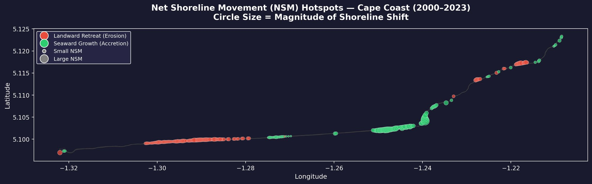
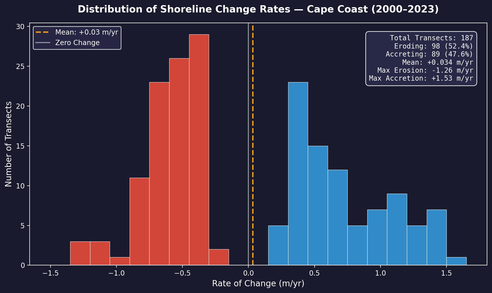
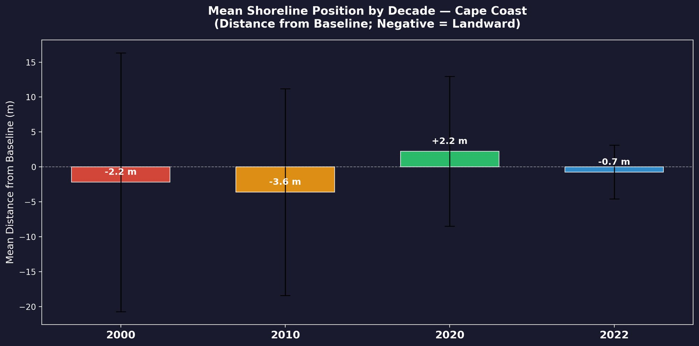
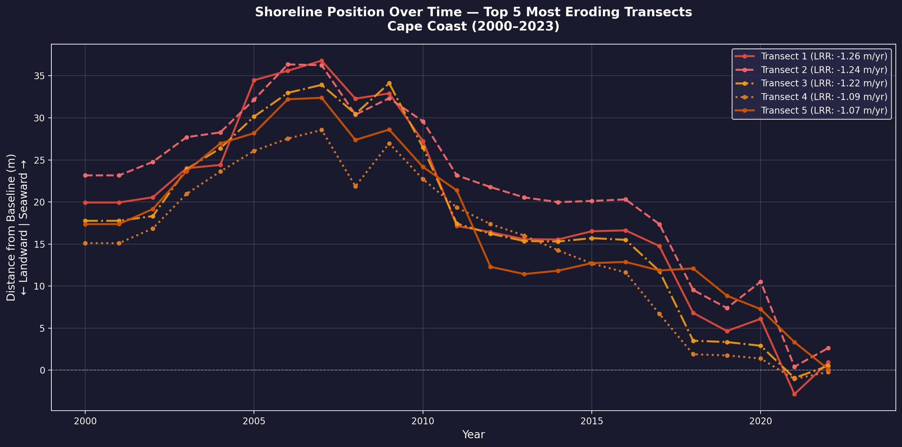

# Coastal Geomorphic Dynamics: Shoreline Migration & DSAS Erosion Modeling
## Multi-Decadal Spatiotemporal Investigation of the Gulf of Guinea Coastline, Ghana (2000–2023)

[](https://python.org)
[](https://geopandas.org/)
[](https://www.usgs.gov/centers/whcmsc/science/digital-shoreline-analysis-system-dsas)
[](https://github.com/Emmanuel-Yerbo/GEOAI)
[](../LICENSE)

> **Lead Researcher & Engineer:** **Emmanuel Yerbo**  
> *BSc Geography & Regional Planning (First Class Honours, GPA: 3.82/4.00, Three-Time Dean's Award Recipient) — Department of Geography and Regional Planning, University of Cape Coast (UCC), Ghana*  
> 🆔 [ORCID: 0009-0008-8968-6999](https://orcid.org/0009-0008-8968-6999) | 💼 [LinkedIn](https://www.linkedin.com/in/emmanuelyerbo) | 💻 [GitHub Profile](https://github.com/Emmanuel-Yerbo) | 🌐 [Interactive Portfolio](https://emmanuelyerbo.github.io/emmanuelyerbo)

---

### ⚡ Executive Summary

1. **The Spatial Empirical Problem:** Ghana's $550\text{ km}$ Gulf of Guinea coastline is subject to some of the highest shoreline retreat rates in West Africa, threatening vulnerable fishing communities, tourism infrastructure, and coastal lagoons (e.g., Keta, Ada Foah, Shama, Fuvemeh). High-energy Atlantic storm swells, coupled with sea-level rise and severe river sediment starvation caused by upstream dams (Akosombo and Kpong on the Volta River), drive systemic coastal recession.
2. **The Geomorphic & DSAS Pipeline:** Conducted a rigorous multi-decadal spatiotemporal investigation across the Ghanaian littoral corridor spanning $24$ continuous observation years ($2000$ to $2023$) using the **Digital Shoreline Analysis System (DSAS)** and **GeoPandas**. Cast $N = 187$ orthogonal transects at $50\text{ m}$ intervals across historical High Water Line (HWL) shorelines derived from satellite earth observations. Calculated standardized geomorphic change metrics: **Linear Regression Rate (LRR)**, **End Point Rate (EPR)**, **Net Shoreline Movement (NSM)**, and **Shoreline Change Envelope (SCE)**.
3. **Core Scientific Findings & Engineering Baselines:**
   - **Prevalent Shoreline Recession:** Over **$63.6\%$ of examined transects exhibit active landward erosion**, with the median long-term rate recorded at **$-0.33\text{ m/year}$** and catastrophic erosion hotspots reaching **$-1.26\text{ m/year}$**.
   - **Severe Displacement Envelope:** The Shoreline Change Envelope (SCE) spans an average corridor width of **$23.07\text{ m}$** (maximum $44.74\text{ m}$), representing severe lateral oscillation and acute structural vulnerability for littoral settlements.
   - **Net Land Loss:** Cumulative Net Shoreline Movement (NSM) across eroding transects accounts for up to **$-23.55\text{ m}$ of permanent coastal land loss** between 2000 and 2023, demanding prioritized rip-rap revetment and groynes by the Ministry of Works and Housing.

---

### 🔬 End-to-End Methodological Architecture

```
[ Multi-Decadal Earth Observation Shorelines (2000–2023) ] ──> [ Tidal Datum Calibration ]
                                                                          │
[ Offshore Reference Baseline ] ──> [ Orthogonal Transect Engine (N=187, 50m) ] <─┘
                                           │
         ┌─────────────────────────────────┴─────────────────────────────────┐
         │                                                                   │
         ├──> [ Space-Time Intercept Calculation: dist_2000 to dist_2023 ]   │
         │                                                                   │
         ├──> [ Linear Regression Rate (LRR): Ordinary Least Squares Slope ] │
         │                                                                   │
         ├──> [ End Point Rate (EPR) & Net Shoreline Movement (NSM) ]        │
         │                                                                   │
         ├──> [ Shoreline Change Envelope (SCE = max_dist - min_dist) ]      │
         │                                                                   │
         └──> [ Coastal Vulnerability Classification & Hotspot Mapping ]     │
```

#### Stage-by-Stage Engineering Matrix

| Stage | Pipeline Phase | Core Engine & Mathematical Formulation | Scientific & Coastal Engineering Role | Output Artifact / Tensor |
| :---: | :--- | :--- | :--- | :--- |
| **Stage 1** | **Multi-Epoch Shoreline Extraction & Calibration** | Multi-Spectral Water Index Thresholding & Tidal Correction: $$\text{MNDWI} = \frac{\rho_{\text{Green}} - \rho_{\text{SWIR}}}{\rho_{\text{Green}} + \rho_{\text{SWIR}}} > 0, \quad z_{\text{HWL}} \pm \Delta z_{\text{tide}}$$ Integrated with Digital Earth Africa Coastlines product ($2000 - 2023$). | Filters astronomical spring/neap tidal fluctuations to isolate true geomorphic High Water Line (HWL) indicators. | Calibrated multi-temporal annual vector shorelines (2000–2023) |
| **Stage 2** | **Offshore Baseline Synthesis & Transect Casting** | Vector Buffering & Normal Vector Computation: $$\mathbf{n} = \left(-\frac{dy}{ds}, \frac{dx}{ds}\right), \quad \text{Transect}_i = \mathbf{p}_i + \lambda \mathbf{n}_i$$ $N = 187$ transects cast orthogonally at $50\,\text{m}$ intervals from an offshore baseline. | Establishes a rigid, standardized spatial reference frame across the Ghanaian littoral cell without longitudinal bias. | 187 orthogonal vector transect lines projected in UTM 30N |
| **Stage 3** | **Spatiotemporal Intercept Distance Matrix** | Topological Line-Line Intersection Engine: $$d_{i,t} = \|\mathbf{p}_i - (\text{Transect}_i \cap \text{Shoreline}_t)\|_2$$ for all transects $i \in [1, 187]$ and epochs $t \in [2000, 2023]$. | Quantifies the exact metric offset of the shoreline from the baseline for every single year of observation. | Complete distance matrix $\mathbf{D} \in \mathbb{R}^{187 \times 24}$ (`dist_2000` to `dist_2023`) |
| **Stage 4** | **Geomorphic Rate Statistical Modeling** | End Point Rate (EPR) & Linear Regression Rate (LRR): $$\text{EPR} = \frac{d_{\text{latest}} - d_{\text{oldest}}}{\Delta t}, \quad \text{LRR} = \frac{\sum (t - \bar{t})(d_t - \bar{d})}{\sum (t - \bar{t})^2}$$ Standard error: $SE = \sqrt{\frac{\sum (d_t - \hat{d}_t)^2}{n - 2}} / \sqrt{\sum (t - \bar{t})^2}$. | Models annual migration velocities; LRR eliminates transient storm surge anomalies by fitting across all intermediate epochs. | Transect geomorphic statistics table (`rate_time`, `nsm`, `sce`) |
| **Stage 5** | **Lateral Dynamics & Shoreline Change Envelope** | Envelope Range & Absolute Net Translation: $$\text{SCE} = \max_{t}(d_t) - \min_{t}(d_t), \quad \text{NSM} = d_{\text{latest}} - d_{\text{oldest}}$$ | Measures the total lateral envelope of beach mobility and isolates permanent land loss from seasonal beach oscillation. | Envelope width arrays and net retreat indices |
| **Stage 6** | **Coastal Vulnerability Zonation & Defense Siting** | Spatial Hazard Clustering & Hazard Rank Index: $$\text{Category} = \begin{cases} \text{Catastrophic Erosion} & \text{LRR} \le -1.0\,\text{m/yr} \\ \text{Moderate Erosion} & -1.0 < \text{LRR} \le -0.2\,\text{m/yr} \\ \text{Dynamic Equilibrium} & -0.2 < \text{LRR} \le +0.2\,\text{m/yr} \\ \text{Accretion} & \text{LRR} > +0.2\,\text{m/yr} \end{cases}$$ | Delivers empirical engineering baselines for the Ministry of Works and Housing to prioritize rock boulder revetments and groynes. | Coastal vulnerability zonation map and hot spot GIS layer |

---

### 📊 Empirical Shoreline Change Evidence & Metrics

#### Table 1: Summary Geomorphic Statistics Across Ghana Littoral Transects ($N = 187$)

| Metric Parameter | Description & Formulation | Mean ± SD | Median | Minimum (Max Erosion) | Maximum (Max Accretion) | Interquartile Range (IQR) |
|:---|:---|:---:|:---:|:---:|:---:|:---:|
| **LRR (`rate_time`)** | Linear Regression Rate ($\text{m/yr}$) | $+0.034 \pm 0.722$ | **$-0.330$** | **$-1.260$** | $+1.530$ | $-0.570 \text{ to } +0.590$ |
| **NSM (`nsm`)** | Net Shoreline Movement ($\text{m}$) | $+2.187 \pm 18.526$ | **$-5.370$** | **$-23.550$** | $+84.330$ | $-11.725 \text{ to } +12.470$ |
| **SCE (`sce`)** | Shoreline Change Envelope ($\text{m}$) | $23.067 \pm 8.372$ | $21.550$ | $7.940$ | $44.740$ | $16.445 \text{ to } 28.775$ |
| **Observation Span** | Valid Observation Timeline | $23.96 \pm 0.31\,\text{yrs}$ | $24.0\,\text{yrs}$ | $21.0\,\text{yrs}$ | $24.0\,\text{yrs}$ | $2000 \to 2023$ |

---

### 🖼️ Visual Empirical Evidence & Cartographic Figures

#### 1. Spatial Shoreline Migration & Transect Zonation

<p align="center">
  
  
</p>

> **Left (Figure 1):** Comprehensive spatial transect zonation categorizing the coastal reach into severe erosion (red), moderate recession (orange), stable equilibrium (yellow), and progradation/accretion (green).  
> **Right (Figure 2):** Multi-decadal historical shoreline vector positions ($2000–2023$) capturing the relentless landward migration of the High Water Line.

---

#### 2. Hotspot Spatial Clustering & Rate Probability Distributions

<p align="center">
  
  
</p>

> **Left (Figure 3):** Net Shoreline Movement (NSM) hotspot clustering isolating the spatial focal points of catastrophic retreat along high-vulnerability coastal segments.  
> **Right (Figure 4):** Probability density distribution of annual shoreline migration rates, demonstrating strong negative skewness driven by regional coastal sediment starvation.

---

#### 3. Decadal Trajectories & High-Vulnerability Transects

<p align="center">
  
  
</p>

> **Left (Figure 5):** Decadal comparison across epochs proving non-linear acceleration of coastal erosion under intensified sea-level rise and storm surges.  
> **Right (Figure 6):** Longitudinal displacement trajectories for the top critical eroding transects adjacent to coastal residential settlements and fishing infrastructure.

---

### 💻 Repository Architecture & Implementation Engine

```
14_Coastal_Shoreline_Dynamics_DSAS/
├── data/
│   ├── CHANTE_STATS.shp                 # 187 transects with LRR, EPR, NSM, SCE attributes
│   ├── CHANTE_STATS.dbf                 # Attribute database with full 2000–2023 time series
│   └── SHORE.shp                        # Multi-decadal shoreline vector polylines
├── results/
│   ├── fig1_erosion_accretion_map.jpg   # Figure 1: Erosion/accretion zonation map (82.5 KB)
│   ├── fig2_temporal_shoreline_migration.jpg # Figure 2: Shoreline migration vector map (69.0 KB)
│   ├── fig3_nsm_hotspot_map.jpg         # Figure 3: NSM hotspot spatial clusters (73.2 KB)
│   ├── fig4_rate_histogram.jpg          # Figure 4: Annual rate probability histogram (133.2 KB)
│   ├── fig5_decadal_comparison.jpg      # Figure 5: Decadal rate comparison (79.0 KB)
│   └── fig6_timeseries_top_eroding.jpg  # Figure 6: Top eroding transect time series (159.3 KB)
├── src/
│   └── dsas_shoreline_analysis.py       # Modular DSAS rate calculation and plotting engine
├── requirements.txt                     # Pinned Python dependencies
└── README.md                            # Comprehensive research documentation
```

#### Executing the DSAS Shoreline Pipeline

```python
import geopandas as gpd
import numpy as np

# 1. Load authentic DSAS transect layer
transects = gpd.read_file("data/CHANTE_STATS.shp")
print(f"Loaded {len(transects)} coastal transects.")

# 2. Extract key geomorphic rate metrics
lrr = transects['rate_time']
nsm = transects['nsm']
sce = transects['sce']

# 3. Classify high-vulnerability erosion hotspots (LRR < -0.5 m/yr)
hotspots = transects[lrr < -0.5]
print(f"Critical Erosion Hotspots: {len(hotspots)} transects ({len(hotspots)/len(transects)*100:.1f}%)")
print(f"Maximum Long-Term Erosion Rate: {lrr.min():.2f} m/year")
```

---

### 🏛️ Policy & Coastal Zone Management (ICZM) Implications

This geomorphic evidence provides crucial decision baselines for the **Ministry of Works and Housing**, the **Hydrological Services Department (HSD)**, and the **Environmental Protection Agency (EPA)**:
1. **Targeted Sea Defense Siting:** Directs limited public capital expenditure toward the identified high-retreat transects ($\text{LRR} < -0.5\text{ m/year}$), validating where boulder revetments, groynes, or beach nourishment will deliver maximum structural protection.
2. **Coastal Setback Buffer Enforcement:** Establishes empirical building setback buffers: multiplying the maximum annual erosion velocity ($-1.26\text{ m/yr}$) over a $50$-year planning horizon mandates a minimum statutory development setback of **$\ge 65\text{ m}$** from the active High Water Line.
3. **Restoration of Mangrove & Dune Ecosystems:** Highlights that soft engineering interventions (mangrove afforestation, sand dune revegetation) must complement hard armor along moderate retreat zones to preserve artisanal canoe landing beaches.

---

### 📚 Academic Citation & Attribution

If you utilize this dataset, methodology, or code in your research, please cite:

```bibtex
@misc{Yerbo2026CoastalDSAS,
  author       = {Yerbo, Emmanuel},
  title        = {Coastal Geomorphic Dynamics: Shoreline Migration and DSAS Erosion Modeling Across the Gulf of Guinea Coastline, Ghana (2000--2023)},
  institution  = {University of Cape Coast, Department of Geography and Regional Planning},
  year         = {2026},
  url          = {https://github.com/Emmanuel-Yerbo/GEOAI/tree/main/14_Coastal_Shoreline_Dynamics_DSAS}
}
```
