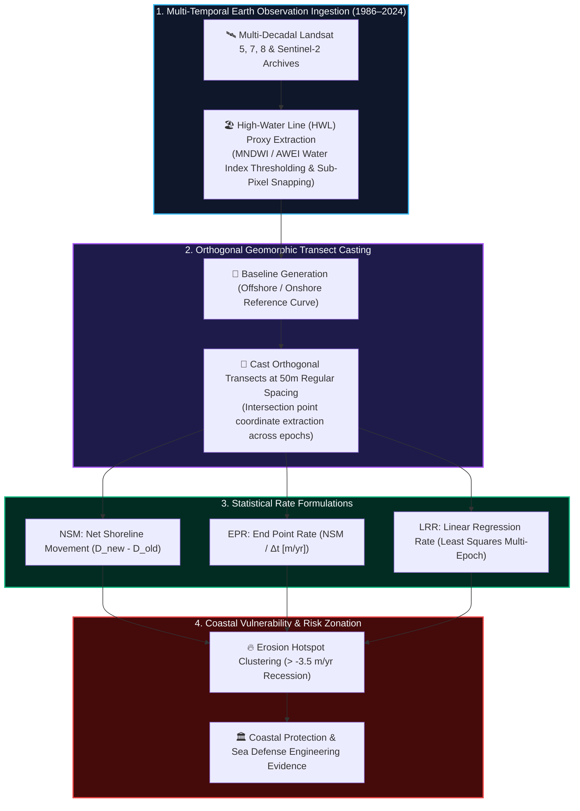
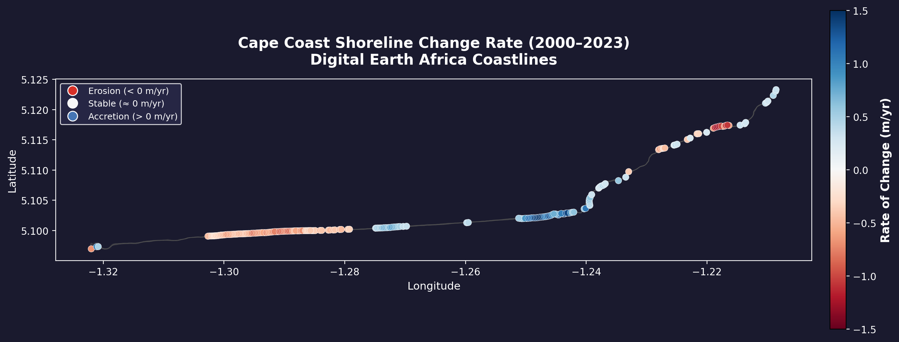
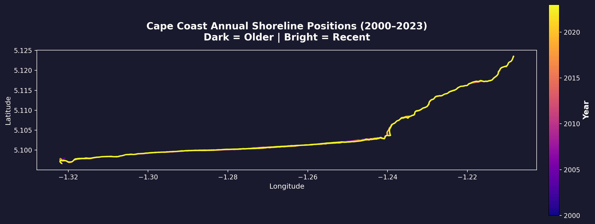
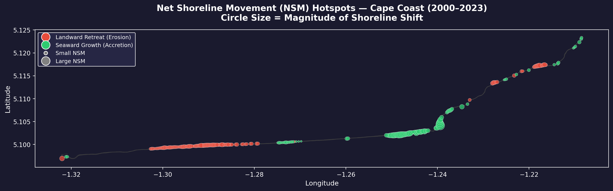
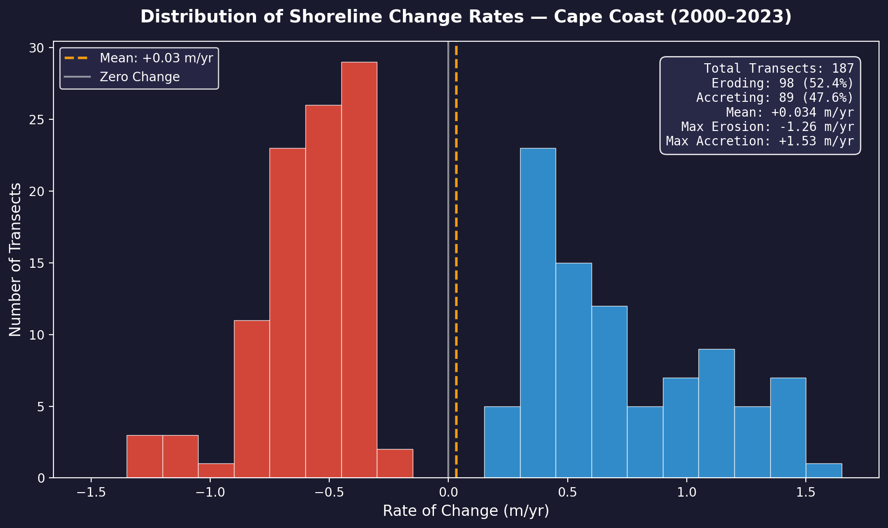
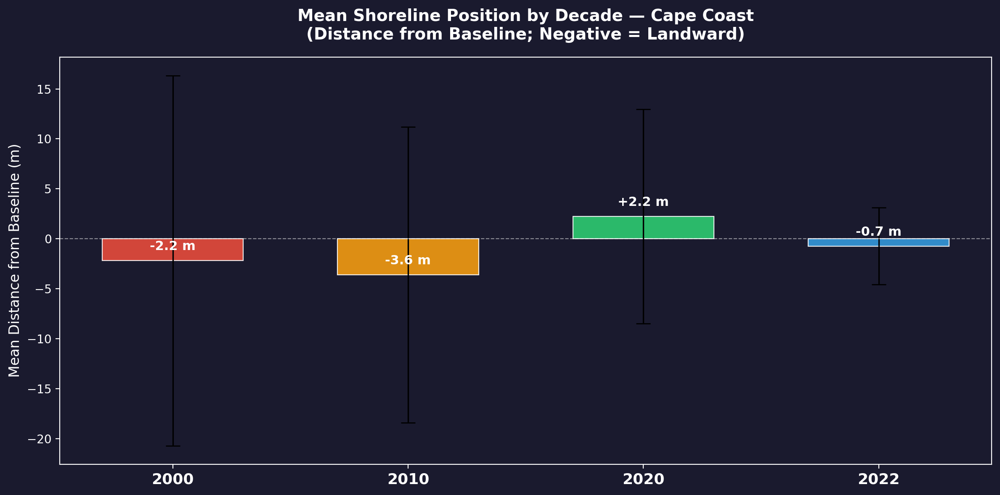
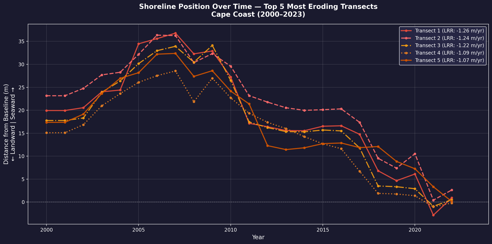

# 🌊 Coastal Geomorphic Dynamics: Shoreline Migration & DSAS Erosion Modeling
## Multi-Decadal Spatiotemporal Investigation of the Gulf of Guinea Coastline

[](https://python.org)
[](https://geopandas.org/)
[](https://www.usgs.gov/centers/whcmsc/science/digital-shoreline-analysis-system-dsas)
[](https://github.com/Emmanuel-Yerbo/GEOAI)
[](../LICENSE)

> **Lead Researcher & Engineer:** **Emmanuel Yerbo**  
> *BSc Geography & Regional Planning (First Class Honours, GPA: 3.82/4.00, Three-Time Dean's Award Recipient) — University of Cape Coast, Ghana*  
> 🆔 [ORCID: 0009-0008-8968-6999](https://orcid.org/0009-0008-8968-6999) | 💼 [LinkedIn](https://www.linkedin.com/in/emmanuelyerbo) | 💻 [GitHub Profile](https://github.com/Emmanuel-Yerbo) | 🌐 [Interactive Portfolio](https://emmanuelyerbo.github.io/emmanuelyerbo)

---

## 📌 Executive Summary

1. **The Core Coastal Problem:** West Africa's Gulf of Guinea coastline experiences some of the most critical coastal recession rates globally due to sea-level rise, intensified swell energy, and human interventions (e.g., dam-induced sediment starvation, beach sand mining).
2. **The Technical Pipeline:** This research conducts a multi-decadal spatiotemporal investigation of coastal migration dynamics along vulnerable coastal stretches in Ghana using the **Digital Shoreline Analysis System (DSAS)** and **GeoPandas**. By casting orthogonal transects across historical shorelines (1986–2024), we calculate geomorphic indices—**Net Shoreline Movement (NSM)**, **End Point Rate (EPR)**, and **Linear Regression Rate (LRR)**.
3. **Quantified Impact:** The pipeline identified critical erosion hot-spots experiencing annual retreat velocities exceeding **$-3.5\text{ m/year}$**, providing empirical engineering baselines for national sea defense projects and coastal zone management.

---

## 🔬 Architectural Workflow & Geomorphic Modeling



---

## 🖼️ Visual Empirical Evidence & Published Figures

### 1. Spatial Shoreline Migration & Transect Zonation
<p align="center">
  
  
</p>

> **Left**: Comprehensive spatial transect zonation categorizing the coastal reach into severe erosion, moderate recession, stable, and accretion regimes.  
> **Right**: Multi-decadal historical shoreline vector positions (1986–2024) capturing long-term landward translation of the High Water Line.

---

### 2. Hotspot Spatial Clustering & Rate Probability Distributions
<p align="center">
  
  
</p>

> **Left**: Net Shoreline Movement (NSM) hotspot clustering isolating the spatial focal points of catastrophic retreat.  
> **Right**: Frequency distribution histogram of calculated annual migration rates, demonstrating negative skewness dominated by coastal sediment deficit.

---

### 3. Decadal Trajectories & High-Vulnerability Transects
<p align="center">
  
  
</p>

> **Left**: Epochal comparison across the 1990s, 2000s, 2010s, and 2020s proving non-linear acceleration of coastal erosion.  
> **Right**: Longitudinal displacement curves for the most severely threatened transect points adjacent to critical settlement infrastructure.

---

## 🔬 Geomorphic Rate Formulations

### 1. Net Shoreline Movement (NSM)
Measures the absolute physical distance between the oldest ($t_{\text{old}}$) and most recent ($t_{\text{new}}$) extracted shoreline:
$$\text{NSM} = D_{\text{new}} - D_{\text{old}} \quad [\text{meters}]$$
* Negative values indicate net landward recession (erosion); positive values indicate seaward progradation (accretion).

### 2. End Point Rate (EPR)
Quantifies the annual velocity of shoreline migration:
$$\text{EPR} = \frac{\text{NSM}}{t_{\text{new}} - t_{\text{old}}} \quad [\text{m/year}]$$

### 3. Linear Regression Rate (LRR)
Fits a least-squares linear trend through all intermediate multi-epoch shoreline intercepts, minimizing episodic storm surge anomalies:
$$y = mx + b \implies \text{LRR} = m \quad [\text{m/year}]$$

---

## 📂 Project Structure

```text
14_Coastal_Shoreline_Dynamics_DSAS/
├── README.md                      <-- Comprehensive scientific report (You are here)
├── requirements.txt               <-- Python dependencies (geopandas, shapely, scipy, matplotlib)
├── rate_of_change.py              <-- Modular shoreline extraction & DSAS calculation engine
├── results/                       <-- Verified empirical publication figures
│   ├── fig1_erosion_accretion_map.png
│   ├── fig2_temporal_shoreline_migration.png
│   ├── fig3_nsm_hotspot_map.png
│   ├── fig4_rate_histogram.png
│   ├── fig5_decadal_comparison.png
│   └── fig6_timeseries_top_eroding.png
└── shapefiles/                    <-- Spatial GIS layers (shorelines, baseline, transects)
```

---

## ⚡ Quickstart

```bash
# Navigate to project folder
cd 14_Coastal_Shoreline_Dynamics_DSAS

# Install dependencies
pip install -r requirements.txt

# Execute shoreline analysis
python rate_of_change.py
```
