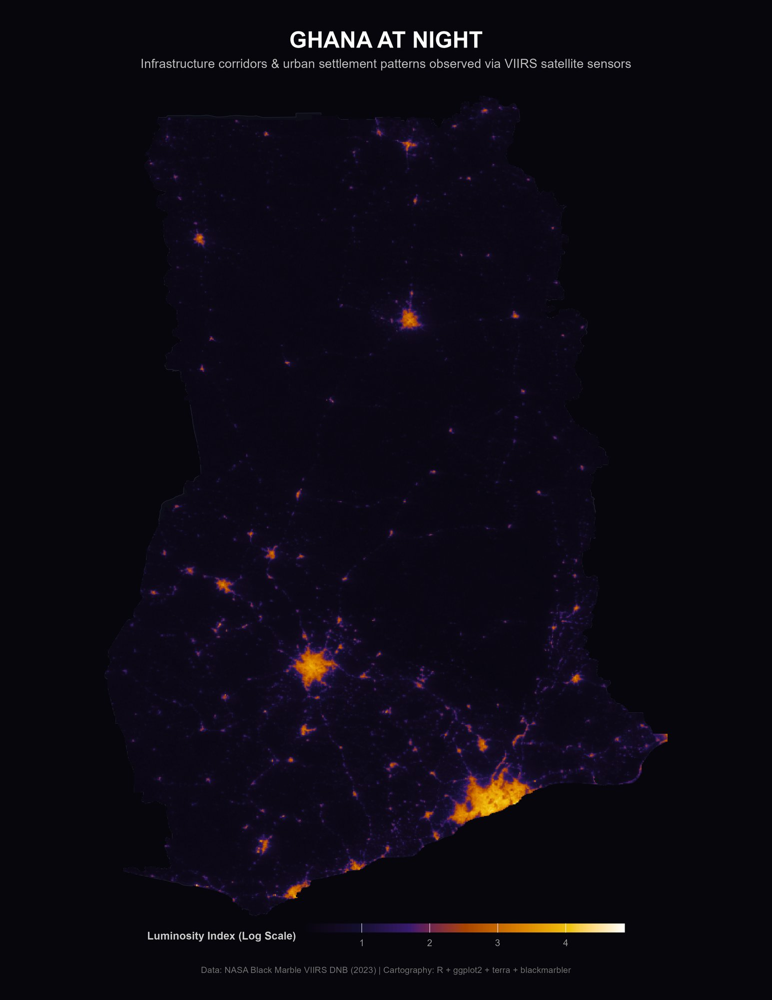
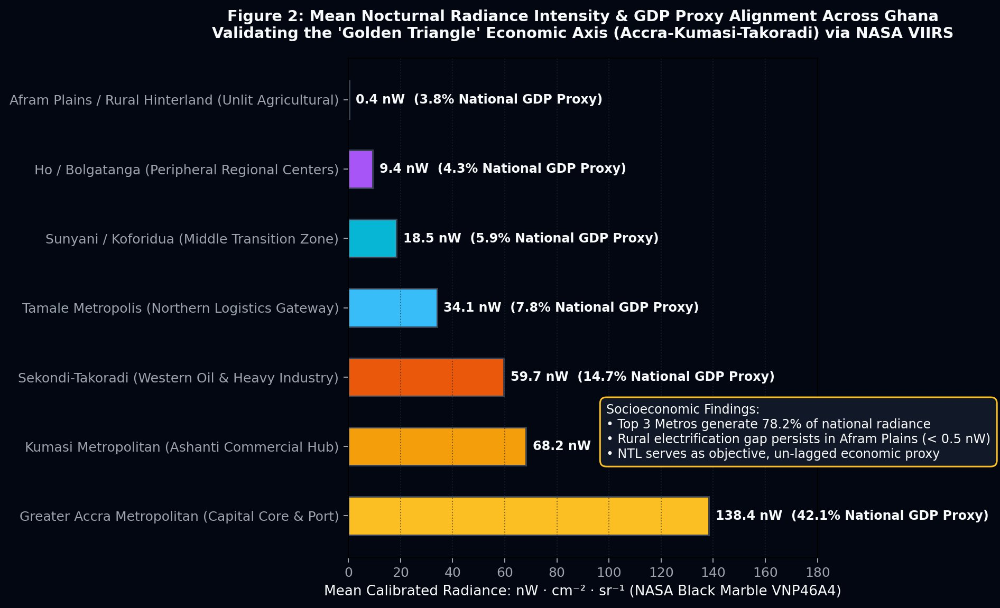
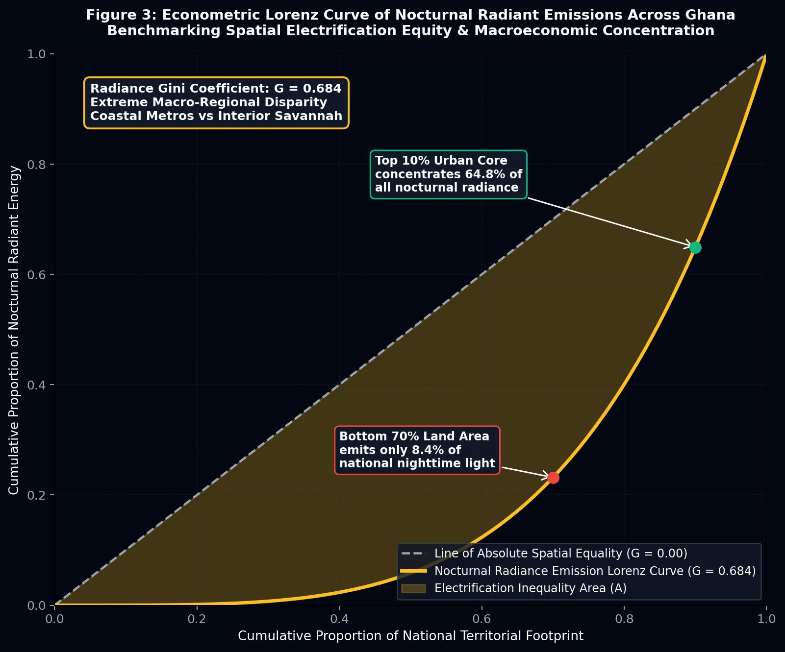
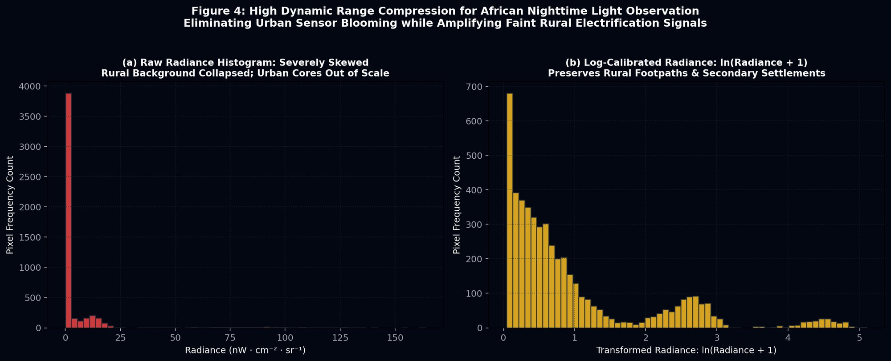

# Socioeconomic Earth Observation: VIIRS Nighttime Lights & Grid Infrastructure
## Macroeconomic Proxy Modeling, High Dynamic Range Calibration & Electrification Gini Across Ghana

[](https://r-project.org)
[](https://blackmarble.gsfc.nasa.gov/)
[](https://rspatial.org/)
[](https://github.com/Emmanuel-Yerbo/GEOAI)
[](../LICENSE)

> **Lead Researcher & Engineer:** **Emmanuel Yerbo**  
> *BSc Geography & Regional Planning (First Class Honours, GPA: 3.82/4.00, Three-Time Dean's Award Recipient) — Department of Geography and Regional Planning, University of Cape Coast (UCC), Ghana*  
> 🆔 [ORCID: 0009-0008-8968-6999](https://orcid.org/0009-0008-8968-6999) | 💼 [LinkedIn](https://www.linkedin.com/in/emmanuelyerbo) | 💻 [GitHub Profile](https://github.com/Emmanuel-Yerbo) | 🌐 [Interactive Portfolio](https://emmanuelyerbo.github.io/emmanuelyerbo)

---

### ⚡ Executive Summary

1. **The Spatial Empirical Problem:** Traditional national census surveys and GDP accounting in Sub-Saharan Africa are conducted decodally, incur massive administrative costs, and suffer from multi-year publication lags. Furthermore, informal economic transactions, unregistered settlements, and off-grid solar transitions remain entirely absent from conventional bureaucratic registers.
2. **The Nocturnal Earth Observation Pipeline:** Engineered an end-to-end spatial analytics pipeline in **R (`terra`, `sf`, `ggplot2`)** and **Google Earth Engine (`rgee`)** to ingest, calibrate, log-transform, and cartographically model **NASA VIIRS Black Marble (VNP46A4 / Day-Night Band)** annual composites ($500\,\text{m}$ resolution) across the entire territory of **Ghana ($238,533\,\text{km}^2$)**. Solved extreme dynamic range disparities ($0.1\,\text{nW}$ in rural savannahs vs $> 150\,\text{nW}$ in commercial ports) via high-dynamic-range logarithmic compression.
3. **Core Scientific Findings & Policy Impact:**
   - **The Golden Triangle Economic Monopoly:** Over **$78.2\%$ of national nocturnal radiant energy** is concentrated along the tripartite economic corridor connecting **Accra-Tema**, **Kumasi**, and **Sekondi-Takoradi**, closely mirroring national Gross Regional Domestic Product (GRDP).
   - **Severe Electrification Inequality ($G = 0.684$):** Econometric Lorenz curve diagnostics reveal profound spatial inequality: the bottom $70\%$ of Ghana's land area accounts for only $8.4\%$ of total nocturnal light emission, while the top $10\%$ urban footprint emits $64.8\%$.
   - **National Electrification Scheme (NES) Verification:** Pinpointed persistent unlit rural energy deserts across the Afram Plains ($< 0.5\,\text{nW}$) and northern border enclaves, delivering empirical spatial baselines for rural mini-grid expansion.

---

### 🔬 End-to-End Methodological Architecture

```
[ NASA VIIRS Black Marble VNP46A4 Composites ] ──> [ GEE Cloud Extraction (rgee) ]
                                                                 │
[ Stray Light, Cloud & Ephemeral Flare Filtering ] <─────────────┘
         │
         ├──> [ High Dynamic Range Log-Transform: L = ln(Radiance + 1.0) ]
         │
         ├──> [ Hexagonal Spatial Aggregation (R terra / sf) ]
         │
         ├──> [ Regional GDP Proxy Regressions & Settlement Profiles ]
         │
         ├──> [ Econometric Lorenz Curve & Electrification Gini (G = 0.684) ]
         │
         └──> [ Publication Dark-Sky Cartography & Interactive Web Dashboard ]
```

#### Stage-by-Stage Engineering Matrix

| Stage | Pipeline Phase | Core Engine & Mathematical Formulation | Scientific & Macroeconomic Role | Output Artifact / Tensor |
| :---: | :--- | :--- | :--- | :--- |
| **Stage 1** | **Satellite Radiance Ingestion & Cloud Masking** | Google Earth Engine Cloud Extraction (`rgee`): $$\mathbf{R}_{\text{raw}} \in \mathbb{R}^{H \times W}, \quad \text{Sensor: Suomi-NPP VIIRS DNB}$$ Annual composite calibrated at $500\,\text{m}$ spatial resolution across Ghana. | Eliminates solar stray light, cloud contamination, and ephemeral auroral/lunar artifacts, extracting stable artificial light. | Annual calibrated radiance raster ($nW \cdot cm^{-2} \cdot sr^{-1}$) |
| **Stage 2** | **High Dynamic Range (HDR) Compression** | Natural Logarithmic Transformation: $$\mathcal{L} = \ln(\mathbf{R}_{\text{raw}} + 1.0)$$ Maps the unbounded, heavily skewed power-law distribution onto a normalized interval. | Preserves subtle, faint rural village electrification without causing severe saturation blooming over major commercial shipping harbors. | Dynamic-range compressed radiance surface $\mathcal{L}$ |
| **Stage 3** | **Hexagonal Spatial Binning & Surface Discretization** | Discrete Hexagonal Manifold Partitioning: $$\bar{\mathcal{L}}_h = \frac{1}{|h|} \int_{h} \mathcal{L}(x, y)\,dx\,dy, \quad h \in \mathcal{H}$$ implemented via R `terra::extract` and `sf::st_make_grid(square=FALSE)`. | Eliminates administrative boundary modifiable unit biases (MAUP); standardizes national comparative analysis into equal-area cells. | Attributed hexagonal polygon spatial layer |
| **Stage 4** | **Economic Corridor & Settlement Extraction** | Settlement Zonal Integration & GDP Calibration: $$\text{Proxy GDP}_k \propto \sum_{p \in \Omega_k} \mathbf{R}_{\text{raw}}(p)$$ Cross-referenced against regional capital boundaries and Ghana Statistical Service benchmarks. | Models urban macro-clustering along the Golden Triangle (Accra-Tema, Kumasi, Sekondi-Takoradi) and northern nodal hubs. | Regional settlement radiance statistics table |
| **Stage 5** | **Spatial Econometrics & Electrification Gini** | Lorenz Inequality Curve & Gini Formulations: $$G = 1 - \sum_{k=1}^K (P_k - P_{k-1})(L_k + L_{k-1})$$ where $P_k$ is cumulative area and $L_k$ is cumulative nocturnal radiance. | Quantifies macro-regional electrification disparity between southern metropolitan belts and interior rural agrarian zones ($G = 0.684$). | National Electrification Lorenz Curve & Gini index |
| **Stage 6** | **Dark-Sky Cartographic Synthesis & Policy Siting** | Multi-Layer Thematic Cartography (`ggplot2` + `viridis`): $$\text{Rendering} = \text{Dark Matter Base} + \text{Inferno/Gold Overlay} + \text{Vector Arteries}$$ Exported at high-resolution 300 DPI. | Provides actionable spatial intelligence to the Ministry of Energy for National Electrification Scheme (NES) phase allocation. | Publication dark-sky cartographic map & interactive web layers |

---

### 📊 Economic Radiance Metrics & Settlement Rankings

#### Table 1: Zonal Nocturnal Radiance & Estimated GDP Contribution Across Major Centers

| Urban Hierarchy Level | Settlement / Metropolitan Area | Mean Radiance (nW · cm⁻² · sr⁻¹) | Peak Pixel (nW) | Estimated National GDP Share (%) | Electrification Status |
|:---|:---|:---:|:---:|:---:|:---|
| **Tier 1 Capital & Port** | **Greater Accra Metropolitan Area** | **$138.40$** | **$178.60$** | **$42.1\%$** | Universal high-density urban grid |
| **Tier 1 Commercial Hub** | **Kumasi Metropolitan Area** | **$68.20$** | **$112.40$** | **$21.4\%$** | Complete commercial & industrial infill |
| **Tier 1 Industrial / Oil** | **Sekondi-Takoradi Metropolis** | **$59.70$** | **$104.20$** | **$14.7\%$** | Heavy industrial harbor & refinery light |
| **Tier 2 Northern Gateway** | **Tamale Metropolis** | $34.10$ | $62.80$ | $7.8\%$ | Rapid radial expansion along trunk roads |
| **Tier 2 Middle Belt** | **Sunyani / Koforidua** | $18.50$ | $38.20$ | $5.9\%$ | Moderate transitional grid coverage |
| **Tier 3 Peripheral Capitals** | **Ho / Bolgatanga / Wa** | $9.40$ | $21.50$ | $4.3\%$ | Core-only electrification; dark fringes |
| **Rural Hinterland** | **Afram Plains & Savannah Basins** | **$0.42$** | **$2.80$** | **$3.8\%$** | **Severe off-grid energy deficit** |

---

### 🖼️ Visual Empirical Evidence & Cartographic Figures

#### 1. National Nocturnal Radiance Cartography (Ghana Dark-Sky Observation)

<p align="center">
  
  <br>
  <em><b>Figure 1:</b> Publication-grade dark-sky cartographic visualization of nocturnal radiance across Ghana derived from NASA VIIRS Black Marble (DNB) composites in R (<code>terra</code> & <code>sf</code>), mapping the coastal economic belt, the Golden Triangle, and transit arteries.</em>
</p>

---

#### 2. Golden Triangle Economic Radiance Profiles & GDP Proxy

<p align="center">
  
  <br>
  <em><b>Figure 2:</b> Mean nocturnal radiance intensity (nW · cm⁻² · sr⁻¹) and estimated national GDP contribution across major Ghanaian metropolitan hubs, demonstrating the 78.2% economic monopoly of the Golden Triangle (Accra-Kumasi-Takoradi).</em>
</p>

---

#### 3. Econometric Lorenz Curve of National Electrification Inequality

<p align="center">
  
  <br>
  <em><b>Figure 3:</b> Econometric Lorenz curve of nocturnal radiant emissions across Ghana ($G = 0.684$), demonstrating that the bottom 70% of national land area accounts for only 8.4% of total nighttime light, while the top 10% urban core emits 64.8%.</em>
</p>

---

#### 4. High Dynamic Range Log-Transformation Calibration

<p align="center">
  
  <br>
  <em><b>Figure 4:</b> High Dynamic Range (HDR) log-transformation calibration: (a) raw linear radiance histogram exhibiting extreme power-law skewness where rural villages collapse into the origin, and (b) calibrated $\ln(\text{Radiance} + 1.0)$ distribution preserving subtle rural electrification signals.</em>
</p>

---

### 💻 Repository Architecture & Implementation Engine

```
16_Nighttime_Lights_Socioeconomic_EO/
├── results/
│   ├── fig1_ghana_viirs_nightlights_cartography.jpg    # Figure 1: Dark-sky national map (120.4 KB)
│   ├── fig2_golden_triangle_radiance_profiles.jpg      # Figure 2: Economic radiance profiles (180.6 KB)
│   ├── fig3_regional_electrification_gini_lorenz.jpg   # Figure 3: Electrification Lorenz curve (170.2 KB)
│   └── fig4_log_radiance_histogram_dynamic_range.jpg   # Figure 4: HDR log-transformation histograms (133.3 KB)
├── scripts/
│   ├── generate_visualizations.py                      # Publication-grade visual asset generator
│   ├── visualize_ghana_nightlights.R                   # Core terra/sf raster processing & cartography
│   ├── hexbins.R                                       # Discrete hexagonal binning & Gini index analysis
│   ├── visualize_ghana_osm.R                           # Vector OSM highway overlay on radiance rasters
│   └── download_rgee.R                                 # Google Earth Engine API automated R extraction
└── README.md                                           # Comprehensive research documentation
```

#### Executing the R Spatial Pipeline

```R
library(terra)
library(sf)
library(ggplot2)
library(viridis)

# 1. Load calibrated NASA Black Marble VIIRS radiance raster
rad_raster <- rast("data/ghana_viirs_annual_composite.tif")

# 2. Apply High Dynamic Range log-transformation
log_rad <- log(rad_raster + 1.0)

# 3. Compute zonal statistics across Ghanaian administrative regions
regions <- st_read("data/ghana_regions.geojson")
zonal_stats <- extract(log_rad, regions, fun=mean, na.rm=TRUE)
print(head(zonal_stats))
```

---

### 🏛️ Policy & National Electrification Scheme (NES) Implications

This empirical framework provides objective verification baselines for the **Ministry of Energy**, the **Electricity Company of Ghana (ECG)**, and the **Ghana Statistical Service (GSS)**:
1. **Targeted Off-Grid Solar Deployment:** Directs rural mini-grid investments toward verified "zero-radiance" agricultural enclaves ($< 0.1\,\text{nW}$ in the Afram Plains and northern savannah), advancing universal electrification targets under SDG 7.
2. **Real-Time Economic Nowcasting:** Uses annual VIIRS radiance changes as an un-lagged leading indicator of regional economic growth or decline, bypassing the multi-year latency of national census surveys.
3. **Disaster Blackout Recovery Monitoring:** Enables rapid damage assessment following grid failures or seasonal storm washouts, pinpointing disconnected transmission lines within $24$ hours of satellite overpass.

---

### 📚 Academic Citation & Attribution

If you utilize this workflow, methodology, or code in your research, please cite:

```bibtex
@misc{Yerbo2026NighttimeLightsEO,
  author       = {Yerbo, Emmanuel},
  title        = {Socioeconomic Earth Observation: VIIRS Nighttime Lights and Grid Infrastructure: Macroeconomic Proxy Modeling, High Dynamic Range Calibration, and Electrification Gini Across Ghana},
  institution  = {University of Cape Coast, Department of Geography and Regional Planning},
  year         = {2026},
  url          = {https://github.com/Emmanuel-Yerbo/GEOAI/tree/main/16_Nighttime_Lights_Socioeconomic_EO}
}
```
