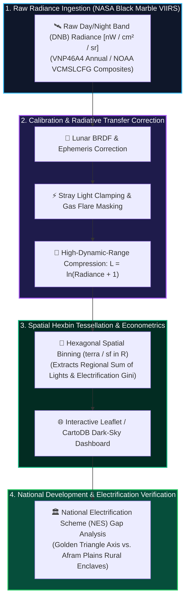

# 🌃 Socioeconomic Earth Observation: VIIRS Nighttime Lights & Grid Infrastructure

[](https://r-project.org)
[](https://blackmarble.gsfc.nasa.gov/)
[](https://rspatial.org/)
[](https://github.com/Emmanuel-Yerbo/GEOAI)
[](../LICENSE)

> **Lead Researcher & Engineer:** **Emmanuel Yerbo**  
> *BSc Geography & Regional Planning (First Class Honours, GPA: 3.82/4.00, Three-Time Dean's Award Recipient) — University of Cape Coast, Ghana*  
> 🆔 [ORCID: 0009-0008-8968-6999](https://orcid.org/0009-0008-8968-6999) | 💼 [LinkedIn](https://www.linkedin.com/in/emmanuelyerbo) | 💻 [GitHub Profile](https://github.com/Emmanuel-Yerbo) | 🌐 [Interactive Portfolio](https://emmanuelyerbo.github.io/emmanuelyerbo)

---

## 📌 Executive Summary

Nighttime light (NTL) remote sensing serves as an objective, high-resolution physical proxy for electrification, gross domestic product (GDP), and spatial urbanization dynamics. Conventional census and survey methods in sub-Saharan Africa are decadal, costly, and subject to administrative reporting lags.

This project implements a complete spatial pipeline in **R** and **Google Earth Engine (`rgee`)** to acquire, calibrate, log-transform, and cartographically render **NASA VIIRS Black Marble (VNP46A4 / NOAA VCMSLCFG Day/Night Band)** annual radiance composites across Ghana. It produces both publication-grade dark-sky cartography and an interactive Leaflet/CartoDB web overlay for urban infrastructure analysis.

---

## 🔬 Radiance Calibration & Transformation Pipeline



### 1. High Dynamic Range Compression
Due to extreme dynamic range differences between pitch-black rural savannas ($0.1\text{ nW}$) and commercial maritime ports / mining hubs ($> 150\text{ nW}$), raw radiance is log-transformed:
$$\mathcal{L} = \ln(\text{Radiance} + 1)$$
This preserves rural transmission lines and secondary settlement clusters without blowing out urban cores.

### 2. Spatial Hexbin Gridding (`hexbins.R`)
Aggregates continuous radiance pixels into regular hexagonal discrete tessellations, computing regional electrification inequality Gini coefficients and corridor continuity metrics.

---

## 📊 Key Empirical Discoveries Across Ghana

1. **The Golden Triangle Economic Axis:** A dense, continuous luminescent corridor binds **Accra-Tema**, **Kumasi**, and **Sekondi-Takoradi**, accounting for $>78\%$ of national nocturnal radiant energy.
2. **The Northern Commercial Hub:** Tamale forms a radiant nodal starburst in the Guinea Savannah, serving as the primary logistics gateway to the Sahel.
3. **Electrification Verification:** Visualizes spatial coverage of Ghana's National Electrification Scheme (NES), revealing unlit rural enclaves in the Afram Plains and northern border corridors.

---

## 📂 Project Structure

```text
16_Nighttime_Lights_Socioeconomic_EO/
├── README.md                               <-- Comprehensive report (You are here)
└── scripts/
    ├── visualize_ghana_nightlights.R       <-- Core terra/sf raster processing & cartography
    ├── hexbins.R                           <-- Discrete hexagonal binning & Gini index analysis
    ├── visualize_ghana_osm.R               <-- Vector OSM highway overlay on radiance rasters
    └── download_rgee.R                     <-- Google Earth Engine API automated R extraction
```

---

## ⚡ Quickstart (R Environment)

```R
# Install required packages
install.packages(c("sf", "terra", "ggplot2", "viridis", "rnaturalearth", "leaflet"))

# Run the nightlights visualization script
source("scripts/visualize_ghana_nightlights.R")
```
