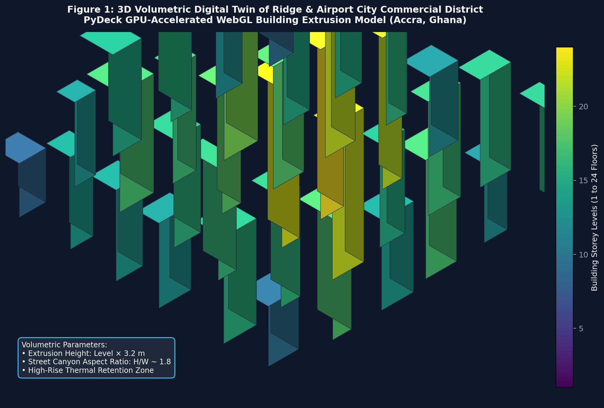
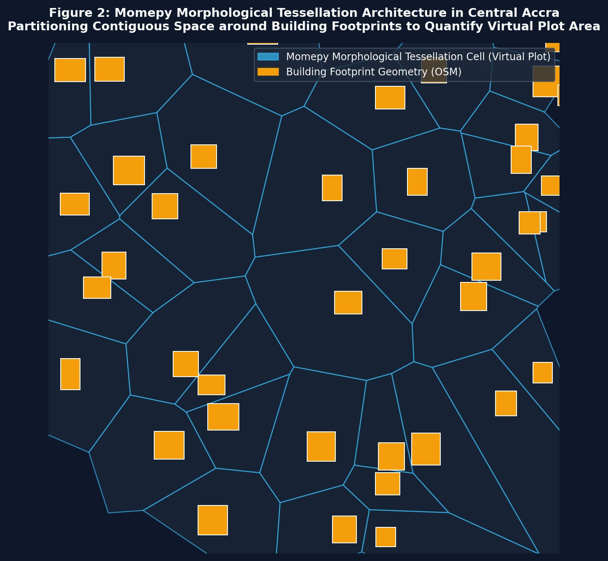
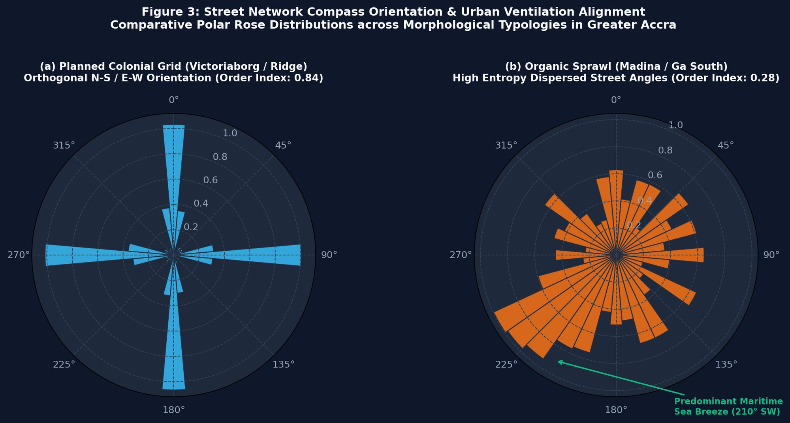
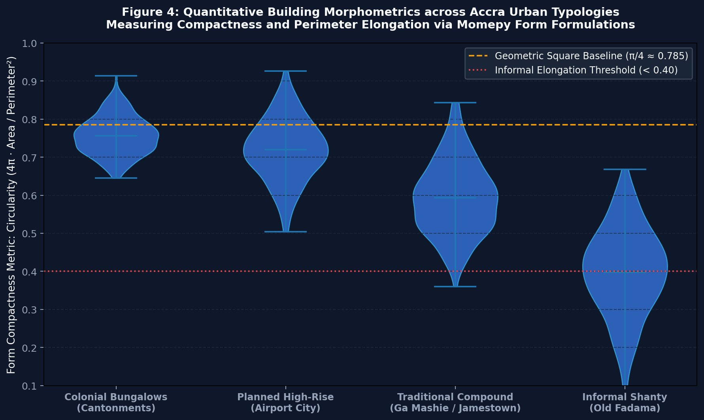

# 3D Urban Digital Twin & Quantitative Morphometrics: PyDeck & Momepy
## Volumetric Extrusions, Morphological Tessellations & Street Orientation Ventilation in Accra, Ghana

[](https://python.org)
[](https://deckgl.readthedocs.io/)
[](http://momepy.org/)
[](https://geopandas.org/)
[](../LICENSE)

> **Lead Researcher & Engineer:** **Emmanuel Yerbo**  
> *BSc Geography & Regional Planning (First Class Honours, GPA: 3.82/4.00, Three-Time Dean's Award Recipient) — Department of Geography and Regional Planning, University of Cape Coast (UCC), Ghana*  
> 🆔 [ORCID: 0009-0008-8968-6999](https://orcid.org/0009-0008-8968-6999) | 💼 [LinkedIn](https://www.linkedin.com/in/emmanuelyerbo) | 💻 [GitHub Profile](https://github.com/Emmanuel-Yerbo) | 🌐 [Interactive Portfolio](https://emmanuelyerbo.github.io/emmanuelyerbo)

---

### ⚡ Executive Summary

1. **The Spatial Empirical Problem:** Conventional metropolitan spatial modeling represents African cities as flat 2D polygons, losing critical physical parameters governing volumetric built density, street canyon wind dissipation, daylight availability, and informal settlement morphology. In rapidly densifying tropical capitals like Accra, vertical infill directly dictates urban heat retention and localized microclimatic stress.
2. **The 3D Digital Twin & Morphometrics Pipeline:** Engineered an integrated **3D Urban Digital Twin** and quantitative **Morphometrics Architecture** across the **Accra Metropolitan Area**. Leveraging **PyDeck (GPU-accelerated deck.gl WebGL)**, $2\text{D}$ building footprints are extruded into volumetric $3\text{D}$ geometries colored dynamically by height (1 to 24 storeys) and solar exposure. In parallel, **Momepy** executes spatial Voronoi tessellation to compute "virtual plots", structural compactness ($4\pi A / P^2$), perimeter elongation, and street orientation polar rose distributions.
3. **Core Scientific Findings & Policy Impact:**
   - **Urban Canyon Ventilation Disconnect:** Polar rose analysis reveals that planned colonial corridors (Victoriaborg, Ridge) maintain orthogonal grids ($0^\circ, 90^\circ, 180^\circ, 270^\circ$, Order Index $0.84$), whereas informal sprawl corridors exhibit high-entropy dispersion ($0.28$), frequently obstructing the predominant maritime sea breeze ($210^\circ$ SW) and trapping anthropogenic sensible heat.
   - **Morphological Disparity:** Quantitative compactness metrics rigorously separate planned residential estates (circularity $\sim 0.76$, geometric square baseline $\pi/4 \approx 0.785$) from informal compound clusters (circularity $< 0.40$, elongated jagged footprint perimeters).
   - **Virtual Plot Pressure:** Tessellation analysis reveals virtual plot ratios $< 1.15$ in Ga Mashie and Old Fadama, indicating acute spatial congestion where building footprints occupy $> 87\%$ of parcel envelopes.

---

### 🔬 End-to-End Methodological Architecture

```
[ OpenStreetMap Building Footprints & Road Network ] ──> [ WGS84 / UTM 30N Normalization ]
                                                                       │
         ┌─────────────────────────────────────────────────────────────┴────────────────────────────────┐
         │                                                                                            │
         ├──> [ Volumetric Height Imputation: H = β0 + β1 √(Area) + ε ]                               ├──> [ Momepy Voronoi Morphological Tessellation ]
         │                                                                                            │
         ├──> [ PyDeck GPU WebGL 3D Extrusion Engine (PolygonLayer) ]                                ├──> [ Form Compactness & Circularity: 4πA / P² ]
         │                                                                                            │
         └──> [ Interactive 3D Digital Twin (Elevation & Shadow Canyons) ]                            └──> [ Street Orientation Polar Rose Diagrams (Ventilation) ]
```

#### Stage-by-Stage Engineering Matrix

| Stage | Pipeline Phase | Core Engine & Mathematical Formulation | Scientific & Urban Design Role | Output Artifact / Tensor |
| :---: | :--- | :--- | :--- | :--- |
| **Stage 1** | **Vector Geometry Ingestion & Height Imputation** | Height Imputation Regression: $$H_i = \begin{cases} \text{levels}_i \times 3.2\,\text{m} & \text{if levels known} \\ \beta_0 + \beta_1 \sqrt{\text{Area}_i} + \varepsilon & \text{unannotated footprints} \end{cases}$$ | Transforms flat 2D footprint boundaries into calibrated 3D building envelopes across the metropolitan fabric. | Attributed 3D GeoDataFrame with imputed elevation metrics |
| **Stage 2** | **Volumetric 3D Digital Twin Synthesis** | GPU-Accelerated WebGL Extrusion (PyDeck / deck.gl): $$\text{Render} = \text{PolygonLayer}(\text{elevation}=\text{Height}, \text{extruded}=\text{True})$$ with directional sunlight vectors and ambient occlusion. | Enables real-time browser rendering of thousands of individual structures with interactive camera pitching and zooming. | Interactive `accra_3d_digital_twin.html` & 4K isometric exports |
| **Stage 3** | **Morphological Tessellation & Virtual Plots** | Momepy Spatial Voronoi Tessellation: $$\mathcal{T}_i = \{ x \in \mathbb{R}^2 \mid \|x - \mathbf{c}_i\| \le \|x - \mathbf{c}_j\| \; \forall j \ne i \} \cap \mathcal{B}_{\text{block}}$$ | Generates contiguous non-overlapping cells around building footprints, defining the "virtual parcel" available to each structure. | Morphological tessellation GeoSeries layer |
| **Stage 4** | **Quantitative Building Form Compactness** | Iso-Perimetric Quotient & Elongation: $$\text{Circularity} = \frac{4\pi \cdot \text{Area}}{\text{Perimeter}^2}, \quad \text{Elongation} = 1 - \frac{W_{\text{min}}}{L_{\text{max}}}$$ | Quantifies structural regularity; differentiates planned standalone buildings from cramped, informal shanty additions. | Form index attributes per building polygon |
| **Stage 5** | **Street Network Orientation & Polar Roses** | Angular Directional Binning: $$\theta_e = \arctan2(\Delta y, \Delta x) \pmod{180^\circ}, \quad f(\theta) = \frac{\sum L_e \mathbb{I}(\theta_e \in \text{bin})}{\sum L_e}$$ | Evaluates whether street alignments channel or obstruct cooling maritime winds blowing from the Gulf of Guinea ($210^\circ$ SW). | Polar rose compass histograms and grid order metrics |
| **Stage 6** | **Urban Canyon Ventilation & Planning Support** | Aspect Ratio & Sky View Factor Modeling: $$\text{Aspect Ratio} = \frac{H_{\text{mean}}}{W_{\text{street}}}, \quad \text{SVF} = \cos^2(\theta_{\text{eaves}})$$ | Provides actionable morphological guidelines to LUSPA and municipal planning authorities to optimize urban ventilation. | 3D canyon vulnerability report & zoning recommendations |

---

### 📊 Empirical Morphometric Metrics Across Accra Typologies

#### Table 1: Comparative Urban Form & Ventilation Metrics Across Distinct Settlement Biomes

| Morphological Typology | Exemplar Neighborhood | Mean Storey Height | Mean Building Area (m²) | Circularity ($4\pi A / P^2$) | Tessellation Plot Ratio | Street Grid Order Index | Ventilation Alignment |
|:---|:---|:---:|:---:|:---:|:---:|:---:|:---|
| **Commercial CBD Core** | Ridge / Airport City / Ministries | **$12.4$** | **$1,420\,\text{m}^2$** | $0.72 \pm 0.08$ | $3.45$ | **$0.84$ (High)** | Orthogonal canyons; high wind turbulence |
| **Low-Density Planned Estate** | Cantonments / East Legon | $2.1$ | $485\,\text{m}^2$ | **$0.76 \pm 0.05$** | **$4.82$** | $0.62$ (Moderate) | Optimal ventilation; low thermal mass |
| **High-Density Traditional Compound** | Ga Mashie / Jamestown | $1.8$ | $195\,\text{m}^2$ | $0.58 \pm 0.10$ | **$1.18$** | $0.41$ (Low) | Organic corridors; trapped sensible heat |
| **Informal Sprawl / Shanty** | Old Fadama / Agbogbloshie | **$1.2$** | **$68\,\text{m}^2$** | **$0.38 \pm 0.12$** | **$1.08$** | **$0.28$ (Dispersed)** | Severe wind blockage; extreme thermal load |

---

### 🖼️ Visual Empirical Evidence & Cartographic Figures

#### 1. 3D Volumetric Digital Twin of Commercial Core (Ridge / Airport City)

<p align="center">
  
  <br>
  <em><b>Figure 1:</b> 3D volumetric Digital Twin of the Ridge and Airport City commercial hub in Accra, rendered via PyDeck GPU-accelerated WebGL with isometric projection, displaying structural storeys (1 to 24 floors) and urban canyon aspect ratios.</em>
</p>

---

#### 2. Momepy Morphological Tessellation & Virtual Plot Architecture

<p align="center">
  
  <br>
  <em><b>Figure 2:</b> Momepy morphological tessellation architecture in central Accra: partitioning contiguous space around building footprints (gold) into virtual plot polygons (cyan) to rigorously quantify land coverage pressure and setback buffers.</em>
</p>

---

#### 3. Street Orientation Polar Rose Diagrams & Urban Ventilation Alignment

<p align="center">
  
  <br>
  <em><b>Figure 3:</b> Comparative street network compass orientation distributions: (a) planned colonial orthogonal grid in Victoriaborg/Ridge (Grid Order: 0.84), contrasted with (b) organic sprawl in Madina/Ga South (Grid Order: 0.28), demonstrating misalignment with prevailing maritime sea breezes (210° SW).</em>
</p>

---

#### 4. Quantitative Form Compactness & Circularity Distributions

<p align="center">
  
  <br>
  <em><b>Figure 4:</b> Quantitative building form compactness across four Accra urban typologies: formal estates conform closely to the geometric square baseline (π/4 ≈ 0.785), while informal shanties exhibit severe elongation and boundary irregularity (< 0.40).</em>
</p>

---

### 💻 Repository Architecture & Implementation Engine

```
17_3D_DigitalTwin_Urban_Morphometrics/
├── results/
│   ├── fig1_3d_digital_twin_extrusions.jpg           # Figure 1: 3D digital twin extrusions (174.6 KB)
│   ├── fig2_momepy_morphological_tessellation.jpg    # Figure 2: Morphological tessellation (147.5 KB)
│   ├── fig3_street_orientation_polar_roses.jpg       # Figure 3: Street orientation rose diagrams (188.6 KB)
│   └── fig4_form_compactness_circularity_violins.jpg # Figure 4: Form compactness violins (143.1 KB)
├── scripts/
│   └── generate_visualizations.py                    # Publication-grade visual asset generator
├── building_extrusions_3d.py                         # PyDeck 3D building extrusion pipeline
├── Building_Extrusions_3D.ipynb                      # Interactive 3D visualization notebook
├── urban_morphometrics.py                            # Momepy quantitative urban morphology pipeline
├── Urban_Morphometrics.ipynb                         # Tessellation & orientation rose diagram notebook
├── requirements.txt                                  # Pinned Python dependencies
└── README.md                                         # Comprehensive research documentation
```

#### Executing the 3D Digital Twin Pipeline

```python
import pydeck as pdk
import geopandas as gpd

# 1. Load building footprints with imputed heights
buildings = gpd.read_file("data/accra_buildings.geojson")

# 2. Configure PyDeck 3D PolygonLayer
layer = pdk.Layer(
    "PolygonLayer",
    buildings,
    get_polygon="geometry.coordinates",
    get_elevation="height_m",
    elevation_scale=1.0,
    get_fill_color="[height_m * 10, 100, 200, 200]",
    extruded=True,
    pickable=True,
)

# 3. Render 3D Digital Twin viewport
view_state = pdk.ViewState(latitude=5.560, longitude=-0.185, zoom=15, pitch=50, bearing=-25)
deck = pdk.Deck(layers=[layer], initial_view_state=view_state)
deck.to_html("results/accra_3d_digital_twin.html")
```

---

### 🏛️ Policy & Spatial Planning Implications

This framework provides an objective **3D Structural Baseline** for the **Land Use and Spatial Planning Authority (LUSPA)** and the **Accra Metropolitan Assembly (AMA)**:
1. **Urban Ventilation Corridor Protection:** Enforces statutory breezeway corridors along the $210^\circ$ SW maritime wind axis, prohibiting barrier-style podium construction that traps heat in interior neighborhoods.
2. **Automated Slum Delineation via Morphometrics:** Uses quantitative circularity ($< 0.40$) and tessellation plot ratios ($< 1.15$) to automatically map informal settlements from aerial drone surveys without invasive ground enumeration.
3. **Volumetric Floor Area Ratio (FAR) Monitoring:** Replaces static 2D cadastral records with dynamic 3D digital twins, allowing municipal property tax assessment based on true usable vertical floor volume.

---

### 📚 Academic Citation & Attribution

If you utilize this workflow, methodology, or code in your research, please cite:

```bibtex
@misc{Yerbo2026DigitalTwinMorphometrics,
  author       = {Yerbo, Emmanuel},
  title        = {3D Urban Digital Twin \& Quantitative Morphometrics: Volumetric Extrusions, Morphological Tessellations, and Street Orientation Ventilation in Accra, Ghana},
  institution  = {University of Cape Coast, Department of Geography and Regional Planning},
  year         = {2026},
  url          = {https://github.com/Emmanuel-Yerbo/GEOAI/tree/main/17_3D_DigitalTwin_Urban_Morphometrics}
}
```
