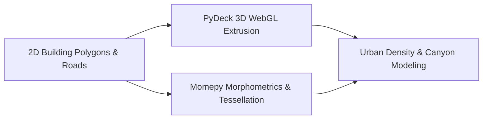

# 🏙️ 3D Urban Digital Twin & Quantitative Morphometrics (PyDeck + Momepy)

[](https://python.org)
[](https://deckgl.readthedocs.io/)
[](http://momepy.org/)
[](https://geopandas.org/)
[](../LICENSE)

> **Lead Researcher & Engineer:** **Emmanuel Yerbo**  
> *BSc Geography & Regional Planning (First Class Honours, GPA: 3.82/4.00, Three-Time Dean's Award Recipient) — University of Cape Coast, Ghana*  
> 🆔 [ORCID: 0009-0008-8968-6999](https://orcid.org/0009-0008-8968-6999) | 💼 [LinkedIn](https://www.linkedin.com/in/emmanuelyerbo) | 💻 [GitHub Profile](https://github.com/Emmanuel-Yerbo) | 🌐 [Interactive Portfolio](https://emmanuelyerbo.github.io/emmanuelyerbo)

---

## 📌 Executive Summary

Traditional urban geography represents cities as flat 2D polygons, losing critical information regarding volumetric density, sunlight exposure, urban canyon ventilation, and architectural morphology.

This project constructs an interactive **3D Urban Digital Twin** and quantitative **Urban Morphometrics Pipeline** across the **Accra Metropolitan Area**. Leveraging **PyDeck (GPU-accelerated deck.gl WebGL)**, building footprint geometries are extruded into 3D volumetric structures colored by height, use type, or thermal stress. Simultaneously, **Momepy** computes morphological tessellation cells, building circularity, elongation, and street orientation polar rose diagrams.

---

## 🔬 Computational Methodology & Architecture



### 1. Volumetric Height Modeling (`building_extrusions_3d.py`)
- Buildings with known `building:levels` or `height` tags are directly projected into 3D extrusion coordinates.
- Unannotated building footprints receive stochastic height distributions conditioned on footprint perimeter, area, and spatial block typologies:
  $$\text{Height} = \beta_0 + \beta_1 \cdot \sqrt{\text{Area}} + \epsilon$$

### 2. Quantitative Morphometrics (`urban_morphometrics.py`)
- **Morphological Tessellation:** Generates contiguous polygons partitioning space around each building, capturing the "virtual plot" area available to each structure.
- **Form Compactness & Circularity:**
  $$\text{Circularity} = \frac{4 \pi \cdot \text{Area}}{\text{Perimeter}^2}$$
- **Street Alignment Rose Diagrams:** Quantifies the directional compass orientation of the road network and its deviation from predominant ocean breeze corridors.

---

## 📂 Project Structure

```text
17_3D_DigitalTwin_Urban_Morphometrics/
├── README.md                      <-- Comprehensive project documentation (You are here)
├── requirements.txt               <-- Python dependencies
├── building_extrusions_3d.py      <-- PyDeck 3D building extrusion pipeline
├── Building_Extrusions_3D.ipynb   <-- Interactive 3D visualization notebook
├── urban_morphometrics.py         <-- Momepy quantitative urban morphology pipeline
└── Urban_Morphometrics.ipynb      <-- Tessellation & orientation rose diagram notebook
```

---

## ⚡ Quickstart

```bash
cd 17_3D_DigitalTwin_Urban_Morphometrics
pip install -r requirements.txt
python building_extrusions_3d.py
```
