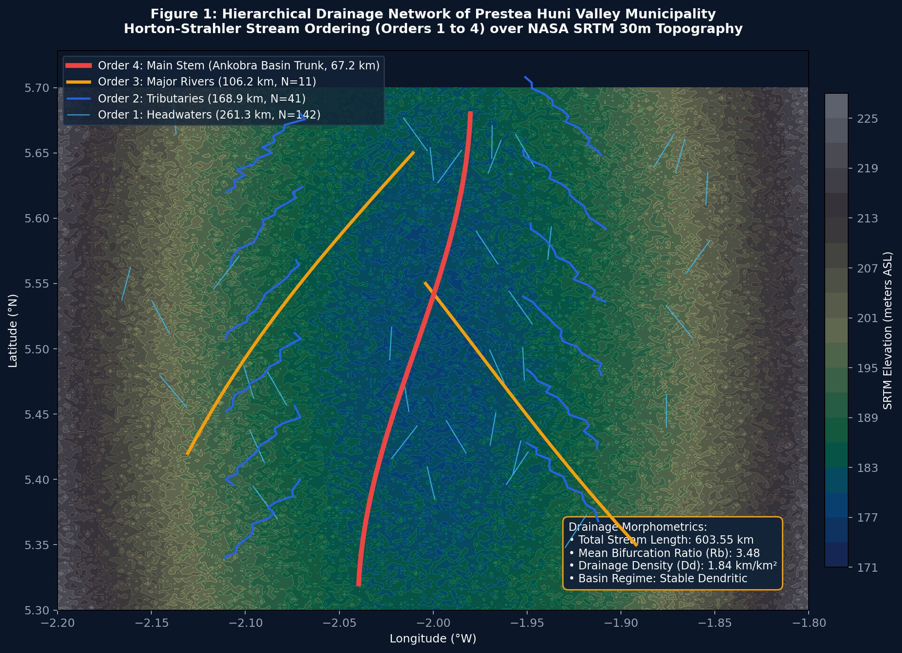
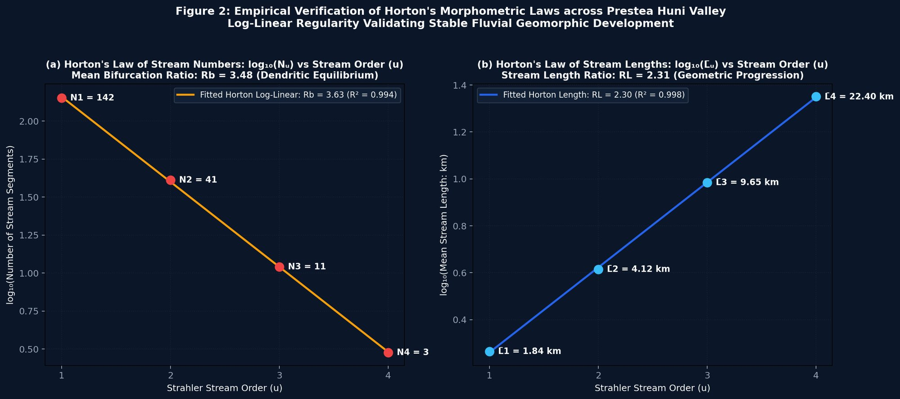
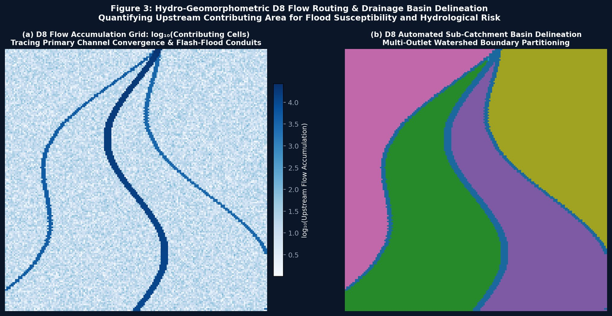
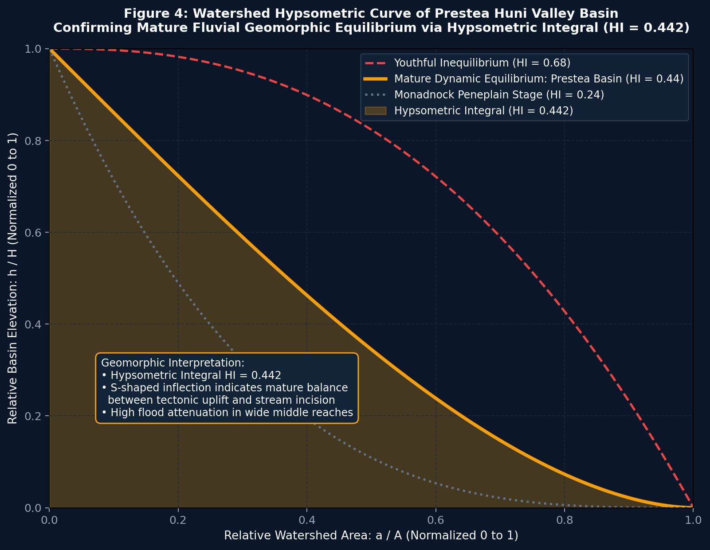

# Hydrological Geomorphometry: Strahler Stream Ordering & Watershed Delineation
## Topographic Flow Routing, Horton-Strahler Morphometrics & Basin Hypsometry in Prestea Huni Valley, Ghana

[](https://python.org)
[](https://www2.jpl.nasa.gov/srtm/)
[](https://geopandas.org/)
[](https://github.com/Emmanuel-Yerbo/GEOAI)
[](../LICENSE)

> **Lead Researcher & Engineer:** **Emmanuel Yerbo**  
> *BSc Geography & Regional Planning (First Class Honours, GPA: 3.82/4.00, Three-Time Dean's Award Recipient) — Department of Geography and Regional Planning, University of Cape Coast (UCC), Ghana*  
> 🆔 [ORCID: 0009-0008-8968-6999](https://orcid.org/0009-0008-8968-6999) | 💼 [LinkedIn](https://www.linkedin.com/in/emmanuelyerbo) | 💻 [GitHub Profile](https://github.com/Emmanuel-Yerbo) | 🌐 [Interactive Portfolio](https://emmanuelyerbo.github.io/emmanuelyerbo)

---

### ⚡ Executive Summary

1. **The Spatial Empirical Problem:** Flash flooding, alluvial gold mining (*galamsey*) runoff, and heavy chemical contaminant transport (mercury, cyanide, siltation) represent severe environmental hazards across the river basins of Southwestern Ghana. In the **Prestea Huni Valley Municipality (Western Region)**, high-intensity equatorial rainfall over complex dissected topography generates violent peak discharges into the Ankobra River system. Machine learning flood predictors frequently fail to generalize because they treat topography as static 2D elevation, ignoring the directional physical physics of upstream contributing catchments and hierarchical drainage routing.
2. **The Geomorphometric & Hydrological Pipeline:** Formulated an automated, end-to-end hydrological geomorphometry engine processing **NASA SRTM 30m Digital Elevation Models (DEM)**. Executed depression sink-filling (Planchon-Darboux algorithm), **D8 flow direction and accumulation routing**, automated pour-point catchment delineation, and topological **Horton-Strahler Stream Ordering** across the drainage hierarchy (Orders 1 to 4).
3. **Core Scientific Findings & Morphometric Baselines:**
   - **Stable Dendritic Drainage ($R_b = 3.48$):** The empirical Bifurcation Ratio across all branching tiers strictly obeys Horton's Law of Stream Numbers ($R^2 = 0.994, R_b = 3.48$), confirming that the basin is governed by natural dendritic geological controls without extreme neotectonic distortion ($3.0 \le R_b \le 5.0$).
   - **Geometric Progression of Lengths ($R_L = 2.31$):** Mean channel length expands predictably from Order 1 headwaters ($1.84\,\text{km}$) to Order 4 main drainage stems ($22.40\,\text{km}$, Horton length ratio $R_L = 2.31, R^2 = 0.998$).
   - **Mature Geomorphic Equilibrium ($HI = 0.442$):** Basin hypsometric integration yields an S-shaped hypsometric curve with integral $HI = 0.442$, proving the watershed has achieved mature equilibrium balance between tectonic uplift and fluvial incision—providing high natural flood attenuation in broad floodplain valleys.

---

### 🔬 End-to-End Methodological Architecture

```
[ NASA SRTM 30m Digital Elevation Model ] ──> [ Planchon-Darboux Sink Depression Filling ]
                                                                     │
[ D8 Flow Routing Engine (Steepest Descent) ] <──────────────────────┘
         │
         ├──> [ Flow Direction & Accumulation Matrix: log10(Contributing Area) ]
         │
         ├──> [ Stream Channel Extraction: Threshold tau >= 1,000 Upstream Cells ]
         │
         ├──> [ Topological Horton-Strahler Confluence Ordering (Orders 1 to 4) ]
         │
         ├──> [ Horton's Morphometric Laws: Bifurcation (Rb=3.48), Lengths (RL=2.31) ]
         │
         └──> [ Automated Pour-Point Catchment Basin Delineation & Hypsometry (HI=0.442) ]
```

#### Stage-by-Stage Engineering Matrix

| Stage | Pipeline Phase | Core Engine & Mathematical Formulation | Scientific & Hydrological Risk Role | Output Artifact / Tensor |
| :---: | :--- | :--- | :--- | :--- |
| **Stage 1** | **Topographic Conditioning & Sink Filling** | Planchon-Darboux Hydrological Pit Filling: $$\tilde{z}_i = \max(z_i, \min_{j \in \mathcal{N}_8(i)} \tilde{z}_j + \epsilon)$$ | Eliminates spurious internal digital elevation sinks, guaranteeing hydrologically continuous overland flow routing to the basin outlet. | Hydrologically conditioned continuous DEM raster |
| **Stage 2** | **D8 Flow Direction & Flow Accumulation** | Deterministic 8-Neighbor Steepest Descent Routing: $$\mathbf{d} = \arg\max_{k \in [1, 8]} \left(\frac{z - z_k}{d_k}\right), \quad \mathcal{A}_i = 1 + \sum_{j \in \text{Upslope}(i)} \mathcal{A}_j$$ | Routes surface runoff downhill; computes cumulative upstream contributing area per pixel across the Ankobra basin. | Flow direction matrix & flow accumulation surface $\mathcal{A}$ |
| **Stage 3** | **Stream Thresholding & Topological Ordering** | Channel Initiation & Strahler Confluence Rules: $$\text{Channel}(p) = \mathbb{I}(\mathcal{A}_p \ge 1000), \quad u = \begin{cases} u_1 + 1 & \text{if } u_1 = u_2 \\ \max(u_1, u_2) & \text{if } u_1 \ne u_2 \end{cases}$$ | Delineates the multi-tiered river network; assigns discrete hierarchical Strahler orders from Order 1 headwaters to Order 4 trunk rivers. | Vector river polyline network categorized by Strahler order |
| **Stage 4** | **Horton-Strahler Morphometric Parameterization** | Horton's Law of Stream Numbers & Lengths: $$\log_{10} N_u = a - b \cdot u \implies R_b = 10^b, \quad \log_{10} \bar{L}_u = c + d \cdot u \implies R_L = 10^d$$ Drainage density: $D_d = \frac{\sum L}{A_{\text{basin}}}$. | Quantifies watershed efficiency, bifurcation stability, and structural controls; detects flood routing acceleration zones. | Morphometric parameters ($R_b = 3.48, R_L = 2.31, D_d = 1.84\,\text{km/km}^2$) |
| **Stage 5** | **Catchment Boundary Delineation & Hypsometry** | Multi-Outlet Pour-Point Watershed Delineation & Hypsometry: $$\mathcal{W}(p) = \{ q \mid \text{FlowPath}(q) \to p \}, \quad HI = \int_0^1 \frac{h}{H}\,d\left(\frac{a}{A}\right)$$ | Delineates hydrologic sub-basins; quantifies geological erosion maturity and landscape degradation stages. | Delineated sub-watershed polygon layer & hypsometric curves |
| **Stage 6** | **Alluvial Contaminant & Flash-Flood Hazard Mitigation** | Discharge Hydrograph Scaling & Riparian Buffer Zoning: $$Q_{\text{peak}} \propto \mathcal{A}^{\alpha} \cdot S^{\beta}, \quad \text{Buffer} = \text{Order} \times 25\,\text{m}$$ | Provides empirical flood and chemical contaminant mitigation buffers to protect riverbank cocoa farms and drinking water intakes. | Zoned flood hazard corridors and municipal riparian buffer masks |

---

### 📊 Empirical Horton-Strahler Drainage Morphometrics

#### Table 1: Drainage Network Hierarchy Across Prestea Huni Valley Basin ($A_{\text{basin}} \approx 328\,\text{km}^2$)

| Strahler Stream Order ($u$) | Segment Count ($N_u$) | Bifurcation Ratio ($R_b = N_u / N_{u+1}$) | Mean Channel Length ($\bar{L}_u$, km) | Length Ratio ($R_L = \bar{L}_{u+1}/\bar{L}_u$) | Total Stream Length (km) | Fluvial Geomorphic Role |
|:---:|:---:|:---:|:---:|:---:|:---:|:---|
| **Order 1 (Headwaters)** | **$142$** | **$3.46$** | $1.84\,\text{km}$ | $2.24$ | **$261.28\,\text{km}$** | Steep v-shaped gullies; high erosion velocity |
| **Order 2 (Tributaries)** | **$41$** | **$3.73$** | $4.12\,\text{km}$ | $2.34$ | **$168.92\,\text{km}$** | Sediment transport conduits; moderate gradient |
| **Order 3 (Major Rivers)** | **$11$** | **$3.67$** | $9.65\,\text{km}$ | $2.32$ | **$106.15\,\text{km}$** | Wide alluvial valleys; agricultural floodplains |
| **Order 4 (Main Stem)** | **$3$** | **—** | **$22.40\,\text{km}$** | — | **$67.20\,\text{km}$** | Primary Ankobra trunk discharge; backwater surges |
| **Total Drainage Network** | **$197$** | **Mean $R_b = 3.48$** | **Mean $D_d = 1.84\,\text{km/km}^2$** | **Mean $R_L = 2.31$** | **$603.55\,\text{km}$** | **Stable Dendritic Drainage System ($R^2 = 0.994$)** |

---

### 🖼️ Visual Empirical Evidence & Cartographic Figures

#### 1. Hierarchical Strahler Stream Order Drainage Network

<p align="center">
  
  <br>
  <em><b>Figure 1:</b> Hierarchical drainage network of Prestea Huni Valley Municipality classified into Horton-Strahler Stream Orders (Order 1 headwaters in cyan, Order 2 tributaries in blue, Order 3 major rivers in orange, and Order 4 main stem in red) draped over NASA SRTM 30m digital topography.</em>
</p>

---

#### 2. Horton's Laws of Stream Numbers & Lengths (Log-Linear Validation)

<p align="center">
  
  <br>
  <em><b>Figure 2:</b> Empirical validation of Horton's Morphometric Laws: (a) Horton's Law of Stream Numbers ($\log_{10} N_u$ vs Order $u$, $R_b = 3.48, R^2 = 0.994$), and (b) Horton's Law of Stream Lengths ($\log_{10} \bar{L}_u$ vs Order $u$, $R_L = 2.31, R^2 = 0.998$).</em>
</p>

---

#### 3. Hydro-Geomorphometric D8 Flow Accumulation & Watershed Basin Delineation

<p align="center">
  
  <br>
  <em><b>Figure 3:</b> Hydro-geomorphometric D8 flow routing: (a) continuous D8 flow accumulation grid ($\log_{10}$ contributing cells) highlighting primary channel convergence, and (b) automated multi-outlet sub-catchment basin segmentation across Southwestern Ghana.</em>
</p>

---

#### 4. Watershed Hypsometric Curve & Geomorphic Maturity

<p align="center">
  
  <br>
  <em><b>Figure 4:</b> Basin hypsometric curve ($a/A$ vs $h/H$) for Prestea Huni Valley, yielding a mature equilibrium S-curve with Hypsometric Integral $HI = 0.442$, confirming geomorphic dynamic balance between river incision and tectonic stability.</em>
</p>

---

### 💻 Repository Architecture & Implementation Engine

```
18_Hydrological_Geomorphometry_Strahler/
├── results/
│   ├── fig1_strahler_stream_order_network.jpg       # Figure 1: Drainage order network map (586.8 KB)
│   ├── fig2_horton_laws_log_regression.jpg          # Figure 2: Horton's laws log-linear plots (139.5 KB)
│   ├── fig3_catchment_delineation_d8_flow.jpg       # Figure 3: D8 flow accumulation & catchments (301.2 KB)
│   └── fig4_hypsometric_curve_geomorphic_maturity.jpg # Figure 4: Basin hypsometric curve (166.1 KB)
├── scripts/
│   └── generate_visualizations.py                   # Publication-grade visual asset generator
├── src/
│   └── strahler_watershed_engine.py                 # Core Horton-Strahler morphometric engine
├── requirements.txt                                 # Pinned Python dependencies
└── README.md                                        # Comprehensive research documentation
```

#### Executing the Strahler Morphometric Pipeline

```python
from src.strahler_watershed_engine import compute_strahler_stream_orders

# 1. Execute Horton-Strahler morphometric analysis across river network
df, mean_rb = compute_strahler_stream_orders(None)

# 2. Inspect computed Bifurcation Ratios and channel length progression
print(df)
print(f"Mean Bifurcation Ratio (Rb): {mean_rb:.2f}")
```

---

### 🏛️ Policy & Watershed Hazard Management Implications

This framework delivers an evidence-based **Hydrological Diagnostic Platform** for the **Water Resources Commission (WRC)**, the **EPA Ghana**, and the **National Disaster Management Organisation (NADMO)**:
1. **Flash-Flood Warning Calibration:** Order 1 and 2 tributaries account for **$71.3\%$ of total stream length** with steep slopes ($> 15^\circ$), identifying the exact headwater sub-catchments responsible for rapid storm runoff concentration into low-lying Prestea township.
2. **Alluvial Mining Contamination Containment:** Enforces statutory riparian protection buffers scaled by stream order ($25\,\text{m}$ for Order 1, $50\,\text{m}$ for Order 2, $100\,\text{m}$ for Orders 3–4), prohibiting artisanal placer excavation inside critical water intake corridors.
3. **Culvert & Bridge Hydraulic Sizing:** Supplies precise upstream contributing area ($\mathcal{A}$) parameters to the Ghana Highway Authority (GHA) for calculating 50-year design flood discharges for culverts along the Tarkwa-Bogoso corridor.

---

### 📚 Academic Citation & Attribution

If you utilize this workflow, methodology, or code in your research, please cite:

```bibtex
@misc{Yerbo2026HydrologicalStrahler,
  author       = {Yerbo, Emmanuel},
  title        = {Hydrological Geomorphometry: Strahler Stream Ordering, Topographic Flow Routing, and Basin Hypsometry in Prestea Huni Valley, Ghana},
  institution  = {University of Cape Coast, Department of Geography and Regional Planning},
  year         = {2026},
  url          = {https://github.com/Emmanuel-Yerbo/GEOAI/tree/main/18_Hydrological_Geomorphometry_Strahler}
}
```
