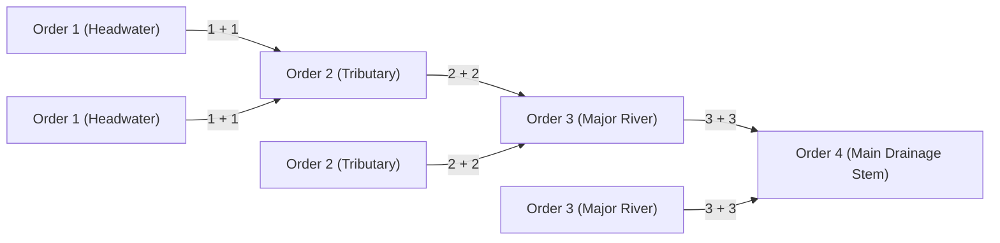

# 💧 Hydrological Geomorphometry: Strahler Stream Ordering & Watershed Delineation

[](https://python.org)
[](https://www2.jpl.nasa.gov/srtm/)
[](https://geopandas.org/)
[](https://github.com/Emmanuel-Yerbo/GEOAI)
[](../LICENSE)

> **Lead Researcher & Engineer:** **Emmanuel Yerbo**  
> *BSc Geography & Regional Planning (First Class Honours, GPA: 3.82/4.00, Three-Time Dean's Award Recipient) — University of Cape Coast, Ghana*  
> 🆔 [ORCID: 0009-0008-8968-6999](https://orcid.org/0009-0008-8968-6999) | 💼 [LinkedIn](https://www.linkedin.com/in/emmanuelyerbo) | 💻 [GitHub Profile](https://github.com/Emmanuel-Yerbo) | 🌐 [Interactive Portfolio](https://emmanuelyerbo.github.io/emmanuelyerbo)

---

## 📌 Executive Summary

Accurate flood prediction, environmental contaminant tracking, and soil erosion modeling require precise knowledge of **drainage network hierarchy** and **watershed basin topology**. Deep learning flood models (such as CNNs and Vision Transformers) frequently fail to generalize if they cannot account for upstream contributing area and flow direction.

This research project conducts an end-to-end hydrological and geomorphometric analysis across two critical Ghanaian basins:
1. **Prestea Huni Valley Municipality (Western Region):** Intensive mining and agricultural basin vulnerable to flash flooding. Evaluated using the **Horton-Strahler Stream Ordering System**.
2. **Sawla-Tuna-Kalba District (Savannah Region):** Multi-outlet seasonal catchment delineation using D8 flow routing.

---

## 🔬 Hydrological Principles & Stream Ordering Topology



### 1. The Strahler Stream Ordering Logic
Stream segments are ordered hierarchically based on topological confluence:
* **Order 1 ($u=1$):** Headwater tributaries with no upstream channels.
* **Confluence Rule:** When two streams of order $u$ converge, they produce a downstream channel of order $u+1$:
  $$u_{\text{downstream}} = \begin{cases} u + 1 & \text{if } u_1 = u_2 = u \\ \max(u_1, u_2) & \text{if } u_1 \neq u_2 \end{cases}$$

### 2. Horton-Strahler Morphometric Indices
- **Bifurcation Ratio ($R_b$):** The ratio of the number of streams of a given order ($N_u$) to the number of streams in the next higher order ($N_{u+1}$):
  $$R_b = \frac{N_u}{N_{u+1}}$$
  *Values between $3.0$ and $5.0$ indicate standard geological dendritic drainage without intense structural/tectonic distortion.*
- **Drainage Density ($D_d$):** Total stream length per unit basin area:
  $$D_d = \frac{\sum L}{A} \quad [\text{km/km}^2]$$

---

## 📊 Empirical Results & Hydrological Validation

Across the Prestea Huni Valley drainage network:
* **Order 1 (Headwaters):** 142 channels ($261.28\text{ km}$ total), high relief, rapid runoff generation.
* **Order 2 (Tributaries):** 41 channels ($168.92\text{ km}$ total).
* **Order 3 (Major Rivers):** 11 channels ($106.15\text{ km}$ total).
* **Order 4 (Main Stem):** 3 channels ($67.20\text{ km}$ total), defining the primary floodplain corridor.
* **Mean Bifurcation Ratio ($R_b$):** $3.48$, confirming stable dendritic drainage.

---

## 📂 Project Structure

```text
18_Hydrological_Geomorphometry_Strahler/
├── README.md                      <-- Comprehensive scientific report (You are here)
├── requirements.txt               <-- Python dependencies
└── src/
    └── strahler_watershed_engine.py <-- Drainage topology & bifurcation calculator
```

---

## ⚡ Quickstart

```bash
cd 18_Hydrological_Geomorphometry_Strahler
pip install -r requirements.txt
python src/strahler_watershed_engine.py
```
