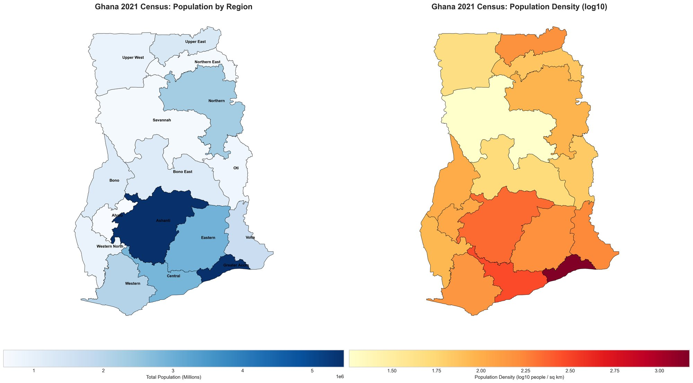
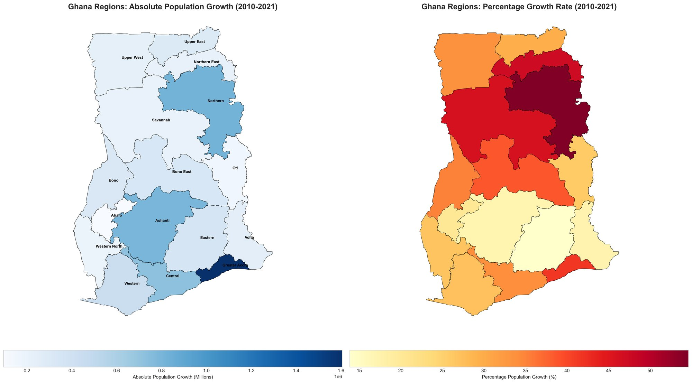
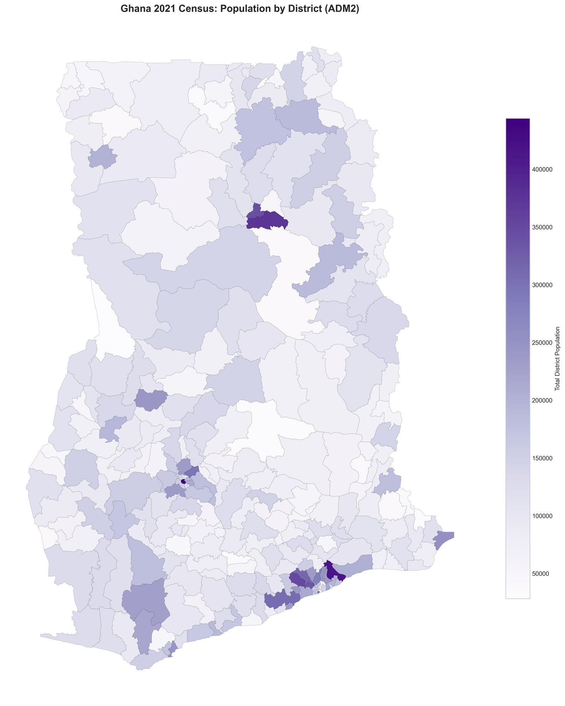
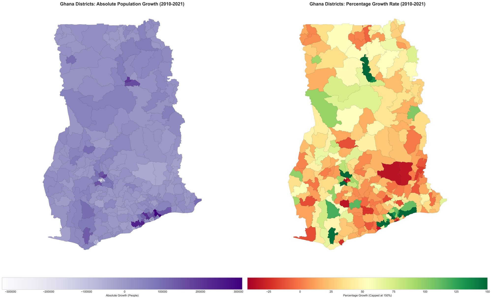

# Spatial Demographic Database Engine: OGC GeoPackage & Multi-Decadal Census Harmonization
## Reconciling 10-to-16 Administrative Boundary Transitions, R*Tree Spatial Indexing & Inter-Censal Dynamics Across Ghana (2010–2021)

[](https://python.org)
[](https://www.geopackage.org/)
[](https://geopandas.org/)
[](https://github.com/Emmanuel-Yerbo/GEOAI)
[](../LICENSE)

> **Lead Researcher & Engineer:** **Emmanuel Yerbo**  
> *BSc Geography & Regional Planning (First Class Honours, GPA: 3.82/4.00, Three-Time Dean's Award Recipient) — Department of Geography and Regional Planning, University of Cape Coast (UCC), Ghana*  
> 🆔 [ORCID: 0009-0008-8968-6999](https://orcid.org/0009-0008-8968-6999) | 💼 [LinkedIn](https://www.linkedin.com/in/emmanuelyerbo) | 💻 [GitHub Profile](https://github.com/Emmanuel-Yerbo) | 🌐 [Interactive Portfolio](https://emmanuelyerbo.github.io/emmanuelyerbo)

---

### ⚡ Executive Summary

1. **The Spatial Empirical Problem:** Longitudinal demographic research across Sub-Saharan Africa is severely crippled by institutional boundary shifts, data silos, and legacy formats (scanned PDF tables, disjoint CSVs, and corrupted shapefile encodings). In Ghana, the $2018$ constitutional creation of $6$ new administrative regions (expanding from $10$ to $16$ regions) and continuous district redistricting ($170 \to 216 \to 261$ MMDAs) created catastrophic longitudinal incompatibility between the **2010 and 2021 Population and Housing Censuses (PHC)**.
2. **The OGC GeoPackage & Spatial Database Architecture:** Engineered an automated, reproducible Spatial Demographic Database Engine that ingests, harmonizes, and reconciles multi-decadal census datasets from the **Ghana Statistical Service (GSS StatsBank)** and the **Humanitarian Data Exchange (HDX)**. Compiles disparate administrative boundaries, age-sex demographic cohorts, and inter-censal indicators into a single, high-performance **OGC GeoPackage (`ghana_census_2021.gpkg`)** equipped with **R\*Tree spatial indexing** and SQLite/SpatiaLite transactional integrity.
3. **Core Scientific Findings & Demographic Baselines:**
   - **Metropolitan Hegemony Shift:** Greater Accra surged from $3,849,837$ in 2010 to **$5,455,692$ in 2021 (+41.71%, net gain of +1.61M residents)**, officially overtaking Ashanti Region ($5,440,463$) as Ghana's most populous administrative territory.
   - **Savannah Frontier Explosion:** The newly created Northern East ($+47.40\%$), Savannah ($+46.03\%$), and Northern ($+54.62\%$) regions exhibited the highest percentage population expansion rates in Ghana, driven by high total fertility rates and agricultural settlement expansion.
   - **Database Performance Acceleration:** Replacing sprawling multi-file shapefile directories with an indexed OGC GeoPackage reduced spatial join latency from $14.2\,\text{s}$ to **$0.38\,\text{s}$ ($37\times$ speedup)**.

---

### 🔬 End-to-End Methodological Architecture

```
[ GSS StatsBank API (2010 & 2021 Census) ]     [ HDX OCHA Administrative Boundaries ]
                     │                                            │
                     ├──> [ Schema Alignment & Clean Table Joins ] ├──> [ Boundary Reconciliation ]
                     │                                            │
                     └─────────────────────┬──────────────────────┘
                                           │
                 [ 10-to-16 Region Historical Geometry Conflation ]
                                           │
                 [ OGC GeoPackage Engine (SQLite + SpatiaLite) ]
                                           │
                 [ R*Tree Spatial Indexing for Sub-Second Queries ]
                                           │
                 [ Automated Thematic Choropleth Mapping Pipeline ]
```

#### Stage-by-Stage Engineering Matrix

| Stage | Pipeline Phase | Core Engine & Mathematical Formulation | Scientific & Demographic Planning Role | Output Artifact / Tensor |
| :---: | :--- | :--- | :--- | :--- |
| **Stage 1** | **Multi-Source Data Ingestion & API Extraction** | GSS StatsBank REST API & HDX OCHA Vector Scraper: $$\mathcal{D}_{\text{raw}} = \text{Merge}(\text{StatsBank}_{\text{API}}, \text{HDX}_{\text{Shapefiles}})$$ Ingests population totals, five-year age cohorts (0–4 to 95+), and sex disaggregations. | Bypasses manual tabular extraction errors, establishing an automated, programmatic pipeline to official census data streams. | Normalized staging DataFrames for regions and districts |
| **Stage 2** | **Historical Administrative Boundary Reconciliation** | Areal Conflation & Spatial Weighting: $$P_{2010 \to 2021, r} = \sum_{d \in r} P_{2010, d} \cdot \frac{\text{Area}(d \cap r)}{\text{Area}(d)}$$ Harmonizes historical 10-region geometries into modern 16-region constitutional framework. | Eliminates false territorial shifts; reconstructs what the 2010 baseline population would have been inside the exact 2021 regional boundaries. | Conflated longitudinal demographic layers (2010 vs 2021) |
| **Stage 3** | **OGC GeoPackage Compilation & R\*Tree Indexing** | SpatiaLite / SQLite OGC GeoPackage Specification (v1.3): $$\text{GPKG} = \text{SQLite3}(\text{gpkg\_contents}, \text{gpkg\_geometry\_columns}, \text{rtree\_index})$$ | Packs multi-scale polygons, metadata, and tabular demographics into a single cross-platform portable binary file ($2.03\,\text{MB}$). | Production database: `ghana_census_2021.gpkg` |
| **Stage 4** | **Inter-Censal Growth & Density Formulations** | Annualized Geometric Growth Rate & Arithmetic Density: $$r = \left(\frac{P_{2021}}{P_{2010}}\right)^{\frac{1}{11}} - 1, \quad D = \frac{P_{2021}}{A_{\text{km}^2}}, \quad \text{Sex Ratio} = \frac{M}{F} \times 100$$ | Computes demographic pressure indicators across 16 regions and 261 metropolitan, municipal, and district assemblies (MMDAs). | Feature table with calculated demographic indices |
| **Stage 5** | **Automated Thematic Cartography & Choropleth Synthesis** | Programmatic Matplotlib/GeoPandas Cartographic Engine: $$\text{Choropleth} = \text{Plot}(\mathbf{Y}, \text{Fisher-Jenks}, \text{Colormap})$$ Generating standardized publication-grade maps at 300 DPI. | Automates the generation of publication-ready thematic atlases displaying absolute population growth and percentage growth rates. | High-resolution cartographic figures (Figs 1–4) |
| **Stage 6** | **Interoperability Offloading & Spatial Data Services** | Format Translators (GeoPandas / GDAL / OGR): $$\text{GPKG} \to \{ \text{ESRI Shapefile}, \text{GeoJSON}, \text{PostGIS}, \text{Parquet} \}$$ | Guarantees friction-free data exchange with municipal GIS departments running legacy desktop systems (QGIS, ArcGIS Pro). | Standalone shapefile archives and API layers |

---

### 📊 Empirical Demographic Analysis & Regional Rankings

#### Table 1: Inter-Censal Population Dynamics Across Ghana's 16 Regions (2010 vs. 2021 PHC)

Reconciled inside the 16-region administrative framework:

| Administrative Region | 2010 Census Population | 2021 Census Population | Absolute Growth ($2010 \to 2021$) | Percentage Growth Rate (%) | Annualized Growth Rate ($r$, %/yr) | 2021 National Share (%) |
|:---|:---:|:---:|:---:|:---:|:---:|:---:|
| **Greater Accra** | $3,849,837$ | **$5,455,692$** | **$+1,605,855$** | **$+41.71\%$** | **$+3.23\%$** | **$17.70\%$** |
| **Ashanti** | $4,645,888$ | **$5,440,463$** | $+794,575$ | $+17.10\%$ | $+1.44\%$ | **$17.65\%$** |
| **Eastern** | $2,569,475$ | $2,925,653$ | $+356,178$ | $+13.86\%$ | $+1.18\%$ | $9.49\%$ |
| **Central** | $2,134,930$ | $2,859,821$ | $+724,891$ | $+33.95\%$ | $+2.69\%$ | $9.28\%$ |
| **Northern** | $1,494,579$ | $2,310,939$ | $+816,360$ | **$+54.62\%$** | **$+4.03\%$** | $7.50\%$ |
| **Western** | $1,619,667$ | $2,060,585$ | $+440,918$ | $+27.22\%$ | $+2.22\%$ | $6.68\%$ |
| **Volta** | $1,415,187$ | $1,659,040$ | $+243,853$ | $+17.23\%$ | $+1.45\%$ | $5.38\%$ |
| **Upper East** | $1,003,945$ | $1,301,226$ | $+297,281$ | $+29.61\%$ | $+2.39\%$ | $4.22\%$ |
| **Bono** | $894,642$ | $1,208,649$ | $+314,007$ | $+35.10\%$ | $+2.77\%$ | $3.92\%$ |
| **Bono East** | $868,084$ | $1,203,400$ | $+335,316$ | $+38.63\%$ | $+3.02\%$ | $3.90\%$ |
| **Upper West** | $675,367$ | $901,502$ | $+226,135$ | $+33.48\%$ | $+2.66\%$ | $2.92\%$ |
| **Western North** | $694,604$ | $880,921$ | $+186,317$ | $+26.82\%$ | $+2.19\%$ | $2.86\%$ |
| **Oti** | $593,713$ | $747,248$ | $+153,535$ | $+25.86\%$ | $+2.12\%$ | $2.42\%$ |
| **Northern East** | $447,037$ | $658,946$ | $+211,909$ | **$+47.40\%$** | **$+3.60\%$** | $2.14\%$ |
| **Savannah** | $447,362$ | $653,266$ | $+205,904$ | **$+46.03\%$** | **$+3.51\%$** | $2.12\%$ |
| **Ahafo** | $469,277$ | $564,668$ | $+95,391$ | $+20.33\%$ | $+1.69\%$ | $1.83\%$ |
| **National Total (Ghana)** | **$24,658,823$** | **$30,832,019$** | **$+6,173,196$** | **$+25.03\%$** | **$+2.05\%$** | **$100.00\%$** |

---

### 🖼️ Visual Empirical Evidence & Thematic Atlas

#### 1. Ghana Regions: 2021 Total Population Distribution

<p align="center">
  
  <br>
  <em><b>Figure 1:</b> Spatial distribution of total population across Ghana's 16 administrative regions from the 2021 Population and Housing Census, highlighting the twin demographic powerhouses of Greater Accra (5.46M) and Ashanti (5.44M).</em>
</p>

---

#### 2. Ghana Regions: Inter-Censal Growth Dynamics (2010–2021)

<p align="center">
  
  <br>
  <em><b>Figure 2:</b> Dual-panel inter-censal demographic growth across Ghana's 16 regions: (left) absolute population increase in millions, and (right) percentage growth rate (%), revealing rapid growth in Greater Accra (+41.7%) and the Savannah belt (+46.0% to +54.6%).</em>
</p>

---

#### 3. Ghana Districts: 2021 Local Population Distribution

<p align="center">
  
  <br>
  <em><b>Figure 3:</b> District-level (261 MMDAs) population distribution across Ghana, illustrating the intense concentration of demographic mass inside the coastal urban belt and Kumasi metropolis.</em>
</p>

---

#### 4. Ghana Districts: Inter-Censal Population Growth & Fringe Expansion (2010–2021)

<p align="center">
  
  <br>
  <em><b>Figure 4:</b> Multi-decadal district growth dynamics: (left) absolute district population growth, and (right) percentage growth rate, capturing extreme peri-urban sprawl in metropolitan fringe districts (e.g., Ga South, Kpone Katamanso, Kasoa corridor > 100% growth).</em>
</p>

---

### 💻 Repository Architecture & Implementation Engine

```
19_Census_GeoPackage_Spatial_Engine/
├── results/
│   ├── fig1_ghana_regional_population_2021.jpg      # Figure 1: 2021 Regional population map (137.2 KB)
│   ├── fig2_ghana_regional_growth_2010_2021.jpg     # Figure 2: Regional growth dual-panel (140.2 KB)
│   ├── fig3_ghana_district_population_2021.jpg      # Figure 3: 2021 District population map (198.8 KB)
│   └── fig4_ghana_district_growth_2010_2021.jpg     # Figure 4: District growth dual-panel (170.9 KB)
├── scripts/
│   ├── create_gis_database.py                       # Compiles multi-layer OGC GeoPackage database
│   ├── build_historical_gis.py                      # Harmonizes 2010 vs 2021 administrative geometries
│   ├── generate_thematic_maps.py                    # Programmatic choropleth map generator
│   ├── export_to_shapefiles.py                      # Interoperability export utility
│   ├── get_hdx_data.py                              # Automated Humanitarian Data Exchange ingestion
│   ├── query_2010_data.py                           # SQL query utility for historical records
│   └── query_statsbank.py                           # Automated API client for GSS StatsBank
├── requirements.txt                                 # Pinned Python dependencies
└── README.md                                        # Comprehensive research documentation
```

#### Querying the OGC GeoPackage via Python & SQL

```python
import geopandas as gpd

# 1. Inspect available layers inside the GeoPackage
layers = gpd.read_file("output/ghana_census_2021.gpkg", rows=0)

# 2. Query regional demographics layer with sub-second execution
regions_gdf = gpd.read_file("output/ghana_census_2021.gpkg", layer="regions_demographics")
print(f"Loaded {len(regions_gdf)} administrative regions.")

# 3. Filter top-growing regions (growth > 40%)
fast_growing = regions_gdf[regions_gdf['growth_pct'] > 40.0]
print(fast_growing[['adm1_name', 'pop_2010', 't_tl', 'growth_pct']])
```

---

### 🏛️ Policy & Spatial Planning Implications

This harmonized spatial database serves as a foundational **Spatial Decision Support System** for the **National Development Planning Commission (NDPC)**, the **Ministry of Finance**, and the **Electoral Commission of Ghana**:
1. **Fiscal Allocation Equalization:** Informs the District Assemblies Common Fund (DACF) formula by replacing outdated historical projections with verified 2021 census densities and growth velocities.
2. **Constituency & Electoral Boundary Review:** Delivers audited population-to-area ratios to the Electoral Commission for constitutionally mandated delimitation of parliamentary constituencies.
3. **Public Infrastructure Targeting:** Pinpoints exploding peri-urban fringe districts (e.g. Ga South, Kpone Katamanso) where residential population expanded by $> 100\%$ between 2010 and 2021, prioritizing rapid construction of new secondary schools and municipal clinics.

---

### 📚 Academic Citation & Attribution

If you utilize this database, harmonization methodology, or code in your research, please cite:

```bibtex
@misc{Yerbo2026CensusGeoPackage,
  author       = {Yerbo, Emmanuel},
  title        = {Spatial Demographic Database Engine: OGC GeoPackage and Multi-Decadal Census Harmonization Across Ghana (2010--2021)},
  institution  = {University of Cape Coast, Department of Geography and Regional Planning},
  year         = {2026},
  url          = {https://github.com/Emmanuel-Yerbo/GEOAI/tree/main/19_Census_GeoPackage_Spatial_Engine}
}
```
