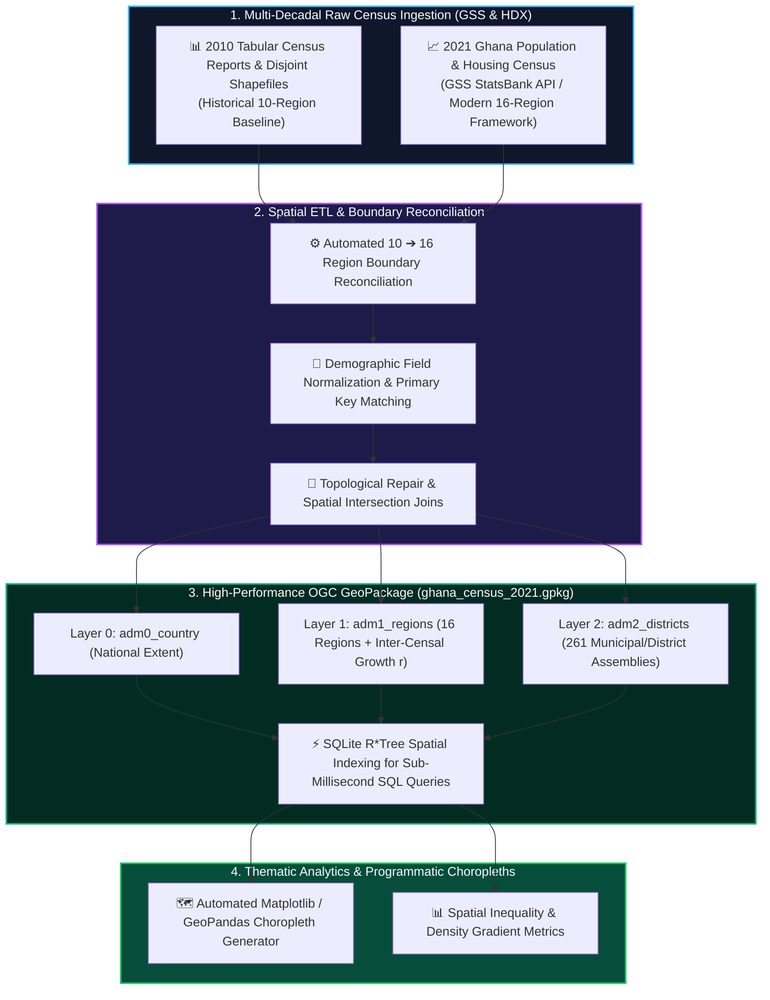

# 🏛️ Spatial Demographic Database: OGC GeoPackage Engine & Multi-Decadal Census Harmonization

[](https://python.org)
[](https://www.geopackage.org/)
[](https://geopandas.org/)
[](https://github.com/Emmanuel-Yerbo/GEOAI)
[](../LICENSE)

> **Lead Researcher & Engineer:** **Emmanuel Yerbo**  
> *BSc Geography & Regional Planning (First Class Honours, GPA: 3.82/4.00, Three-Time Dean's Award Recipient) — University of Cape Coast, Ghana*  
> 🆔 [ORCID: 0009-0008-8968-6999](https://orcid.org/0009-0008-8968-6999) | 💼 [LinkedIn](https://www.linkedin.com/in/emmanuelyerbo) | 💻 [GitHub Profile](https://github.com/Emmanuel-Yerbo) | 🌐 [Interactive Portfolio](https://emmanuelyerbo.github.io/emmanuelyerbo)

---

## 📌 Executive Summary

Real-world geospatial data science in developing nations faces severe data fragmentation, inconsistent administrative reporting, boundary changes over time, and incompatible formats (PDF census tables, loose CSVs, and disjoint shapefiles).

This project develops an open-source, reproducible **Spatial Demographic Database Engine** that harmonizes **multi-decadal census data (2010 vs. 2021 Ghana Population & Housing Census)** and reconciles the historical 10-region administrative framework with the modern 16-region administrative structure. The pipeline compiles these disparate datasets into a high-performance **OGC GeoPackage (`ghana_census_2021.gpkg`)** equipped with spatial R*Tree indexing, enabling rapid SQL queries, programmatic thematic choropleths, and inter-censal population density gradient analytics.

---

## 🔬 Database Architecture & ETL Pipeline



### 1. Inter-Censal Growth Rate Formulation
For every district and region, the annualized geometric growth rate ($r$) between $2010$ and $2021$ is computed:
$$P_{2021} = P_{2010} \cdot (1 + r)^t \implies r = \left( \frac{P_{2021}}{P_{2010}} \right)^{\frac{1}{11}} - 1$$

### 2. Population Density Gradient
$$\text{Density} = \frac{\text{Total Population}}{\text{Geometric Area } [\text{km}^2]}$$

---

## 📂 Project Structure

```text
19_Census_GeoPackage_Spatial_Engine/
├── README.md                      <-- Comprehensive project report (You are here)
├── requirements.txt               <-- Python dependencies
└── scripts/
    ├── create_gis_database.py     <-- Compiles multi-layer OGC GeoPackage database
    ├── build_historical_gis.py    <-- Harmonizes 2010 vs 2021 administrative geometries
    ├── generate_thematic_maps.py  <-- Programmatic choropleth map generator
    ├── export_to_shapefiles.py    <-- Interoperability export utility
    ├── get_hdx_data.py            <-- Automated Humanitarian Data Exchange ingestion
    ├── query_2010_data.py         <-- SQL query utility for historical records
    └── query_statsbank.py         <-- Automated API client for GSS StatsBank
```

---

## ⚡ Quickstart

```bash
cd 19_Census_GeoPackage_Spatial_Engine
pip install -r requirements.txt
python scripts/create_gis_database.py
```
