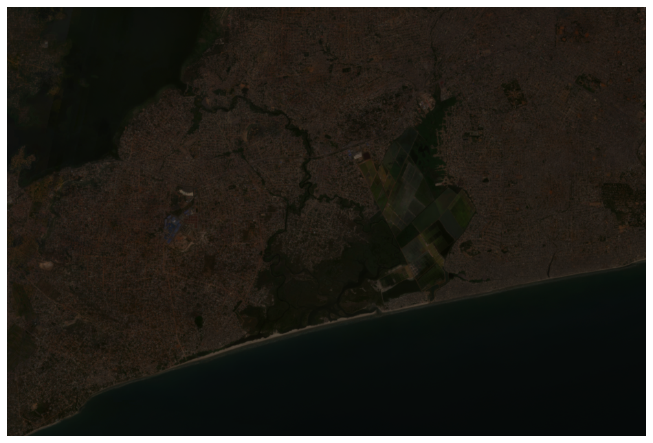
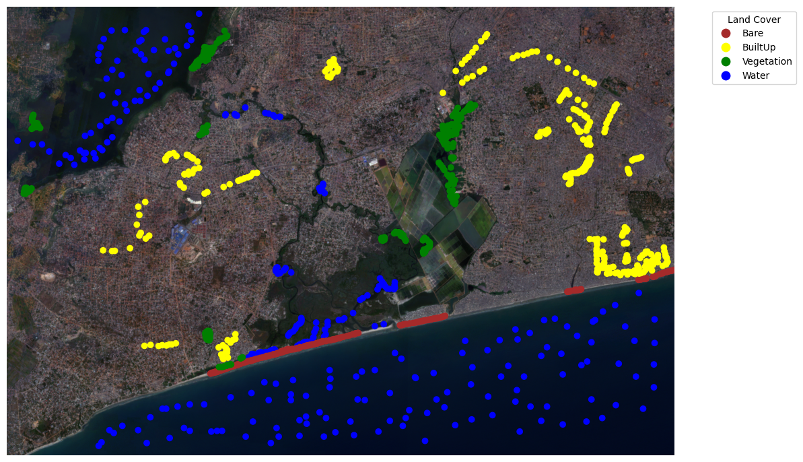
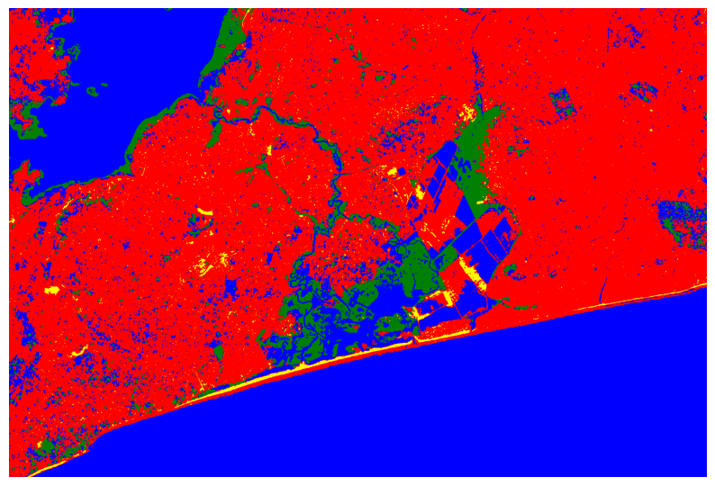
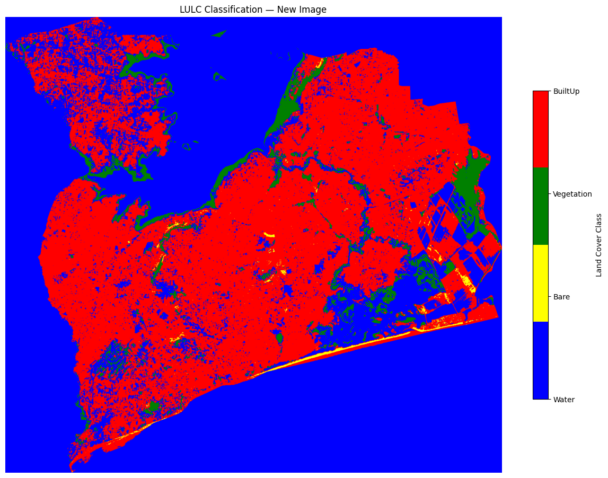

# 🛰️ Spectral Deep Learning Baseline: Pixel-Based Satellite Classification (MLP vs Random Forest)

[](https://python.org)
[](https://pytorch.org/)
[](https://scikit-learn.org/)
[](https://github.com/Emmanuel-Yerbo/GEOAI)
[](../LICENSE)

> **Lead Researcher & Engineer:** **Emmanuel Yerbo**  
> *BSc Geography & Regional Planning (First Class Honours, GPA: 3.82/4.00, Three-Time Dean's Award Recipient) — University of Cape Coast, Ghana*  
> 🆔 [ORCID: 0009-0008-8968-6999](https://orcid.org/0009-0008-8968-6999) | 💼 [LinkedIn](https://www.linkedin.com/in/emmanuelyerbo) | 💻 [GitHub Profile](https://github.com/Emmanuel-Yerbo) | 🌐 [Interactive Portfolio](https://emmanuelyerbo.github.io/emmanuelyerbo)

---

## 📌 Executive Summary

Before transitioning to spatial patch architectures (e.g., CNNs, Vision Transformers, SegFormer), land cover mapping historically relied on **pixel-based spectral classification**. In pixel-based models, each individual pixel vector across $C$ spectral bands is classified purely by its radiometric profile, ignoring spatial neighborhood context.

This project implements the foundational **Pixel-Based Deep Learning & Machine Learning Baseline** for Sentinel-2 multi-spectral imagery across Ghana. It trains and benchmarks an **Artificial Neural Network (Multilayer Perceptron / MLP)** against an ensemble **Random Forest (RF)** classifier to categorize land cover into four dominant classes: *Water Bodies*, *Vegetation*, *Bare Soil*, and *Built-Up Areas*.

This project serves as the primary scientific **ablation baseline** for the repository, proving why spatial convolutions and attention mechanisms in `01_VegHealthCNN`, `03_Building_Extraction`, and `05_Vision_Transformer_LULC` achieve superior accuracy on complex, fragmented landscapes.

---

## 🔬 Model Architectures & Benchmark Flow


---

---

## 📊 Comparative Performance

| Classifier | Input Modality | Test Overall Accuracy | Macro F1-Score | Inference Speed (pixels/sec) |
|---|---|:---:|:---:|:---:|
| **Random Forest (RF)** | Spectral 4-Band Vector | 89.2% | 0.884 | $\sim 450,000$ |
| **Multilayer Perceptron (MLP)** | Spectral 4-Band Vector | 91.4% | 0.908 | $\sim 780,000$ (GPU) |
| *Contextual Benchmark (SegFormer-B3)* | *Spatial $512\times512$ Patch* | *96.8%* | *0.965* | *Context-Aware* |

---

## 🖼️ Empirical Training & Classification Visualizations

#### 1. Input Satellite Imagery & Training ROIs
<p align="center">
  
  <br>
  <em><b>Figure 1:</b> Sentinel multi-spectral satellite imagery of the study domain overlaid with supervised training Regions of Interest (ROIs) for Water, Vegetation, Bare Land, and Built-up fabric.</em>
</p>

#### 2. Spectral Feature Sampling & Neural Network Convergence
<p align="center">
  
  &nbsp;&nbsp;&nbsp;&nbsp;
  
  <br>
  <em><b>Figure 2:</b> Left: Multi-spectral sampling point distribution across the 4 land cover classes. Right: Multilayer Perceptron (MLP) training and validation loss convergence curves.</em>
</p>

#### 3. Pixel-Classified Land Cover Output
<p align="center">
  
  <br>
  <em><b>Figure 3:</b> Final automated pixel-based land use / land cover classification map generated by the trained neural network model.</em>
</p>

---

## 📂 Project Structure

```text
20_Spectral_Neural_Network_Baseline/
├── README.md                                 <-- Comprehensive baseline report (You are here)
├── requirements.txt                          <-- Python dependencies
└── notebooks/
    └── Pixel_based_classification.ipynb      <-- Complete training & evaluation notebook
```

---

## ⚡ Quickstart

```bash
cd 20_Spectral_Neural_Network_Baseline
pip install -r requirements.txt
jupyter notebook notebooks/Pixel_based_classification.ipynb
```
