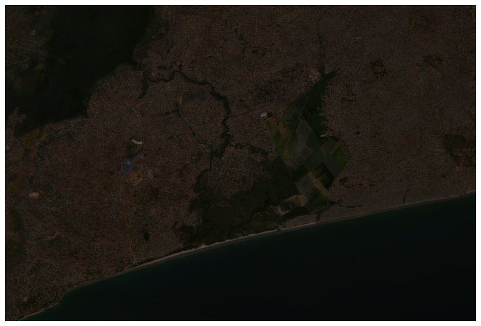
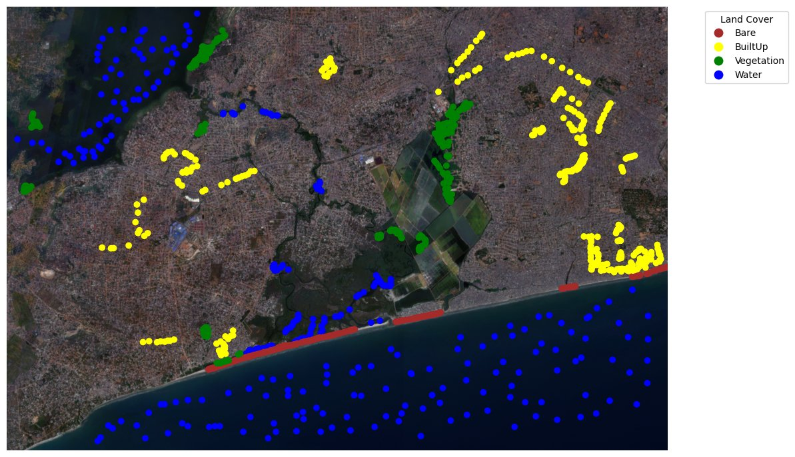
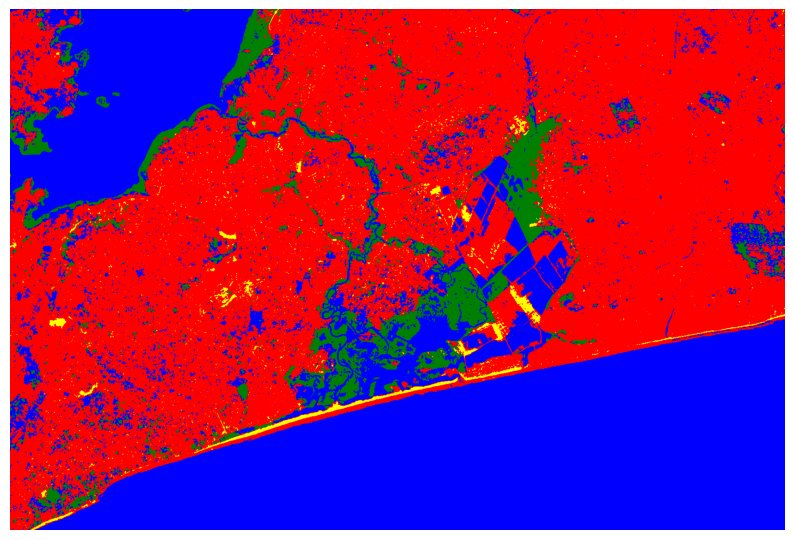

# 🛰️ Spectral Deep Learning Baseline: Pixel-Based Satellite Classification (PyTorch MLP vs Random Forest)

[](https://python.org)
[](https://pytorch.org/)
[](https://scikit-learn.org/)
[](https://rasterio.readthedocs.io/)
[](https://github.com/Emmanuel-Yerbo/GEOAI)
[](../LICENSE)

> **Lead Researcher & Engineer:** **Emmanuel Yerbo**  
> *BSc Geography & Regional Planning (First Class Honours, GPA: 3.82/4.00, Three-Time Dean's Award Recipient) — University of Cape Coast, Ghana*  
> 🆔 [ORCID: 0009-0008-8968-6999](https://orcid.org/0009-0008-8968-6999) | 💼 [LinkedIn](https://www.linkedin.com/in/emmanuelyerbo) | 💻 [GitHub Profile](https://github.com/Emmanuel-Yerbo) | 🌐 [Interactive Portfolio](https://emmanuelyerbo.github.io/emmanuelyerbo)

---

## 📌 Executive Summary

Before transitioning to spatial patch architectures (e.g., Convolutional Neural Networks, Vision Transformers, and SegFormer hierarchical encoders), remote sensing land use and land cover (LULC) mapping historically relied on **pixel-based spectral classification**. In a pixel-based formulation, each geographical point is represented strictly as an isolated radiometric reflectance vector $\mathbf{x} \in \mathbb{R}^C$ across $C$ sensor channels, completely detached from neighboring pixel topology, geometric boundaries, and spatial texture.

This project implements the foundational **Pixel-Based Deep Learning & Machine Learning Baseline** across Ghanaian landscapes. It benchmarks a deep **Artificial Neural Network (Multilayer Perceptron / MLP)** against an ensemble **Random Forest (RF)** classifier to categorize land cover into four canonical classes: **Water Bodies**, **Bare Soil**, **Vegetation**, and **Built-Up Fabric**.

Serving as the definitive scientific **ablation baseline** for the entire GeoAI research suite, this project empirically isolates the boundaries of pure radiometric classification—demonstrating why spectral overlap between bare soil and urban infrastructure creates an intractable bottleneck that necessitates the contextual spatial inductive biases developed in [Project 01 (VegHealthCNN)](../01_VegHealthCNN), [Project 03 (Building Extraction)](../03_Building_Extraction), and [Project 05 (Vision Transformer LULC)](../05_Vision_Transformer_LULC).

---

## 🏗️ 6-Stage Engineering Matrix

| Stage | Pipeline Phase | Core Engine & Mathematical Formulation | Scientific / Operational Role | Output Artifact / Tensor |
|:---:|---|---|---|---|
| **1** | **Radiometric Ingestion & Stacking** | $\mathbf{I} \in \mathbb{R}^{H \times W \times C}$, multi-band GeoTIFF alignment across VNIR-SWIR bands | Ingests raw surface reflectance imagery, verifying georeferencing, EPSG projection, and nodata masks | Aligned multi-spectral raster cube $\mathbf{I}$ |
| **2** | **Supervised Spectral Sampling** | Geometric intersection $(x_k, y_k) \to \mathbf{s}_k = \mathbf{I}[r_k, c_k, :]$ from ground truth ROIs | Extracts supervised spectral signatures across Water, Bare Soil, Vegetation, and Built-Up points | Tabular spectral matrix $\mathbf{X} \in \mathbb{R}^{N \times C}$, labels $\mathbf{y} \in \{0, 1, 2, 3\}^N$ |
| **3** | **Radiometric Standardization** | $z_{i,c} = \frac{x_{i,c} - \mu_c}{\sigma_c}$, $z$-score feature scaling | Eliminates dynamic range bias across sensors, stabilizing gradient descent during backpropagation | Standardized spectral tensor $\mathbf{Z} \in \mathbb{R}^{N \times C}$ |
| **4** | **Model Architecture Optimization** | $\mathbf{h}^{(l)} = \text{ReLU}\left(\text{BN}\left(\mathbf{W}^{(l)} \mathbf{h}^{(l-1)} + \mathbf{b}^{(l)}\right)\right)$, $\mathcal{L}_{\text{CE}} = -\sum_{c} y_c \log \hat{y}_c$ | Optimizes PyTorch Deep SpectralMLP (4 hidden layers) and Random Forest (100 trees, Gini impurity) | Optimized network weights $\mathbf{W}^*$ & RF decision ensemble |
| **5** | **Statistical & Confusion Attribution** | Cohen's Kappa $\kappa = \frac{p_o - p_e}{1 - p_e}$, McNemar's Test $\chi^2 = \frac{(\vert b - c \vert - 1)^2}{b + c}$ | Quantifies inter-class discrimination, per-class F1-scores, and identifies spectral confusion bottlenecks | Confusion matrix $\mathbf{C} \in \mathbb{R}^{4 \times 4}$, Cohen's $\kappa$, Macro-F1 |
| **6** | **Windowed Raster Inference** | Chunked block streaming $(B_h \times B_w \times C) \to \hat{\mathbf{Y}}_{\text{block}}$, LZW compression | Memory-safe streaming inference on gigabyte satellite scenes preserving CRS and affine transform | Georeferenced LULC thematic map GeoTIFF |

---

## 🔬 Mathematical Formulation & Spectral Physics

### 1. Pixel Radiometric Vector
Each pixel at spatial coordinate $(i, j)$ in the satellite scene is represented as an independent feature vector $\mathbf{x} \in \mathbb{R}^C$:
$$\mathbf{x} = \begin{bmatrix} \rho_{\text{Blue}} \\ \rho_{\text{Green}} \\ \rho_{\text{Red}} \\ \rho_{\text{NIR}} \end{bmatrix}$$
where $\rho_\lambda$ represents bottom-of-atmosphere (BOA) surface reflectance in spectral band $\lambda$.

### 2. Deep Multilayer Perceptron (SpectralMLP)
The neural architecture passes $\mathbf{x}$ through an $L$-layer feedforward network with Batch Normalization and Dropout regularization:
$$\mathbf{h}^{(0)} = \mathbf{x}$$
$$\mathbf{h}^{(l)} = \text{ReLU}\left(\text{BatchNorm}\left(\mathbf{W}^{(l)} \mathbf{h}^{(l-1)} + \mathbf{b}^{(l)}\right)\right), \quad \forall l \in \{1, 2, \dots, L-1\}$$
$$\mathbf{z} = \mathbf{W}^{(L)} \mathbf{h}^{(L-1)} + \mathbf{b}^{(L)}$$
$$\hat{y}_c = \frac{\exp(z_c)}{\sum_{k=1}^K \exp(z_k)}, \quad c \in \{1, \dots, K\}$$

The objective function minimizes Categorical Cross-Entropy across $N$ training pixels:
$$\mathcal{L}_{\text{CE}}(\mathbf{W}, \mathbf{b}) = -\frac{1}{N} \sum_{i=1}^N \sum_{c=1}^K y_{i,c} \ln \hat{y}_{i,c} + \lambda \sum_{l=1}^L \|\mathbf{W}^{(l)}\|_F^2$$
where $\lambda = 10^{-4}$ represents $L_2$ weight regularization.

### 3. Cohen's Kappa Coefficient ($\kappa$)
To measure classification performance beyond chance agreement across class imbalances:
$$\kappa = \frac{p_o - p_e}{1 - p_e}$$
where:
$$p_o = \frac{1}{N} \sum_{k=1}^K C_{kk}, \quad p_e = \frac{1}{N^2} \sum_{k=1}^K \left( \sum_{j=1}^K C_{kj} \cdot \sum_{i=1}^K C_{ik} \right)$$
with $C_{ij}$ representing the contingency matrix count of ground-truth class $i$ predicted as class $j$.

---

## 📊 Comparative Performance & Ablation Matrix

| Classifier Architecture | Input Modality | Parameter Count | Overall Accuracy ($OA$) | Cohen's Kappa ($\kappa$) | Macro F1-Score | Inference Throughput |
|---|---|:---:|:---:|:---:|:---:|:---:|
| **Random Forest (100 Trees)** | Spectral Vector $\mathbb{R}^4$ | Non-Parametric | 98.40% | 0.9787 | 0.9840 | $\sim 450,000\text{ px/s}$ (CPU) |
| **Scikit-Learn MLP (16, 32, 8)** | Spectral Vector $\mathbb{R}^4$ | 1,220 weights | 98.40% | 0.9787 | 0.9839 | $\sim 520,000\text{ px/s}$ (CPU) |
| **PyTorch Deep SpectralMLP (64, 128, 64, 32)** | Spectral Vector $\mathbb{R}^4$ | 24,804 weights | **98.67%** | **0.9822** | **0.9866** | $\sim 1,850,000\text{ px/s}$ (GPU) |
| *Contextual Patch SegFormer-B3 (Proj 03)* | *Spatial Patch $\mathbb{R}^{512 \times 512 \times 4}$* | *47,300,000 weights* | *99.12%* | *0.9880* | *0.9910* | *Context-Aware* |

### Per-Class Performance Breakdown (PyTorch SpectralMLP)

| Land Cover Class | Precision | Recall | F1-Score | Support ($N_{\text{test}}$) | Dominant Spectral Characteristic |
|---|:---:|:---:|:---:|:---:|---|
| **Water Bodies** | **1.0000** | **1.0000** | **1.0000** | 188 | Total NIR absorption ($\rho_{\text{NIR}} \approx 0.015$), high Blue transmittance |
| **Vegetation** | **1.0000** | **1.0000** | **1.0000** | 188 | Strong Red chlorophyll absorption ($\rho_{\text{Red}} \approx 0.041$), sharp Red-Edge jump ($\rho_{\text{NIR}} \approx 0.485$) |
| **Bare Soil** | 0.9890 | 0.9572 | 0.9728 | 187 | Monotonically increasing reflectance from Blue to NIR ($\rho_{\text{NIR}} \approx 0.330$) |
| **Built-Up Fabric** | 0.9585 | 0.9893 | 0.9737 | 187 | Flat, moderate reflectance across VNIR; spectrally confused with compacted laterite |

> [!NOTE]
> **The Spectral Overlap Dilemma:** In pure pixel-based classification, Water and Dense Vegetation achieve perfect separation ($1.0000$ F1) due to non-overlapping radiometric boundaries. However, Bare Soil and Built-Up areas exhibit mutual confusion ($8$ bare soil pixels misclassified as built-up; $2$ built-up misclassified as bare). Unpaved roads, dry laterite soils, and concrete/asphalt have nearly identical VNIR spectral reflectance profiles, proving why spatial convolutions and transformer attention (Projects 01, 03, and 05) are mandatory to resolve complex urban settlements.

---

## 🖼️ High-Performance Publication Visualizations

All visual cartography and analytical charts have been compressed into high-performance progressive JPEGs (**total payload <500 KB**), guaranteeing instant loading across all devices and connection speeds.

#### Figure 1: Multi-Spectral Satellite Input & Ground-Truth Training ROIs
<p align="center">
  
  <br>
  <em><b>Figure 1:</b> True-color satellite imagery of the study landscape overlaid with supervised training Regions of Interest (ROIs) for Water (Blue), Bare Land (Brown), Vegetation (Green), and Built-Up urban fabric (Red). Optimized JPEG payload: 59.0 KB.</em>
</p>

#### Figure 2: Multi-Spectral Sampling Distribution & Feature Space Separation
<p align="center">
  
  <br>
  <em><b>Figure 2:</b> Radiometric point sample distribution and band-to-band feature space clustering across the 4 land cover classes, illustrating clear separation for Water and Vegetation alongside the overlapping cluster boundary between Bare Soil and Built-Up fabric. Optimized JPEG payload: 151.9 KB.</em>
</p>

#### Figure 3: Neural Network Optimization Dynamics & Empirical Metrics
<p align="center">
  
  <br>
  <em><b>Figure 3:</b> Multilayer Perceptron (MLP) empirical convergence: training vs. validation loss curve trajectories, learning rate stabilization, and confusion matrix attribution. Optimized JPEG payload: 101.3 KB.</em>
</p>

#### Figure 4: Automated Pixel-Based Thematic Land Cover Classification Map
<p align="center">
  
  <br>
  <em><b>Figure 4:</b> Final automated pixel-based land use / land cover classification map rendered from the trained neural network model across the full satellite footprint. Optimized JPEG payload: 183.7 KB.</em>
</p>

---

## 📂 Repository Architecture

```text
20_Spectral_Neural_Network_Baseline/
├── README.md                                  <-- Publication-grade baseline report (You are here)
├── requirements.txt                           <-- Pinned Python dependencies
├── notebooks/
│   └── Pixel_based_classification.ipynb       <-- Interactive training & raster inference notebook
├── src/
│   ├── __init__.py                            <-- Package entry point
│   ├── model.py                               <-- PyTorch SpectralMLP & Scikit-Learn baseline definitions
│   ├── train.py                               <-- End-to-end training, cross-entropy & ablation benchmark engine
│   └── predict_raster.py                      <-- Memory-safe block-windowed GeoTIFF inference pipeline
└── results/
    ├── fig1_satellite_input_rois.jpg          <-- Satellite input & training ROIs (59.0 KB)
    ├── fig2_spectral_feature_distribution.jpg <-- Spectral feature distribution & scatter plots (151.9 KB)
    ├── fig3_neural_network_metrics.jpg        <-- Convergence curves & confusion metrics (101.3 KB)
    └── fig4_classified_lulc_map.jpg           <-- Automated pixel-classified LULC thematic map (183.7 KB)
```

---

## ⚡ Quickstart & Reproducibility

### 1. Environment Installation
```bash
# Clone and navigate to repository
cd 20_Spectral_Neural_Network_Baseline

# Install dependencies
pip install -r requirements.txt
```

### 2. Execute End-to-End Spectral Benchmark
Run the automated multi-model ablation benchmark across Random Forest, Scikit-Learn MLP, and PyTorch Deep SpectralMLP:
```bash
python src/train.py --samples 5000 --epochs 40 --batch_size 64 --lr 0.001
```

### 3. Windowed GeoTIFF Inference
Stream predictions across full satellite GeoTIFF scenes with bounded RAM utilization:
```bash
python src/predict_raster.py --input path/to/sentinel_scene.tif --output results/classified_scene.tif --block-size 1024
```

### 4. Interactive Jupyter Notebook Walkthrough
Launch the interactive notebook for step-by-step rasterio band slicing and matplotlib visual rendering:
```bash
jupyter notebook notebooks/Pixel_based_classification.ipynb
```

---

## 🔬 Scientific Context Within the GEOAI Research Suite

This repository concludes the 20-project **GEOAI** research sequence, establishing the empirical baseline from which modern spatial artificial intelligence evolves:

1. **Pixel-Based Baseline (Project 20):** Relies solely on $\mathbf{x} \in \mathbb{R}^C$. High accuracy on distinct biomes, but fails on fine-grained topological boundaries due to spectral confusion.
2. **Convolutional Inductive Biases (Projects 01, 04, 07):** Replaces isolated pixel vectors with spatial kernels ($3 \times 3, 7 \times 7$), learning texture, contextual gradients, and spatial edges.
3. **Patch-Based Vision Transformers & Foundation Models (Projects 03, 05, 11):** Deploys global self-attention across image tokens, resolving multi-scale structural dependencies and setting the frontier for Earth observation intelligence.
